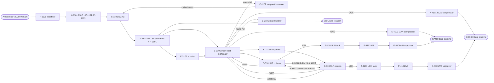

# Design decisions

One entry per decision: what was decided, why, what was rejected, and what it assumes.
Numbers marked ASSUMED are concept estimates (about +/-30 %), not vendor or client data.

## 1 Process description (stage concept)

ASU-1 is a low-pressure double-column cryogenic air separation unit without an argon column.

- **P-01 Main air compression and precooling.** Ambient air (76,000 Nm3/h, ASSUMED) passes the
  self-cleaning inlet filter F-1101 and is compressed in the integrally geared, 3-stage
  centrifugal main air compressor K-1101 to 5.8 bara (ASSUMED) with intercoolers E-1101/E-1102
  and aftercooler E-1103 (cooling water). Inlet guide vanes control throughput; an anti-surge
  blow-off valve vents to atmosphere through silencer S-1101. The direct contact aftercooler
  C-1101 cools the air to 12 C (ASSUMED): cooling water in the lower section (pumps P-1101A/B),
  chilled water in the upper section. The chilled water (pumps P-1102A/B) is cooled to about
  10 C (ASSUMED) in the evaporative cooler C-1102 by dry waste nitrogen from the cold box.
- **P-02 Front-end purification.** Two molecular sieve adsorbers V-2101A/B (activated alumina
  under 13X, ASSUMED) work in TSA mode: one adsorbs H2O, CO2, N2O and most hydrocarbons
  (C2H2 completely) while the other is regenerated with waste nitrogen heated to 200 C in the
  electric heater E-2101, then cooled with unheated waste N2. Switching valves are sequenced by
  KS-2101. Dust filter F-2101 retains sieve fines. CO2 (AIA-2102) and H2O (AIA-2103) analyzers on
  the outlet detect breakthrough.
- **P-03 Cold box.** The purified air is split. The main part (64,500 Nm3/h) is cooled close to
  its dew point in the brazed aluminium main heat exchanger E-3101 and fed to the HP column
  C-3101 (5.4 bara). The rest (11,500 Nm3/h) is boosted in K-3101 (braked by expander KT-3101,
  aftercooler E-3104), part-cooled in E-3101, expanded in KT-3101 to 1.35 bara and fed to the
  LP column C-3102 (Lachmann air) as the plant's refrigeration. HP column bottom (rich liquid,
  ~38 % O2) and top liquid nitrogen are subcooled in E-3102 and let down through JT valves into
  the LP column. The main condenser-reboiler E-3103 (bath type, in the LP column sump) condenses
  HP nitrogen against boiling LOX. GOX is drawn from the LP sump vapour space, GAN (pressurized
  N2) from the HP column top, waste N2 from the LP top. A continuous LOX purge from the sump
  (FIC-3111) removes hydrocarbons; the LOX product is drawn from the same sump. Sump liquid is
  analysed for hydrocarbons (AIA-3103).
- **P-04 Products.** GOX (1.15 bara, warm) is compressed to 31 bara in the oil-free, multistage
  centrifugal GOX compressor K-4101 (D-002). GAN (5.2 bara) is compressed to 9 bara in K-4102.
  LOX and LIN go to the flat-bottom tanks T-4101 (250 m3) and T-4102 (400 m3). On loss of the
  ASU the cryogenic pumps P-4101A/B (LOX) and P-4102A/B (LIN) start and send liquid through the
  ambient-air vaporizers E-4105A/B and E-4106A/B into the GOX and GAN headers (D-014).

## 2 Block flow

## 3 Mass and energy balance (main streams, ASSUMED values)

Basis: design case, 30 C ambient, 94 % O2 recovery (ASSUMED). Nm3 at 0 C, 1.013 bar.

| stream | from -> to | Nm3/h | kg/h | p bara | T C | composition |
|---|---|---|---|---|---|---|
| 1 air feed | atm -> K-1101 | 76,000 | 98,270 | 1.01 | 30 | air, wet |
| 2 compressed air | K-1101 -> C-1101 | 76,000 | 98,270 | 5.8 | 40 | air, saturated |
| 3 precooled air | C-1101 -> V-2101 | 76,000 | 98,270 | 5.7 | 12 | air, saturated |
| 4 dry air to cold box | V-2101 -> E-3101 | 76,000 | 98,000 | 5.6 | 15 | dry, CO2 < 0.1 ppm |
| 5 HP column feed | E-3101 -> C-3101 | 64,500 | 83,400 | 5.5 | -173 | air near dew point |
| 6 Lachmann air | KT-3101 -> C-3102 | 11,500 | 14,870 | 1.35 | -178 | air |
| 7 GOX product | E-3101 -> K-4101 | 14,600 | 20,860 | 1.15 | 25 | O2 99.5 % |
| 8 GOX to pipeline | K-4101 -> BL | 14,600 | 20,860 | 31.0 | 40 | O2 99.5 % |
| 9 GAN product | E-3101 -> K-4102 -> BL | 10,000 | 12,510 | 5.2 / 9.0 | 25 / 40 | N2, O2 <= 10 ppm |
| 10 LOX to storage | C-3102 -> T-4101 | 330 | 470 | 1.3 | -180 | O2 99.5 % |
| 11 LIN to storage | C-3101 -> T-4102 | 375 | 470 | 5.2 | -178 | N2 |
| 12 waste N2 | C-3102 -> E-3101 | 50,500 | 63,530 | 1.15 | 25 | N2 96.7, O2 2.1, Ar 1.3 % (closes the cold-box O2/Ar balance) |
| 12a regeneration | -> E-2101 -> V-2101 | 13,000 | 16,350 | 1.1 | 200 (heating) | waste N2 |
| 12b evaporative cooler | -> C-1102 | 25,000 | 31,450 | 1.05 | 25 | waste N2 |
| 12c vent | -> atm | 12,500 | 15,730 | 1.02 | 25 | waste N2 |

Mass closure: 98,270 kg/h in, 98,100 kg/h products + waste + ~400 kg/h water/CO2 removed
(within 0.2 %). O2 balance: 15,922 Nm3/h O2 in air, 14,945 Nm3/h in GOX + LOX (94 %), 977 Nm3/h
in waste. (Liquid rates revised to 470 kg/h each with the expander recalculation below; the
difference of 260 kg/h goes to waste N2, inside the accuracy of this balance.)
This table is the concept seed. The closed basic-stage balance (streams 4, 5, 12, 12c and the
regeneration gas revised, cold-box internal streams added) is in process/flowsheet.yaml (D-027).

Refrigeration (ASSUMED, revised at S2 after review finding 5): expander KT-3101 on 14,870 kg/h
(4.13 kg/s), 7.8 -> 1.35 bara. For the -178 C exhaust the LP column needs (just above the air dew
point at 1.35 bara), the inlet must be about -115 to -120 C; design point -118 C. Ideal-gas check:
pressure ratio 0.173, T2s/T1 = 0.606, with eta_s 0.85 T2/T1 = 0.665, so T1 = 95 K / 0.665 = 143 K
ideal gas; real-gas cp near saturation moves this to ~155 K (-118 C). Enthalpy drop ~52 kJ/kg ->
**~215 kW** (the earlier -100 C inlet and 250 kW were inconsistent with a -178 C exhaust).
Demand: heat leak ~50 kW + warm-end temperature difference ~55 kW = ~105 kW; the remaining
~110 kW makes 110 kW / ~420 kJ/kg = 0.26 kg/s = **~940 kg/h liquid** (470 kg/h LOX incl. the
hydrocarbon purge + 470 kg/h LIN), down from 1,200 kg/h. More liquid needs more expander flow at
the cost of O2 recovery (D-017).

| consumer | power / duty | basis |
|---|---|---|
| K-1101 MAC | 8.0 MW electric | 0.105 kWh/Nm3 air, 5.8 bara (ASSUMED) |
| K-4101 GOX compressor | 2.3 MW electric | isothermal 1.48 MW / 0.65 (ASSUMED) |
| K-4102 GAN compressor | 0.3 MW electric | 5.2 -> 9 bara, 1 stage (ASSUMED) |
| E-2101 regeneration heater | 1.0 MW electric (peak) | 16,350 kg/h x 1.04 kJ/kgK x 185 K, ~1/3 of cycle |
| pumps, chiller water, misc. | 0.3 MW electric | ASSUMED |
| **total electric** | **~11.9 MW (average ~11.2 MW)** | 6.6 kV |
| cooling water | ~10.5 MW, ~900 m3/h at 10 K | MAC 7.6, DCAC 0.6, GOX comp 2.2, GAN comp 0.3 MW (ASSUMED) |

Specific energy: ~0.71 kWh per Nm3 GOX delivered at 30 barg (MAC + GOX compressor).

## 4 Relief case list (preliminary, ASSUMED cases; sizing in detail engineering)

| device | protects | governing case | discharge |
|---|---|---|---|
| PSV-1109 | C-1101 DCAC, AIR-1002 | MAC at surge / max. IGV with AIR-1004 blocked; MAC max. discharge ~6.5 bara vs 8 barg design: PSV as backup to UIC-1102 (fire case for the packed column) | atmosphere, local (air) |
| PSV-2108A/B | V-2101A, V-2101B (one each: each bed can be blocked in by its XVs) | fire; blocked outlet during repressurization | atmosphere, local at the bed top (dry air / N2) |
| TSV on E-2101 | heater shell | blocked-in heating (TSHH-2107 primary) | atmosphere |
| PSV-3114 | C-3102 LP column | waste N2 outlet blocked (PIC-3110 failure) with expander and JT valves running | outside cold box, elevated (O2-rich: safe location) |
| PSV-3116 | C-3101 HP column | MAC deadhead feed with GAN and liquid outlets blocked | outside cold box |
| TSVs | trapped cryogenic liquid between valves (LOX, LIN, RL, LN lines) | heat-in of blocked liquid | to vent / drain vaporizer V-3101 |
| PSV-3119 | K-3101 discharge, E-3104 (on AIR-3002 at the E-3104 outlet, upstream of the check valve) | blocked outlet (KT-3101 inlet XV-3117 closed) | atmosphere (air), local |
| PSV-3123 | cold box casing (breathing valve, both directions) | purge PV-3113 failed open; casing vacuum on cool-down | VNT-3004, elevated (N2), AIA-3122 |
| PSV-4122 | K-4101 discharge, E-4102 | blocked outlet at max. speed (ESD XV-4118 closed) | VNT-4002 via S-4101 |
| PSV-4123 + vacuum breaker PSV-4142 | T-4101 LOX tank | heat-leak increase (perlite settling or wetting, outer-tank damage; the flat-bottom tank is perlite-insulated, not vacuum-jacketed), external fire, fill overpressure, roll-over; vacuum on fast draw-off | VNT-4001 / own outlet, safe location |
| PSV-4124 + vacuum breaker PSV-4143 | T-4102 LIN tank | as T-4101 | elevated (N2) |
| PSV-4125 / PSV-4126 | P-4101A/B / P-4102A/B discharge headers | closed discharge (pump deadhead), thermal; also the TSV of LOX-4002 / LIN-4002 between the check valves and the vaporizer inlet valves | into the cool-down return LOX-4003 / LIN-4003 to the tank vapour space |
| PSV-4127 / PSV-4128 | E-4105A/B / E-4106A/B (no outlet isolation valve, so one PSV on each outlet header covers both) | blocked outlet, thermal | elevated |
| TSV-4140 / TSV-4141 | LOX-3001 / LIN-3001 between FV-3111 (P-03) and the manual tank inlet valve | heat-in of blocked liquid | atmosphere (LOX: safe location) |
| XV-4133 / XV-4135 | GOX / GAN BL bleeds (DBB) | bleed between the two closed block valves | VNT-4006 safe location / VNT-4007 elevated |
| PSV on CW headers | E-1101..E-1103 tube side | tube rupture (5.8 bara air into CW) | local |

All PSV tags are fixed (S4); TSV-4140/4141 and the vacuum breakers PSV-4142/4143 are drawn on P-04 (S5). Remaining TSVs (RL, LN in the cold box) get tags in detail engineering.

## D-001 Process cycle: LP double column, no argon column, Lachmann expander (2026-10-18)
Decision: Classic LP double-column cycle, MAC at 5.8 bara, bath condenser-reboiler, booster
expander feeding Lachmann air to the LP column, argon left in the waste nitrogen.
Reason: Lowest capital and proven at 500 t/d; 99.5 % O2 needs no argon column (specification).
Rejected: Elevated-pressure cycle (higher MAC power for a GAN demand of only 10,000 Nm3/h);
argon column (excluded by the specification).
Assumptions: O2 recovery 94 %; HP top 5.4 bara; LP top 1.3 bara (ASSUMED).

## D-002 GOX compression route: external GOX compressor (2026-10-18)
Decision: GOX leaves the cold box at low pressure and is compressed to 31 bara in K-4101, an
oil-free, multistage integrally geared centrifugal oxygen compressor with dry gas seals, nitrogen
buffer gas, Monel/copper-alloy wetted parts in high-velocity zones, fire barriers between
stages and a separate fire-safe enclosure.
Reason: About 5-8 % lower specific power than internal compression at 30 barg (no booster air
compressor to ~65 bara), simpler and lower-pressure main heat exchanger, and the LOX backup
system (pumps + vaporizers) is needed anyway. The compressor hazard is handled by the O2 rules
(D-009, D-012) and an oxygen-compressor vendor with a proven reference list.
Rejected: Internal compression (pumped LOX vaporized in the MHX against ~65 bara booster air):
safer in principle and no GOX machine, but higher power, high-pressure brazed exchanger and a
second large air compressor. To be re-evaluated if the client's oxygen-safety policy forbids
GOX compressors at 30 bar.
Assumptions: Suction 1.15 bara, 25 C; discharge 31 bara, 40 C after aftercooler; 2.3 MW.

## D-003 Refrigeration: booster-braked air expander (2026-10-18)
Decision: Turbo-expander KT-3101 on 11,500 Nm3/h air, its power absorbed by the air booster
K-3101 on the same shaft (companders), exhaust to the LP column (Lachmann).
Reason: No electric generator needed, booster raises inlet pressure and so refrigeration per kg;
Lachmann air is standard for LP cycles at 99.5 % O2.
Rejected: Generator-braked expander (power recovery small, electrical complexity); waste-N2
expander (less refrigeration at this LP pressure, cannot produce the liquid needed).
Assumptions: inlet -118 C / 7.8 bara, exhaust -178 C / 1.35 bara, eta_s 0.85, ~215 kW
refrigeration; liquid 470 kg/h LOX + 470 kg/h LIN (see balance, D-017).
Booster anti-surge (S4): recycle AIR-3006 from the E-3104 aftercooler outlet (cooled gas, so the
recycle does not heat the suction) back to AIR-3005 through UV-3120 (fail open), controlled by
UIC-3120 on the suction flow and pressure ratio; a check valve on AIR-3002 downstream of the
recycle tee stops backflow from E-3101 on a booster trip. Recycle DN150 ASSUMED (~50 % flow).
Reason: a centrifugal booster needs surge protection at start-up and turndown; the compander has
no other flow path while XV-3117 is closed.

## D-004 GAN source and compression (2026-10-18)
Decision: 10,000 Nm3/h pressurized nitrogen from the HP column top (<= 10 ppm O2), warmed in
E-3101 and compressed 5.2 -> 9 bara in the oil-free single-stage centrifugal K-4102.
Reason: Taking GAN from the HP column needs a compression ratio of only 1.7 instead of 7 from
the LP column; ~13 % of the air is compatible with HP reflux needs.
Rejected: LP nitrogen + 3-stage compressor (more power); raising MAC pressure (penalizes all air).
Assumptions: Pure N2 section at the HP column top is sufficient (to be verified by simulation).

## D-005 Precooling: DCAC with chilled water from an evaporative cooler (2026-10-18)
Decision: Packed direct contact aftercooler C-1101 (cooling water lower, chilled water upper
section), chilled water from evaporative cooler C-1102 using dry waste N2. Mist eliminator and
level trip LSHH-1106 at the DCAC to prevent water carry-over to the adsorbers.
Reason: Lowers the water load and adsorber size; uses waste N2 that is otherwise vented; no
refrigeration machine.
Rejected: Mechanical chiller (power, refrigerant; kept as future option if 12 C is not reached at
30 C ambient with high humidity).
Assumptions: Chilled water ~10 C at 30 C ambient (ASSUMED, to be confirmed with site humidity).

## D-006 Front-end purification: 2-bed TSA molecular sieve, electric heater (2026-10-18)
Decision: Two horizontal radial/axial-flow adsorbers V-2101A/B, alumina + 13X, ~4 h adsorption
(ASSUMED), regeneration with waste N2 heated to 200 C in electric heater E-2101 (no steam).
Breakthrough monitored by CO2 analyzer AIA-2102 (alarm 1 ppm, ASSUMED) and H2O analyzer AIA-2103.
Reason: Removes H2O, CO2, N2O and C2H2 before the cold box; steam is not available.
Rejected: Reversing heat exchangers (no hydrocarbon removal, obsolete); steam heater.

## D-007 Tag and numbering convention (2026-10-18)
Decision:
- Equipment: `<letters>-<s><nnn>[A/B]`, s = sheet/section digit (1 = P-01 ... 4 = P-04),
  nnn from 101. Letters: K compressor/booster, KT expander turbine, E heat exchanger/heater/
  vaporizer, C column/contact tower, V vessel/adsorber, T storage tank, P pump, F filter,
  S silencer. A/B = installed spares or parallel units.
- Instruments: ISA 5.1 letters + loop `<s><nnn>`, e.g. FIC-1101, AIA-3103. One loop number per
  measured variable; trips carry the same number (e.g. LSHH-1106).
- Lines: `<fluid>-<s><nnn>`, fluid codes AIR, GOX, GAN, WN (waste N2), RL (rich liquid), LN
  (liquid N2 reflux), LOX, LIN, CW/CWR (cooling water supply/return), CHW (chilled water),
  RG (regeneration gas), VNT (vent). DN, pressure class and insulation are list attributes.
Reason: Section digit makes the sheet obvious from the tag; short tags stay legible on sheets.

## D-008 Sheet split (2026-10-18)
Decision: P-01 MAC + precooling, P-02 TSA purification, P-03 cold box, P-04 products, storage
and backup. Off-sheet connectors at the section boundaries: air P-01 -> P-02 -> P-03; waste N2
P-03 -> P-02 (regeneration) and P-01 (evaporative cooler); GOX, GAN, LOX, LIN P-03 -> P-04.
Reason: Follows the process blocks and vendor packages (MAC, TSA, cold box, product machines).

## D-009 Oxygen service: materials and cleaning (2026-10-18)
Decision: All equipment and lines with O2 > 23.5 % (GOX, LOX, LP column, condenser, GOX
compressor, LOX tank, pumps, vaporizers, analyzer sample lines) are designed and cleaned for
oxygen service to EIGA Doc 13 / Doc 33 and ASTM G93: stainless steel or copper alloys in
impingement zones and valves, carbon steel only below the EIGA impingement velocity curve
(GOX at 31 bara: <= ~10 m/s ASSUMED design limit), no fast-opening valves in GOX lines (bypass
for pressure equalisation), oxygen-compatible gaskets and lubricants, cleaning verified and
documented, lines marked "Oxygen - clean". GOX DN chosen for <= 10 m/s.
Reason: Ignition by particle impact and adiabatic compression is the main GOX fire mechanism.

## D-010 Hydrocarbon accumulation protection (2026-10-18)
Decision: (1) Molecular sieve removes C2H2, most C3+, N2O and CO2 (D-006). (2) Continuous LOX
purge from the LP sump: the whole LOX product through FIC-3111 (470 kg/h, about 330 Nm3/h, ~2.3 %
of the O2 product) is the hydrocarbon purge to the LOX tank (drain vaporizer when the tank is
unavailable); 0.2 % of the O2 product (~30 Nm3/h, ASSUMED per EIGA Doc 65) is the minimum, so
FIC-3111 has a low-flow alarm at that value. (3) The condenser-reboiler E-3103 is kept fully submerged (LP sump level
LICA-3102 with low alarm), bath type, no dry boiling. (4) Analyzers: total hydrocarbons and
C2H2 in sump LOX (AIA-3103, alarm/trip), CO2 at TSA outlet (AIA-2102); action limits per EIGA
Doc 65 (ASSUMED); hydrocarbons in the LOX tank liquid (AIA-4121, periodic), since
boil-off in storage concentrates them. (5) Air intake located away from hydrocarbon sources; intake survey in basic
engineering. (6) Periodic derime/warm-up procedure.
Reason: Hydrocarbon accumulation in boiling LOX is the dominant ASU explosion hazard.

## D-011 Relief, vent and blowdown philosophy (2026-10-18)
Decision: Every enclosed volume that can be blocked in has a relief device; trapped cryogenic
liquid between two valves has a thermal relief valve. Columns relieve to atmosphere through
dedicated vent lines. O2-rich vents (GOX, LOX tank, LOX purge, vaporizers, analyzer vents) are
routed to a safe location: elevated, away from ignition sources, walkways and air intake; GOX
vent with silencer. N2 vents routed high to avoid asphyxiation zones. LOX/LIN tanks: PSVs +
vacuum breakers + rupture discs on the annular space. Cold liquid drains go to an atmospheric
drain vaporizer, never to sewers or open pits. Relief cases (blocked outlet, fire, CW failure,
control valve failure, heater over-temperature) are listed per device in section 4. The LP
column C-3102 has its own PSV-3114 (design 3.5 barg against normal 0.3 barg): it can be blocked in
by PIC-3110 / the waste N2 valves while the expander and the JT valves keep feeding it. Vents of
different pressure levels never share a header (D-019).
Reason: Overpressure, O2 enrichment and N2 asphyxiation risks of an ASU.

## D-012 No oil-lubricated equipment in O2 service (2026-10-18)
Decision: GOX compressor with dry gas seals and N2 buffer gas, oil system separated by an
atmospheric distance piece; LOX pumps with vapour-lifted/leakage-vented seals and grease-free
bearings in O2-wetted parts; MAC oil system with demister and oil-free air path; no
oil-lubricated valve actuators in O2 lines. The compander KT-3101/K-3101 is the one oil-bearing
machine that touches cold-box air: its bearings are oil-lubricated, sealed from the expander and
booster wheels by labyrinths fed with N2 seal gas. PDSLL-3115 (seal gas minus bearing housing
pressure) is a permissive for the lube oil pump (seal gas first, oil second) and trips the
compander (inlet XV closed) on low-low. The oil tank vent has an oil mist eliminator and vents
outside the cold box. So no oil can be carried with the Lachmann air into the LP column, where it
would accumulate in the LOX sump. (Alternative for the vendor enquiry: magnetic or gas bearings.)
Reason: Hydrocarbon oils are ignition sources in oxygen.

## D-013 Isolation and blowdown (2026-10-18)
Decision: Double block and bleed at the GOX and GAN battery limits: GOX XV-4119 + XV-4132 with
bleed XV-4133 to VNT-4006 (safe location), GAN XV-4120 + XV-4134 with bleed XV-4135 to VNT-4007;
the blocks fail closed, the bleeds fail open, so a trip isolates and vents the space between them;
fail-closed tank outlet valves XV-4136 (T-4101) and XV-4137 (T-4102) for remote shut-off of the
storage on a leak or fire; manual suction and discharge block valves on every pump (P-4101A/B,
P-4102A/B) for maintenance isolation (an isolated pump is drained/warmed through its casing vent
before both are closed, vendor); emergency isolation valves XV-4117 (K-4101 suction) and XV-4118 (discharge);
GOX compressor depressurized on trip by blowdown valve XV-4116 to VNT-4002 / S-4101; cold box liquid drain valves to the drain vaporizer; the
cold box casing is N2-purged (PIC on purge) with a breathing valve.
Reason: Safe isolation for maintenance and fast removal of energy from a GOX fire.

## D-014 Backup supply (2026-10-18)
Decision: On GOX or GAN header low pressure (PIC-4111 / PIC-4112) the standby LOX pump P-4101A/B
or LIN pump P-4102A/B starts and supplies through ambient-air vaporizers E-4105A/B / E-4106A/B.
Low outlet temperature trip TSLL-4113/4114 protects the carbon-steel pipeline from cold gas.
Reason: Supply continuity during ASU trips (25 % GOX, 50 % GAN, 2 days, specification).
Assumptions: Pumps cold-standby, kept cold by the cool-down / min-flow return LOX-4003 / LIN-4003
(HV-4138 / HV-4139, continuous small flow, restriction orifice ASSUMED) to the tank vapour space;
it also takes the pump minimum flow at start-up and the discharge PSV-4125 / PSV-4126.

## D-015 Empty sheet frames at stage concept (2026-10-18)
Decision: pid/P-01..P-04.xml are created now as empty DEXPI frames (title block only), drafted in
stage basic.
Reason: plant.yaml must declare the sheets and plantcode requires each declared file to exist.
The lists then cross-check against the sheets; the resulting "not on P&ID" warnings are expected
until basic engineering.

## D-016 Line sizing basis (2026-10-18)
Decision: Concept DN from velocity: gas <= 20 m/s (waste/regen <= 25 m/s at near-atmospheric
pressure), GOX <= 10 m/s at 31 bara (D-009), liquids 1-2 m/s, pump suction <= 1 m/s.
Reason: Pressure-drop and O2 velocity limits. Final sizing in basic engineering.

## D-017 Liquid production and storage refill time: client to confirm (2026-10-18)
Decision (proposed, CLIENT TO CONFIRM): keep the expander at 11,500 Nm3/h and ~940 kg/h liquid.
Refilling the full backup reserve then takes ~22 days for LOX (250 t / 470 kg/h) and ~27 days
for LIN (300 t / 470 kg/h); at the previous 600 kg/h it was 17 / 21 days. After a backup event
the tanks are topped up by road tankers (truck fill connection on T-4101/T-4102, P-04).
Alternative for the client: a ~30 % larger expander flow (~15,000 Nm3/h) restores ~1,200 kg/h
(refill ~17 / 21 days) for about 1-1.5 points of O2 recovery and ~0.2 MW more MAC power.
Reason: the backup reserve (2 days of 25 % GOX and 50 % GAN) is set by the specification, the
refill time is not; it is a commercial choice between truck liquid and power/recovery.
Assumptions: liquid refrigeration ~420 kJ/kg (ASSUMED).
Tank volume check (S6): LIN reserve 2 d x 50 % x 10,000 Nm3/h = 240,000 Nm3 = 300 t; at
0.807 t/m3 that is 372 m3 net. T-4102 is 400 m3 working (between the LALL pump heel and the
max. fill level, +7.5 % margin) and ~440 m3 gross: heel ~12 m3 (pump NPSH) and ~6 % ullage
(ASSUMED). LOX reserve 2 d x 25 % x 14,600 Nm3/h = 175,200 Nm3 = 250 t; at 1.141 t/m3 that is
219 m3 net against 250 m3 working (+14 %), ~275 m3 gross (ASSUMED).
Truck fill (S6): drawn on P-04 as LOX-4004 / LIN-4004: tanker hose coupling, check valve, TSV-4144 /
TSV-4145 for the liquid trapped between check valve and block valve, block valve HV-4146 / HV-4147,
fill nozzle N6. The LOX fill bay has a concrete (not asphalt) pad under the hose coupling (D-026).

## D-018 O2 recovery 94 % and sensitivity at 90 % (2026-10-18)
Decision: keep 94 % as the design recovery and size the MAC for 80,000 Nm3/h (+5 %, ASSUMED
margin). Check: an LP double column with ~15 % Lachmann air and no argon column typically reaches
93-96 % at 99.5 % O2, so 94 % is plausible but not conservative. At 90 % the O2 in the air must be
14,930 / 0.90 = 16,590 Nm3/h -> 79,200 Nm3/h air (+4.2 %), MAC power ~8.35 MW (+0.35 MW), adsorber
and MHX loads +4 %: covered by the 80,000 Nm3/h MAC rating; specific energy rises to ~0.73 kWh/Nm3.
Reason: recovery is the main uncertainty of the concept balance; the margin keeps the product rate
if the simulation in basic engineering gives less.
Air/O2 ratio: design air 14,930 / (0.94 x 0.2095) = 75,800 Nm3/h for 14,600 Nm3/h GOX gives
5.2 Nm3 air per Nm3 GOX. The reason it is above the stoichiometric 1/0.2095 = 4.8: 6 % of the
O2 leaves with the waste N2 and the GAN (recovery 94 %), and the GOX product is 99.5 % O2 while
14,930 Nm3/h contained O2 includes the liquid make. The MAC rating 80,000 Nm3/h (ratio 5.5) adds
the +5 % margin above (ASSUMED).

## D-019 Vent separation and GOX suction vent (2026-10-18)
Decision: no shared vent headers between pressure levels. VNT-4001 is the LOX tank vent only
(0.5 barg, PV-4109); VNT-4002 is the K-4101 blowdown (31 bara, XV-4116, silencer S-4101);
VNT-4003 is the GOX suction vent on GOX-4001 (PV-4101B, silencer S-4102), split range with
PIC-4101: output A first (to the K-4101 inlet guide vane actuator; there is no separate PV-4101A
valve body, S6 correction), output B (PV-4101B) opens above it on a K-4101 trip or
during start-up, so the LP column pressure stays controlled while the compressor is not taking
GOX. All three discharge elevated at a safe location (D-011).
Reason: a 31 bara blowdown into a header shared with a 0.5 barg tank would back-pressure and
possibly overpressure the tank, and push O2 back into it (review finding S1-2/3).

## D-020 DEXPI classes used for equipment (2026-10-18)
Decision: CentrifugalCompressor (MAC, booster, GOX/GAN compressors), TubularHeatExchanger
(coolers), PlateHeatExchanger (brazed aluminium exchangers), ProcessColumn (columns, DCAC,
evaporative cooler), GasFilter, Silencer, CentrifugalPump, Tank, PressureVessel, ElectricHeater.
Verified on P-01 by `plantcode validate` (the loader rejects unknown classes). Classes for P-03/
P-04 that are not on a sheet yet (Turbine for KT-3101, Vessel for V-3101, HeatExchanger for the
ambient vaporizers) are checked the same way when those sheets are drawn; if the loader refuses
them: SteamTurbine is wrong for an air expander, so use the generic class the loader offers and
say so here.
Turbine, Vessel and HeatExchanger are valid (generic) pyDEXPI classes (checked in the pyDEXPI
class model at S2): KT-3101 stays Turbine (there is no expander class); V-3101 (atmospheric drain
vaporizer) becomes Tank and the ambient vaporizers stay HeatExchanger when P-03/P-04 are drawn.
Silencers (DEXPI `Silencer` is a PipeFitting) and safety valves (`SpringLoadedGlobeSafetyValve`)
are piping components, not tagged plant items or instrument functions: they carry their tag as
PipingComponentNumber / PositionNumber on the P&ID and are listed here, not in the equipment or
instrument lists:

| tag | class | line | sheet |
|---|---|---|---|
| S-1101 | Silencer | AIR-1003 | P-01 |
| PSV-1109 | SpringLoadedGlobeSafetyValve | AIR-1004 (C-1101 top) | P-01 |
| S-2101 | Silencer | RG-2003 | P-02 |
| PSV-2108A/B | SpringLoadedGlobeSafetyValve | AIR-2001 (V-2101A/B tops) | P-02 |
| S-3101 | Silencer | WN-3003 | P-03 |
| PSV-3114, PSV-3116 | SpringLoadedGlobeSafetyValve | VNT-3002 (C-3102), VNT-3003 (C-3101) | P-03 |
| PSV-3119 | SpringLoadedGlobeSafetyValve | AIR-3002 (K-3101 discharge) | P-03 |
| S-4101, S-4102 | Silencer | VNT-4002, VNT-4003 | P-04 |

Note: the `name` attribute of the XML root (`example`) is rewritten by `plantcode fmt` (pyDEXPI
serializer); the plant identification is in the title-block MetaData (ASU-1).

## D-021 P-01 drawing content (2026-10-18)
Decision: P-01 shows F-1101, K-1101 (one compressor symbol with stage nozzles; intercoolers
E-1101/E-1102 below it on interstage lines AIR-1005/AIR-1006), aftercooler E-1103, blow-off
AIR-1003 with UV-1102 to S-1101, non-return valve on AIR-1002 before the DCAC (no backflow from
the adsorbers into the MAC on trip), PSV-1109 on C-1101, CW pumps P-1101A/B (FV-1108), DCAC sump
water CWR-1001 via LV-1106, chilled water C-1102 -> P-1102A/B -> TV-1105 -> C-1101 upper section,
CW make-up CW-1003 via LV-1107, waste N2 WN-1001 from P-03 into C-1102 and vent WN-1002. Cooling
water to the intercoolers and aftercooler is CW-1002 / CWR-1002 with off-sheet connectors to the
CW utility system (not drawn in this project). One line number per cooler (CW-1002/CWR-1002 E-1101,
CW-1004/CWR-1003 E-1102, CW-1005/CWR-1004 E-1103) so from/to are exact.
Rev after the S2 review: CW-1001 enters C-1101 on the right side (no crossing with AIR-1002), DCAC
level instruments on the left side, CWR-1001 leaves to the left; mist eliminator drawn as a mesh pad
at the C-1101 top (D-005); TIA-1110 (MAC vendor multipoint: stage discharges and intercooler
outlets) and TIA-1111 on AIR-1002 after E-1103. LSHH-1106 trips the MAC only: no XV on AIR-1004,
because the MAC trip stops the flow and the check valve on AIR-1002 prevents back-flow; a 600 mm
XV in the wet air would add a failure point without extra protection.
Signal lines are drawn as dashed lines to the valve actuators; the DEXPI actuating-system objects
(ActuatingSystem / ActuatingFunction) are added in detail engineering. Control valves carry their
tag as the valve number (e.g. TV-1105).

## D-022 P-02 drawing content (2026-10-18)
Decision: adsorbers V-2101A/B in upflow adsorption (air in bottom, dry air out top) and
counter-current downflow regeneration (RG-2002 in at the top, RG-2003 out at the bottom to
S-2101). Eight switching valves XV-2101A/B..XV-2104A/B (actuated ball valves, sequenced by
KS-2101; valve tags, not instrument-list items). AIR-1004 continues from P-01 to the adsorber inlet
header. FV-2105 on RG-2001 (FIC-2105), TIC-2104 trims E-2101, TSHH-2107 on the heater element.
Rev after the S2 review: no line crosses another. With two beds and four external streams (feed in,
product out, regeneration in, regeneration out) two of the four headers must lie inside the loop
formed by the beds; the product header (top) and the regeneration outlet header with S-2101
(bottom, then right) run outside, the feed-air and regeneration-gas inlets (off-page connectors
from P-01 / P-03) sit between the beds. Air out at the outer top nozzles, regeneration in at the
inner top nozzles, air in at the inner bottom, regeneration out at the outer bottom.
Added: PSV-2108A/B on the bed tops; repressurization XV-2111A/B (DN100 globe, slow, bypassing the
inlet XV-2101A/B) and depressurization XV-2112A/B (DN100 globe, bypassing XV-2104A/B to S-2101),
all sequenced by KS-2101; heater bypass XV-2109 (butterfly, DN500) for the cooling step: E-2101 is
de-energised and XV-2109 opens, so cold waste N2 cools the bed; TI-2113A/B on the dry-air outlets
(hot bed on line) and TI-2114A/B on the regeneration outlets (heat pulse ends the heating step).
S-2101 discharges via an arrow "to atmosphere (safe location)" (waste N2, D-011). DN100 of the
bypasses ASSUMED (repressurization in ~15 min).

S5 (S4 review): PDI-2115A/B across each adsorber bed; TSHH-2116 on RG-2002 at the heater outlet trips
E-2101 independently of TIC-2104 and the shell TSHH-2107.

## D-023 P-03 drawing content (2026-10-18)
Decision: P-03 (scripts/draft_P-03.py) shows E-3101 with the warm end at the top and the cold end
at the bottom; dry air AIR-2002 from P-02 with the booster branch AIR-3005 -> K-3101 -> E-3104 ->
AIR-3002 back to the warm end; booster air leaves E-3101 at mid height (AIR-3003, quick-closing
XV-3117 tripped by SSHH-3108) to KT-3101 and enters the LP column as Lachmann air (AIR-3004,
TIC-3109). The double column is drawn stacked: C-3101 below, C-3102 above, E-3103 in the LP sump
(GAN-3002 vapour up, LN-3002 condensate back). Rich liquid RL-3001 and reflux LN-3001 pass the
subcooler E-3102 (right) and LV-3101 / FV-3106; LIN-3001 is taken from subcooled LN-3001 to P-04.
Waste N2 WN-3001 leaves the LP top, warms in E-3102 and E-3101 and is distributed at the right
edge as WN-3002: RG-2001 to P-02, WN-1001 via PV-3110A to P-01, surplus WN-3003 via PV-3110B and
S-3101 to an elevated vent (split range PIC-3110). Hydrocarbon protection (D-010) on the sheet:
AIA-3103 and LICA-3102 on the LP sump, LOX-3001 with the continuous purge FIC-3111/FV-3111 to the
LOX tank, LOX-3002 drain via HV-3118 to the drain vaporizer V-3101 (vent VNT-3001 to a safe
location). Relief: PSV-3114 (LP column), PSV-3116 (HP column), PSV-3119 (booster discharge).
Casing purge UN-3001 via PV-3113 (PIC-3113); casing breather VNT-3004 via breathing valve PSV-3123 with AIA-3122 (O2) on the exhaust.
S4 review fixes: line labels as one row "number DN" above or below a horizontal line (stacked only
beside vertical lines), so no label is crossed by its own line (also P-02); PSV-3114 and PSV-3116
discharge stubs end in "to atm." arrows (PSV-3114, O2-rich LP column: "outside cold box,
elevated, safe location"); booster anti-surge AIR-3006 / UV-3120 / UIC-3120 and discharge check
valve (D-003); AIA-3103 samples LOX-3001 at the sump outlet (the liquid that concentrates
hydrocarbons); LIC-3101 tap on the HP sump, rich liquid RL-3001 leaves the HP column bottom. Product analyzers AI-3104 / AIA-3105 and the GAN flow
loop FIC-3107 are on the warm product headers at the compressor suctions, so they are drawn on P-04.
Crossings: with stacked columns the RL and LN loops through the subcooler interleave (RL 232 -> 106,
LN 190 -> 76 on the column side), so they cross once below E-3102; LOX-3001 leaving the LP sump
crosses the GOX-3001 riser once. Both crossings are plain crossings away from any tee.
S5: PSV-3119 sits on AIR-3002 at the E-3104 outlet, upstream of the check valve, with a "to atm." arrow (it was drawn on the K-3101 casing).
The compander K-3101 / KT-3101 is one machine (same shaft, D-003); the two casings are drawn apart
because the booster is warm and the expander is in the cold box. Seal-gas and oil systems are in
the vendor package (D-012, PDSLL-3115). DNs of GAN-3002, LN-3002, VNT lines ASSUMED.

## D-024 P-04 drawing content (2026-10-18)
Decision: P-04 (scripts/draft_P-04.py, regenerate with scripts/regen.py) shows the GOX train along
the top: GOX-4001 from P-03 E-3101 with AI-3104, the suction vent PV-4101B / S-4102 / VNT-4003
(split range PIC-4101, which also acts on the K-4101 inlet guide vanes), the recycle return
GOX-4003, suction ESD XV-4117, K-4101 (oil-free, dry gas seals with N2 buffer, TSHH-4104 fire
detection) with the intercooler package E-4101 (GOX-4005), aftercooler E-4102, recycle take-off
UV-4103 (UIC-4103), PSV-4122, blowdown XV-4116 and PSV-4122 into VNT-4002 / S-4101 (separate from
the LOX tank vent VNT-4001, D-019), discharge ESD XV-4118, check valve, PIC-4102, the backup GOX
riser GOX-4004 joining upstream of AI-4115 and the BL valve XV-4119. The GAN train (middle):
GAN-4001 with AIA-3105 (O2 <= 10 ppm; high opens XV-3105 to VNT-4004 and closes XV-4120, so off-spec
GAN never reaches the customer), FIC-3107 on the K-4102 guide vanes, PIC-4106, K-4102, E-4103, check
valve, FIC-4105/FV-4105, the casing purge take-off UN-3001 to P-03 PV-3113, the backup GAN riser
GAN-4003 and XV-4120. Storage (bottom): T-4102 (left) and T-4101 (right) filled by LIN-3001 /
LOX-3001 from P-03, each with PICA vent valve (PV-4110 / PV-4109), tank PSV (PSV-4124 / PSV-4123),
LIA, pumps A/B with check valves, a pump discharge header PSV relieving back to the tank
(PSV-4126 / PSV-4125), ambient-air vaporizers A/B with manual inlet valves, an outlet header PSV
(PSV-4128 / PSV-4127), TSLL (4114 / 4113) and the backup pressure valve PV-4112 / PV-4111 (PIC).
AIA-4121 samples the LOX tank bottom: the continuous LOX purge (FIC-3111) carries the sump
hydrocarbons into T-4101, where boil-off concentrates them (D-010).
XV-4116..4120 and XV-3105 are actuated piping valves (logic in D-013), so they are tagged on the
valves and no longer carried in the instrument list (same rule as the PSVs, D-020).
Simplifications at basic engineering: E-4101 drawn as one intercooler loop for all stages (vendor
package with its CW); annular-space rupture discs of the tanks not drawn (relief case list).
S4 review fixes (S5): K-4102 anti-surge GAN-4004 from the E-4103 outlet upstream of the check valve
to the suction, UV-4131 fail open, UIC-4131 (same scheme as UIC-4103 on K-4101); true DBB at both
BLs (D-013); fail-closed tank outlet XV-4136 / XV-4137; pump suction and discharge block valves;
cool-down / min-flow returns LOX-4003 / LIN-4003 (D-014) with PSV-4125 / PSV-4126 relieving into
them; manual tank inlet valves with TSV-4140 / TSV-4141 on LOX-3001 / LIN-3001; vacuum breakers
PSV-4142 / PSV-4143 on the tank vent lines upstream of the PICA valves (connected to the vapour
space). Trip outputs written beside TSHH-4104, PIC-4102 and TSLL-4113/4114 (cause and effect
matrix in detail engineering). DNs of GOX-4005, CW-4001/4002, VNT-4004/4005 ASSUMED.
Reason: one row per product train keeps the GOX and GAN trains free of crossings; the two backup
risers run up at the outer edges of their storage blocks so they cross nothing.
O2 review fixes (S4): globe-valve equalizing bypasses HV-4129 around XV-4118 and HV-4130 around
XV-4119 (exempt material); the ESD valves open only after the bypass has equalized the pressure
(dP permissive), so no ball valve opens against 30 bar of GOX (EIGA Doc 13, adiabatic compression).
Impingement-site materials recorded on GOX-4002 in the line list. PI-3121 on the HP column top.
S5 review fixes (S6): FI-4148 on GOX-4001 at the K-4101 suction is the flow input of UIC-4103
(anti-surge needs suction flow and pressure ratio; the signal line is shown by the instrument list
and drawn with the C&E matrix in detail engineering, ASSUMED); FQI-4149 totaliser beside AI-4115 at
the GOX BL for billing. LALL on LIA-4107 / LIA-4108 trips P-4101A/B / P-4102A/B and closes XV-4136 /
XV-4137 (dry-run protection of the pumps, written beside the TSLL trip notes). Truck fill lines
LOX-4004 / LIN-4004 (D-017). No check valves on the backup risers GOX-4004 / GAN-4003: the
vaporizers and risers are rated for the export header pressure (PN40 / PN16), so reverse flow
from the header cannot overpressure them; reverse flow needs header pressure above pump discharge,
which only occurs when the pumps are stopped, and then PV-4111 / PV-4112 are closed by PIC and by
the TSLL / LALL trips (tight shut-off class V specified, ASSUMED). A swing check in GOX at 30 bar
would add a flutter and particle-impact site in O2 service for no protective function. Revisit in
HAZOP (open item).

## D-025 Plot plan and vent location (2026-10-18)
Decision: Plot 200 x 150 m (ASSUMED) in layout/: process row along the south (A1 MAC/precooling,
A2 TSA, A3 cold box, A4 GOX/GAN compressors, west to east, in process order), storage A5 north of
the central road with truck access from the north road, roads on all four sides of the process
row for fire access. Prevailing wind ASSUMED from the south-west: the MAC intake F-1101 is at the
upwind south-west corner, all vents and silencers (O2: S-4101, S-4102, VNT-4001, VNT-4006,
VNT-3001, PSV-3114; N2: VNT-4004/4005/4007, S-3101, VNT-3004) are grouped in the reserved area V1
at the downwind north-east corner, about 190 m from the intake, so neither O2-rich nor N2 vent gas
nor hydrocarbons from the roads reach the intake (D-010 (5), D-011). The GOX compressor K-4101
stands behind a fire wall; LOX/LIN pumps stand next to their tanks (short suction, NPSH).
All dimensions ASSUMED; E-3103 is inside the C-3102 sump and has no own placement.
Reason: Intake air quality (hydrocarbons, O2/N2 enrichment) and O2 fire separation drive an ASU plot.

## D-026 Compressor house, pipe racks, cold box height and LOX storage distances (2026-10-18)
Decision: (1) Building B1 (layout/building.yaml), 36 x 26 m, 12 m clear to the crane runway,
houses K-1101 and its coolers E-1101/E-1102/E-1103; the intake filter F-1101 stays outside on the
upwind side, the GOX compressor K-4101 stays in the open behind its fire wall (no enclosed room
around an O2 compressor, D-012). (2) Pipe rack PR1 along the north side of the process row
(y = 68, tiers 6 / 8 m, ASSUMED) carries air, GOX, GAN, waste N2, CW and utilities west to east in
process order; PR2 branches north at x = 137 over the central road (6 m clearance) to the storage
area for LOX-3001, LIN-3001 and the backup risers GOX-4004 / GAN-4003. O2 lines on the top tier at
the rack edge, away from flanged flammable or oil lines (none in the ASU). (3) Cold box: C-3101
(20 m) and C-3102 (30 m) are stacked, so the cold box is ~50 m tall plus ~3 m roof platform; its
footprint (A3, x 110-140) keeps > 1 x height from the MAC house (wind/seismic toppling distance,
ASSUMED). (4) LOX storage T-4101: >= 15 m to buildings and to the GOX compressor, >= 8 m to roads
and site boundary, >= 15 m to any oil or flammable storage, no asphalt within 5 m of the fill
coupling and LOX drains (concrete pad), drains not to sewers (EIGA Doc 127 practice, values
ASSUMED). Placed: T-4101 edge ~26 m from road R2, ~24 m from R3; nearest building B1 > 60 m.
Reason: noise and maintenance for the MAC, O2 fire separation, rack routing in process order with
one crossing of the central road, and LOX spill / combustible-contact hazards near the tanks.

## D-027 Basic-stage stream balance closure (2026-10-21)
Decision: close the component balances of PUR (V-2101A/B) and of the cold box (E-3101, C-3101,
C-3102) in process/flowsheet.yaml with values derived from the section 3 table, all ASSUMED:
(1) Air water content H2O 0.25 mol% = saturation at 12 C / 5.7 bara (stream 3 "saturated"); the
flowsheet keeps the air mass constant through K-1101 and C-1101 (no condensate stream), which
means ~59 % RH at 30 C ambient. (2) V-2101A/B remove 153 kg/h H2O + 60 kg/h CO2 = 213 kg/h (the
table said ~270 / ~400): dry air S4 98,060 kg/h (was 98,000), N2 78.11, O2 20.96, Ar 0.93 %;
regeneration gas out S12D 16,560 kg/h with that H2O and CO2 (cycle average; N2O and hydrocarbons
neglected). (3) HP column feed S5 = S4 - S5B = 83,190 kg/h (the table had 83,400, which left out
the TSA removal). (4) Cold streams S14 / S15 / S16 equal their warm products (E-3101 only warms
them). (5) C-3101 bottoms S13 = S5 - S14 - S11 = 70,210 kg/h, O2 24.99 %: this flowsheet has no
separate LN reflux stream, so S13 lumps the rich liquid (~35 % O2 in practice) and the LN reflux.
(6) Waste N2 by difference S17 = S4 - S7 - S9 - S10 - S11 = 63,750 kg/h (was 63,530), N2 96.65,
O2 2.09, Ar 1.26 % (table: 96.7 / 2.1 / 1.3); the extra 220 kg/h goes to the vent S12C
15,950 kg/h, the regeneration and evaporative-cooler flows stay as sized.
Reason: the basic gate needs evaluable component balances; the concept table was consistent only
to ~0.3 % (stream 5 + 6 ignored the TSA removal, the 260 kg/h liquid revision stayed a residual).
Deriving the open streams by balance from the stated products keeps every specification (GOX,
GAN, LOX, LIN rates and purities) unchanged. O2 recovery on this basis (O2 in GOX + LOX / O2 in
S4) is 93.4 %, against the 94 % of D-018: inside the accuracy of the concept balance, and D-018's
MAC margin covers 90 %.
Open: site humidity (D-005); a column simulation in detail engineering replaces (5) and (6).

## D-028 Equipment dimensions, placement and nozzle positions for the 3D layout (2026-10-21)
Decision: (1) Sizes move from the placement into `dimensions:` of equipment/equipment-list.yaml
(overall sizes; heads, skirts, legs, saddles, base plates), all ASSUMED at basic engineering
(vendor data in detail engineering): columns C-1101 4.0 x 25 m and C-1102 4.5 x 22 m on skirts;
C-3101 4.2 x 20 m on its skirt and C-3102 4.2 x 30 m standing on it (stacked double column);
V-2101A/B horizontal 4.5 x 18 m on 2 m saddles (bottom nozzles clear of grade); exchangers with
their shell heights on saddles; E-3101 a bank of four brazed cores 4.8 x 2.4 x 8 m; E-3102
two cores 3.0 x 1.5 x 4.5 m (the DN800 waste N2 headers need the length); pumps, compressors,
vaporizers as boxes. (2) Storage tanks sized to the capacities of D-017 (the review measured
the old envelopes at ~500 m3 for 275 m3 LOX and ~636 m3 for 440 m3 LIN): T-4101 inner tank 6.4 m
x 8.6 m shell = 277 m3 gross, outer tank 7.4 m (0.5 m perlite annulus), 10.4 m overall with
bottom insulation, top space and cone roof; T-4102 inner 7.2 m x 10.8 m = 440 m3, outer 8.2 m,
12.6 m overall. The `dimensions` are the outer tank (what the layout needs); the capacity is the
inner tank, stated in the notes. (3) E-3103, the bath condenser-reboiler, is an internal of the
C-3102 sump with no placement of its own: its `layout-not-placed` finding is accepted in
checks/checks.yaml, and its internal connections GAN-3002 / LN-3002 are skipped in
piping/routing.yaml. Placing it inside C-3102 would only draw a clash with its own column.
(4) Nozzle overrides where the P&ID side is not the real arrangement (layout/
equipment-placement.yaml `nozzles:`): V-2101A/B feed in and regeneration gas out at the bottom,
dry air out and regeneration gas in on top (the P&ID draws the horizontal adsorbers upright);
K-1101 interstage nozzles on the north side towards the intercoolers and the discharge on top
(drawn below the machine and at the motor end); K-4101 / K-4102 interstage and discharge on the
north side (not at the motor end, which must stay free for motor removal); E-1103, E-4102,
E-4103 process nozzles on the shell top (drawn at the ends, which would block the bundle pull);
E-3101 warm-end headers spread in two rows over the top and cold-end headers low on the column
side, E-3102 inlets low on its south side and outlets on top (the P&ID draws them 0.4 to 0.8 m
apart, closer than their diameters); the compander nozzles on top and to the sides; tank bottom
outlets towards the pumps; C-3101/C-3102 nozzles turned towards E-3101/E-3102 and LOX north to
the rack. Pumps turned with their suction towards the vessel they draw from.
(5) Moves: the cold box group to x 126-141 (D-030), the compander K-3101/KT-3101 against the
cold box south wall with E-3104 south of it, K-4101 into its fire wall at x 161.5-171.5 with
E-4101 north and E-4102 north-east of it, E-1102 1 m east and E-1103 north-east of K-1101 (bundle
pulls clear of E-1101 and the K-1101 motor), C-1102 1 m south and P-1102A/B clear of the PR1
columns, the GOX and waste N2 silencers in the vent area V1 (D-029).
Reason: the 3D model derives every shape from the equipment list; a layout review needs real
envelopes, nozzles where the piping can reach them and maintenance spaces kept free.

## D-029 Racks, tiers, battery limits, vent discharge points and pipe specs (2026-10-21)
Decision: (1) Rack PR1 widened to 8 m with three tiers (layout/site-plan.yaml; D-026 (2) had 6 m
and 6 / 8 m): 5 m cooling and chilled water, 7 m air, dry air and waste N2, 9 m (top) oxygen,
nitrogen, LOX, LIN and rich liquid at the rack edge, away from the water lines. PR2 over the
central road keeps 6 / 8 m (8 m oxygen and LOX, 6 m nitrogen and LIN) and joins PR1 at x = 143,
east of the cold box risers (the joint at x = 137 lay right above them). New vent rack PR3
(3 m wide, 6 / 8 m) from the PR1 east end over the central road to the vent area V1. Routing
rules in piping/routing.yaml. With 6 m the air / waste N2 tier was 137 % full on the first
build. (2) Battery limits: cooling water supply and return at the west end of PR1 (CW plant west
of the plot, ASSUMED); the GOX and GAN product pipelines at [185, 66] / [185, 64.5], 9.2 m, just
beyond the PR1 east end (customer tie-ins, ASSUMED); the LOX / LIN road tanker couplings at the
south edge of the truck fill bay Z-TRUCK (y = 132.4, 1 m above grade). (3) Vent discharge
points (amends D-025): the large vents go to V1 - the GOX blowdown silencer S-4101 and the GOX
suction vent silencer S-4102 at [186, 124] / [191, 124] (16 m from the north road), the waste N2
surplus silencer S-3101 10 m south of them - over PR1 and PR3 (piping/special-items.yaml lists
them, the placement places them). The small vents and relief outlets discharge elevated at their
item, as the P&IDs draw them: the tank boil-off vents VNT-4001 / VNT-4005 on the tank roofs,
VNT-3001 at the drain vaporizer, the GOX / GAN BL bleeds VNT-4006 / VNT-4007 at the battery
limit, PSV-3114 / PSV-3116 at the cold box, the TSA regeneration vent RG-2003 / S-2101 at the
adsorbers, the evaporative cooler top vent WN-1002 and the MAC blow-off silencer S-1101 beside
B1. All are downwind of the intake F-1101; the nearest O2 vent zone (VNT-3001 at V-3101) is
90.7 m from it (layout-separation, >= 50 m ASSUMED). (4) Pipe classes and insulation in
piping/pipe-specs.yaml: material by service under each PN class (D-009), colours for the model;
insulation `cold box (perlite)` 0 mm on the pipe (the perlite fill insulates), `vacuum
jacketed` 50 / 65 / 80 mm radial build-up of the jacket by DN, `cold (PUR)` 80 / 100 / 120 / 150 mm
by DN (all ASSUMED). (5) Skipped lines: GAN-3002 and LN-3002 (internals of the double column,
D-028), VNT-3004 (the casing breather sits on the casing roof, no process nozzle). The pipe-way
for local runs stays at the router's 3.5 m (ASSUMED).
Reason: the first build put 13 large lines on one 6 m tier and the GOX and waste N2 vents 1 m
above their valves next to the compressors and the cold box; tier allocation by service keeps
oxygen apart from the water lines and the big warm gas lines (D-026 (2)). Open: stress and
supports (expansion of the cold lines, the DN900 waste N2 header), the CW plant location, the
customer tie-in points, a vent dispersion study (D-031).

## D-030 Cold box and fire wall structures, MAC house walls, access, separations (2026-10-21)
Decision: (1) Cold box CB-1 (layout/structures.yaml): steel frame 15 x 9 m (bays 6 / 5 / 4 m by
9 m) with a casing all round, 50.5 m high (C-3101 + C-3102 stacked, D-026 (3)); west bay the
column stack, middle bay E-3101 on the base slab, east bay E-3102 on platform E20 (20 m, near the
HP column top); access platforms along the north side at 10, 20, 30 and 40 m and a roof walkway
RF at 50.5 m; a stair from grade to P10 on the east side, caged ladders offset between the
platforms and a second way down from P10 by ladder LD0 at the west end (inert vents near the
roof, D-011). East and south faces braced; the west and north faces carry the pipe penetrations
and rely on the stiffened casing panels (ASSUMED, structural design to confirm). The columns
have no platforms of their own (`access: {platforms: []}`): inside the perlite-filled casing,
their valves and instruments are brought out to the casing platforms. Section sizes are
plantcode's defaults by span (ASSUMED).
(2) Fire wall FW-4101: reinforced concrete 0.3 m, 7 m high, on the west, south and north sides
of K-4101, open to the east, away from the cold box, the rack and road R1 (EIGA Doc 27 practice
for oxygen compressors, ASSUMED; D-012).
(3) MAC house B1 clad all round: roller door W1 (west, E-1101 bundle pull), roller door S1
(south, truck under the crane), personnel doors S2 and E3 on opposite sides (two ways out),
pipe openings W2 (suction duct from F-1101), E1 / E2 (blow-off to S-1101, discharge to C-1101)
and a louvred pipe band N1 for the cooling water from PR1.
(4) Platforms of C-1101 at 6.3, 11.3, 18.8 and 23.9 m and of C-1102 at 4.7, 11.3, 18.5 and
21.0 m above their bottoms, all round, ladders on the west side: reviewed from the build's
proposals (process inlets, the mid-height tappings, the top outlets with PSV-1109); the sump
outlets are reached from grade (ASSUMED access philosophy: operating valves, manways and field
instruments above 2.5 m on platforms).
(5) Separations (layout/site-plan.yaml, measured by plantcode validate and `plantcode show
--layout`): cold box CB-1 to the MAC house B1 54.0 m >= 53 m (toppling radius 1 x height, 50.5 m
casing + roof walkway, D-026 (3)) - kept by placing the cold box at x 126-141. CB-1 to K-4101
21.4 m: the review's 53 m toppling radius is NOT applied to K-4101. The cold box steel and casing
are designed for wind and seismic loads to code (structural design, detail engineering), so
toppling is not a design case; the 1 x height distance is kept from the occupied building B1
only, as D-026 (3) states. K-4101 is separated from the cold box by its fire wall FW-4101 and by
at least 15 m (oxygen compressor fire separation, ASSUMED). Keeping 53 m would put K-4101 east of
the east road. LOX tank T-4101 (D-026 (4)): to B1 77.9 m and to K-4101 > 15 m (validate measures
both), roads R3 24.3 m and R2 26.8 m (>= 8 m), site boundary 34.3 m (>= 8 m).
(6) Maintenance and laydown (layout/zones.yaml): crane pad Z-CRANE-CB1 west of the cold box (19 x
19 m, nothing between 0 and 8 m) for the columns, casing panels and the compander rotor;
Z-LAYDOWN-B1 in front of roller door S1; Z-PULL-E1101 outside W1; Z-SIEVE between V-2101A and
V-2101B for the adsorbent change-out; Z-TRUCK, the LOX/LIN truck fill bay (D-031).
Reason: the reviews asked for the cold box as a structure (~50 m), for its toppling distance and
for access to every elevated valve; a cold box column is never reached from platforms on its
shell. Open: structural design, a site-specific toppling / dropped-object study, the access
philosophy with the operator.

## D-031 Oxygen-enriched and oxygen-deficient zones, keep-clear and maintenance zones (2026-10-21)
Decision: layout/zones.yaml declares the zones of the 3D layout as a SCREENING (skill
area-classification): volumes around release points from plantcode's indicative radius table,
every one ASSUMED. Oxygen-enriched: Z-O2-V1 (silencers S-4101, S-4102; intermittent, primary
grade), Z-O2-VENTS (LOX tank vent VNT-4001 continuous; VNT-3001 drain vaporizer and VNT-4006 GOX
bleed primary; the PSV-3114 outlet VNT-3002 secondary, treated as O2-rich as section 4 and D-011
state), Z-O2-SEALS (K-4101 dry gas seals, P-4101A/B seals, secondary). Oxygen-deficient: Z-N2-V1
(S-3101 waste N2 surplus vent, continuous), Z-N2-VENTS (WN-1002 evaporative cooler top vent
continuous, RG-2003 regeneration vent, VNT-4004 / VNT-4007 GAN vents and bleeds, VNT-4005 LIN
tank vent continuous, the PSV-3116 outlet VNT-3003), Z-N2-CASING (the casing breather VNT-3004 on
the cold box roof, an explicit 5 m sphere: the roof walkway RF is inside it, so the roof is
entered with a personal O2 monitor and the purge isolated), Z-N2-SEALS (P-4102A/B seals). No
hazardous (Ex) zones: the ASU handles no flammables. Keep-clear, laydown and maintenance zones
(D-030 (6)) are router obstacles. No ignition sources, oil or asphalt inside the O2-enriched
zones; the LOX truck fill pad is concrete (D-017).
Reason: the layout gates and the review need the vent and seal zones in the model to check
separations (intake F-1101 to the O2 vent zones >= 50 m, measured 90.7 m; Z-O2-V1 to the north
road >= 10 m) and to keep walkways and escape routes out of them. Open: an oxygen and inert vent
study (EIGA guidance on vent locations, prevailing wind) by a competent person replaces or
confirms every zone before detail engineering; until then the zones stay ASSUMED and no equipment
selection rests on them.

## D-032 Layout changes after the independent layout review (2026-10-21)
Decision (reviews/2026-10-21-layout.md): (#1) the relief valves PSV-3114 and PSV-3116 stand on
the cold box roof RF (placed special items): VNT-3002 / VNT-3003 rise inside the casing to them
and discharge 1 m above the roof; their zones take the valves as sources. C-3101 N7 (PSV-3116
inlet) leaves the column on the north side (C-3102 stands on the HP column's top head). (#2)
Lines passing the cold box casing, the fire wall or the MAC house no longer go through their
walls (plantcode routes around enclosures a line does not start or end in): CW-3001 / CWR-3001
reach E-3104 round the cold box. (#3) The casing is 53 m high (C-3102 top 50 m plus its top
nozzle piping inside), roof walkway RF at 53 m; the toppling distance CB-1 to B1 stays 53 m (the
casing roof), measured 54.0 m. (#4) The TSA regeneration / depressurization silencer S-2101 is
placed west of the adsorbers with its outlet 6 m up; RG-2003 is routed to it and Z-N2-VENTS takes
S-2101 as its source. (#6) The GOX / GAN battery limits move to x = 176 beside PR1, 11 m from the
east road, with a separation of the O2 vent zones from R5 (>= 3 m). (#7) Lines reach their rack
lane straight from the passing elevation, so LOX-3001 now runs on its oxygen tier (PR1 9 m, PR2
8.5 m). (#10) Separations F-1101 to R4 >= 10 m (measured 10.0 m) and to R1 >= 15 m (17.0 m):
the intake filter house draws at 4 to 8 m above the road (ASSUMED). (#11) Second caged ladders
LD5..LD8 at the west end of CB-1 give every platform two ways down; escape zone Z-ESC-CB1 from
the stair ST1 south to road R1. (#14) E-2101 gas inlet 1 m up on the west side. (#17) PR2 and
PR3 tiers at 6.5 / 8.5 m (beam underside above the 6 m road headroom).
Open, recorded for the next review: #5 (the C-1102 top platform lies in the continuous WN-1002
vent zone: access with the vent isolated or an O2 monitor until the vent stack is extended in
detail engineering), #8 (GOX compressor barrier penetrations and E-4101 outside it, sealed wall
sleeves to be designed with the vendor), #9 (B1 wall penetrations outside the declared openings,
detailed with the building), #12, #13, #15, #16.
Reason: the review's high findings put cold lines and relief outlets where they cannot be, and
the medium ones are cheap to fix in the layout files.

## D-033 Layout changes for example-asu#2: relief valves, bleeds, walls, tiers, access (2026-10-22)
Decision (reviews/2026-10-21-layout-rereview.md, example-asu#2; plantcode's engineering rules
on the model, gate layout-rules): (1) rereview#1: PSV-3114 and PSV-3116 move off the roof
walkway RF onto a relief valve platform RV (53 m, frame [0.5, 3.5, 6.5, 7.2]) south of it,
3.6 m from ladder LD8 and off the way to the ladders and stairs. Their tailpipes VNT-3002 /
VNT-3003 rise straight up (piping/routing.yaml `vents`) until the 3 m zone sphere clears the
roof walking levels plus 2.2 m headroom: outlets at 58.25 m, 5.25 m above the deck. The zones
take the tailpipe outlets as sources (the lines VNT-3002 / VNT-3003, `psv_outlet`). Reaction
forces and tailpipe supports are for the piping stress engineer. (2) rereview#2: the toppling
height is the height of the structure, the 53 m frame and casing; the separation CB-1 to B1
stays 53 m (measured 54.0 m). The roof items (handrails, two relief valves and DN tailpipes on
a light platform) do not topple with the casing as a rigid body; their failure is a dropped
object on the cold box roof and around it, covered by the structural design of the platform
and the tailpipe supports. Criterion 1 x height ASSUMED (D-026 (3)); a site-specific toppling
study confirms it. (3) rereview#3 and #4 (O2 vents to roads): the GOX / GAN battery limits move
from x 176 to x 171; the bleeds VNT-4006 / VNT-4007 rise above the PR1 top tier (outlets
14.7 m, `vents` rules) so their 5 m zones stay above every walking level and grade, and the
O2 bleed outlet is 16 m from the east road edge (D-025: O2 vent outlets >= 15 m from roads);
separation Z-O2-VENTS to R5 now >= 10 m (15 m less the zone radius, measured >= 10 m). The
intake criteria F-1101 to R4 / R1 (10 / 15 m) stay owner-practice values, ASSUMED, with no
published distance claimed; the filter house draws 4-8 m above grade (ASSUMED) and the
prevailing wind carries road exhaust away from it (D-025). Recorded as a deviation to confirm
with the site's air quality survey. (4) Walls and tiers: B1 openings W2 (AIR-1001), E1
(AIR-1003) and a pipe band N1 in the north wall (x 40.2-67.2, z 3.4-4.4) for the six CW / CWR
lines and AIR-1002 (layout#9; E2 removed, unused). K-4101 suction N1 on the compressor top:
GOX-4001 comes over the 7 m fire wall and drops onto it, no penetration (layout#8); the
interstage loop GOX-4005 to the intercooler package E-4101 north of the wall crosses it in two
declared fire-rated sleeves SL1 / SL2 (sealed sleeves designed with the vendor). Inside the
cold box the PSV-3114 inlet (C-3102 N2) and the Lachmann air (C-3102 N3) leave the column north
and south, into the 2.4 m gaps, not into the 0.9 m gap to the west casing wall, and the
expander feed draw E-3101 N10 faces south towards KT-3101, so no line runs in a casing wall.
The casing penetrations stay info findings for the casing penetration schedule. WN-3003 now
lies on its 7 m tier (plantcode keeps a flat bottom of pipe where a smaller line continues a
larger one on the rack). LIN-3001 crossing PR1 to PR2 (3 m) and the RG-2001 jog off the rack
are accepted in the gate layout-rules with reasons (rereview#7). (5) Low findings: S-2101 on its
stack, outlet 10 m (above the adsorber tops, rereview#5); the sieve change-out zone Z-SIEVE
4.5 m high for the vacuum truck, so RG-2003 crosses it at 5.3 m; CW-3001 pinned south of the
compander skid (rereview#6); AIR-1006 pinned east first, off the E-1102 bundle pull (layout#12);
the GOX silencers S-4101 / S-4102 with 7.5 m outlet stacks and the drain vaporizer vent
VNT-3001 at 7.2 m, so no O2 zone reaches grade; the WN-1002 top vent of C-1102 raised to
27.6 m, above the top platform's headroom (layout#5). (6) Access: the cold box gets a stair
tower on the east side above ST1 (ST2 to E20/P20, ST3, ST4, ST5 to the roof), pinned from the
build's proposals: the floors at 20 m and up are entered with tools for valves, analysers and
the relief valves, and the inert roof needs a quick way down; the ladders stay as second ways.
C-1101 platforms over its north half with the ladder north (every nozzle at 0, 90 or 180 deg),
C-1102 platforms over 240-30 deg with the ladder south (every nozzle east): no point more than
7.5 m from the ladder. C-1102 moves 1 m south so its foundation clears the PR1 columns.
(7) KT-3101 / K-3101 are the two ends of one compander skid: their separation is declared
(0.05 m) instead of the 3 m machine spacing of the package table. (8) rereview#8: PR2 carries
LOX-3001 and LIN-3001; the backup risers GOX-4004 / GAN-4003 run over PR3 (titles corrected;
D-026 (2) is read with this). Kept as they are: the cryogenic pumps 6.5 m from their tanks
(layout#13: room for the tank outlet valves, the pump removal and the bottom outlet's
flexibility; suction head from the tank level, NPSH checked in detail engineering), the
expander casing extension (layout#15, vendor arrangement in detail engineering).
Reason: example-asu#2 lists the open findings of the second layout review; the new engineering
rules (vent outlets, wall penetrations, tiers, escape, spacing) are now a basic gate.
Open: tailpipe forces and supports, the vent study (D-031), the fire wall sleeves with the
vendor, the operability findings (D-034).

## D-034 Weights, cranes and lifting; valve access and pipe spans left to detail engineering (2026-10-22)
Decision: (1) Weights (`dimensions.weight`, empty, t, ASSUMED from typical sizes of the duty)
are given to the items lifted whole in maintenance: the coolers and exchangers (E-1101/E-1102
12, E-1103 9, E-3104 4, E-4101 8, E-4102 6, E-4103 4), the regeneration heater E-2101 8 and
filter F-2101 4, the compander halves KT-3101 / K-3101 8 each, the GOX compressor K-4101 45 and
the GAN compressor K-4102 25, the vaporizers E-4105A/B 6 and E-4106A/B 7, the pumps (1.5-2.5,
below the 5 t lift threshold), and the cold box internals (left out by the rule). Columns,
adsorbers, tanks, the filter house and the MAC train (~85 t) are erected once before the piping
and get no weight: their lifts belong to the construction lifting plan, not to the layout's
maintenance check. (2) The MAC house B1 gets an overhead crane of 40 t (heaviest maintenance
lift the MAC motor, ~30 t ASSUMED; cooler bundles). (3) Crane pads (kind crane_pad, with reach)
and laydown zones: the cold box pad Z-CRANE-CB1 (was a maintenance zone), Z-PAD-A2 / Z-LAYDOWN-A2
for the heater and filter, Z-PAD-A4 / Z-LAYDOWN-A4 on the open east side of the fire wall,
Z-PAD-A5 / Z-PAD-A5N with laydowns for the vaporizers. All ASSUMED; a lifting study with the
crane contractor replaces them. (4) Ten lifting findings stay as warnings, each a case for that
study: the lift of K-4101, E-4101 and K-4102 passes the 7 m fire wall FW-4101 (vertical lift above
the wall, then slewing over its open east side); KT-3101 / K-3101 lie against the cold box south
wall (braces in the lane; the rotor cartridges are pulled with a hoist, the halves lifted south);
the lanes to E-2101, E-4102, E-4105A/B and E-4106B cross their own or their neighbours' outlet
spools at the pipe-way, removed for the lift. (5) Operability: 71 findings (60 manual valves,
11 transmitters more than 1.8 / 2 m above the floor below them). The router places in-line
valves along the route in P&ID order, 1 m apart from the start, not where an operator stands;
valve positions, chain wheels, extension spindles and extra platforms are set in the piping
layout of detail engineering, valve by valve, from this list. Not accepted, kept visible.
(6) Pipe spans: 26 lines (mostly DN 40-250 water and gas lines on the 6 m rack bents) span more
than the ASSUMED table allows; the racks get intermediate steel (a stringer between the bents)
for lines below DN 300, designed with the racks in detail engineering. Not accepted, kept
visible.
Reason: the lifting, operability and span rules need weights, cranes and pads to say anything;
weights on erected-once items would only flag construction lifts, and moving 60 valves by pinned
routes at basic engineering would be guesswork the piping layout redoes.
Open: lifting study, valve-by-valve operability review, rack intermediate steel.

## D-035 Material take-off and the example rates of the estimate (2026-10-22)
Decision: the take-off of the 3D model is written to estimate/mto.csv|md (`plantcode assess mto
--write`) and kept current by the basic gate `mto` (`require: [mto-current]`). At this model:
4,501 m of pipe, 752 elbows, 70 tees, 1 reducer, 364 flanges and gasket sets, 105 valves, 5
in-line items, 319 t of steel, 367 m2 of grating, 305 m2 of pipe insulation, 115 m3 of concrete
(plinths and foundations). The estimate (estimate/rates.yaml, estimate/estimate.csv|md) uses
EXAMPLE rates (`example: true`, currency XXX): ASU-1 has no cost source (no quotation, company
cost database or published index was given), and an agent does not invent prices. The example
file has the rows the ASU needs: oxygen and cryogenic classes PN25 / PN40 / PN63 priced apart
from the carbon steel water and air lines, large-bore pipe (DN 500 and above) apart, safety and
globe valves apart, erection factors for piping (with oxygen cleaning), steel and civil, indirects
and contingency. The take-off leaves out what the model does not show: the cold box internals and
casing (cold box vendor package), the machines, small bore and field-run lines, the rack
intermediate steel (D-034), paving and piles.
Reason: the take-off is a deliverable of the 3D model; pricing it needs a cost engineer's sources.
Open: rates and factors from a cost source, then gate requirements `rates` and
`estimate-current`; allowances for what the take-off does not count.

## D-036 Substation and control building, motor list, junction boxes and cable trays (2026-10-22)
Decision (electrical/electrical-list.yaml, electrical/tray-rules.yaml, skill
electrical-cabling; all ASSUMED until the electrical engineer's load list and single-line
diagram): (1) A substation and control building B2 (18 x 10 x 5 m, layout/building.yaml) at
the upwind west end of PR1, north of the MAC house: the 8 MW / 6.6 kV MAC motor is fed from
close by, the cables reach the plant on PR1, and the occupied control room is ~120 m from the
nearest O2 vent and outside every O2-enriched and inert zone (D-025, D-031). It holds the 6.6 kV
switchgear SWG-1, the LV MCC-1 and the control room CR-1; transformers TR-1 33 / 6.6 kV
16 MVA and TR-2 6.6 / 0.4 kV 2.5 MVA stand outdoors beside it (not modelled). (2) Motors: MV
above 200 kW (K-1101 8000 kW and K-4101 2300 kW from the equipment list, K-4102 315 kW), LV
pumps estimated from their duties (P-1101A/B 45, P-1102A/B 18.5, P-4101A/B 15, P-4102A/B
11 kW), each `assumed` with its basis; K-3101 has no motor (braked by the expander on its
shaft). The regeneration heater E-2101 (1 MW) is a 690 V feeder from MCC-1 to its terminal box
on the east face. (3) Nine junction boxes pinned from the build's proposals after review, two
moved: JB-A1-1 out of the MAC house to its north side, JB-A2-1 out of V-2101B to the west end of
the adsorbers, JB-A3-2 off the PR2 junction; the casing O2 analyser AIA-3122 is placed at the
breather on the cold box roof. (4) Trays: ladder trays up to 1200 mm (the MV cables of the MAC
and GOX compressor share the PR1 power tray over the first bays), fill 30 % power / 40 %
instrument, 0.3 m power-instrument separation, trays 2 m above each rack's top pipe tier on
steel of their own (PR1 11 m, PR2 / PR3 10.5 m), power and instrument lanes 0.3 of the rack
width either side of its centreline. Where the PR2 instrument tray passes 0.27 m under the PR1
power tray at the junction a steel cover plate separates them (accepted in checks.yaml).
Result: 131 cables (12 power, 119 instrument and multipair), 46 tray runs, ~987 m of tray and
~6,500 m of cable (electrical/cable-schedule.csv|md, `plantcode layout cables --write`); gate
`electrical` (detail) passes. The MV cable to K-1101 drops from PR1 into the MAC house: its wall
or roof entry is detailed with the building (not checked by the model).
Reason: the layout reserves the tray space and the substation location now; cable sizes are
catalogue placeholders for tray sizing only.
Open: load list and single-line diagram, cable sizing, the transformer yard, a cable trench
or tray entry into B1, hazardous-area and oxygen-zone cable glands (none needed in the ASU's
zones as screened, D-031).

## D-037 Ventilation of the MAC house and the substation building (2026-10-22)
Decision (layout/hvac.yaml, skill hvac-ducts; every number ASSUMED until the HVAC engineer's
heat load calculation): (1) MAC house B1: 4 air changes, 44,928 m3/h, from ~150 kW of heat to
the room air (gearbox, casings, warm piping; the 8 MW motor air-water cooled) at a 10 K rise;
extract 90 % (slight overpressure against dust). Unit AHU-1 (50,000 m3/h, 12 x 3 x 3 m) along
the south wall between the roller door S1 and the personnel door S2, south of the K-1101 base;
outdoor air through louvre LV1 at the south end of the east wall, exhaust through LV2 in the
south wall above the unit (louvre face velocity 2.5 / 1.8 m/s, at most 2.5); supply mains at
9.3 m under the crane runway, extract mains below them. Ducts run along the hall in two supply
and two extract rows; the overhead crane's hook path across them is a lifting-plan item (the
model only lowers the ceiling). (2) Substation and control building B2: 10 air changes,
9,000 m3/h, 80 % extracted (overpressure against the plant air), for ~30 kW of switchgear, MCC,
drive and cabinet losses and the occupied control room; unit AHU-2 (10,000 m3/h) in the
south-east corner, intake at the north end of the east wall, exhaust in the south wall above the
unit, 8 m apart. The control room's own air conditioning, the gas-tight intake (the control room
is outside every O2 and inert zone, D-036) and fire dampers are detail engineering. Result: 2
units, 43 terminals, 52 duct runs, 246 m of duct, 736 m2 of duct sheet; gate `hvac` passes.
Reason: the gate hvac needs every clad building ventilated, and the layout must reserve the
duct, unit and louvre space now.
Open: heat load calculation, cooling of the control and switchgear rooms, recirculation,
dampers, fans and noise.

## D-038 Layout changes for the fourth layout review: casing access, tank vents, valves, trays, buildings (2026-10-22)
Decision (reviews/2026-10-22-layout-review4.md #1-#11; amends D-025 (vent of VNT-4004),
D-029 (3), D-030 (1), D-032, D-033 (6), D-034, D-036 and D-037; every value ASSUMED):
(1) **Nobody stands inside the cold box casing** (review4#1). The access platforms P10, P20,
P30, P40 (1.5 m wide) are cantilevered outside the north casing face (frame extent y 9.2 ..
10.7, outside the 0.2 m wall), where the lines, valves and instruments leave the casing. A
stacked stair ST1 .. ST5 stands outside them at their east end (x 134.7 .. 140.5) from grade
to every platform and to the roof landing RF-out (53 m, outside the wall), which joins the
casing roof walkway RF and the relief valve platform RV; caged ladders LD0 .. LD4 at their west
end (offset 1 m between flights) are the second way down from every platform and the roof.
The stair and the RF-out landing were pinned from the build's proposals. The old platforms
inside the casing, the east stair tower that met none of them and the ladders inside the
casing are gone. The escape route Z-ESC-CB1 starts at the foot of ST1 at the north-east corner
and runs along the east casing face to the south road. E20 stays the steel support deck of
E-3102 inside the casing, no access level (finding layout-access-enclosed accepted with that
reason in checks.yaml).
(2) **Tank vents and relief outlets away from the tank stairs** (review4#2). On T-4101 and
T-4102 the boil-off vent / vacuum breaker nozzle N2 is on the west side of the roof (2.8 / 3.1 m
off centre) and the relief valve nozzle N3 (PSV-4123 / PSV-4124) on the west shell at the top
(angle 180 deg), opposite the spiral stair, its landing and the roof platform on the east side;
a vents rule for VNT-4001 / VNT-4005 raises the outlets until their zones clear every walking
level. No outlet is under a walking surface and no layout-vent-outlet finding remains.
(3) **No valve inside the casing that cannot be worked** (review4#3). The warm compander
piping stands outside the casing in a valve station east of K-3101 at 1 m: the booster
discharge AIR-3002 tees for PSV-3119 (T1, its air tailpipe to 3.5 m) and for the anti-surge
recycle AIR-3006 (T2, UV-3120 beside it), the check valve on the line into the casing; the
booster suction AIR-3005 branches off AIR-2002 outside the north casing face and runs round
the east face at 8.25 m to the booster, so no warm air line crosses the perlite (all pinned in
piping/routing.yaml). E-3101 moved 1.1 m south (y 41.4) with its expander feed N10 low on the
south end: XV-3117 stands just outside the south wall at 1.5 m, in the expander's casing
extension (review layout#15, still not modelled), on AIR-3003 between the skid and the wall.
E-3102 moved to the north end of E20 with the rich liquid and LN outlets on its north face:
the JT valves LV-3101 and FV-3106 (extended bonnets) stand 0.4 m inside the north wall at the
access hatch H1 (enclosure opening `kind: hatch`, 20.3 .. 21.5 m), worked from P20 outside.
The warm-end nozzles of E-3101 were rearranged so GOX-4001 leaves north without crossing the
GAN-4001 riser. No layout-operability finding inside the casing remains.
(4) **Vents and trays** (review4#4): the off-spec GAN divert VNT-4004 (the whole GAN-4001 flow)
goes to the vent area V1 as D-025 places it, on the PR1 top tier (lane y 69.5) and the PR3
8.5 m tier (lane x 182.6), outlet riser at [189, 116.5] to 12 m; D-029 (3) keeps only the small
vents at their items. The GOX battery limit bleed VNT-4006 rises 8 m to 17.1 m (pinned at the
BL tee, the GOX-4002 run pinned as built) so its 5 m zone stays clear of the PR1 trays at 11 m
and 16 m off the east road. The tray rules keep the default `avoid_zones` (oxygen-enriched,
hazardous). The LOX pump motor trays end inside the pumps' own seal zone Z-O2-SEALS: stainless
last tray length, halogen-free armoured cable with a non-combustible sheath, metal glands, no
PVC or grease (accepted). Oxygen-deficient zones are no cable hazard and are not avoided.
(5) **The large MV motors are not fed by tray over their items** (review4#5, review3#1): the
GOX compressor motor cable runs on the PR1 power tray to a cable pit under the rack at x 169
and from there ~40 m in a covered trench south to the open east side of FW-4101 and the motor
terminal box (electrical list feeder K-4101-MV; the trench length is not in the schedule's
185 m and is added in detail design), out of the K-4101 lift lane, which FW-4101 alone now
blocks (the vertical lift over the wall, D-034 (4)). The 8 MW MAC motor is fed from SWG-1
through the B2 cable cellar and a 2 m covered trench into the B1 floor trench (~25 m), no
tray over the B1 roof or through its roller door (the motor is `skip`ped in the tray model with
that reason). Branch trays off the racks (to the other motors, the heater, the junction boxes
and B2's room exits) are carried on cable-ladder posts and brackets at no more than 3 m; the
model holds no tray support steel off the racks (layout-tray-span accepted with that reason).
(6) **B2 beside B1** (review4#6): B1 is `use: compressor`, B2 `use: substation`; the 15 m of the
building spacing table is replaced by a declared separation (site-plan.yaml, 2 m): the two face
each other only over x 36 .. 38, B2's south wall is a REI 120 masonry fire wall without doors
or louvres (D1 and the switchgear roller door D2 moved to the north wall, the AHU-2 louvres to
the east and north walls), the MAC house holds no flammable gas, and its noise (~85 dB(A)
inside) is reduced by its cladding and the masonry wall to below the control room limit. A
fire and noise assessment confirms it in detail engineering.
(7) **Transformer yard** (review4#10): TR-1 (16 MVA) and TR-2 (2.5 MVA) stand in bunded bays
west of B2 (zones Z-TR1 / Z-TR2, x 13 .. 19), separated by the fire wall FW-TR (REI 120, 5 m),
with B2's west wall REI 90 behind them and the low-loader access from the west road R4; the
switchgear delivery door moved off that face.
(8) **Crane pad of the LOX vaporizers** (review4#7): Z-PAD-A5 moved off PR2 to open ground south
of E-4105A/B (x 157 .. 177, y 83 .. 91, reach 20 m); the backup GOX lines GOX-4004 rise in the
gaps beside the vaporizers and join north of them, so nothing crosses the lift lanes; no
layout-pad-overlap and no vaporizer lifting finding remain. A pad Z-PAD-A4N south of the GAN
compressor K-4102 replaces the lift over PR1 (its lane is now crossed only by the motor's own
feed tray, a removable tray section for the lifting study).
(9) **LOX pump discharge** (review4#9): LOX-4002 runs level at 4.0 m (the vaporizer inlet
height) from the pumps under PR2 to E-4105A/B, without the 9.6 m run over open ground and its
two high points.
(10) The casing breather zone Z-N2-CASING is centred at the breather on the 53 m roof
([127, 46, 53.5], review4#8). (11) The B1 roof title gives the 40 t crane (review4#11).
Reason: the fourth, independent layout review found the cold box access inside the perlite,
the tank relief and vent outlets at the generated tank stairs, valves inside the casing, a
large N2 vent and the GOX bleed zone at the rack trays, an MV tray over a 45 t lift and a crane
pad on a rack; the improved plantcode rules (access in casings, connected stairs, walking
surfaces of tanks, hatches, trays in lift lanes and zones, building spacing, pad overlap) now
see them, and the fixes above clear them.
Result: validate 0 errors, 0 clashes; no escape, access, vent-outlet, building-spacing or
pad-overlap finding; layout findings left: 8 lifting cases for the lifting study (review3#5),
71 operability (review3#3), 23 free spans and 69 missing supports (review3#4); gates concept
and basic pass except layout-review (a new independent review is needed).
Open: the expander casing extension (layout#15), the trench routes in the cable schedule,
tray support details, the B1 / B2 fire and noise assessment, transformer oil quantities and
fire protection.

## D-039 Layout changes for the fifth layout review: stair, headroom, hatch, tank fills, breather (2026-10-22)
Decision (reviews/2026-10-22-layout-review5.md, example-asu#4; amends D-038 (1), (2), (3),
(10); every value ASSUMED; checked by the core rules of core#61: access headroom 2.1 m over
every walking surface above grade, standing space in front of valves and hatches, landing
width of stacked stairs, ways off a roof outside vent zones):
(1) **The cold box stair stands beside the platforms, not on them** (review5#1, #3, #7). ST1 ..
ST5 keep their place at the east end (x 134.7 .. 140.5) but stand out 1.7 m from the casing
side (`out: 1.7`: the 0.2 m wall plus the 1.5 m platform), so their flights rise north of the
platforms (y 48.7 .. 50.5) and land on the platform edge. The platforms in front of the
casing face stay free: the walk from one flight to the next is the full 1.5 m platform (no
layout-landing-width finding), the hatch H1 above P20 has free standing space in front of it
(LV-3101 / FV-3106 worked through it; no operability finding at the hatch), and the pinned
booster suction AIR-3005 at 8.25 m along y 48.2 runs under P10, 0.36 m clear of the stair box
(no headroom finding). The escape zone Z-ESC-CB1 now starts at the stair foot (x 140.6, y up
to 50.6). The perlite-retaining valve box at H1 (review5#3) is a vendor detail of the cold box
casing: the hatch opening is the box's face; not modelled.
(2) **Lines leaving the north face clear P10** (review5#2). GOX-4001 leaves at 12.65 m (bottom
2.40 m above the P10 grating), GAN-4001 at 12.4 m (bottom 2.26 m), LOX-3001 at 12.3 m (bottom
2.23 m) and falls all the way to the rack (no high point in the liquid line); its sample tee
is just north of P10, so the LOX purge valve FV-3111 stands 0.5 m off the platform edge at
10.8 m, worked from P10. The casing purge UN-3001 drops north of P10 and enters the casing
under the P10 steel at 9.03 m (a dry-gas low point). The four P-03 segments are pinned by their
sheet-qualified ids (core: a line on two sheets repeats its segment ids). The two step-overs
on P10 are gone. The DCAC CW inlet C-1101 N3 moved to the south face (270 deg), outside the
platform arcs, so CW-1001 no longer crosses platform-2 at 0.92 m; the DCAC top outlet AIR-1004
is pinned 2.4 m above platform-4.
(3) **Tank fills on the north side of the roofs** (review5#5): the fill nozzles N1 of T-4101 and
T-4102 are on the north side of the roof (2.5 / 2.8 m off centre), away from the stair, its
landing and the roof platform on the east side; LOX-3001 and LIN-3001 come over the roof from
the north-west and cross no walking surface. The LIN pump recycle LIN-4003 is pinned as routed
at 0530ede (north of the tank, clear of the stair).
(4) **Breather away from the roof ladder** (review5#6): the casing breather PSV-3123 stands at
the south-east roof corner (zone Z-N2-CASING centre [140, 39, 53.5], 5 m), more than 5 m from
the roof walkway RF, the relief valve platform RV, the roof landing RF-out, the stair head ST5
and the ladder head LD4: no layout-egress-zone finding.
(5) **Relief valve inlets come up under the valves** (review5#9): the PSV-3114 / PSV-3116 inlet
lines run inside the casing to 51.8 m and come up through the roof straight under the valve
inlets, so no leg crosses the relief valve platform RV (0 headroom findings on RV).
(6) **Backup GOX joined to the pipeline** (found by the core fix of chains at a pinned run):
GOX-4004 S4 from the PSV-4127 tee had been a 0.3 m stub at the GOX-4002 backup tee, not joined
to the vaporizer risers. It now runs along PR3 at 8.56 m to PR1 and onto the backup tee
(pinned).
(7) **Tray spans accepted one by one** (review5#8): the wildcard acceptance of every
layout-tray-span finding is replaced by one entry per tray (17), each with its length and the
number of cable-ladder posts at no more than 3 m (ASSUMED, the electrical standard detail;
the two B2 room runs hang from the roof steel). A new tray-span finding now fails until it is
accepted by name. The rereview#7 acceptance of a LIN-3001 tier finding that no longer exists
is removed.
(8) **No out-and-back loops at the vaporizers** (review5#10): the LOX and LIN pump discharge
headers drop to 1.2 m south of E-4105A/B (y 92.5) and E-4106A/B (y 122), clear of the crane
pads; the inlet valves stand there at 1.2 m, worked from grade, and each branch rises straight
to its inlet (no loop round E-4105A / E-4106A, no high point in the liquid lines). The GOX
vent VNT-4003 keeps its 1.1 m pocket on the PR1 top tier between the vent valve PV-4101B and
the riser at the rack corner: the GOX from the cold box is dry (no liquid can collect), and a
low-point drain would add an oxygen release point; no drain (justified, not removed).
Reason: the fifth, independent layout review found the stair across the walking and hatch
space of the platforms, lines at head height over P10 and over the tank roof access, and the
breather zone over the roof ladder; the core rules now report each of these (core#61), and
the rebuilt model has 0 headroom, landing-width and egress-zone findings.
Rejected: widening the platforms to 2.2 m over the stair bay (more steel on the unbraced north
face, and the stair would still run across the hatch); moving the stair to the west end (the
lines leaving the north face at x 129 .. 135 would cross it).
Result (core feat/open-points): 214 of 218 segments routed, 0 clashes, 0 layout-headroom,
0 landing-width, 0 egress-zone; take-off 4,671 m pipe, 724 elbows, 324 t steel.

