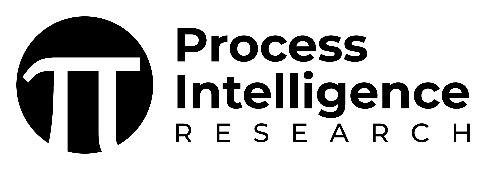
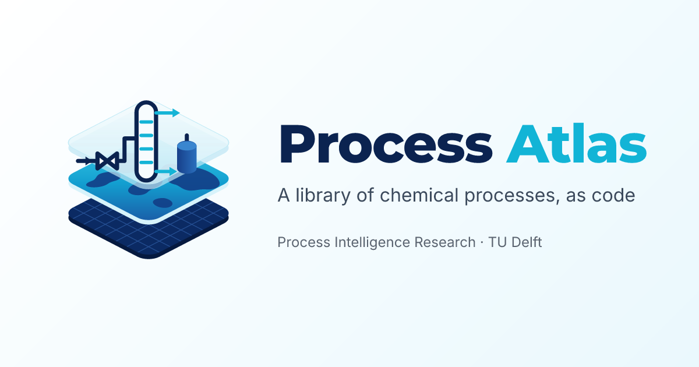
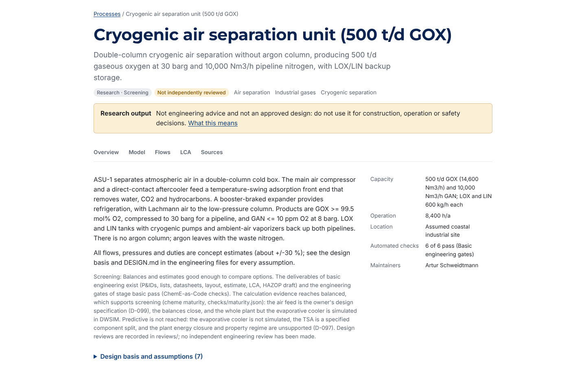

# Process library by [](https://www.pi-research.org/)

<p align="center">
  <a href="https://cheme-as-code.org"></a>
</p>

<p align="center">
  <a href="https://cheme-as-code.org"></a>
  <a href="https://atlas.cheme-as-code.org"></a>
  <a href="https://docs.cheme-as-code.org"></a>
  <a href="LICENSE-DATA"></a>
  <a href="LICENSE"></a>
  
  <a href="https://github.com/ChemE-as-Code/process-library/actions/workflows/validate.yml"></a>
  <a href="https://github.com/ChemE-as-Code/process-library/actions/workflows/docs.yml"></a>
  
</p>

## Overview

The process library is a collection of 50 chemical processes kept as code, from air separation,
ammonia and methanol to chlor-alkali, sulfuric acid and the utilities a plant needs. Each process
is one folder with a manifest, `process.yaml`: what goes in, what comes out, how far the design
is taken and who has reviewed it. Most folders are also ChemE-as-Code engineering projects,
checked by the `cheme` toolkit: each has a block and a process flow diagram in the DEXPI exchange
standard, a flowsheet and an equipment list; the most advanced (`asu-1`, `ammonia-1`) also have
P&IDs and a 3D layout. The [home page](https://cheme-as-code.org) explains what "chemical
engineering as code" means.

The library is the source of the [Process Atlas](https://atlas.cheme-as-code.org) (a preview;
processes appear there as they pass review), which links the processes through the chemicals
they make and use. From the same files it builds open life cycle inventory (LCI) datasets for
[Brightway](https://docs.brightway.dev) and openLCA. All of it is plain text in git, so every
change is reviewed and versioned. This is research software
in active development: research output, not engineering advice.

<p align="center">
  
</p>

## Features

- **One folder per process**: 44 engineering projects (`plant.yaml`) and 6 library utilities
  (steam, cooling water, chilled water, instrument air, wastewater treatment, flaring).
- **A manifest per process** (`process.yaml`, with a JSON Schema): families mapped to the ISIC
  Rev. 4 and NACE Rev. 2 industry classifications, and separate fields for design maturity and
  review status.
- **A chemicals registry** with CAS, InChIKey and ChEBI identities and product grades; it links
  the processes to each other in the Atlas.
- **LCI database builds**: a Brightway workbook, an openLCA JSON-LD package and a file for
  Brightway's `multifunctional` package (the last two keep the unallocated multi-output
  datasets), plus a one-call Brightway installer (`python/`). Background data (e.g. ecoinvent)
  are referenced by name; no licensed data are shipped.
- **Markets and regional scenarios**: supply chains per product and region, and one design
  assessed against several regional backgrounds without copying its folder.
- **Benchmarks** per process family, with reference ranges from cited open sources.
- **Continuous checks**: CI validates every plant with `cheme`, runs the tests and builds the
  catalog and the LCI database; only processes marked public enter the public build.

## Quick start

The [Process Atlas](https://atlas.cheme-as-code.org) shows the published processes. To open
every plant of the library in the ChemE-as-Code Viewer on your own machine (`cheme serve` in
library mode, core 1.1.0 or later), you need [uv](https://docs.astral.sh/uv/), Node.js and access
to the private ChemE-as-Code repositories:

```sh
git clone https://github.com/ChemE-as-Code/core.git && uv tool install './core[serve]'
(cd core/viewer && npm install && npm run build)
git clone https://github.com/ChemE-as-Code/process-library.git && cd process-library
cheme serve --repo . --ui ../core/viewer/dist   # http://127.0.0.1:8765, each plant under /p/<id>/
```

To work on one process, run `cheme` in its folder (`cd processes/asu-1`). To add a process, copy
`templates/process/` and follow [CONTRIBUTING.md](CONTRIBUTING.md).

## Documentation

- Technical documentation of the toolkit: [docs.cheme-as-code.org](https://docs.cheme-as-code.org).
  This library's methodology and governance pages are in [`docs/`](docs/) (an MkDocs site, built
  in CI but not yet published).
- Plain-language pages: [cheme-as-code.org](https://cheme-as-code.org) and the
  [Process Atlas](https://atlas.cheme-as-code.org).
- The full reference of this repository (paths, processes, builds, CI, repository size):
  [REFERENCE.md](REFERENCE.md). The reference sections of the earlier README now live there.
- Adding and publishing a process: [CONTRIBUTING.md](CONTRIBUTING.md). The LCI export:
  [lci/README.md](lci/README.md).

## Citation

Both papers are in preparation and their titles are working titles. If you use the library,
please cite the Process Atlas paper, and ChemE-as-Code for the toolkit. See also
[cheme-as-code.org/about/cite](https://cheme-as-code.org/about/cite/).

```bibtex
@misc{schweidtmann_process_atlas,
  author = {Schweidtmann, Artur M. and Weber, Jana M.},
  title  = {Process Atlas: an open, git-native, reproducible library and life cycle inventory of chemical processes (working title)},
  url    = {https://atlas.cheme-as-code.org},
  year   = {2026},
  note   = {in preparation}
}

@misc{schweidtmann_cheme_as_code,
  author = {Schweidtmann, Artur M.},
  title  = {ChemE-as-Code: An Open-Source Platform for AI-Accelerated Chemical Process Engineering (working title)},
  url    = {https://cheme-as-code.org},
  year   = {2026},
  note   = {in preparation}
}
```

## Contributors

| | Name | Role |
|---|---|---|
|  | [Artur M. Schweidtmann](https://www.pi-research.org/author/artur-schweidtmann/) ([LinkedIn](https://www.linkedin.com/in/schweidtmann/)) | ChemE-as-Code and Process Atlas (principal investigator); Process Intelligence Research, Department of Chemical Engineering, Delft University of Technology |
|  | Jana M. Weber | Process Atlas; Delft Bioinformatics Lab, Department of Computer Science, Delft University of Technology |

Everyone who contributes is credited in the git history: see the
[contributors of this repository](https://github.com/ChemE-as-Code/process-library/graphs/contributors).

## License

The process data and designs are licensed under [CC BY 4.0](LICENSE-DATA), unless a process
states otherwise in its `process.yaml`; third-party data keep their own terms. The code (scripts,
schemas and tests) and the skills and scripts inside process folders are licensed under
[AGPL-3.0-or-later](LICENSE). The one exception is the small LCI data installer in `python/`, which
is under the [MIT License](python/LICENSE) so that you can use it in any workflow.
Copyright (C) 2026 Artur Schweidtmann; TU Delft disclaims copyright interest (see [NOTICE](NOTICE)).

## Contact

Questions, or working with industry: Artur Schweidtmann,
[a.schweidtmann@tudelft.nl](mailto:a.schweidtmann@tudelft.nl). Ways to collaborate:
[pi-research.org/industry](https://www.pi-research.org/industry/) and
[cheme-as-code.org/about](https://cheme-as-code.org/about/#contact).
