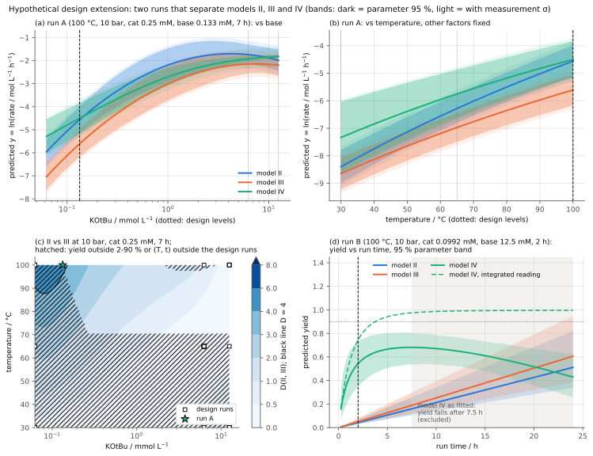

# Mn-CNP ketone hydrogenation: which batch run tells the kinetic models apart?

Case study for issue #341 (scope tracker #333, priority P3). Protocol: ADR 0030 (reference
reproductions, tolerances frozen first); layout: ADR 0031 (case studies: a reproduction plus
a labelled design extension; Proposed, merged in #344).

**Engineering question.** Which feasible batch condition most clearly distinguishes the
competing kinetic models of a manganese-catalysed hydrogenation?

**Source.** van Schendel, Yang, Uslamin, Pidko, *ChemCatChem* 2021, 13, 4886,
doi:10.1002/cctc.202101140 (CC BY 4.0). Acetophenone hydrogenation with a Mn(I) CNP pincer
catalyst and KOtBu in dioxane; 30 batch runs from a face-centred central composite design
over temperature, H2 pressure, catalyst and base concentration; four regression models of the
average rate (full quadratic I; stepwise II; III with the interaction terms eliminated by
"chemical logic"; nonlinear IV built on formal kinetics, which the abstract calls the
"chemical logic" model); and separate initial-rate kinetics. The Supporting Information holds the complete run table.

## Status

| Part | Status | Basis |
| --- | --- | --- |
| Reproduction | **fail** under the frozen rule (94 of 96 checks pass) | All 35 coefficients of models I-IV, their standard errors, RMSE, R2 and PRESS of models I-III, and the initial-rate Ea and orders reproduce within the frozen tolerances. Two checks fail on how the source reported numbers: SI Table S10 lists the fitted values of the 30-run first-stage fit, not of the reported 26-run model II (we reproduce both); model IV's RMSE differs by -12 % because we report the weighted residual RMSE, while MATLAB reports its robust sigma; applying MATLAB's robust-sigma convention to our fit gives 0.6572 (reported 0.657), a non-gating sensitivity. See `comparison.md`. |
| Independent validation | none | No data from another laboratory exist. The initial-rate runs are separate experiments by the same authors; their comparison with the regression coefficients is the article's and is restated, not counted as validation. |
| Design extension | hypothetical | Two runs at 100 °C and 10 bar separate every pair of models by at least two combined standard deviations (D >= 4.2); no feasible point of the 70,875-point grid does as a single run, and even infinitely many replicates of any feasible grid point give D_min <= 3.2. Run A is a hidden extrapolation (leverage above the design's maximum) for models II and III. See `extension.md`. |
| Specialist review | not yet | Optional follow-up: catalysis and kinetic experiment design. |

## Result in brief

- **Reproduction.** Refitting the published term lists to the published runs gives, for
  example, model III's apparent activation energy as 41.04 kJ/mol (reported 41.0) and model
  II's T x ln(cat) coefficient as -1597 ± 528 K (reported -1601 ± 530). The initial-rate
  runs give 90.7 ± 7.5 and 51.2 ± 4.2 kJ/mol (reported 90 ± 7 and 51 ± 4).
- **Discriminating experiment (hypothetical).** Run A: 100 °C, 10 bar H2, 0.25 mmol/L
  Mn-CNP, 0.133 mmol/L KOtBu, 7 h. Model II predicts 0.0105 mol/(L h) (5.8 % yield), model
  III 0.0037 mol/(L h) (2.0 %): it tests model II's interaction terms. Run B: 100 °C,
  10 bar, 0.099 mmol/L Mn-CNP, 12.5 mmol/L KOtBu, 2 h. Models II and III predict 4-5 % yield,
  model IV 54 %: it tests whether the average rate falls with run time (catalyst
  deactivation, or run times chosen by how fast a run went). Measurement resolution: 0.21 in
  ln(rate), the pure error of the centre replicates.
- **Changed input (extrapolation).** Halving the substrate at run A doubles the yield
  predicted by models II and III (zero order in substrate) and leaves model IV's unchanged
  (first order); it does not improve the separation.



## Rerun

From the repository root (needs `uv`; downloads the pinned SI PDF, 0.6 MB, into
`~/.cache/cheme-reproductions/mn-hydrogenation-kinetic-discrimination/` or
`$XDG_CACHE_HOME/...`, and checks its sha256):

```sh
uv run benchmarks/reproductions/mn-hydrogenation-kinetic-discrimination/run.py
```

It prints the verdict and the proposed runs and rewrites `results/` (deterministic: the same
files on every run). It exits non-zero only if it cannot run; the verdict is in
`results/comparison.json`.

## Files

| File | What |
| --- | --- |
| `source.yaml` | pinned sources (DOI, SI file with sha256, licence), the models, reported results restated with locators |
| `inputs.yaml` | every model input with value, unit, label (measured, reconstructed, assumed) and source or reason |
| `tolerances.yaml` | acceptance tolerances and pass rule, frozen in commit 1fa0e6d before the first comparison run |
| `sufficiency.md` | what data exist, what is missing, and the scope decided from it (P3) |
| `run.py` | single entry point: download, parse, refit, compare, design search, figures |
| `results/comparison.json` | every compared quantity, the fits with covariances, sensitivities and the extension |
| `results/fig1_parity.svg` | our refits of models II-IV against the measured runs, with the SI's fitted values |
| `results/fig2_discrimination.svg` | prediction bands at run A, the II-vs-III separation map, yield vs time at run B |
| `results/fig3_conventional_kinetics.svg` | our straight-line fits of the initial-rate runs |
| `comparison.md` | run details, result table, verdict, deviations and explanations |
| `NOTICE.md` | attribution and licence of the source numbers restated and replotted here |
| `extension.md` | the hypothetical design extension and the changed-input example |

No third-party file is committed. The run table is read at runtime from the pinned SI file;
the figures are drawn by `run.py` from numbers, not taken from the article, and carry a data
credit. `NOTICE.md` records the CC BY 4.0 attribution for the restated numbers.

## Evidence gaps

- No time-resolved H2-uptake curves are published; each run gives one average rate over its
  run time. The article says model IV's x6 is the time each run took to finish according to
  the H2 uptake; the Table S1 times look mixed (shared batch stop times for some groups,
  different near-completion times for the high-yield 100 °C runs). Model IV's time term is
  therefore confounded with run time, and its as-fitted form predicts a falling yield beyond
  7.5 h. Read as the integrated rate law and refitted, model IV fits better (RMSE 0.36) but
  only by letting the catalyst die within about 0.3 h, so its time term becomes a pure 1/t.
- Six of the 30 design runs (7, 10, 13, 14, 15, 21) reached 87-95 % yield. Their average
  rates are lower bounds on the rate, yet the source regressed on them (five each in models
  II and III, four in model IV).
- Substrate concentration was not varied (about 1.255 mol/L in every run), so the
  substrate order that separates model IV from models II and III cannot be tested within
  the data.
- End-of-run substrate concentration (a model IV regressor) was measured by GC in the
  source but not tabulated. We reconstruct it from rate, time and yield, which assumes a
  100 % mass balance; the SI reports 90-110 %, which at 90 % yield moves ln S_end by +0.7 or
  more. The model IV coefficients still reproduce within 0.07 SE (largest: x4, 0.064 SE).
- No replicate data at low yield; the proposed run A sits at 2-6 % yield, where the
  measurement resolution may be worse than the 0.21 used.
- Inconsistencies in the source: SI Table S10 fitted values come from a different fit
  than SI Table S7's coefficients; SI Table S16 lists 25 runs where the text and the fit
  use 24; for model IV, article Table 2 and SI p. 24-25 differ (adjusted R2 0.945 vs 0.942,
  F 99.7 vs 75.6, 19 vs 18 error degrees of freedom). Table S2 uses 1/(T + 274.1 K) without
  explanation.
- No mass-transfer data (kLa, stirring) to check the article's inference of gas-liquid
  limitation at 200 ppm catalyst.
