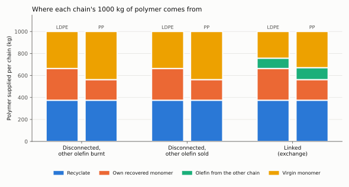

# Linked LDPE and polypropylene recycling inventories

**Engineering question:** what happens to the combined material and environmental inventories
when two recycling chains, LDPE and polypropylene, exchange a stream?

Issue #339 (priority P3), scope tracker #333. Protocol: ADR 0030 (reference reproductions,
tolerances frozen first); case layout: ADR 0031 (a reproduction plus a labelled design
extension). Data sufficiency was assessed first (`sufficiency.md`).

The study the issue names (El Khoury, Somoza-Tornos, Pozo, Jimenez; SETAC Europe 2025) is a
conference abstract without inventory inputs, so it cannot be reproduced numerically. This case
reproduces instead the open process model for the step that creates the exchangeable stream,
pyrolysis of waste polyethylene to monomers (Somoza-Tornos et al. 2020, two of the same
authors), and builds the two-chain mass inventory on it, with every missing parameter labelled
ASSUMED.

## Status

| Row | Status |
| --- | --- |
| Reproduction | **fail** under the frozen rule (`tolerances.yaml`). Target study: **not achievable** (no inputs published). Component (PE pyrolysis inventory, Table 2): 4 of 5 checks pass; benzene is 6.3 % low against 3 %. |
| Independent validation | none (no plant or experimental data) |
| Design extension | hypothetical: PP waste throughput against a fixed LDPE chain (`extension.md`) |
| Specialist review | not yet (optional follow-up: industrial ecology and LCA) |

## Result in brief

On a basis of 1000 kg sorted waste per chain and 1000 kg polymer delivered per chain, linking
the chains moves 108.6 kg propylene from the LDPE plant to the PP chain and 93.8 kg ethylene
from the PP plant to the LDPE chain, and the two chains together buy 202.4 kg less virgin
olefin (571.5 instead of 773.9 kg). Whether this is a saving depends on what the disconnected
chains did with that olefin: burnt as fuel, it also adds 635 kg fossil CO2, which the link
avoids; sold to the market, the net virgin olefin and the direct CO2 are the same with or
without the link (system expansion). Under the library's cut-off model with mass allocation,
the exchanged olefin carries its sender's direct CO2 into the receiving folder.
`comparison.md` has the full reconciliation.



## Rerun

From the repository root:

```sh
uv run benchmarks/reproductions/recycling-symbiosis-lci/run.py
```

It reads `inputs.yaml`, `source.yaml`, `tolerances.yaml` and the pinned library file
`processes/ethylene-1/lca/inventory.csv`, downloads the component source's accepted manuscript
into `$XDG_CACHE_HOME/cheme-reproductions/recycling-symbiosis-lci/` (default `~/.cache/...`) only
to check its sha256 (it is never parsed or executed; without network the run continues and records
"not verified"), and writes `results/`. It exits non-zero only if the script fails or an internal
reconciliation check fails; the reproduction verdict is in `results/comparison.json`.

## Files

| File | What |
| --- | --- |
| `sufficiency.md` | what data exist, where, under which licence, what is missing, the achievable scope |
| `source.yaml` | pinned sources (records, file hashes, licences, locators) and reported results, restated as facts |
| `inputs.yaml` | every model input with value, unit, label (measured, reconstructed, assumed) and source or rationale |
| `tolerances.yaml` | acceptance tolerances and pass rule, frozen in 7319d4b before the first run |
| `run.py` | single entry point (PEP 723 header, pinned dependencies) |
| `results/comparison.json` | every compared and computed quantity, per configuration and folder, the checks, the extension |
| `results/*.svg` | monomer supply per chain, combined inventory, extension sweep (our own matplotlib code) |
| `comparison.md` | run details, reference against ours, verdict, deviations, reconciliation |
| `extension.md` | the changed-input result, labelled hypothetical |

## Evidence gaps

- No inventory of the target study exists in the open; the scenario cannot be pinned to the
  authors' numbers, and their impact shares (26 to 51 %, 9 and 14 %) cannot be recomputed.
- PP pyrolysis yields are assumed; they set the size of the ethylene exchange and the
  saturation point of the extension.
- The PE model is applied to LDPE unchanged; its benzene line is not reproduced from Eq. 1.
- Mechanical recycling shares and yields are assumed; mechanical recycling energy, sorting,
  pyrolysis utilities other than net electricity and the transport of exchanged olefin are
  missing from the inventory.
- No characterised impacts: the only displaced-production value is the library's own ethane
  cracker (gate-to-gate direct CO2, concept maturity, unreviewed); no open naphtha-route or
  propylene background is available, and ecoinvent values cannot be published here.

## Sources

- El Khoury C., Somoza-Tornos A., Pozo C., Jimenez L. (2025). Enhancing Environmental
  Sustainability through Industrial Symbiosis in Plastic Waste Recycling. SETAC Europe 35th
  Annual Meeting, Vienna, abstract 5.10.P-We469.
  [TU Delft record](https://research.tudelft.nl/en/publications/enhancing-environmental-sustainability-through-industrial-symbios/)
- Somoza-Tornos A., Gonzalez-Garay A., Pozo C., Graells M., Espuna A., Guillen-Gosalbez G.
  (2020). Realizing the Potential High Benefits of Circular Economy in the Chemical Industry:
  Ethylene Monomer Recovery via Polyethylene Pyrolysis. ACS Sustainable Chemistry & Engineering
  8, 3561-3572. [doi:10.1021/acssuschemeng.9b04835](https://doi.org/10.1021/acssuschemeng.9b04835)
  (CC BY 4.0); accepted manuscript at [UPCommons](http://hdl.handle.net/2117/336839).
