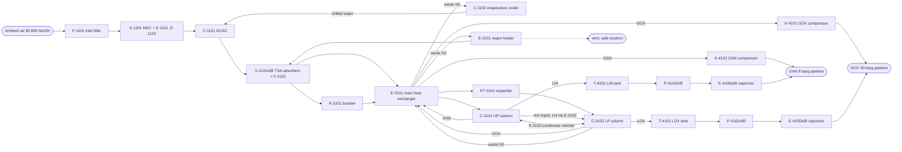

# Design decisions

One entry per decision: what was decided, why, what was rejected, and what it assumes.
Numbers marked ASSUMED are concept estimates (about +/-30 %), not vendor or client data.

The tool was renamed in core 0.7.0: `plantcode` is now `cheme-as-code` (command `cheme`, finding
ids `cheme.<rule>`, schema ids `cheme/<kind>/v1`). The decisions below keep the names they were
written with; read `plantcode <cmd>` as `cheme <cmd>` and `plantcode.<rule>` as `cheme.<rule>`.

## 1 Process description (stage concept)

ASU-1 is a low-pressure double-column cryogenic air separation unit without an argon column.

- **P-01 Main air compression and precooling.** Ambient air (85,840 Nm3/h dry, ASSUMED, D-066; concept 76,000) passes the
  self-cleaning inlet filter F-1101 and is compressed in the integrally geared, 3-stage
  centrifugal main air compressor K-1101 to 5.8 bara (ASSUMED) with intercoolers E-1101/E-1102
  and aftercooler E-1103 (cooling water). Inlet guide vanes control throughput; an anti-surge
  blow-off valve vents to atmosphere through silencer S-1101. The direct contact aftercooler
  C-1101 cools the air to 12 C (ASSUMED): cooling water in the lower section (pumps P-1101A/B),
  chilled water in the upper section. The chilled water (pumps P-1102A/B) is cooled to about
  10 C (ASSUMED) in the evaporative cooler C-1102 by dry waste nitrogen from the cold box.
- **P-02 Front-end purification.** Two molecular sieve adsorbers V-2101A/B (activated alumina
  under 13X, ASSUMED) work in TSA mode: one adsorbs H2O, CO2, N2O and most hydrocarbons
  (C2H2 completely) while the other is regenerated with waste nitrogen heated to 200 C in the
  electric heater E-2101, then cooled with unheated waste N2. Switching valves are sequenced by
  KS-2101. Dust filter F-2101 retains sieve fines. CO2 (AIA-2102) and H2O (AIA-2103) analyzers on
  the outlet detect breakthrough.
- **P-03 Cold box.** The purified air is split. The main part (64,500 Nm3/h) is cooled close to
  its dew point in the brazed aluminium main heat exchanger E-3101 and fed to the HP column
  C-3101 (5.4 bara). The rest (11,500 Nm3/h) is boosted in K-3101 (braked by expander KT-3101,
  aftercooler E-3104), part-cooled in E-3101, expanded in KT-3101 to 1.35 bara and fed to the
  LP column C-3102 (Lachmann air) as the plant's refrigeration. HP column bottom (rich liquid,
  ~38 % O2) and top liquid nitrogen are subcooled in E-3102 and let down through JT valves into
  the LP column. The main condenser-reboiler E-3103 (bath type, in the LP column sump) condenses
  HP nitrogen against boiling LOX. GOX is drawn from the LP sump vapour space, GAN (pressurized
  N2) from the HP column top, waste N2 from the LP top. A continuous LOX purge from the sump
  (FIC-3111) removes hydrocarbons; the LOX product is drawn from the same sump. Sump liquid is
  analysed for hydrocarbons (AIA-3103).
- **P-04 Products.** GOX (1.15 bara, warm) is compressed to 31 bara in the oil-free, multistage
  centrifugal GOX compressor K-4101 (D-002). GAN (5.2 bara) is compressed to 9 bara in K-4102.
  LOX and LIN go to the flat-bottom tanks T-4101 (250 m3) and T-4102 (400 m3). On loss of the
  ASU the cryogenic pumps P-4101A/B (LOX) and P-4102A/B (LIN) start and send liquid through the
  ambient-air vaporizers E-4105A/B and E-4106A/B into the GOX and GAN headers (D-014).

## 2 Block flow

## 3 Mass and energy balance (main streams, ASSUMED values)

Basis: design case, 30 C ambient, ~83 % O2 recovery (D-066; the concept's 94 % is not reached
by the simulated double column). Nm3 at 0 C, 1.013 bar.

| stream | from -> to | Nm3/h | kg/h | p bara | T C | composition |
|---|---|---|---|---|---|---|
| 1 air feed | atm -> K-1101 | 85,840 dry, 88,820 wet | 113,329 | 1.01 | 30 | air, 80 % RH, H2O 3.35 mol% (D-058, D-066) |
| 1c MAC condensate | E-1102, E-1103 drains | | 1,609 | | 40 | water (simulated, D-058) |
| 2 compressed air | K-1101 -> C-1101 | 85,840 dry | 111,720 | 6.02 (D-089) | 40 | air, saturated, H2O 1.11 mol% (simulated) |
| 3c DCAC condensate | into the DCAC water | | 640 | | 27 / 12 | water (simulated, D-058; lower and upper section) |
| 3 precooled air | C-1101 -> V-2101 | 85,840 dry | 111,080 | 5.92 (D-089) | 12 | air, saturated, H2O 0.21 mol% (simulated) |
| 4 dry air to cold box | V-2101 -> E-3101 | 85,810 | 110,870 | 5.6 | 15 | dry, CO2 < 0.1 ppm (D-066) |
| 4E boosted air | E-3104 -> E-3105 -> E-3101 | 11,500 | 14,870 | 8.45 | 30 / 15 | air (D-067: cooling water, then chilled water) |
| 5 HP column feed | E-3101 -> C-3101 | 74,300 | 96,000 | 5.5 | -173 | air near dew point (D-066) |
| 6 Lachmann air | KT-3101 -> C-3102 | 11,500 | 14,870 | 1.35 | -178 | air |
| 13 crude oxygen (rich liquid) | C-3101 -> E-3102 -> C-3102 | | 53,740 | 5.5 | -174 / -180 | N2 59.9, O2 38.5, Ar 1.7 % (simulated, D-066) |
| 18 LN reflux | C-3101 -> E-3102 -> C-3102 | | 29,280 | 5.3 | -178 / -185 | N2, Ar 0.04 %, O2 0.5 ppm (simulated, D-066) |
| 7 GOX product | E-3101 -> K-4101 | 14,600 | 20,860 | 1.15 | 13 (D-061) | O2 99.71 % (simulated, D-066; spec >= 99.5 %) |
| 8 GOX to pipeline | K-4101 -> BL | 14,600 | 20,860 | 31.0 | 40 | O2 99.71 % |
| 9 GAN product | E-3101 -> K-4102 -> BL | 10,000 | 12,510 | 5.2 / 9.0 | 13 / 40 (D-061) | N2, O2 0.2 ppm (simulated; spec <= 10 ppm) |
| 10 LOX to storage | C-3102 -> T-4101 | 330 | 470 | 1.3 | -183 | O2 99.81 % (simulated) |
| 11 LIN to storage | C-3101 -> T-4102 | 375 | 470 | 5.2 | -181 | N2 |
| 12 waste N2 | C-3102 -> E-3102 -> E-3101 | 60,500 | 76,560 | 1.15 | 13 (D-061) | N2 93.6, O2 5.1, Ar 1.2 % (simulated, D-066) |
| 12a regeneration | -> E-2101 -> V-2101 | 14,600 | 18,486 | 1.1 | 200 (heating) | waste N2 (D-066) |
| 12b evaporative cooler | -> C-1102 | 45,900 | 58,074 | 1.05 | 13 (D-061) | waste N2: all not used for regeneration (D-067) |
| 12c vent | -> atm | 0 | 0 | 1.02 | 13 (D-061) | start-up and bypass of C-1102 only (D-067) |

Balance (D-066):
- Air: 113,329 kg/h wet in. Of that, 2,249 kg/h condense in the MAC coolers and the DCAC before
  the TSA (streams 1c, 3c), and the adsorbers remove 210 kg/h of H2O and CO2 (D-089).
- Cold box: 110,870 kg/h dry air in = 20,860 GOX + 12,510 GAN + 470 LOX + 470 LIN + 76,560 waste
  N2.
- O2: 17,985 Nm3/h in the air, 14,890 Nm3/h in GOX + LOX (82.8 %), 3,095 Nm3/h in the waste.
- Nm3 at 0 C and 1.013 bar, from the flowsheet's molar masses.

The table gives the main streams of process/flowsheet.yaml, where the full balance is
(cold-box internal streams, D-027, D-059, D-066). The concept seed of D-027 (98,270 kg/h in, 94 %
recovery) is history.

Refrigeration (ASSUMED, revised at S2 after review finding 5): expander KT-3101 on 14,870 kg/h
(4.13 kg/s), 7.8 -> 1.35 bara. For the -178 C exhaust the LP column needs (just above the air dew
point at 1.35 bara), the inlet must be about -115 to -120 C; design point -118 C. Ideal-gas check:
pressure ratio 0.173, T2s/T1 = 0.606, with eta_s 0.85 T2/T1 = 0.665, so T1 = 95 K / 0.665 = 143 K
ideal gas; real-gas cp near saturation moves this to ~155 K (-118 C). Enthalpy drop ~52 kJ/kg ->
**~215 kW** (the earlier -100 C inlet and 250 kW were inconsistent with a -178 C exhaust).
Demand: heat leak ~50 kW + warm-end temperature difference ~55 kW = ~105 kW; the remaining
~110 kW makes 110 kW / ~420 kJ/kg = 0.26 kg/s = **~940 kg/h liquid** (470 kg/h LOX incl. the
hydrocarbon purge + 470 kg/h LIN), down from 1,200 kg/h. More liquid needs more expander flow at
the cost of O2 recovery (D-017).
Superseded by D-061 (PR, the compander balanced): booster 5.6 -> 8.45 bara, expander inlet
8.25 bara / -124.7 C, 198.4 kW, exhaust -178 C. The demand above omits the booster air entering
E-3101 at 40 C (~105 kW): the cold box is ~78 kW short at 940 kg/h liquid (D-061). Closed by
D-067: the boosted air enters E-3101 at 15 C (E-3104 to 30 C on cooling water, E-3105 to 15 C
on chilled water); the cold box then closes at a heat leak of ~75 kW against 50 kW ASSUMED.

| consumer | power / duty | basis |
|---|---|---|
| K-1101 MAC | 7.29 MW electric (6.89 MW shaft) | simulated, D-066 (85,810 Nm3/h), D-058 (wet air): 3 stages, 6.02 bara (D-079, D-089); motor 9.0 MW (D-066; was 8.0) |
| K-4101 GOX compressor | 2.26 MW electric (2.14 MW shaft) | simulated, D-061 (suction 13 C): 5 stages to 31 bara (D-065 (7)) |
| K-4102 GAN compressor | 0.24 MW electric (0.22 MW shaft) | simulated, D-057, D-061 (suction 13 C): 5.2 -> 9 bara, 1 stage |
| E-2101 regeneration heater | 1.13 MW electric (peak) | 18,486 kg/h x 1.04 kJ/kgK x 185 K = 0.99 MW, plus the concept's 14 % margin; ~1/3 of cycle (D-066, ASSUMED) |
| pumps, chiller water, misc. | 0.3 MW electric | ASSUMED |
| **total electric** | **~11.2 MW (average ~10.5 MW)** | 6.6 kV (D-066, D-079, D-089; D-058 ~10.2 / ~9.5) |
| cooling water | ~10.7 MW, ~920 m3/h at 10 K | MAC 7.73, DCAC lower section 0.70, GOX comp 2.04, GAN comp 0.12, booster aftercooler E-3104 0.13 MW (simulated, D-066, D-067, D-089) |
| chilled water (C-1102) | ~0.70 MW | DCAC upper section 0.64, E-3105 0.06 MW (simulated); no machine: evaporative cooling by dry waste N2, whose heat leaves with the waste (D-005, D-067) |

Specific energy: ~0.65 kWh per Nm3 GOX delivered at 30 barg (MAC + GOX compressor; D-066, D-089; D-058 ~0.59).

The utilities of this table are the energy streams of `process/flowsheet.yaml` (feed POWER,
product CW; electric heater at its cycle average), which the LCA reads (`lca/`,
`plantcode assess lca`): change a power or duty there and rewrite the LCA.

## 4 Relief case list (preliminary, ASSUMED cases; sizing in detail engineering)

| device | protects | governing case | discharge |
|---|---|---|---|
| PSV-1109 | C-1101 DCAC, AIR-1002 | MAC at surge / max. IGV with AIR-1004 blocked; MAC max. discharge ~6.5 bara vs 8 barg design: PSV as backup to UIC-1102 (fire case for the packed column) | atmosphere, local (air) |
| PSV-2108A/B | V-2101A, V-2101B (one each: each bed can be blocked in by its XVs) | fire; blocked outlet during repressurization | atmosphere, local at the bed top (dry air / N2) |
| TSV on E-2101 | heater shell | blocked-in heating (TSHH-2107 primary) | atmosphere |
| PSV-3114 | C-3102 LP column | waste N2 outlet blocked (PIC-3110 failure) with expander and JT valves running | outside cold box, elevated (O2-rich: safe location) |
| PSV-3116 | C-3101 HP column | MAC deadhead feed with GAN and liquid outlets blocked | outside cold box |
| TSVs | trapped cryogenic liquid between valves (LOX, LIN, RL, LN lines) | heat-in of blocked liquid | to vent / drain vaporizer V-3101 |
| PSV-3119 | K-3101 discharge, E-3104 (on AIR-3002 at the E-3104 outlet, upstream of the check valve) | blocked outlet (KT-3101 inlet XV-3117 closed) | atmosphere (air), local |
| PSV-3123 | cold box casing (breathing valve, both directions) | purge PV-3113 failed open; casing vacuum on cool-down | VNT-3004, elevated (N2), AIA-3122 |
| PSV-4122 | K-4101 discharge, E-4102 | blocked outlet at max. speed (ESD XV-4118 closed) | VNT-4002 via S-4101 |
| PSV-4123 + vacuum breaker PSV-4142 | T-4101 LOX tank | heat-leak increase (perlite settling or wetting, outer-tank damage; the flat-bottom tank is perlite-insulated, not vacuum-jacketed), external fire, fill overpressure, roll-over; vacuum on fast draw-off | VNT-4001 / own outlet, safe location |
| PSV-4124 + vacuum breaker PSV-4143 | T-4102 LIN tank | as T-4101 | elevated (N2) |
| PSV-4125 / PSV-4126 | P-4101A/B / P-4102A/B discharge headers | closed discharge (pump deadhead), thermal; also the TSV of LOX-4002 / LIN-4002 between the check valves and the vaporizer inlet valves | into the cool-down return LOX-4003 / LIN-4003 to the tank vapour space |
| PSV-4127 / PSV-4128 | E-4105A/B / E-4106A/B (no outlet isolation valve, so one PSV on each outlet header covers both) | blocked outlet, thermal | elevated |
| TSV-4140 / TSV-4141 | LOX-3001 / LIN-3001 between FV-3111 (P-03) and the manual tank inlet valve | heat-in of blocked liquid | atmosphere (LOX: safe location) |
| XV-4133 / XV-4135 | GOX / GAN BL bleeds (DBB) | bleed between the two closed block valves | VNT-4006 safe location / VNT-4007 elevated |
| PSV on CW headers | E-1101..E-1103 tube side | tube rupture (6.02 bara air into CW, D-089) | local |
| WN-1002 open vent (no device, no valve) | C-1102 evaporative cooler (1 barg) | air blow-by through CHWR-1001 when the DCAC chimney tray loses its seal, 94.5 t/h bound + the design gas: ~25 kPa(g) at the top (D-083); I-03 (SIL 1 screening) limits the duration | elevated, WN-1002 (air / N2, zone Z-N2-WN1002) |

All PSV tags are fixed (S4); TSV-4140/4141 and the vacuum breakers PSV-4142/4143 are drawn on P-04 (S5). Remaining TSVs (RL, LN in the cold box) get tags in detail engineering.

## D-001 Process cycle: LP double column, no argon column, Lachmann expander (2026-10-18)
Decision: Classic LP double-column cycle, MAC at 5.8 bara, bath condenser-reboiler, booster
expander feeding Lachmann air to the LP column, argon left in the waste nitrogen.
Reason: Lowest capital and proven at 500 t/d; 99.5 % O2 needs no argon column (specification).
Rejected: Elevated-pressure cycle (higher MAC power for a GAN demand of only 10,000 Nm3/h);
argon column (excluded by the specification).
Assumptions: O2 recovery 94 %; HP top 5.4 bara; LP top 1.3 bara (ASSUMED).

## D-002 GOX compression route: external GOX compressor (2026-10-18)
Decision: GOX leaves the cold box at low pressure and is compressed to 31 bara in K-4101, an
oil-free, multistage integrally geared centrifugal oxygen compressor with dry gas seals, nitrogen
buffer gas, Monel/copper-alloy wetted parts in high-velocity zones, fire barriers between
stages and a separate fire-safe enclosure.
Reason: About 5-8 % lower specific power than internal compression at 30 barg (no booster air
compressor to ~65 bara), simpler and lower-pressure main heat exchanger, and the LOX backup
system (pumps + vaporizers) is needed anyway. The compressor hazard is handled by the O2 rules
(D-009, D-012) and an oxygen-compressor vendor with a proven reference list.
Rejected: Internal compression (pumped LOX vaporized in the MHX against ~65 bara booster air):
safer in principle and no GOX machine, but higher power, high-pressure brazed exchanger and a
second large air compressor. To be re-evaluated if the client's oxygen-safety policy forbids
GOX compressors at 30 bar.
Assumptions: Suction 1.15 bara, 25 C; discharge 31 bara, 40 C after aftercooler; 2.3 MW.

## D-003 Refrigeration: booster-braked air expander (2026-10-18)
Decision: Turbo-expander KT-3101 on 11,500 Nm3/h air, its power absorbed by the air booster
K-3101 on the same shaft (companders), exhaust to the LP column (Lachmann).
Reason: No electric generator needed, booster raises inlet pressure and so refrigeration per kg;
Lachmann air is standard for LP cycles at 99.5 % O2.
Rejected: Generator-braked expander (power recovery small, electrical complexity); waste-N2
expander (less refrigeration at this LP pressure, cannot produce the liquid needed).
Assumptions (amended by D-061: inlet -124.7 C / 8.25 bara, 198 kW): inlet -118 C / 7.8 bara, exhaust -178 C / 1.35 bara, eta_s 0.85, ~215 kW
refrigeration; liquid 470 kg/h LOX + 470 kg/h LIN (see balance, D-017).
Booster anti-surge (S4): recycle AIR-3006 from the E-3104 aftercooler outlet (cooled gas, so the
recycle does not heat the suction) back to AIR-3005 through UV-3120 (fail open), controlled by
UIC-3120 on the suction flow and pressure ratio; a check valve on AIR-3002 downstream of the
recycle tee stops backflow from E-3101 on a booster trip. Recycle DN150 ASSUMED (~50 % flow).
Reason: a centrifugal booster needs surge protection at start-up and turndown; the compander has
no other flow path while XV-3117 is closed.

## D-004 GAN source and compression (2026-10-18)
Decision: 10,000 Nm3/h pressurized nitrogen from the HP column top (<= 10 ppm O2), warmed in
E-3101 and compressed 5.2 -> 9 bara in the oil-free single-stage centrifugal K-4102.
Reason: Taking GAN from the HP column needs a compression ratio of only 1.7 instead of 7 from
the LP column; ~13 % of the air is compatible with HP reflux needs.
Rejected: LP nitrogen + 3-stage compressor (more power); raising MAC pressure (penalizes all air).
Assumptions: Pure N2 section at the HP column top is sufficient (to be verified by simulation).

## D-005 Precooling: DCAC with chilled water from an evaporative cooler (2026-10-18)
Revised by D-067: all waste N2 not used for regeneration feeds C-1102, and its chilled water also
trims the booster air (E-3105).
Decision: Packed direct contact aftercooler C-1101 (cooling water lower, chilled water upper
section), chilled water from evaporative cooler C-1102 using dry waste N2. Mist eliminator and
level trip LSHH-1106 at the DCAC to prevent water carry-over to the adsorbers.
Reason: Lowers the water load and adsorber size; uses waste N2 that is otherwise vented; no
refrigeration machine.
Rejected: Mechanical chiller (power, refrigerant; kept as future option if 12 C is not reached at
30 C ambient with high humidity).
Assumptions: Chilled water ~10 C at 30 C ambient (ASSUMED, to be confirmed with site humidity).

## D-006 Front-end purification: 2-bed TSA molecular sieve, electric heater (2026-10-18)
Decision: Two horizontal radial/axial-flow adsorbers V-2101A/B, alumina + 13X, ~4 h adsorption
(ASSUMED), regeneration with waste N2 heated to 200 C in electric heater E-2101 (no steam).
Breakthrough monitored by CO2 analyzer AIA-2102 (alarm 1 ppm, ASSUMED) and H2O analyzer AIA-2103.
Reason: Removes H2O, CO2, N2O and C2H2 before the cold box; steam is not available.
Rejected: Reversing heat exchangers (no hydrocarbon removal, obsolete); steam heater.

## D-007 Tag and numbering convention (2026-10-18)
Decision:
- Equipment: `<letters>-<s><nnn>[A/B]`, s = sheet/section digit (1 = P-01 ... 4 = P-04),
  nnn from 101. Letters: K compressor/booster, KT expander turbine, E heat exchanger/heater/
  vaporizer, C column/contact tower, V vessel/adsorber, T storage tank, P pump, F filter,
  S silencer. A/B = installed spares or parallel units.
- Instruments: ISA 5.1 letters + loop `<s><nnn>`, e.g. FIC-1101, AIA-3103. One loop number per
  measured variable; trips carry the same number (e.g. LSHH-1106).
- Lines: `<fluid>-<s><nnn>`, fluid codes AIR, GOX, GAN, WN (waste N2), RL (rich liquid), LN
  (liquid N2 reflux), LOX, LIN, CW/CWR (cooling water supply/return), CHW (chilled water),
  RG (regeneration gas), VNT (vent). DN, pressure class and insulation are list attributes.
Reason: Section digit makes the sheet obvious from the tag; short tags stay legible on sheets.

## D-008 Sheet split (2026-10-18)
Decision: P-01 MAC + precooling, P-02 TSA purification, P-03 cold box, P-04 products, storage
and backup. Off-sheet connectors at the section boundaries: air P-01 -> P-02 -> P-03; waste N2
P-03 -> P-02 (regeneration) and P-01 (evaporative cooler); GOX, GAN, LOX, LIN P-03 -> P-04.
Reason: Follows the process blocks and vendor packages (MAC, TSA, cold box, product machines).

## D-009 Oxygen service: materials and cleaning (2026-10-18)
Decision: All equipment and lines with O2 > 23.5 % (GOX, LOX, LP column, condenser, GOX
compressor, LOX tank, pumps, vaporizers, analyzer sample lines) are designed and cleaned for
oxygen service to EIGA Doc 13 / Doc 33 and ASTM G93: stainless steel or copper alloys in
impingement zones and valves, carbon steel only below the EIGA impingement velocity curve
(GOX at 31 bara: <= ~10 m/s ASSUMED design limit), no fast-opening valves in GOX lines (bypass
for pressure equalisation), oxygen-compatible gaskets and lubricants, cleaning verified and
documented, lines marked "Oxygen - clean". GOX DN chosen for <= 10 m/s.
Reason: Ignition by particle impact and adiabatic compression is the main GOX fire mechanism.

## D-010 Hydrocarbon accumulation protection (2026-10-18)
Decision: (1) Molecular sieve removes C2H2, most C3+, N2O and CO2 (D-006). (2) Continuous LOX
purge from the LP sump: the whole LOX product through FIC-3111 (470 kg/h, about 330 Nm3/h, ~2.3 %
of the O2 product) is the hydrocarbon purge to the LOX tank (drain vaporizer when the tank is
unavailable); 0.2 % of the O2 product (~30 Nm3/h, ASSUMED per EIGA Doc 65) is the minimum, so
FIC-3111 has a low-flow alarm at that value. (3) The condenser-reboiler E-3103 is kept fully submerged (LP sump level
LICA-3102 with low alarm), bath type, no dry boiling. (4) Analyzers: total hydrocarbons and
C2H2 in sump LOX (AIA-3103, alarm/trip), CO2 at TSA outlet (AIA-2102); action limits per EIGA
Doc 65 (ASSUMED); hydrocarbons in the LOX tank liquid (AIA-4121, periodic), since
boil-off in storage concentrates them. (5) Air intake located away from hydrocarbon sources; intake survey in basic
engineering. (6) Periodic derime/warm-up procedure.
Reason: Hydrocarbon accumulation in boiling LOX is the dominant ASU explosion hazard.

## D-011 Relief, vent and blowdown philosophy (2026-10-18)
Decision: Every enclosed volume that can be blocked in has a relief device; trapped cryogenic
liquid between two valves has a thermal relief valve. Columns relieve to atmosphere through
dedicated vent lines. O2-rich vents (GOX, LOX tank, LOX purge, vaporizers, analyzer vents) are
routed to a safe location: elevated, away from ignition sources, walkways and air intake; GOX
vent with silencer. N2 vents routed high to avoid asphyxiation zones. LOX/LIN tanks: PSVs +
vacuum breakers + rupture discs on the annular space. Cold liquid drains go to an atmospheric
drain vaporizer, never to sewers or open pits. Relief cases (blocked outlet, fire, CW failure,
control valve failure, heater over-temperature) are listed per device in section 4. The LP
column C-3102 has its own PSV-3114 (design 3.5 barg against normal 0.3 barg): it can be blocked in
by PIC-3110 / the waste N2 valves while the expander and the JT valves keep feeding it. Vents of
different pressure levels never share a header (D-019).
Reason: Overpressure, O2 enrichment and N2 asphyxiation risks of an ASU.

## D-012 No oil-lubricated equipment in O2 service (2026-10-18)
Decision: GOX compressor with dry gas seals and N2 buffer gas, oil system separated by an
atmospheric distance piece; LOX pumps with vapour-lifted/leakage-vented seals and grease-free
bearings in O2-wetted parts; MAC oil system with demister and oil-free air path; no
oil-lubricated valve actuators in O2 lines. The compander KT-3101/K-3101 is the one oil-bearing
machine that touches cold-box air: its bearings are oil-lubricated, sealed from the expander and
booster wheels by labyrinths fed with N2 seal gas. PDSLL-3115 (seal gas minus bearing housing
pressure) is a permissive for the lube oil pump (seal gas first, oil second) and trips the
compander (inlet XV closed) on low-low. The oil tank vent has an oil mist eliminator and vents
outside the cold box. So no oil can be carried with the Lachmann air into the LP column, where it
would accumulate in the LOX sump. (Alternative for the vendor enquiry: magnetic or gas bearings.)
Reason: Hydrocarbon oils are ignition sources in oxygen.

## D-013 Isolation and blowdown (2026-10-18)
Decision: Double block and bleed at the GOX and GAN battery limits: GOX XV-4119 + XV-4132 with
bleed XV-4133 to VNT-4006 (safe location), GAN XV-4120 + XV-4134 with bleed XV-4135 to VNT-4007;
the blocks fail closed, the bleeds fail open, so a trip isolates and vents the space between them;
fail-closed tank outlet valves XV-4136 (T-4101) and XV-4137 (T-4102) for remote shut-off of the
storage on a leak or fire; manual suction and discharge block valves on every pump (P-4101A/B,
P-4102A/B) for maintenance isolation (an isolated pump is drained/warmed through its casing vent
before both are closed, vendor); emergency isolation valves XV-4117 (K-4101 suction) and XV-4118 (discharge);
GOX compressor depressurized on trip by blowdown valve XV-4116 to VNT-4002 / S-4101; cold box liquid drain valves to the drain vaporizer; the
cold box casing is N2-purged (PIC on purge) with a breathing valve.
Reason: Safe isolation for maintenance and fast removal of energy from a GOX fire.

## D-014 Backup supply (2026-10-18)
Decision: On GOX or GAN header low pressure (PIC-4111 / PIC-4112) the standby LOX pump P-4101A/B
or LIN pump P-4102A/B starts and supplies through ambient-air vaporizers E-4105A/B / E-4106A/B.
Low outlet temperature trip TSLL-4113/4114 protects the carbon-steel pipeline from cold gas.
Reason: Supply continuity during ASU trips (25 % GOX, 50 % GAN, 2 days, specification).
Assumptions: Pumps cold-standby, kept cold by the cool-down / min-flow return LOX-4003 / LIN-4003
(HV-4138 / HV-4139, continuous small flow, restriction orifice ASSUMED) to the tank vapour space;
it also takes the pump minimum flow at start-up and the discharge PSV-4125 / PSV-4126.

## D-015 Empty sheet frames at stage concept (2026-10-18)
Decision: pid/P-01..P-04.xml are created now as empty DEXPI frames (title block only), drafted in
stage basic.
Reason: plant.yaml must declare the sheets and plantcode requires each declared file to exist.
The lists then cross-check against the sheets; the resulting "not on P&ID" warnings are expected
until basic engineering.

## D-016 Line sizing basis (2026-10-18)
Decision: Concept DN from velocity: gas <= 20 m/s (waste/regen <= 25 m/s at near-atmospheric
pressure), GOX <= 10 m/s at 31 bara (D-009), liquids 1-2 m/s, pump suction <= 1 m/s.
Reason: Pressure-drop and O2 velocity limits. Final sizing in basic engineering.

## D-017 Liquid production and storage refill time: client to confirm (2026-10-18)
Decision (proposed, CLIENT TO CONFIRM): keep the expander at 11,500 Nm3/h and ~940 kg/h liquid.
Refilling the full backup reserve then takes ~22 days for LOX (250 t / 470 kg/h) and ~27 days
for LIN (300 t / 470 kg/h); at the previous 600 kg/h it was 17 / 21 days. After a backup event
the tanks are topped up by road tankers (truck fill connection on T-4101/T-4102, P-04).
Alternative for the client: a ~30 % larger expander flow (~15,000 Nm3/h) restores ~1,200 kg/h
(refill ~17 / 21 days) for about 1-1.5 points of O2 recovery and ~0.2 MW more MAC power.
Reason: the backup reserve (2 days of 25 % GOX and 50 % GAN) is set by the specification, the
refill time is not; it is a commercial choice between truck liquid and power/recovery.
Assumptions: liquid refrigeration ~420 kJ/kg (ASSUMED).
Tank volume check (S6): LIN reserve 2 d x 50 % x 10,000 Nm3/h = 240,000 Nm3 = 300 t; at
0.807 t/m3 that is 372 m3 net. T-4102 is 400 m3 working (between the LALL pump heel and the
max. fill level, +7.5 % margin) and ~440 m3 gross: heel ~12 m3 (pump NPSH) and ~6 % ullage
(ASSUMED). LOX reserve 2 d x 25 % x 14,600 Nm3/h = 175,200 Nm3 = 250 t; at 1.141 t/m3 that is
219 m3 net against 250 m3 working (+14 %), ~275 m3 gross (ASSUMED).
Truck fill (S6): drawn on P-04 as LOX-4004 / LIN-4004: tanker hose coupling, check valve, TSV-4144 /
TSV-4145 for the liquid trapped between check valve and block valve, block valve HV-4146 / HV-4147,
fill nozzle N6. The LOX fill bay has a concrete (not asphalt) pad under the hose coupling (D-026).

## D-018 O2 recovery 94 % and sensitivity at 90 % (2026-10-18)
Revised by D-066: the simulated double column needs ~83 % recovery (85,840 Nm3/h dry air) for
99.5 % GOX.
Decision: keep 94 % as the design recovery and size the MAC for 80,000 Nm3/h (+5 %, ASSUMED
margin). Check: an LP double column with ~15 % Lachmann air and no argon column typically reaches
93-96 % at 99.5 % O2, so 94 % is plausible but not conservative. At 90 % the O2 in the air must be
14,930 / 0.90 = 16,590 Nm3/h -> 79,200 Nm3/h air (+4.2 %), MAC power ~8.35 MW (+0.35 MW), adsorber
and MHX loads +4 %: covered by the 80,000 Nm3/h MAC rating; specific energy rises to ~0.73 kWh/Nm3.
Reason: recovery is the main uncertainty of the concept balance; the margin keeps the product rate
if the simulation in basic engineering gives less.
Air/O2 ratio: design air 14,930 / (0.94 x 0.2095) = 75,800 Nm3/h for 14,600 Nm3/h GOX gives
5.2 Nm3 air per Nm3 GOX. The reason it is above the stoichiometric 1/0.2095 = 4.8: 6 % of the
O2 leaves with the waste N2 and the GAN (recovery 94 %), and the GOX product is 99.5 % O2 while
14,930 Nm3/h contained O2 includes the liquid make. The MAC rating 80,000 Nm3/h (ratio 5.5) adds
the +5 % margin above (ASSUMED).

## D-019 Vent separation and GOX suction vent (2026-10-18)
Decision: no shared vent headers between pressure levels. VNT-4001 is the LOX tank vent only
(0.5 barg, PV-4109); VNT-4002 is the K-4101 blowdown (31 bara, XV-4116, silencer S-4101);
VNT-4003 is the GOX suction vent on GOX-4001 (PV-4101B, silencer S-4102), split range with
PIC-4101: output A first (to the K-4101 inlet guide vane actuator; there is no separate PV-4101A
valve body, S6 correction), output B (PV-4101B) opens above it on a K-4101 trip or
during start-up, so the LP column pressure stays controlled while the compressor is not taking
GOX. All three discharge elevated at a safe location (D-011).
Reason: a 31 bara blowdown into a header shared with a 0.5 barg tank would back-pressure and
possibly overpressure the tank, and push O2 back into it (review finding S1-2/3).

## D-020 DEXPI classes used for equipment (2026-10-18)
Decision: CentrifugalCompressor (MAC, booster, GOX/GAN compressors), TubularHeatExchanger
(coolers), PlateHeatExchanger (brazed aluminium exchangers), ProcessColumn (columns, DCAC,
evaporative cooler), GasFilter, Silencer, CentrifugalPump, Tank, PressureVessel, ElectricHeater.
Verified on P-01 by `plantcode validate` (the loader rejects unknown classes). Classes for P-03/
P-04 that are not on a sheet yet (Turbine for KT-3101, Vessel for V-3101, HeatExchanger for the
ambient vaporizers) are checked the same way when those sheets are drawn; if the loader refuses
them: SteamTurbine is wrong for an air expander, so use the generic class the loader offers and
say so here.
Turbine, Vessel and HeatExchanger are valid (generic) pyDEXPI classes (checked in the pyDEXPI
class model at S2): KT-3101 stays Turbine (there is no expander class); V-3101 (atmospheric drain
vaporizer) becomes Tank and the ambient vaporizers stay HeatExchanger when P-03/P-04 are drawn.
Silencers (DEXPI `Silencer` is a PipeFitting) and safety valves (`SpringLoadedGlobeSafetyValve`)
are piping components, not tagged plant items or instrument functions: they carry their tag as
PipingComponentNumber / PositionNumber on the P&ID and are listed here, not in the equipment or
instrument lists:

| tag | class | line | sheet |
|---|---|---|---|
| S-1101 | Silencer | AIR-1003 | P-01 |
| PSV-1109 | SpringLoadedGlobeSafetyValve | AIR-1004 (C-1101 top) | P-01 |
| S-2101 | Silencer | RG-2003 | P-02 |
| PSV-2108A/B | SpringLoadedGlobeSafetyValve | AIR-2001 (V-2101A/B tops) | P-02 |
| S-3101 | Silencer | WN-3003 | P-03 |
| PSV-3114, PSV-3116 | SpringLoadedGlobeSafetyValve | VNT-3002 (C-3102), VNT-3003 (C-3101) | P-03 |
| PSV-3119 | SpringLoadedGlobeSafetyValve | AIR-3002 (K-3101 discharge) | P-03 |
| S-4101, S-4102 | Silencer | VNT-4002, VNT-4003 | P-04 |

Note: the `name` attribute of the XML root (`example`) is rewritten by `plantcode fmt` (pyDEXPI
serializer); the plant identification is in the title-block MetaData (ASU-1).

## D-021 P-01 drawing content (2026-10-18)
Decision: P-01 shows F-1101, K-1101 (one compressor symbol with stage nozzles; intercoolers
E-1101/E-1102 below it on interstage lines AIR-1005/AIR-1006), aftercooler E-1103, blow-off
AIR-1003 with UV-1102 to S-1101, non-return valve on AIR-1002 before the DCAC (no backflow from
the adsorbers into the MAC on trip), PSV-1109 on C-1101, CW pumps P-1101A/B (FV-1108), DCAC sump
water CWR-1001 via LV-1106, chilled water C-1102 -> P-1102A/B -> TV-1105 -> C-1101 upper section,
CW make-up CW-1003 via LV-1107, waste N2 WN-1001 from P-03 into C-1102 and vent WN-1002. Cooling
water to the intercoolers and aftercooler is CW-1002 / CWR-1002 with off-sheet connectors to the
CW utility system (not drawn in this project). One line number per cooler (CW-1002/CWR-1002 E-1101,
CW-1004/CWR-1003 E-1102, CW-1005/CWR-1004 E-1103) so from/to are exact.
Rev after the S2 review: CW-1001 enters C-1101 on the right side (no crossing with AIR-1002), DCAC
level instruments on the left side, CWR-1001 leaves to the left; mist eliminator drawn as a mesh pad
at the C-1101 top (D-005); TIA-1110 (MAC vendor multipoint: stage discharges and intercooler
outlets) and TIA-1111 on AIR-1002 after E-1103. LSHH-1106 trips the MAC only: no XV on AIR-1004,
because the MAC trip stops the flow and the check valve on AIR-1002 prevents back-flow; a 600 mm
XV in the wet air would add a failure point without extra protection.
Signal lines are drawn as dashed lines to the valve actuators; the DEXPI actuating-system objects
(ActuatingSystem / ActuatingFunction) are added in detail engineering. Control valves carry their
tag as the valve number (e.g. TV-1105).

## D-022 P-02 drawing content (2026-10-18)
Decision: adsorbers V-2101A/B in upflow adsorption (air in bottom, dry air out top) and
counter-current downflow regeneration (RG-2002 in at the top, RG-2003 out at the bottom to
S-2101). Eight switching valves XV-2101A/B..XV-2104A/B (actuated ball valves, sequenced by
KS-2101; valve tags, not instrument-list items). AIR-1004 continues from P-01 to the adsorber inlet
header. FV-2105 on RG-2001 (FIC-2105), TIC-2104 trims E-2101, TSHH-2107 on the heater element.
Rev after the S2 review: no line crosses another. With two beds and four external streams (feed in,
product out, regeneration in, regeneration out) two of the four headers must lie inside the loop
formed by the beds; the product header (top) and the regeneration outlet header with S-2101
(bottom, then right) run outside, the feed-air and regeneration-gas inlets (off-page connectors
from P-01 / P-03) sit between the beds. Air out at the outer top nozzles, regeneration in at the
inner top nozzles, air in at the inner bottom, regeneration out at the outer bottom.
Added: PSV-2108A/B on the bed tops; repressurization XV-2111A/B (DN100 globe, slow, bypassing the
inlet XV-2101A/B) and depressurization XV-2112A/B (DN100 globe, bypassing XV-2104A/B to S-2101),
all sequenced by KS-2101; heater bypass XV-2109 (butterfly, DN500) for the cooling step: E-2101 is
de-energised and XV-2109 opens, so cold waste N2 cools the bed; TI-2113A/B on the dry-air outlets
(hot bed on line) and TI-2114A/B on the regeneration outlets (heat pulse ends the heating step).
S-2101 discharges via an arrow "to atmosphere (safe location)" (waste N2, D-011). DN100 of the
bypasses ASSUMED (repressurization in ~15 min).

S5 (S4 review): PDI-2115A/B across each adsorber bed; TSHH-2116 on RG-2002 at the heater outlet trips
E-2101 independently of TIC-2104 and the shell TSHH-2107.

## D-023 P-03 drawing content (2026-10-18)
Decision: P-03 (scripts/draft_P-03.py) shows E-3101 with the warm end at the top and the cold end
at the bottom; dry air AIR-2002 from P-02 with the booster branch AIR-3005 -> K-3101 -> E-3104 ->
AIR-3002 back to the warm end; booster air leaves E-3101 at mid height (AIR-3003, quick-closing
XV-3117 tripped by SSHH-3108) to KT-3101 and enters the LP column as Lachmann air (AIR-3004,
TIC-3109). The double column is drawn stacked: C-3101 below, C-3102 above, E-3103 in the LP sump
(GAN-3002 vapour up, LN-3002 condensate back). Rich liquid RL-3001 and reflux LN-3001 pass the
subcooler E-3102 (right) and LV-3101 / FV-3106; LIN-3001 is taken from subcooled LN-3001 to P-04.
Waste N2 WN-3001 leaves the LP top, warms in E-3102 and E-3101 and is distributed at the right
edge as WN-3002: RG-2001 to P-02, WN-1001 via PV-3110A to P-01, surplus WN-3003 via PV-3110B and
S-3101 to an elevated vent (split range PIC-3110). Hydrocarbon protection (D-010) on the sheet:
AIA-3103 and LICA-3102 on the LP sump, LOX-3001 with the continuous purge FIC-3111/FV-3111 to the
LOX tank, LOX-3002 drain via HV-3118 to the drain vaporizer V-3101 (vent VNT-3001 to a safe
location). Relief: PSV-3114 (LP column), PSV-3116 (HP column), PSV-3119 (booster discharge).
Casing purge UN-3001 via PV-3113 (PIC-3113); casing breather VNT-3004 via breathing valve PSV-3123 with AIA-3122 (O2) on the exhaust.
S4 review fixes: line labels as one row "number DN" above or below a horizontal line (stacked only
beside vertical lines), so no label is crossed by its own line (also P-02); PSV-3114 and PSV-3116
discharge stubs end in "to atm." arrows (PSV-3114, O2-rich LP column: "outside cold box,
elevated, safe location"); booster anti-surge AIR-3006 / UV-3120 / UIC-3120 and discharge check
valve (D-003); AIA-3103 samples LOX-3001 at the sump outlet (the liquid that concentrates
hydrocarbons); LIC-3101 tap on the HP sump, rich liquid RL-3001 leaves the HP column bottom. Product analyzers AI-3104 / AIA-3105 and the GAN flow
loop FIC-3107 are on the warm product headers at the compressor suctions, so they are drawn on P-04.
Crossings: with stacked columns the RL and LN loops through the subcooler interleave (RL 232 -> 106,
LN 190 -> 76 on the column side), so they cross once below E-3102; LOX-3001 leaving the LP sump
crosses the GOX-3001 riser once. Both crossings are plain crossings away from any tee.
S5: PSV-3119 sits on AIR-3002 at the E-3104 outlet, upstream of the check valve, with a "to atm." arrow (it was drawn on the K-3101 casing).
The compander K-3101 / KT-3101 is one machine (same shaft, D-003); the two casings are drawn apart
because the booster is warm and the expander is in the cold box. Seal-gas and oil systems are in
the vendor package (D-012, PDSLL-3115). DNs of GAN-3002, LN-3002, VNT lines ASSUMED.

## D-024 P-04 drawing content (2026-10-18)
Decision: P-04 (scripts/draft_P-04.py, regenerate with scripts/regen.py) shows the GOX train along
the top: GOX-4001 from P-03 E-3101 with AI-3104, the suction vent PV-4101B / S-4102 / VNT-4003
(split range PIC-4101, which also acts on the K-4101 inlet guide vanes), the recycle return
GOX-4003, suction ESD XV-4117, K-4101 (oil-free, dry gas seals with N2 buffer, TSHH-4104 fire
detection) with the intercooler package E-4101 (GOX-4005), aftercooler E-4102, recycle take-off
UV-4103 (UIC-4103), PSV-4122, blowdown XV-4116 and PSV-4122 into VNT-4002 / S-4101 (separate from
the LOX tank vent VNT-4001, D-019), discharge ESD XV-4118, check valve, PIC-4102, the backup GOX
riser GOX-4004 joining upstream of AI-4115 and the BL valve XV-4119. The GAN train (middle):
GAN-4001 with AIA-3105 (O2 <= 10 ppm; high opens XV-3105 to VNT-4004 and closes XV-4120, so off-spec
GAN never reaches the customer), FIC-3107 on the K-4102 guide vanes, PIC-4106, K-4102, E-4103, check
valve, FIC-4105/FV-4105, the casing purge take-off UN-3001 to P-03 PV-3113, the backup GAN riser
GAN-4003 and XV-4120. Storage (bottom): T-4102 (left) and T-4101 (right) filled by LIN-3001 /
LOX-3001 from P-03, each with PICA vent valve (PV-4110 / PV-4109), tank PSV (PSV-4124 / PSV-4123),
LIA, pumps A/B with check valves, a pump discharge header PSV relieving back to the tank
(PSV-4126 / PSV-4125), ambient-air vaporizers A/B with manual inlet valves, an outlet header PSV
(PSV-4128 / PSV-4127), TSLL (4114 / 4113) and the backup pressure valve PV-4112 / PV-4111 (PIC).
AIA-4121 samples the LOX tank bottom: the continuous LOX purge (FIC-3111) carries the sump
hydrocarbons into T-4101, where boil-off concentrates them (D-010).
XV-4116..4120 and XV-3105 are actuated piping valves (logic in D-013), so they are tagged on the
valves and no longer carried in the instrument list (same rule as the PSVs, D-020).
Simplifications at basic engineering: E-4101 drawn as one intercooler loop for all stages (vendor
package with its CW); annular-space rupture discs of the tanks not drawn (relief case list).
S4 review fixes (S5): K-4102 anti-surge GAN-4004 from the E-4103 outlet upstream of the check valve
to the suction, UV-4131 fail open, UIC-4131 (same scheme as UIC-4103 on K-4101); true DBB at both
BLs (D-013); fail-closed tank outlet XV-4136 / XV-4137; pump suction and discharge block valves;
cool-down / min-flow returns LOX-4003 / LIN-4003 (D-014) with PSV-4125 / PSV-4126 relieving into
them; manual tank inlet valves with TSV-4140 / TSV-4141 on LOX-3001 / LIN-3001; vacuum breakers
PSV-4142 / PSV-4143 on the tank vent lines upstream of the PICA valves (connected to the vapour
space). Trip outputs written beside TSHH-4104, PIC-4102 and TSLL-4113/4114 (cause and effect
matrix in detail engineering). DNs of GOX-4005, CW-4001/4002, VNT-4004/4005 ASSUMED.
Reason: one row per product train keeps the GOX and GAN trains free of crossings; the two backup
risers run up at the outer edges of their storage blocks so they cross nothing.
O2 review fixes (S4): globe-valve equalizing bypasses HV-4129 around XV-4118 and HV-4130 around
XV-4119 (exempt material); the ESD valves open only after the bypass has equalized the pressure
(dP permissive), so no ball valve opens against 30 bar of GOX (EIGA Doc 13, adiabatic compression).
Impingement-site materials recorded on GOX-4002 in the line list. PI-3121 on the HP column top.
S5 review fixes (S6): FI-4148 on GOX-4001 at the K-4101 suction is the flow input of UIC-4103
(anti-surge needs suction flow and pressure ratio; the signal line is shown by the instrument list
and drawn with the C&E matrix in detail engineering, ASSUMED); FQI-4149 totaliser beside AI-4115 at
the GOX BL for billing. LALL on LIA-4107 / LIA-4108 trips P-4101A/B / P-4102A/B and closes XV-4136 /
XV-4137 (dry-run protection of the pumps, written beside the TSLL trip notes). Truck fill lines
LOX-4004 / LIN-4004 (D-017). No check valves on the backup risers GOX-4004 / GAN-4003: the
vaporizers and risers are rated for the export header pressure (PN40 / PN16), so reverse flow
from the header cannot overpressure them; reverse flow needs header pressure above pump discharge,
which only occurs when the pumps are stopped, and then PV-4111 / PV-4112 are closed by PIC and by
the TSLL / LALL trips (tight shut-off class V specified, ASSUMED). A swing check in GOX at 30 bar
would add a flutter and particle-impact site in O2 service for no protective function. Revisit in
HAZOP (open item).

## D-025 Plot plan and vent location (2026-10-18)
Decision: Plot 200 x 150 m (ASSUMED) in layout/: process row along the south (A1 MAC/precooling,
A2 TSA, A3 cold box, A4 GOX/GAN compressors, west to east, in process order), storage A5 north of
the central road with truck access from the north road, roads on all four sides of the process
row for fire access. Prevailing wind ASSUMED from the south-west: the MAC intake F-1101 is at the
upwind south-west corner, all vents and silencers (O2: S-4101, S-4102, VNT-4001, VNT-4006,
VNT-3001, PSV-3114; N2: VNT-4004/4005/4007, S-3101, VNT-3004) are grouped in the reserved area V1
at the downwind north-east corner, about 190 m from the intake, so neither O2-rich nor N2 vent gas
nor hydrocarbons from the roads reach the intake (D-010 (5), D-011). The GOX compressor K-4101
stands behind a fire wall; LOX/LIN pumps stand next to their tanks (short suction, NPSH).
All dimensions ASSUMED; E-3103 is inside the C-3102 sump and has no own placement.
Reason: Intake air quality (hydrocarbons, O2/N2 enrichment) and O2 fire separation drive an ASU plot.

## D-026 Compressor house, pipe racks, cold box height and LOX storage distances (2026-10-18)
Decision: (1) Building B1 (layout/building.yaml), 36 x 26 m, 12 m clear to the crane runway,
houses K-1101 and its coolers E-1101/E-1102/E-1103; the intake filter F-1101 stays outside on the
upwind side, the GOX compressor K-4101 stays in the open behind its fire wall (no enclosed room
around an O2 compressor, D-012). (2) Pipe rack PR1 along the north side of the process row
(y = 68, tiers 6 / 8 m, ASSUMED) carries air, GOX, GAN, waste N2, CW and utilities west to east in
process order; PR2 branches north at x = 137 over the central road (6 m clearance) to the storage
area for LOX-3001, LIN-3001 and the backup risers GOX-4004 / GAN-4003. O2 lines on the top tier at
the rack edge, away from flanged flammable or oil lines (none in the ASU). (3) Cold box: C-3101
(20 m) and C-3102 (30 m) are stacked, so the cold box is ~50 m tall plus ~3 m roof platform; its
footprint (A3, x 110-140) keeps > 1 x height from the MAC house (wind/seismic toppling distance,
ASSUMED). (4) LOX storage T-4101: >= 15 m to buildings and to the GOX compressor, >= 8 m to roads
and site boundary, >= 15 m to any oil or flammable storage, no asphalt within 5 m of the fill
coupling and LOX drains (concrete pad), drains not to sewers (EIGA Doc 127 practice, values
ASSUMED). Placed: T-4101 edge ~26 m from road R2, ~24 m from R3; nearest building B1 > 60 m.
Reason: noise and maintenance for the MAC, O2 fire separation, rack routing in process order with
one crossing of the central road, and LOX spill / combustible-contact hazards near the tanks.

## D-027 Basic-stage stream balance closure (2026-10-21)
Revised by D-066 and D-067: the air, waste and regeneration flows, and the waste split (the vent
is now a bypass).
Decision: close the component balances of PUR (V-2101A/B) and of the cold box (E-3101, C-3101,
C-3102) in process/flowsheet.yaml with values derived from the section 3 table, all ASSUMED:
(1) Air water content H2O 0.25 mol% = saturation at 12 C / 5.7 bara (stream 3 "saturated"); the
flowsheet keeps the air mass constant through K-1101 and C-1101 (no condensate stream), which
means ~59 % RH at 30 C ambient. (2) V-2101A/B remove 153 kg/h H2O + 60 kg/h CO2 = 213 kg/h (the
table said ~270 / ~400): dry air S4 98,060 kg/h (was 98,000), N2 78.11, O2 20.96, Ar 0.93 %;
regeneration gas out S12D 16,560 kg/h with that H2O and CO2 (cycle average; N2O and hydrocarbons
neglected). (3) HP column feed S5 = S4 - S5B = 83,190 kg/h (the table had 83,400, which left out
the TSA removal). (4) Cold streams S14 / S15 / S16 equal their warm products (E-3101 only warms
them). (5) C-3101 bottoms S13 = S5 - S14 - S11 = 70,210 kg/h, O2 24.99 %: this flowsheet has no
separate LN reflux stream, so S13 lumps the rich liquid (~35 % O2 in practice) and the LN reflux.
(6) Waste N2 by difference S17 = S4 - S7 - S9 - S10 - S11 = 63,750 kg/h (was 63,530), N2 96.65,
O2 2.09, Ar 1.26 % (table: 96.7 / 2.1 / 1.3); the extra 220 kg/h goes to the vent S12C
15,950 kg/h, the regeneration and evaporative-cooler flows stay as sized.
Reason: the basic gate needs evaluable component balances; the concept table was consistent only
to ~0.3 % (stream 5 + 6 ignored the TSA removal, the 260 kg/h liquid revision stayed a residual).
Deriving the open streams by balance from the stated products keeps every specification (GOX,
GAN, LOX, LIN rates and purities) unchanged. O2 recovery on this basis (O2 in GOX + LOX / O2 in
S4) is 93.4 %, against the 94 % of D-018: inside the accuracy of the concept balance, and D-018's
MAC margin covers 90 %.
Open: site humidity (D-005); a column simulation in detail engineering replaces (5) and (6).

## D-028 Equipment dimensions, placement and nozzle positions for the 3D layout (2026-10-21)
Decision: (1) Sizes move from the placement into `dimensions:` of equipment/equipment-list.yaml
(overall sizes; heads, skirts, legs, saddles, base plates), all ASSUMED at basic engineering
(vendor data in detail engineering): columns C-1101 4.0 x 25 m and C-1102 4.5 x 22 m on skirts;
C-3101 4.2 x 20 m on its skirt and C-3102 4.2 x 30 m standing on it (stacked double column);
V-2101A/B horizontal 4.5 x 18 m on 2 m saddles (bottom nozzles clear of grade); exchangers with
their shell heights on saddles; E-3101 a bank of four brazed cores 4.8 x 2.4 x 8 m; E-3102
two cores 3.0 x 1.5 x 4.5 m (the DN800 waste N2 headers need the length); pumps, compressors,
vaporizers as boxes. (2) Storage tanks sized to the capacities of D-017 (the review measured
the old envelopes at ~500 m3 for 275 m3 LOX and ~636 m3 for 440 m3 LIN): T-4101 inner tank 6.4 m
x 8.6 m shell = 277 m3 gross, outer tank 7.4 m (0.5 m perlite annulus), 10.4 m overall with
bottom insulation, top space and cone roof; T-4102 inner 7.2 m x 10.8 m = 440 m3, outer 8.2 m,
12.6 m overall. The `dimensions` are the outer tank (what the layout needs); the capacity is the
inner tank, stated in the notes. (3) E-3103, the bath condenser-reboiler, is an internal of the
C-3102 sump with no placement of its own: its `layout-not-placed` finding is accepted in
checks/checks.yaml, and its internal connections GAN-3002 / LN-3002 are skipped in
piping/routing.yaml. Placing it inside C-3102 would only draw a clash with its own column.
(4) Nozzle overrides where the P&ID side is not the real arrangement (layout/
equipment-placement.yaml `nozzles:`): V-2101A/B feed in and regeneration gas out at the bottom,
dry air out and regeneration gas in on top (the P&ID draws the horizontal adsorbers upright);
K-1101 interstage nozzles on the north side towards the intercoolers and the discharge on top
(drawn below the machine and at the motor end); K-4101 / K-4102 interstage and discharge on the
north side (not at the motor end, which must stay free for motor removal); E-1103, E-4102,
E-4103 process nozzles on the shell top (drawn at the ends, which would block the bundle pull);
E-3101 warm-end headers spread in two rows over the top and cold-end headers low on the column
side, E-3102 inlets low on its south side and outlets on top (the P&ID draws them 0.4 to 0.8 m
apart, closer than their diameters); the compander nozzles on top and to the sides; tank bottom
outlets towards the pumps; C-3101/C-3102 nozzles turned towards E-3101/E-3102 and LOX north to
the rack. Pumps turned with their suction towards the vessel they draw from.
(5) Moves: the cold box group to x 126-141 (D-030), the compander K-3101/KT-3101 against the
cold box south wall with E-3104 south of it, K-4101 into its fire wall at x 161.5-171.5 with
E-4101 north and E-4102 north-east of it, E-1102 1 m east and E-1103 north-east of K-1101 (bundle
pulls clear of E-1101 and the K-1101 motor), C-1102 1 m south and P-1102A/B clear of the PR1
columns, the GOX and waste N2 silencers in the vent area V1 (D-029).
Reason: the 3D model derives every shape from the equipment list; a layout review needs real
envelopes, nozzles where the piping can reach them and maintenance spaces kept free.

## D-029 Racks, tiers, battery limits, vent discharge points and pipe specs (2026-10-21)
Decision: (1) Rack PR1 widened to 8 m with three tiers (layout/site-plan.yaml; D-026 (2) had 6 m
and 6 / 8 m): 5 m cooling and chilled water, 7 m air, dry air and waste N2, 9 m (top) oxygen,
nitrogen, LOX, LIN and rich liquid at the rack edge, away from the water lines. PR2 over the
central road keeps 6 / 8 m (8 m oxygen and LOX, 6 m nitrogen and LIN) and joins PR1 at x = 143,
east of the cold box risers (the joint at x = 137 lay right above them). New vent rack PR3
(3 m wide, 6 / 8 m) from the PR1 east end over the central road to the vent area V1. Routing
rules in piping/routing.yaml. With 6 m the air / waste N2 tier was 137 % full on the first
build. (2) Battery limits: cooling water supply and return at the west end of PR1 (CW plant west
of the plot, ASSUMED); the GOX and GAN product pipelines at [185, 66] / [185, 64.5], 9.2 m, just
beyond the PR1 east end (customer tie-ins, ASSUMED); the LOX / LIN road tanker couplings at the
south edge of the truck fill bay Z-TRUCK (y = 132.4, 1 m above grade). (3) Vent discharge
points (amends D-025): the large vents go to V1 - the GOX blowdown silencer S-4101 and the GOX
suction vent silencer S-4102 at [186, 124] / [191, 124] (16 m from the north road), the waste N2
surplus silencer S-3101 10 m south of them - over PR1 and PR3 (piping/special-items.yaml lists
them, the placement places them). The small vents and relief outlets discharge elevated at their
item, as the P&IDs draw them: the tank boil-off vents VNT-4001 / VNT-4005 on the tank roofs,
VNT-3001 at the drain vaporizer, the GOX / GAN BL bleeds VNT-4006 / VNT-4007 at the battery
limit, PSV-3114 / PSV-3116 at the cold box, the TSA regeneration vent RG-2003 / S-2101 at the
adsorbers, the evaporative cooler top vent WN-1002 and the MAC blow-off silencer S-1101 beside
B1. All are downwind of the intake F-1101; the nearest O2 vent zone (VNT-3001 at V-3101) is
90.7 m from it (layout-separation, >= 50 m ASSUMED). (4) Pipe classes and insulation in
piping/pipe-specs.yaml: material by service under each PN class (D-009), colours for the model;
insulation `cold box (perlite)` 0 mm on the pipe (the perlite fill insulates), `vacuum
jacketed` 50 / 65 / 80 mm radial build-up of the jacket by DN, `cold (PUR)` 80 / 100 / 120 / 150 mm
by DN (all ASSUMED). (5) Skipped lines: GAN-3002 and LN-3002 (internals of the double column,
D-028), VNT-3004 (the casing breather sits on the casing roof, no process nozzle). The pipe-way
for local runs stays at the router's 3.5 m (ASSUMED).
Reason: the first build put 13 large lines on one 6 m tier and the GOX and waste N2 vents 1 m
above their valves next to the compressors and the cold box; tier allocation by service keeps
oxygen apart from the water lines and the big warm gas lines (D-026 (2)). Open: stress and
supports (expansion of the cold lines, the DN900 waste N2 header), the CW plant location, the
customer tie-in points, a vent dispersion study (D-031).

## D-030 Cold box and fire wall structures, MAC house walls, access, separations (2026-10-21)
Decision: (1) Cold box CB-1 (layout/structures.yaml): steel frame 15 x 9 m (bays 6 / 5 / 4 m by
9 m) with a casing all round, 50.5 m high (C-3101 + C-3102 stacked, D-026 (3)); west bay the
column stack, middle bay E-3101 on the base slab, east bay E-3102 on platform E20 (20 m, near the
HP column top); access platforms along the north side at 10, 20, 30 and 40 m and a roof walkway
RF at 50.5 m; a stair from grade to P10 on the east side, caged ladders offset between the
platforms and a second way down from P10 by ladder LD0 at the west end (inert vents near the
roof, D-011). East and south faces braced; the west and north faces carry the pipe penetrations
and rely on the stiffened casing panels (ASSUMED, structural design to confirm). The columns
have no platforms of their own (`access: {platforms: []}`): inside the perlite-filled casing,
their valves and instruments are brought out to the casing platforms. Section sizes are
plantcode's defaults by span (ASSUMED).
(2) Fire wall FW-4101: reinforced concrete 0.3 m, 7 m high, on the west, south and north sides
of K-4101, open to the east, away from the cold box, the rack and road R1 (EIGA Doc 27 practice
for oxygen compressors, ASSUMED; D-012).
(3) MAC house B1 clad all round: roller door W1 (west, E-1101 bundle pull), roller door S1
(south, truck under the crane), personnel doors S2 and E3 on opposite sides (two ways out),
pipe openings W2 (suction duct from F-1101), E1 / E2 (blow-off to S-1101, discharge to C-1101)
and a louvred pipe band N1 for the cooling water from PR1.
(4) Platforms of C-1101 at 6.3, 11.3, 18.8 and 23.9 m and of C-1102 at 4.7, 11.3, 18.5 and
21.0 m above their bottoms, all round, ladders on the west side: reviewed from the build's
proposals (process inlets, the mid-height tappings, the top outlets with PSV-1109); the sump
outlets are reached from grade (ASSUMED access philosophy: operating valves, manways and field
instruments above 2.5 m on platforms).
(5) Separations (layout/site-plan.yaml, measured by plantcode validate and `plantcode show
--layout`): cold box CB-1 to the MAC house B1 54.0 m >= 53 m (toppling radius 1 x height, 50.5 m
casing + roof walkway, D-026 (3)) - kept by placing the cold box at x 126-141. CB-1 to K-4101
21.4 m: the review's 53 m toppling radius is NOT applied to K-4101. The cold box steel and casing
are designed for wind and seismic loads to code (structural design, detail engineering), so
toppling is not a design case; the 1 x height distance is kept from the occupied building B1
only, as D-026 (3) states. K-4101 is separated from the cold box by its fire wall FW-4101 and by
at least 15 m (oxygen compressor fire separation, ASSUMED). Keeping 53 m would put K-4101 east of
the east road. LOX tank T-4101 (D-026 (4)): to B1 77.9 m and to K-4101 > 15 m (validate measures
both), roads R3 24.3 m and R2 26.8 m (>= 8 m), site boundary 34.3 m (>= 8 m).
(6) Maintenance and laydown (layout/zones.yaml): crane pad Z-CRANE-CB1 west of the cold box (19 x
19 m, nothing between 0 and 8 m) for the columns, casing panels and the compander rotor;
Z-LAYDOWN-B1 in front of roller door S1; Z-PULL-E1101 outside W1; Z-SIEVE between V-2101A and
V-2101B for the adsorbent change-out; Z-TRUCK, the LOX/LIN truck fill bay (D-031).
Reason: the reviews asked for the cold box as a structure (~50 m), for its toppling distance and
for access to every elevated valve; a cold box column is never reached from platforms on its
shell. Open: structural design, a site-specific toppling / dropped-object study, the access
philosophy with the operator.

## D-031 Oxygen-enriched and oxygen-deficient zones, keep-clear and maintenance zones (2026-10-21)
Decision: layout/zones.yaml declares the zones of the 3D layout as a SCREENING (skill
area-classification): volumes around release points from plantcode's indicative radius table,
every one ASSUMED. Oxygen-enriched: Z-O2-V1 (silencers S-4101, S-4102; intermittent, primary
grade), Z-O2-VENTS (LOX tank vent VNT-4001 continuous; VNT-3001 drain vaporizer and VNT-4006 GOX
bleed primary; the PSV-3114 outlet VNT-3002 secondary, treated as O2-rich as section 4 and D-011
state), Z-O2-SEALS (K-4101 dry gas seals, P-4101A/B seals, secondary). Oxygen-deficient: Z-N2-V1
(S-3101 waste N2 surplus vent, continuous), Z-N2-VENTS (WN-1002 evaporative cooler top vent
continuous, RG-2003 regeneration vent, VNT-4004 / VNT-4007 GAN vents and bleeds, VNT-4005 LIN
tank vent continuous, the PSV-3116 outlet VNT-3003), Z-N2-CASING (the casing breather VNT-3004 on
the cold box roof, an explicit 5 m sphere: the roof walkway RF is inside it, so the roof is
entered with a personal O2 monitor and the purge isolated), Z-N2-SEALS (P-4102A/B seals). No
hazardous (Ex) zones: the ASU handles no flammables. Keep-clear, laydown and maintenance zones
(D-030 (6)) are router obstacles. No ignition sources, oil or asphalt inside the O2-enriched
zones; the LOX truck fill pad is concrete (D-017).
Reason: the layout gates and the review need the vent and seal zones in the model to check
separations (intake F-1101 to the O2 vent zones >= 50 m, measured 90.7 m; Z-O2-V1 to the north
road >= 10 m) and to keep walkways and escape routes out of them. Open: an oxygen and inert vent
study (EIGA guidance on vent locations, prevailing wind) by a competent person replaces or
confirms every zone before detail engineering; until then the zones stay ASSUMED and no equipment
selection rests on them.

## D-032 Layout changes after the independent layout review (2026-10-21)
Decision (reviews/2026-10-21-layout.md): (#1) the relief valves PSV-3114 and PSV-3116 stand on
the cold box roof RF (placed special items): VNT-3002 / VNT-3003 rise inside the casing to them
and discharge 1 m above the roof; their zones take the valves as sources. C-3101 N7 (PSV-3116
inlet) leaves the column on the north side (C-3102 stands on the HP column's top head). (#2)
Lines passing the cold box casing, the fire wall or the MAC house no longer go through their
walls (plantcode routes around enclosures a line does not start or end in): CW-3001 / CWR-3001
reach E-3104 round the cold box. (#3) The casing is 53 m high (C-3102 top 50 m plus its top
nozzle piping inside), roof walkway RF at 53 m; the toppling distance CB-1 to B1 stays 53 m (the
casing roof), measured 54.0 m. (#4) The TSA regeneration / depressurization silencer S-2101 is
placed west of the adsorbers with its outlet 6 m up; RG-2003 is routed to it and Z-N2-VENTS takes
S-2101 as its source. (#6) The GOX / GAN battery limits move to x = 176 beside PR1, 11 m from the
east road, with a separation of the O2 vent zones from R5 (>= 3 m). (#7) Lines reach their rack
lane straight from the passing elevation, so LOX-3001 now runs on its oxygen tier (PR1 9 m, PR2
8.5 m). (#10) Separations F-1101 to R4 >= 10 m (measured 10.0 m) and to R1 >= 15 m (17.0 m):
the intake filter house draws at 4 to 8 m above the road (ASSUMED). (#11) Second caged ladders
LD5..LD8 at the west end of CB-1 give every platform two ways down; escape zone Z-ESC-CB1 from
the stair ST1 south to road R1. (#14) E-2101 gas inlet 1 m up on the west side. (#17) PR2 and
PR3 tiers at 6.5 / 8.5 m (beam underside above the 6 m road headroom).
Open, recorded for the next review: #5 (the C-1102 top platform lies in the continuous WN-1002
vent zone: access with the vent isolated or an O2 monitor until the vent stack is extended in
detail engineering), #8 (GOX compressor barrier penetrations and E-4101 outside it, sealed wall
sleeves to be designed with the vendor), #9 (B1 wall penetrations outside the declared openings,
detailed with the building), #12, #13, #15, #16.
Reason: the review's high findings put cold lines and relief outlets where they cannot be, and
the medium ones are cheap to fix in the layout files.

## D-033 Layout changes for example-asu#2: relief valves, bleeds, walls, tiers, access (2026-10-22)
Decision (reviews/2026-10-21-layout-rereview.md, example-asu#2; plantcode's engineering rules
on the model, gate layout-rules): (1) rereview#1: PSV-3114 and PSV-3116 move off the roof
walkway RF onto a relief valve platform RV (53 m, frame [0.5, 3.5, 6.5, 7.2]) south of it,
3.6 m from ladder LD8 and off the way to the ladders and stairs. Their tailpipes VNT-3002 /
VNT-3003 rise straight up (piping/routing.yaml `vents`) until the 3 m zone sphere clears the
roof walking levels plus 2.2 m headroom: outlets at 58.25 m, 5.25 m above the deck. The zones
take the tailpipe outlets as sources (the lines VNT-3002 / VNT-3003, `psv_outlet`). Reaction
forces and tailpipe supports are for the piping stress engineer. (2) rereview#2: the toppling
height is the height of the structure, the 53 m frame and casing; the separation CB-1 to B1
stays 53 m (measured 54.0 m). The roof items (handrails, two relief valves and DN tailpipes on
a light platform) do not topple with the casing as a rigid body; their failure is a dropped
object on the cold box roof and around it, covered by the structural design of the platform
and the tailpipe supports. Criterion 1 x height ASSUMED (D-026 (3)); a site-specific toppling
study confirms it. (3) rereview#3 and #4 (O2 vents to roads): the GOX / GAN battery limits move
from x 176 to x 171; the bleeds VNT-4006 / VNT-4007 rise above the PR1 top tier (outlets
14.7 m, `vents` rules) so their 5 m zones stay above every walking level and grade, and the
O2 bleed outlet is 16 m from the east road edge (D-025: O2 vent outlets >= 15 m from roads);
separation Z-O2-VENTS to R5 now >= 10 m (15 m less the zone radius, measured >= 10 m). The
intake criteria F-1101 to R4 / R1 (10 / 15 m) stay owner-practice values, ASSUMED, with no
published distance claimed; the filter house draws 4-8 m above grade (ASSUMED) and the
prevailing wind carries road exhaust away from it (D-025). Recorded as a deviation to confirm
with the site's air quality survey. (4) Walls and tiers: B1 openings W2 (AIR-1001), E1
(AIR-1003) and a pipe band N1 in the north wall (x 40.2-67.2, z 3.4-4.4) for the six CW / CWR
lines and AIR-1002 (layout#9; E2 removed, unused). K-4101 suction N1 on the compressor top:
GOX-4001 comes over the 7 m fire wall and drops onto it, no penetration (layout#8); the
interstage loop GOX-4005 to the intercooler package E-4101 north of the wall crosses it in two
declared fire-rated sleeves SL1 / SL2 (sealed sleeves designed with the vendor). Inside the
cold box the PSV-3114 inlet (C-3102 N2) and the Lachmann air (C-3102 N3) leave the column north
and south, into the 2.4 m gaps, not into the 0.9 m gap to the west casing wall, and the
expander feed draw E-3101 N10 faces south towards KT-3101, so no line runs in a casing wall.
The casing penetrations stay info findings for the casing penetration schedule. WN-3003 now
lies on its 7 m tier (plantcode keeps a flat bottom of pipe where a smaller line continues a
larger one on the rack). LIN-3001 crossing PR1 to PR2 (3 m) and the RG-2001 jog off the rack
are accepted in the gate layout-rules with reasons (rereview#7). (5) Low findings: S-2101 on its
stack, outlet 10 m (above the adsorber tops, rereview#5); the sieve change-out zone Z-SIEVE
4.5 m high for the vacuum truck, so RG-2003 crosses it at 5.3 m; CW-3001 pinned south of the
compander skid (rereview#6); AIR-1006 pinned east first, off the E-1102 bundle pull (layout#12);
the GOX silencers S-4101 / S-4102 with 7.5 m outlet stacks and the drain vaporizer vent
VNT-3001 at 7.2 m, so no O2 zone reaches grade; the WN-1002 top vent of C-1102 raised to
27.6 m, above the top platform's headroom (layout#5). (6) Access: the cold box gets a stair
tower on the east side above ST1 (ST2 to E20/P20, ST3, ST4, ST5 to the roof), pinned from the
build's proposals: the floors at 20 m and up are entered with tools for valves, analysers and
the relief valves, and the inert roof needs a quick way down; the ladders stay as second ways.
C-1101 platforms over its north half with the ladder north (every nozzle at 0, 90 or 180 deg),
C-1102 platforms over 240-30 deg with the ladder south (every nozzle east): no point more than
7.5 m from the ladder. C-1102 moves 1 m south so its foundation clears the PR1 columns.
(7) KT-3101 / K-3101 are the two ends of one compander skid: their separation is declared
(0.05 m) instead of the 3 m machine spacing of the package table. (8) rereview#8: PR2 carries
LOX-3001 and LIN-3001; the backup risers GOX-4004 / GAN-4003 run over PR3 (titles corrected;
D-026 (2) is read with this). Kept as they are: the cryogenic pumps 6.5 m from their tanks
(layout#13: room for the tank outlet valves, the pump removal and the bottom outlet's
flexibility; suction head from the tank level, NPSH checked in detail engineering), the
expander casing extension (layout#15, vendor arrangement in detail engineering).
Reason: example-asu#2 lists the open findings of the second layout review; the new engineering
rules (vent outlets, wall penetrations, tiers, escape, spacing) are now a basic gate.
Open: tailpipe forces and supports, the vent study (D-031), the fire wall sleeves with the
vendor, the operability findings (D-034).

## D-034 Weights, cranes and lifting; valve access and pipe spans left to detail engineering (2026-10-22)
Decision: (1) Weights (`dimensions.weight`, empty, t, ASSUMED from typical sizes of the duty)
are given to the items lifted whole in maintenance: the coolers and exchangers (E-1101/E-1102
12, E-1103 9, E-3104 4, E-4101 8, E-4102 6, E-4103 4), the regeneration heater E-2101 8 and
filter F-2101 4, the compander halves KT-3101 / K-3101 8 each, the GOX compressor K-4101 45 and
the GAN compressor K-4102 25, the vaporizers E-4105A/B 6 and E-4106A/B 7, the pumps (1.5-2.5,
below the 5 t lift threshold), and the cold box internals (left out by the rule). Columns,
adsorbers, tanks, the filter house and the MAC train (~85 t) are erected once before the piping
and get no weight: their lifts belong to the construction lifting plan, not to the layout's
maintenance check. (2) The MAC house B1 gets an overhead crane of 40 t (heaviest maintenance
lift the MAC motor, ~30 t ASSUMED; cooler bundles). (3) Crane pads (kind crane_pad, with reach)
and laydown zones: the cold box pad Z-CRANE-CB1 (was a maintenance zone), Z-PAD-A2 / Z-LAYDOWN-A2
for the heater and filter, Z-PAD-A4 / Z-LAYDOWN-A4 on the open east side of the fire wall,
Z-PAD-A5 / Z-PAD-A5N with laydowns for the vaporizers. All ASSUMED; a lifting study with the
crane contractor replaces them. (4) Ten lifting findings stay as warnings, each a case for that
study: the lift of K-4101, E-4101 and K-4102 passes the 7 m fire wall FW-4101 (vertical lift above
the wall, then slewing over its open east side); KT-3101 / K-3101 lie against the cold box south
wall (braces in the lane; the rotor cartridges are pulled with a hoist, the halves lifted south);
the lanes to E-2101, E-4102, E-4105A/B and E-4106B cross their own or their neighbours' outlet
spools at the pipe-way, removed for the lift. (5) Operability: 71 findings (60 manual valves,
11 transmitters more than 1.8 / 2 m above the floor below them). The router places in-line
valves along the route in P&ID order, 1 m apart from the start, not where an operator stands;
valve positions, chain wheels, extension spindles and extra platforms are set in the piping
layout of detail engineering, valve by valve, from this list. Not accepted, kept visible.
(6) Pipe spans: 26 lines (mostly DN 40-250 water and gas lines on the 6 m rack bents) span more
than the ASSUMED table allows; the racks get intermediate steel (a stringer between the bents)
for lines below DN 300, designed with the racks in detail engineering. Not accepted, kept
visible.
Reason: the lifting, operability and span rules need weights, cranes and pads to say anything;
weights on erected-once items would only flag construction lifts, and moving 60 valves by pinned
routes at basic engineering would be guesswork the piping layout redoes.
Open: lifting study, valve-by-valve operability review, rack intermediate steel.

## D-035 Material take-off and the example rates of the estimate (2026-10-22)
Decision: the take-off of the 3D model is written to estimate/mto.csv|md (`plantcode assess mto
--write`) and kept current by the basic gate `mto` (`require: [mto-current]`). At this model:
4,501 m of pipe, 752 elbows, 70 tees, 1 reducer, 364 flanges and gasket sets, 105 valves, 5
in-line items, 319 t of steel, 367 m2 of grating, 305 m2 of pipe insulation, 115 m3 of concrete
(plinths and foundations). The estimate (estimate/rates.yaml, estimate/estimate.csv|md) uses
EXAMPLE rates (`example: true`, currency XXX): ASU-1 has no cost source (no quotation, company
cost database or published index was given), and an agent does not invent prices. The example
file has the rows the ASU needs: oxygen and cryogenic classes PN25 / PN40 / PN63 priced apart
from the carbon steel water and air lines, large-bore pipe (DN 500 and above) apart, safety and
globe valves apart, erection factors for piping (with oxygen cleaning), steel and civil, indirects
and contingency. The take-off leaves out what the model does not show: the cold box internals and
casing (cold box vendor package), the machines, small bore and field-run lines, the rack
intermediate steel (D-034), paving and piles.
Reason: the take-off is a deliverable of the 3D model; pricing it needs a cost engineer's sources.
Open: rates and factors from a cost source, then gate requirements `rates` and
`estimate-current`; allowances for what the take-off does not count.

## D-036 Substation and control building, motor list, junction boxes and cable trays (2026-10-22)
Decision (electrical/electrical-list.yaml, electrical/tray-rules.yaml, skill
electrical-cabling; all ASSUMED until the electrical engineer's load list and single-line
diagram): (1) A substation and control building B2 (18 x 10 x 5 m, layout/building.yaml) at
the upwind west end of PR1, north of the MAC house: the 8 MW / 6.6 kV MAC motor is fed from
close by, the cables reach the plant on PR1, and the occupied control room is ~120 m from the
nearest O2 vent and outside every O2-enriched and inert zone (D-025, D-031). It holds the 6.6 kV
switchgear SWG-1, the LV MCC-1 and the control room CR-1; transformers TR-1 33 / 6.6 kV
16 MVA and TR-2 6.6 / 0.4 kV 2.5 MVA stand outdoors beside it (not modelled). (2) Motors: MV
above 200 kW (K-1101 8000 kW and K-4101 2300 kW from the equipment list, K-4102 315 kW), LV
pumps estimated from their duties (P-1101A/B 45, P-1102A/B 18.5, P-4101A/B 15, P-4102A/B
11 kW), each `assumed` with its basis; K-3101 has no motor (braked by the expander on its
shaft). The regeneration heater E-2101 (1 MW) is a 690 V feeder from MCC-1 to its terminal box
on the east face. (3) Nine junction boxes pinned from the build's proposals after review, two
moved: JB-A1-1 out of the MAC house to its north side, JB-A2-1 out of V-2101B to the west end of
the adsorbers, JB-A3-2 off the PR2 junction; the casing O2 analyser AIA-3122 is placed at the
breather on the cold box roof. (4) Trays: ladder trays up to 1200 mm (the MV cables of the MAC
and GOX compressor share the PR1 power tray over the first bays), fill 30 % power / 40 %
instrument, 0.3 m power-instrument separation, trays 2 m above each rack's top pipe tier on
steel of their own (PR1 11 m, PR2 / PR3 10.5 m), power and instrument lanes 0.3 of the rack
width either side of its centreline. Where the PR2 instrument tray passes 0.27 m under the PR1
power tray at the junction a steel cover plate separates them (accepted in checks.yaml).
Result: 131 cables (12 power, 119 instrument and multipair), 46 tray runs, ~987 m of tray and
~6,500 m of cable (electrical/cable-schedule.csv|md, `plantcode layout cables --write`); gate
`electrical` (detail) passes. The MV cable to K-1101 drops from PR1 into the MAC house: its wall
or roof entry is detailed with the building (not checked by the model).
Reason: the layout reserves the tray space and the substation location now; cable sizes are
catalogue placeholders for tray sizing only.
Open: load list and single-line diagram, cable sizing, the transformer yard, a cable trench
or tray entry into B1, hazardous-area and oxygen-zone cable glands (none needed in the ASU's
zones as screened, D-031).

## D-037 Ventilation of the MAC house and the substation building (2026-10-22)
Decision (layout/hvac.yaml, skill hvac-ducts; every number ASSUMED until the HVAC engineer's
heat load calculation): (1) MAC house B1: 4 air changes, 44,928 m3/h, from ~150 kW of heat to
the room air (gearbox, casings, warm piping; the 8 MW motor air-water cooled) at a 10 K rise;
extract 90 % (slight overpressure against dust). Unit AHU-1 (50,000 m3/h, 12 x 3 x 3 m) along
the south wall between the roller door S1 and the personnel door S2, south of the K-1101 base;
outdoor air through louvre LV1 at the south end of the east wall, exhaust through LV2 in the
south wall above the unit (louvre face velocity 2.5 / 1.8 m/s, at most 2.5); supply mains at
9.3 m under the crane runway, extract mains below them. Ducts run along the hall in two supply
and two extract rows; the overhead crane's hook path across them is a lifting-plan item (the
model only lowers the ceiling). (2) Substation and control building B2: 10 air changes,
9,000 m3/h, 80 % extracted (overpressure against the plant air), for ~30 kW of switchgear, MCC,
drive and cabinet losses and the occupied control room; unit AHU-2 (10,000 m3/h) in the
south-east corner, intake at the north end of the east wall, exhaust in the south wall above the
unit, 8 m apart. The control room's own air conditioning, the gas-tight intake (the control room
is outside every O2 and inert zone, D-036) and fire dampers are detail engineering. Result: 2
units, 43 terminals, 52 duct runs, 246 m of duct, 736 m2 of duct sheet; gate `hvac` passes.
Reason: the gate hvac needs every clad building ventilated, and the layout must reserve the
duct, unit and louvre space now.
Open: heat load calculation, cooling of the control and switchgear rooms, recirculation,
dampers, fans and noise.

## D-038 Layout changes for the fourth layout review: casing access, tank vents, valves, trays, buildings (2026-10-22)
Decision (reviews/2026-10-22-layout-review4.md #1-#11; amends D-025 (vent of VNT-4004),
D-029 (3), D-030 (1), D-032, D-033 (6), D-034, D-036 and D-037; every value ASSUMED):
(1) **Nobody stands inside the cold box casing** (review4#1). The access platforms P10, P20,
P30, P40 (1.5 m wide) are cantilevered outside the north casing face (frame extent y 9.2 ..
10.7, outside the 0.2 m wall), where the lines, valves and instruments leave the casing. A
stacked stair ST1 .. ST5 stands outside them at their east end (x 134.7 .. 140.5) from grade
to every platform and to the roof landing RF-out (53 m, outside the wall), which joins the
casing roof walkway RF and the relief valve platform RV; caged ladders LD0 .. LD4 at their west
end (offset 1 m between flights) are the second way down from every platform and the roof.
The stair and the RF-out landing were pinned from the build's proposals. The old platforms
inside the casing, the east stair tower that met none of them and the ladders inside the
casing are gone. The escape route Z-ESC-CB1 starts at the foot of ST1 at the north-east corner
and runs along the east casing face to the south road. E20 stays the steel support deck of
E-3102 inside the casing, no access level (finding layout-access-enclosed accepted with that
reason in checks.yaml).
(2) **Tank vents and relief outlets away from the tank stairs** (review4#2). On T-4101 and
T-4102 the boil-off vent / vacuum breaker nozzle N2 is on the west side of the roof (2.8 / 3.1 m
off centre) and the relief valve nozzle N3 (PSV-4123 / PSV-4124) on the west shell at the top
(angle 180 deg), opposite the spiral stair, its landing and the roof platform on the east side;
a vents rule for VNT-4001 / VNT-4005 raises the outlets until their zones clear every walking
level. No outlet is under a walking surface and no layout-vent-outlet finding remains.
(3) **No valve inside the casing that cannot be worked** (review4#3). The warm compander
piping stands outside the casing in a valve station east of K-3101 at 1 m: the booster
discharge AIR-3002 tees for PSV-3119 (T1, its air tailpipe to 3.5 m) and for the anti-surge
recycle AIR-3006 (T2, UV-3120 beside it), the check valve on the line into the casing; the
booster suction AIR-3005 branches off AIR-2002 outside the north casing face and runs round
the east face at 8.25 m to the booster, so no warm air line crosses the perlite (all pinned in
piping/routing.yaml). E-3101 moved 1.1 m south (y 41.4) with its expander feed N10 low on the
south end: XV-3117 stands just outside the south wall at 1.5 m, in the expander's casing
extension (review layout#15, still not modelled), on AIR-3003 between the skid and the wall.
E-3102 moved to the north end of E20 with the rich liquid and LN outlets on its north face:
the JT valves LV-3101 and FV-3106 (extended bonnets) stand 0.4 m inside the north wall at the
access hatch H1 (enclosure opening `kind: hatch`, 20.3 .. 21.5 m), worked from P20 outside.
The warm-end nozzles of E-3101 were rearranged so GOX-4001 leaves north without crossing the
GAN-4001 riser. No layout-operability finding inside the casing remains.
(4) **Vents and trays** (review4#4): the off-spec GAN divert VNT-4004 (the whole GAN-4001 flow)
goes to the vent area V1 as D-025 places it, on the PR1 top tier (lane y 69.5) and the PR3
8.5 m tier (lane x 182.6), outlet riser at [189, 116.5] to 12 m; D-029 (3) keeps only the small
vents at their items. The GOX battery limit bleed VNT-4006 rises 8 m to 17.1 m (pinned at the
BL tee, the GOX-4002 run pinned as built) so its 5 m zone stays clear of the PR1 trays at 11 m
and 16 m off the east road. The tray rules keep the default `avoid_zones` (oxygen-enriched,
hazardous). The LOX pump motor trays end inside the pumps' own seal zone Z-O2-SEALS: stainless
last tray length, halogen-free armoured cable with a non-combustible sheath, metal glands, no
PVC or grease (accepted). Oxygen-deficient zones are no cable hazard and are not avoided.
(5) **The large MV motors are not fed by tray over their items** (review4#5, review3#1): the
GOX compressor motor cable runs on the PR1 power tray to a cable pit under the rack at x 169
and from there ~40 m in a covered trench south to the open east side of FW-4101 and the motor
terminal box (electrical list feeder K-4101-MV; the trench length is not in the schedule's
185 m and is added in detail design), out of the K-4101 lift lane, which FW-4101 alone now
blocks (the vertical lift over the wall, D-034 (4)). The 8 MW MAC motor is fed from SWG-1
through the B2 cable cellar and a 2 m covered trench into the B1 floor trench (~25 m), no
tray over the B1 roof or through its roller door (the motor is `skip`ped in the tray model with
that reason). Branch trays off the racks (to the other motors, the heater, the junction boxes
and B2's room exits) are carried on cable-ladder posts and brackets at no more than 3 m; the
model holds no tray support steel off the racks (layout-tray-span accepted with that reason).
(6) **B2 beside B1** (review4#6): B1 is `use: compressor`, B2 `use: substation`; the 15 m of the
building spacing table is replaced by a declared separation (site-plan.yaml, 2 m): the two face
each other only over x 36 .. 38, B2's south wall is a REI 120 masonry fire wall without doors
or louvres (D1 and the switchgear roller door D2 moved to the north wall, the AHU-2 louvres to
the east and north walls), the MAC house holds no flammable gas, and its noise (~85 dB(A)
inside) is reduced by its cladding and the masonry wall to below the control room limit. A
fire and noise assessment confirms it in detail engineering.
(7) **Transformer yard** (review4#10): TR-1 (16 MVA) and TR-2 (2.5 MVA) stand in bunded bays
west of B2 (zones Z-TR1 / Z-TR2, x 13 .. 19), separated by the fire wall FW-TR (REI 120, 5 m),
with B2's west wall REI 90 behind them and the low-loader access from the west road R4; the
switchgear delivery door moved off that face.
(8) **Crane pad of the LOX vaporizers** (review4#7): Z-PAD-A5 moved off PR2 to open ground south
of E-4105A/B (x 157 .. 177, y 83 .. 91, reach 20 m); the backup GOX lines GOX-4004 rise in the
gaps beside the vaporizers and join north of them, so nothing crosses the lift lanes; no
layout-pad-overlap and no vaporizer lifting finding remain. A pad Z-PAD-A4N south of the GAN
compressor K-4102 replaces the lift over PR1 (its lane is now crossed only by the motor's own
feed tray, a removable tray section for the lifting study).
(9) **LOX pump discharge** (review4#9): LOX-4002 runs level at 4.0 m (the vaporizer inlet
height) from the pumps under PR2 to E-4105A/B, without the 9.6 m run over open ground and its
two high points.
(10) The casing breather zone Z-N2-CASING is centred at the breather on the 53 m roof
([127, 46, 53.5], review4#8). (11) The B1 roof title gives the 40 t crane (review4#11).
Reason: the fourth, independent layout review found the cold box access inside the perlite,
the tank relief and vent outlets at the generated tank stairs, valves inside the casing, a
large N2 vent and the GOX bleed zone at the rack trays, an MV tray over a 45 t lift and a crane
pad on a rack; the improved plantcode rules (access in casings, connected stairs, walking
surfaces of tanks, hatches, trays in lift lanes and zones, building spacing, pad overlap) now
see them, and the fixes above clear them.
Result: validate 0 errors, 0 clashes; no escape, access, vent-outlet, building-spacing or
pad-overlap finding; layout findings left: 8 lifting cases for the lifting study (review3#5),
71 operability (review3#3), 23 free spans and 69 missing supports (review3#4); gates concept
and basic pass except layout-review (a new independent review is needed).
Open: the expander casing extension (layout#15), the trench routes in the cable schedule,
tray support details, the B1 / B2 fire and noise assessment, transformer oil quantities and
fire protection.

## D-039 Layout changes for the fifth layout review: stair, headroom, hatch, tank fills, breather (2026-10-22)
Decision (reviews/2026-10-22-layout-review5.md, example-asu#4; amends D-038 (1), (2), (3),
(10); every value ASSUMED; checked by the core rules of core#61: access headroom 2.1 m over
every walking surface above grade, standing space in front of valves and hatches, landing
width of stacked stairs, ways off a roof outside vent zones):
(1) **The cold box stair stands beside the platforms, not on them** (review5#1, #3, #7). ST1 ..
ST5 keep their place at the east end (x 134.7 .. 140.5) but stand out 1.7 m from the casing
side (`out: 1.7`: the 0.2 m wall plus the 1.5 m platform), so their flights rise north of the
platforms (y 48.7 .. 50.5) and land on the platform edge. The platforms in front of the
casing face stay free: the walk from one flight to the next is the full 1.5 m platform (no
layout-landing-width finding), the hatch H1 above P20 has free standing space in front of it
(LV-3101 / FV-3106 worked through it; no operability finding at the hatch), and the pinned
booster suction AIR-3005 at 8.25 m along y 48.2 runs under P10, 0.36 m clear of the stair box
(no headroom finding). The escape zone Z-ESC-CB1 now starts at the stair foot (x 140.6, y up
to 50.6). The perlite-retaining valve box at H1 (review5#3) is a vendor detail of the cold box
casing: the hatch opening is the box's face; not modelled.
(2) **Lines leaving the north face clear P10** (review5#2). GOX-4001 leaves at 12.65 m (bottom
2.40 m above the P10 grating), GAN-4001 at 12.4 m (bottom 2.26 m), LOX-3001 at 12.3 m (bottom
2.23 m) and falls all the way to the rack (no high point in the liquid line); its sample tee
is just north of P10, so the LOX purge valve FV-3111 stands 0.5 m off the platform edge at
10.8 m, worked from P10. The casing purge UN-3001 drops north of P10 and enters the casing
under the P10 steel at 9.03 m (a dry-gas low point). The four P-03 segments are pinned by their
sheet-qualified ids (core: a line on two sheets repeats its segment ids). The two step-overs
on P10 are gone. The DCAC CW inlet C-1101 N3 moved to the south face (270 deg), outside the
platform arcs, so CW-1001 no longer crosses platform-2 at 0.92 m; the DCAC top outlet AIR-1004
is pinned 2.4 m above platform-4.
(3) **Tank fills on the north side of the roofs** (review5#5): the fill nozzles N1 of T-4101 and
T-4102 are on the north side of the roof (2.5 / 2.8 m off centre), away from the stair, its
landing and the roof platform on the east side; LOX-3001 and LIN-3001 come over the roof from
the north-west and cross no walking surface. The LIN pump recycle LIN-4003 is pinned as routed
at 0530ede (north of the tank, clear of the stair).
(4) **Breather away from the roof ladder** (review5#6): the casing breather PSV-3123 stands at
the south-east roof corner (zone Z-N2-CASING centre [140, 39, 53.5], 5 m), more than 5 m from
the roof walkway RF, the relief valve platform RV, the roof landing RF-out, the stair head ST5
and the ladder head LD4: no layout-egress-zone finding.
(5) **Relief valve inlets come up under the valves** (review5#9): the PSV-3114 / PSV-3116 inlet
lines run inside the casing to 51.8 m and come up through the roof straight under the valve
inlets, so no leg crosses the relief valve platform RV (0 headroom findings on RV).
(6) **Backup GOX joined to the pipeline** (found by the core fix of chains at a pinned run):
GOX-4004 S4 from the PSV-4127 tee had been a 0.3 m stub at the GOX-4002 backup tee, not joined
to the vaporizer risers. It now runs along PR3 at 8.56 m to PR1 and onto the backup tee
(pinned).
(7) **Tray spans accepted one by one** (review5#8): the wildcard acceptance of every
layout-tray-span finding is replaced by one entry per tray (17), each with its length and the
number of cable-ladder posts at no more than 3 m (ASSUMED, the electrical standard detail;
the two B2 room runs hang from the roof steel). A new tray-span finding now fails until it is
accepted by name. The rereview#7 acceptance of a LIN-3001 tier finding that no longer exists
is removed.
(8) **No out-and-back loops at the vaporizers** (review5#10): the LOX and LIN pump discharge
headers drop to 1.2 m south of E-4105A/B (y 92.5) and E-4106A/B (y 122), clear of the crane
pads; the inlet valves stand there at 1.2 m, worked from grade, and each branch rises straight
to its inlet (no loop round E-4105A / E-4106A, no high point in the liquid lines). The GOX
vent VNT-4003 keeps its 1.1 m pocket on the PR1 top tier between the vent valve PV-4101B and
the riser at the rack corner: the GOX from the cold box is dry (no liquid can collect), and a
low-point drain would add an oxygen release point; no drain (justified, not removed).
(9) **Earlier review items** (review3#6, #7, #2, layout#15): the casing penetration schedule is
declared: one opening per line leaving the casing (10, from the build's penetrations), and the
cold internals GAN-3001 and RL-3001, which the router had taken out through the north wall and
back in, are pinned inside the casing (0 layout-wall-penetration). The MAC house supply and
extract mains follow the walls (terminals along the walls in duct order, within 1.2 m of
them), outside the hook path of the 40 t crane over the hall. Not changed: the PSV-3114 /
PSV-3116 tailpipe guides (review3#2: a guide off the RV platform steel, a pipe support detail
for the stress engineer with the reaction forces) and the expander casing extension of
KT-3101 (layout#15: vendor data, the cold box vendor's drawing).
Reason: the fifth, independent layout review found the stair across the walking and hatch
space of the platforms, lines at head height over P10 and over the tank roof access, and the
breather zone over the roof ladder; the core rules now report each of these (core#61), and
the rebuilt model has 0 headroom, landing-width and egress-zone findings.
Rejected: widening the platforms to 2.2 m over the stair bay (more steel on the unbraced north
face, and the stair would still run across the hatch); moving the stair to the west end (the
lines leaving the north face at x 129 .. 135 would cross it).
Result (core feat/open-points): 214 of 218 segments routed, 0 clashes, 0 layout-headroom,
0 landing-width, 0 egress-zone; take-off 4,671 m pipe, 724 elbows, 324 t steel.

## D-040 Valves and transmitters out of reach: operating criteria (2026-10-22)
Decision (review3#3, the 73 layout-operability findings of the core#61 rules; amends D-034;
every limit ASSUMED until the owner's standard and the valve and instrument suppliers confirm
it). A valve's handwheel or lever is within reach at most 1.8 m above a floor (a transmitter
head 2 m), with a free 0.6 m standing square within 0.6 m in plan; the rules check it. What
stays out of reach is answered by duty:
(1) **Operated in normal operation or at every tanker load: within reach, no operator.** The
LOX / LIN tanker fill isolation valves HV-4146 / HV-4147 now stand at 1.0 m: the fill lines
run on sleepers at 1.0 m from the couplings to the tanks (pinned). The vaporizer inlet valves
are at 1.2 m (D-039 (8)); FV-3111 is worked from P10 (D-039 (2)).
(2) **Manual isolation in infrequent use** (maintenance, spare-pump changeover, column warm-up
drain), handwheel valves: a chain wheel with the handwheel at most 6 m above a floor:
BV-P1101A/B suction (DCAC CW pumps), HV-3118 (LOX drain, 2.3 m above P10), HV-4138 / HV-4139
(pump minimum-flow returns). Never on control or emergency duty.
(3) **Manual isolation in infrequent use, lever valves**: a gear operator with an extension
spindle to a pedestal at a floor, at most 6 m: the chilled water pump suctions, the four LOX /
LIN pump discharges (cold standby, D-012) and the tank inlet isolations HV_T4101_in (now at
4.0 m: the LOX fill drops off PR2 at its north end to 4.0 m and rises over the tank roof) and
HV_T4102_in.
(4) **Actuated valves** (control and on/off, operated from the DCS / SIS): the local air set,
the manual override and the positioner are brought to a pedestal at a floor within 6 m
(declared `remote_operator`): FV-1108, LV-1106, LV-1107, TV-1105, UV-1102, XV-2101B,
XV-2104B, XV-2109, XV-2111B, XV-2112B, FV-4105, UV-4131, XV-4120. Positioner and actuator
maintenance from a mobile elevating work platform.
(5) **Transmitters on equipment tappings**: mounted on a stand at a floor on impulse lines up
to 6 m, capillary seals up to 10 m where longer (F-1101 DP, T-4102 upper tapping); the
cryogenic tank level and pressure transmitters at grade (common LOX / LIN tank practice). All
11 are declared.
(6) **Open: 27 valves above 6 m need platforms or relocation in detail design** (not declared,
the findings stay as warnings): the battery limit valve station of GOX-4002 / GAN-4002 at 9 ..
10.7 m (HV-4129 and HV-4130 manual block valves, XV-4118, XV-4119, XV-4132 .. XV-4135): a BL
valve platform beside the rack (the lines on the PR1 south edge leave no room for a platform
below the 2.1 m headroom; proposal: drop the BL valve station to grade south of PR1); the TSA
switching valves on the adsorber top piping at 7.2 .. 7.9 m (XV-2101A, XV-2102A/B,
XV-2103A/B, XV-2111A) and FV-2105 on PR1: a valve platform between the adsorbers or the valves
moved onto the risers; the tank boil-off control valves PV-4109 / PV-4110 on the west side of
the tank roofs: a west roof platform with its own ladder; the rack valves PV-3113, PV-4101B,
PV-4111, PV-4112, XV-3105, XV-4116, XV-4117, UV-4103 and the waste N2 valves PV-3110A/B
(remote operator 6.7 m, over the limit): rack access platforms or the valves moved to the rack
columns' risers near grade. Each is an actuated or infrequently used valve: none is operated by
hand in normal operation.
Reason: the core rules now accept a declared operator only within its limit and say why the
rest does not fit; the criteria above are the usual practice for basic engineering and are
listed so the owner can confirm or tighten them.
Result: layout-operability 73 -> 27 (no transmitter left), 0 layout-operator-unknown.

## D-041 Lifting study: crane pads, clear lanes, erection lifts (2026-10-22)
Decision (review3#5, D-034 (4); every value ASSUMED). The study is `layout/lifting-study.md`
and `.csv` (`plantcode layout lifting --write`, gate `lifting-study`): per heavy item (5 t or
more, the weights of D-034) its crane, radius from the pad centre, gross load (x 1.1 dynamic,
+5 % rigging), load moment, chart capacity needed at 75 % utilisation, lift and hook height,
lane and laydown. All 14 maintenance lifts have a crane and a clear lane:
(1) E-1101, E-1102, E-1103 by the 40 t overhead crane of B1 (14 t gross at most).
(2) K-4101 (45 t, 52 t gross, 69.3 t chart capacity at 12.5 m): lifted straight east out of the
open side of FW-4101 from Z-PAD-A4, now centred on the compressor's axis (x 174 .. 184, y 23 ..
35); the 8 m lane runs between the fire wall's north and south walls (the core's lane is the
item's width across its travel, the load held on tag lines).
(3) E-4101 from a new pad Z-PAD-A4C north of it (the GOX-4001 suction now drops onto K-4101
along x 162, 1 m west, out of the lane); E-4102 from Z-PAD-A4 (the GOX-4002 outlet turns east
off the shell before it rises). K-4102 (25 t) from Z-PAD-A4N: its motor cable comes in from
the north at 1 m (feeder K-4102-M), not over the compressor.
(4) The compander halves KT-3101 / K-3101 lifted south from a new pad Z-PAD-A3S (x 123 .. 137,
y 16 .. 24), away from the cold box casing and its bracing; CW-3001 now crosses south of the
skid at 2.5 m and CWR-3001 rises east of E-3104, out of the lane. The rotor cartridges are
pulled with a hoist (vendor).
(5) E-2101 from Z-PAD-A2: the regeneration gas branch RG-2001 S3 runs round the west of the
heater and the heater cable comes in from the north. The LIN vaporizer outlets GAN-4003 are
collected south of E-4106A/B at 4.5 m and rise east of them, so E-4106B lifts clear from
Z-PAD-A5N. E-4105A/B unchanged.
(6) **Erection lifts are not in the maintenance study** (weights superseded by D-081 (5)): items lifted once, before the piping
and racks, by the erection crane: K-1101 train ~85 t (D-034), C-1101 ~55 t, C-1102 ~25 t,
V-2101A/B ~49 t each, all ASSUMED order of magnitude: shell mass pi x D x L x t x 7.85 t/m3
with the shell thickness from the thin-shell formula t = P R / (S E - 0.6 P) + 3 mm corrosion
allowance (S 138 MPa, E 0.85, carbon steel, at least 8 mm; ASSUMED), times 1.3 for heads,
nozzles, supports and internals (ASSUMED); the adsorbent and the packing are loaded after
setting. The tanks T-4101 / T-4102 are field-erected; the cold box internals are set before
the casing (vendor). The filter house F-1101 goes in as modules (weight TBD).
(7) **Crane selection stays open (human judgement)**: no crane load chart is given
(`layout/crane-chart.yaml` absent) and none is invented; the crane contractor chooses the
crane against the capacity needed at each radius in the study and writes the lifting plan
(ground bearing, outriggers, rigging, slewing clearances, wind, tandem lifts). The heaviest
maintenance lift needs 69.3 t chart capacity at 12.5 m (K-4101).
Reason: the lifting rule and the study need a pad within reach and a clear lane for every
maintenance lift; the lane obstructions of review3#5 were lines and trays over the items and
pads that did not face the item's way out.

## D-042 Equipment datasheets: drafts from the lists, completed where the design gives a value (2026-10-22)
Decision: `plantcode datasheets draft` wrote `equipment/datasheets/<TAG>.yaml` for all 39
items (type, service, design conditions, material, dimensions from the equipment list; the
nozzles from the P&IDs; inlet and outlet conditions of the linked flowsheet streams), each
value with its source. Completed from the design where it gives a value (each marked
`assumed: true` with its source): the DCAC and chilled water pump flows (list), the LOX / LIN
backup pump flow, head and shaft power (calculated from the list's 5.2 t/h to 31 bara and
6.3 t/h to 9 bara with the saturated-liquid densities of the NIST Chemistry WebBook, LOX 1141
and LIN 806 kg/m3, a suction of 1.5 bara and a pump efficiency of 0.5, both ASSUMED), the
compressor and expander powers of the section 3 utility table and D-003, the E-2101 and E-4103
duties (section 3), the filter and vaporizer flows and the cooler outlet temperatures (list),
and the sizing basis of the tanks, the backup pumps and the adsorbers. 66 values stay `TBD`
(exchanger duties and areas, column stage counts, pump NPSH available, the CW / chilled water
pump heads, most compressor fluid powers, the operating conditions of items no flowsheet
stream links): they need the process simulation or the supplier and are not guessed. Every
file keeps `draft: true`, so the detail-stage `datasheets` gate still fails, as it should: a
datasheet with open values is not the detail deliverable.

## D-043 Equipment estimate: published correlations escalated by a cited CEPCI (2026-10-22)
Decision (amends D-035): the equipment is estimated by `plantcode assess equipment` from the
correlations of Turton et al., Analysis, Synthesis, and Design of Chemical Processes, 5th ed.
(2018), Appendix A (base CEPCI 397, 2001), escalated to the **2023 annual average CEPCI of
797.9**: S. Jenkins, "2023 CEPCI annual average value decreases from previous year", Chemical
Engineering, 25 March 2024 (chemengonline.com), the latest annual average the project could
cite (`estimate/cost-basis.yaml`). Costs are in 2023 USD; a later index replaces it with its
own citation. No size, material factor or bare module factor is invented: an item without
one stays a finding.
Coverage (`estimate/equipment-cost.md`, 39 items): bare module cost for 5 (C-1102 and the four
LOX / LIN backup pumps, whose shaft power D-042 calculates), purchased cost only for 9 (C-1101
'CS / SS packing', C-3101 / C-3102 aluminium, K-4101 'SS / Monel / copper alloys': no
material factor; V-2101A/B horizontal vessels, KT-3101, T-4101 / T-4102: no bare module factor
in the package data), not covered 25 (exchanger areas, the MAC / booster / GAN compressor fluid
powers, the CW and chilled water pump powers not yet sized; the filters and the electric
heater have no correlation; V-3101 12.6 m3 is below the fixed-roof tank range). Purchased
equipment of the covered items USD 3.31 million, bare module of the 5 fully factored items USD
2.20 million (2023). **Estimate class 5** (AACE International RP 18R-97: -20 % to -50 % low,
+30 % to +100 % high), and only for the items it covers.
The bulk factor estimate of the take-off (`estimate/estimate.md`) still runs on the example
rates of D-035 (`example: true`, currency XXX): it prices nothing until a cost engineer gives
the unit rates with their source. Gate `mto` now also requires the equipment estimate to be
current.
Open: exchanger areas and machine powers (process simulation, suppliers), material and bare
module factors for aluminium, Monel and the cold box (from the printed tables or quotations;
the cold box is normally a vendor package quotation), the unit rates of the bulk estimate.

## D-044 Layout changes for the sixth layout review: ladders, ring platforms, LIN high point, breather (2026-10-22)
Decision: the fixes of reviews/2026-10-22-layout-review6.md #1..#5, #7 and #9, checked by the
two rules core now has for them, `layout-ladder-clearance` (a pipe through a ladder's cage or
less than 0.2 m from its rails, ASSUMED) and `layout-walkway-riser` (a riser through an item's
ring platform that cuts the handrail or leaves less than 0.6 m of walkway, after ISO 14122-2,
ASSUMED); both are added to the `layout-rules` gate. On the model of 521f5c2 they report all
the review's cases (9 ladder, 7 walkway); now 0.
1. **AIR-1004** (DCAC top outlet, DN600): from N2 east at 26.62 m (2.7 m above platform-4),
   then north to the drop at [74.7, 54.7] (45 deg, r 3.82: 0.41 m outside the handrail and
   2.5 m from the ladder at 90 deg), down to 7.3 m and north to the P-02 sheet end. It no
   longer drops through the four walkways and ladder exits nor runs through the platform-1
   ladder cage (review6#1). The 19 m drop is guided off the column (support by the stress
   engineer).
2. **CHW-1001** (chilled water inlet): N4 moved to 270 deg, 19.833 m (as N3 at 270 deg, 12.5 m),
   so its riser rises in the gap of the platform arcs (195..345 deg) at [72, 48.35], 0.76 m
   clear of the CW-1001 riser; it ran up the middle of the walkway (review6#2). The C-1101
   datasheet gives the new orientation (D-045).
3. **Rack end ladders**: LIN-3001 S2 leaves PR2 to the west at y 103 and runs north at x 139.6,
   LOX-3001 S2 rises at x 140.2 (0.78 m from the cage), both clear of the PR2 end ladder
   (review6#3). VNT-4002 S3 rises over the PR3 top tier at y 115.5 and turns east to S-4101; a
   keep-clear zone Z-LAD-PR3 round the PR3 end ladder (0.25 m round the rails, 0.35 m round the
   cage, to 10 m) keeps the rack-routed VNT-4003 off it (now 0.75 m and more, was 0.01 m), and
   GAN-4003 S3 comes in along x 179.7 (0.79 m from the cage, was 0.24 m) (review6#4). Pinning
   VNT-4003 instead moved the rack lanes of GOX-4001, UN-3001 and GOX-4003 on PR1 (the lane
   allocation treats a pinned branch's riser as an obstacle), so it stays rack-routed.
4. **CW-3001** under P10 at y 47.6: 0.32 m from the casing, 0.48 m behind the LD0 rungs (it ran
   0.02 m behind them, review6#5).
5. **LIN-4002**: level at 5.39 m from the pump risers to the tanks (S3 and S4 pinned). The
   minimum-flow return LIN-4003 now leaves it at the S3 / S4 tee [144.52, 101.5] from below,
   with HV-4139 on the drop; before, the route climbed to 6.61 m towards the LIN-4003 start,
   which did not meet LIN-4002 at all (a detached branch, found by checking every pipe end).
   No high point in the cryogenic liquid line (review6#7).
6. **Casing breather access**: a declared roof strip RB (frame x 13.8..15, y 1.6..7.2, 53 m)
   from the east end of RF along the east roof edge to 0.6 m from PSV-3123, for inspection,
   test and replacement, entered only under the purge isolation and permit of D-031 with a
   personal O2 monitor. It lies in the 5 m zone Z-N2-CASING by necessity and is no way down
   (review6#9).
Model: 0 clashes, 0 headroom, 0 ladder-clearance, 0 walkway-riser; operability 27, free-span
21, support-missing 75 (unchanged, review3#3, #4). Take-off 4,717 m pipe, 738 elbows, 64 tees
(the LIN-4003 branch now counted), 328 t steel (+3 t: the RB strip), 375 m2 grating.
Open: the pipe stress and supports of the new AIR-1004 drop, the RB strip's structural detail.

## D-045 Nozzle locations on the datasheets (2026-10-22)
Decision (amends D-042): the datasheets of the items whose nozzle positions the layout decided
give each nozzle's `face`, `orientation_deg` (plan direction from site east, counter-clockwise:
of the axis for a side nozzle, of the offset from the centre for a top or bottom one),
`offset_m` and `elevation_m` (above the item's base), with `location_source` naming the
placement override and its decision: C-1101 (N3 and N4 at 270 deg, D-039 (2), D-044 (2)),
T-4101 / T-4102 (fill N1 on the north side of the roof, vent N2 and relief N3 on the west side,
D-038 (2), D-039 (5)), V-2101A/B (the five nozzles along the shell, top and bottom), C-3101
(N1 east, N2 at 30 deg, N7 at 90 deg). `plantcode validate` compares them with the layout model
(`plantcode.datasheet-nozzle-layout`, 0 findings), so a later move of a nozzle in the layout
shows up on the datasheet that goes to the supplier (review6#8). The instrument tappings placed
by default (I1..I3) are not given: their positions are not decided yet.
Not on a datasheet: the JT valve access hatch H1 is an opening of the cold box casing (CB-1,
`layout/structures.yaml` enclosure openings, D-038 (3)), not of an equipment-list item; it
goes to the cold box vendor with the casing penetration schedule of D-039 (9).

## D-046 Model rebuilt with the core's pipe-end check and lane-keeping pins (2026-10-22)
Decision: the layout is rebuilt with core feat/open-points, whose router no longer pushes
larger lines aside for a pinned route and whose new error rule `layout-pipe-disconnected`
checks every pipe end against its nozzle, tee, connector or line (10 mm). 50 generated routes
change by up to a few metres (the P-02 adsorber piping of AIR-1004, the RG-2001 / AIR-2002
rack runs, the GOX / GAN lines at the battery limit, the CW mains by 0.2 .. 0.4 m); the rules
check them like any route. The rebuild needed four fixes:
1. **RG-2001 S3** (regeneration gas branch round E-2101, D-041) started 0.1 .. 0.7 m beside its
   tee Tee_RG2001_B on the rack run (the committed model was already detached). It now starts
   on the tee at [97.43, 68.06, 7.25] and moves 0.7 m south on the tier before it drops at
   y 67.35 between the CW-3001 and CWR-3001 lanes (dropping at the tee hit both). The rack run
   and the heater inlet (P-02 S1, S2, P-03 S1) are pinned as routed, so the tee no longer
   moves between builds.
2. **AIR-3005 S1** (booster suction, D-038 (3)) started 0.5 m east of its tee TA on AIR-2002.
   AIR-2002 is pinned as routed (north along x 134.4 at 8.25 m, into the casing at x 132.9),
   and AIR-3005 starts on its tee at [132.91, 48.2, 8.25].
3. **AIR-2002 casing opening**: the rebuilt line enters the north casing face at 8.25 m,
   not 6.7 m. The casing penetration schedule (D-039 (9)) takes the new sleeve height (sill
   7.95 m, same offset and size) rather than a pinned dog-leg in front of the casing.
4. **GOX-4003** (anti-surge recycle) had moved into the E-4102 lift lane from Z-PAD-A4 (rising
   at x 181.6). It is pinned on its route of acc433c, up x 183.6 east of the lane, and the
   lifting study is clear again.
Stale acceptances: `validate` reports no `accept-stale` (no accepted finding quotes a length
that has moved more than 0.1 m / 2 %) and no `accept-unused`.
Result: 0 errors, 0 clashes, 0 lifting, 0 wall-penetration; operability 27, free-span 21,
support-missing 77 (before: 27 / 21 / 75). Gates: every concept and basic gate passes except
layout-review. Take-off 4,710 m pipe, 726 elbows, 69 tees, 327.5 t steel, 375 m2 grating.

## D-047 Valves out of reach: valve access platforms, two control valves moved to grade (2026-10-22)
Decision (amends D-040 (6); review3#3). The 27 valves above 6 m that D-040 left open are
answered valve by valve with the core's valve-platform proposals (`VP-n`), adapted where the
proposal does not fit, or by moving the valve. Criteria (ASSUMED, as D-040, until the owner's
standard confirms them):
- **Reach**: a floor at most 1.8 m below the handwheel or lever and within 0.6 m of it in plan,
  with a free 0.6 m standing square (the core's operability rule).
- **Way down**: below 6 m a caged ladder; from 6 m a stair (one way down is enough for an
  occasional-use valve platform within 7.5 m of it). The floor is set as low as the reach
  allows where that brings it under 6 m (ladder, no stair): VP-1 at 5.6 m, VP-6 at 5.9 m.
- **Nothing in it**: no pipe through a column, beam or flight, none less than 2.1 m over a
  floor or landing, no structure in a laydown or crane lane, no floor or stair head inside a
  vent zone. Each platform's stair side and position were chosen by building every variant
  (four sides, two starts, shifts of 0.3 / 0.6 m) and keeping one that adds no finding.
- **Prefer grade**: a control valve at the start of a segment whose route can drop to grade
  is moved onto a riser at grade instead of getting a platform.
- **Pins**: the routes of every line whose valves are served, and of the lines tee'd to them
  (AIR-1004, AIR-2001, GAN-4001 .. 4004, GOX-4001 .. 4004, RG-2001 / 2002, UN-3001, VNT-4001 ..
  4007, WN-1001 / 3002 / 3003), are pinned as routed: pinning only the valves' segments let
  the router move the tees of the others (5 pipe-disconnected errors in the trials).
Resolved (13 of 27):
1. **Moved to grade**: FV-2105 (regeneration gas flow control, RG-2001): the P-03 / P-02 sheet
   joint now lies at grade north of the cold box (x 134.9, y 57.6, 0.6 m), the line dips on
   sleepers and rises at y 58.6, so the valve stands on the riser at 1.1 m (it sat inside PR1
   between the 7 and 9 m tiers, where no platform fits). Dry waste N2: the low point needs no
   drain. PV-3113 (casing purge, UN-3001): the sheet joint at grade south of PR1 (x 145.85,
   y 63.3, 0.3 m), the valve on the riser at 1.55 m (it sat on the PR1 top tier).
2. **Platforms** in `layout/structures.yaml`: VP-1 PV-3110B (5.6 m, ladder; extended west so
   the ladder clears the CW-3001 riser), VP-2 PV-4101B (10.16 m, cut to 1.6 m south of the
   UN-3001 lane), VP-3 XV-4117 (9.95 m), VP-4 XV-4116 and HV-4129 (one 7.2 m walkway at
   8.65 m west of the GOX-4002 riser, instead of two proposals), VP-5 HV-4130 (8.35 m), VP-6
   XV-4134 / XV-4135 (5.9 m, ladder), VP-7 UV-4103 (9.51 m), VP-8 PV-4111 and VP-9 PV-4112
   (7.87 m on the west side of PR3, shifted off the VNT-4003 lane). The GAN BL bleed VNT-4007
   now ends at 15.6 m (was 14.7 m), so its 5 m N2 zone clears VP-5.
Open (14, kept as warnings; the build names each one's proposal):
- **TSA switching valves** XV-2101A, XV-2102A/B, XV-2103A/B, XV-2111A on the adsorber top
  piping (7.7 .. 8.8 m): every free-standing platform puts columns through the horizontal
  adsorber shells or into the sieve change-out laydown Z-SIEVE, and the S-2101 vent zone
  reaches the space between the vessels. A frame spanning the vessel with a small floor over
  it reaches XV-2102A/B, but no stair position clears the top piping. The adsorber top piping
  and its valve platforms go to the adsorber (TSA) supplier's arrangement.
- **Tank boil-off valves** PV-4109 / PV-4110 (12.6 / 13.7 m on the west side of the tank
  roofs): a platform there lies in the 5 m zone of the boil-off outlet itself. Needs the tank
  supplier's west roof platform with the outlet raised to about 19 m (vent study, D-025).
- **GOX / GAN battery limit**: XV-4118 (GOX ESD block on the riser at 10.6 m): the bypass
  HV-4129 at 10.13 m runs across the only side a platform could take, and its stair would run
  under it. XV-4119 (DBB block, handwheel 0.25 m north of the pipe at the PR1 edge), XV-4132
  and the bleed valve XV-4133: in the 0.9 m between the GAN-4003 / GAN-4004 runs at 9.97 m and
  the BL risers, with no stair position. These need the BL valve station re-arranged in the
  piping layout (the operators turned to face VP-5, or the station dropped to grade south of
  PR1, D-040 (6)).
- **XV-3105** (off-spec GAN divert, on the VNT-4004 leg crossing PR1 at 9.9 m) and **PV-3110A**
  (waste N2 vent, in the nest of the DN 600 / 700 WN-1001, WN-3002, WN-3003 lines north of the
  cold box, where no column position clears them): need a PR1 rack walkway or the lines
  re-arranged in detail engineering.
Core: the stair proposed for a small valve platform topped out 2 .. 3 m off it, the next
build gave a pinned platform's id to a new proposal, and `layout pin LINE` added a second pin
for a segment pinned with its sheet; fixed in core feat/open-points (adac685).
Result: operability 27 -> 14, 0 errors, 0 clashes, no new finding of any other rule. Take-off
4,746 m pipe (+36 m: the two drops to grade), 376.9 t steel (+49.4 t: 9 platforms, 7 stairs,
2 ladders), 508 m2 grating (+134 m2).

## D-048 Rack intermediate steel (2026-10-22)
Decision (amends D-034 (6); review3#4). The racks get intermediate steel between the 6 m bents
(`intermediate_supports` in `layout/site-plan.yaml`): stringers along both edges and beams
across, HEB200 (ASSUMED; the rack design in detail engineering sizes them), on the tiers that
carry lines too small for a 6 m span (pipe-spans table, ASSUMED):
- **PR1**: the 5 m tier (cooling water DN 100 .. 250, 4.3 .. 5.8 m) and the 9 m top tier
  (O2 / N2 / cryogenic lines down to DN 40 LOX / LIN, 2.1 m), a beam every 2.03 m (`spacing_m`
  3: three pieces per 6.08 m bay). The 7 m tier (air and waste N2, DN 500 .. 800, spans 11.9 m
  and more) needs none.
- **PR2**: both tiers, every 2 m or less (`spacing_m` 2): LOX-3001 / LIN-3001 DN 40 at 2.1 m.
- **PR3**: the 8.5 m tier (backup GOX-4004 / GAN-4003 DN 100, 5.2 m); not 6.5 m.
Consequences: the PR3 west edge stringer at 8.3 .. 8.5 m stood in the standing space of the
PV-4111 / PV-4112 platforms (D-047): VP-8 and VP-9 are raised to 8.6 m, above it (the
handwheels 0.5 m above the grating, ASSUMED acceptable for actuated valves worked only in
maintenance; stair from the west, three flights). The pinned drops of CHW-1001 (x 75.3, was
74.57) and AIR-1004 on P-02 (x 89.6, was 89.0) moved off the new beams; LIN-3001 is pinned out
through its east casing sleeve again (its rebuilt route had turned out through the north face,
a casing penetration finding since D-047); the out-and-back loop of the pinned VNT-4002 S2 at
the PR3 north end now dips 0.5 m under GAN-4003 and back instead of leaving the rack. Two
tray-span acceptances quote the new lengths of the rerouted branch trays (PT-M-P-4101B 13.85 m,
IT-JB-A1-1 13.75 m, both still within the posts they name).
Core: at the PR2 joint both racks' bents were left out and the bays into it had no
intermediate steel, so the PR1 lines spanned 6.08 m across it; fixed in core feat/open-points
(6c059be: the main rack keeps its steel, only the tiers the branch's lanes cross are cut).
Result: free-span 21 -> 4, 0 clashes, 0 errors; support-missing 77 -> 89 (runs whose rack part
is now supported and whose part off the rack has no support at all move from free-span to
support-missing; D-049). Take-off 4,755 m pipe, 489 t steel (+112 t intermediate steel,
582 members, 1,918 m), 513 m2 grating.

## D-049 Pipe support steel off the racks (2026-10-22)
Decision (review3#4, D-034 (6)). Every level run off the racks that spans farther than its
DN's span (pipe-spans table, ASSUMED) gets the build's support proposals, declared in
`pipe_supports` of `layout/structures.yaml`: 250 posts (T-posts from grade, HEB200 with a
footing, ASSUMED; the stress engineer confirms each), pinned as proposed (234) or moved along
the pipe where the proposed one stood in another pipe, an item, an access space or a lift lane
(15 moved by 0.5 .. 2 m after building each shift and keeping the first that adds no finding;
AIR-3005 S2 post-1 2.1 m east, out of the K-3101 lift lane from Z-PAD-A3S). LIN-3001 runs
north at x 142.7 (0.6 m east of its 63a79fd route, D-048) so its posts stand clear of the
CWR-3001 run under it; its first post stands inside the casing at the east sleeve. No
proposal was pinned inside the cold box casing.
Accepted (`checks/checks.yaml`, with the measured length in the reason): the 8 runs inside
the perlite-filled casing (AIR-3002 S4, GAN-3001, LN-3001 S1 / S3, RL-3001 S1 / S2, WN-3001
S2, WN-3002 S1), supported from the column and casing internal steel the cold box vendor
designs with the internals; the LOX / LIN pump suctions LOX-4001 / LIN-4001 at 0.5 m on a
concrete sleeper (below the 0.3 m top of steel from which posts are proposed).
Open (kept as warnings and infos, each with what is in the way of the proposed post):
- the GOX riser area at the battery limit: GOX-4002 S5 (7.6 m, DN 200) and S12 (22.3 m,
  DN 80) run 0.5 m apart over VNT-4002 at x 180.3 .. 180.8: every post or stub stands in one of
  the other two lines; a common T-post frame or brackets off VP-4 in the piping layout;
- GOX-4001 on P-03 (18.6 m at 12.65 m north of the cold box): the post stands in AIR-2002;
  UN-3001 on P-04 (7.0 m), GAN-4004 (6.2 m), CWR-4002 (5.4 m), CW-4001 (9.8 m) and CWR-1004
  (11.7 m, the post stood in the P-1101B access space): posts land in the pipes below them;
- LIN-4003 S1 (7.4 m, DN 25, at 8.1 m over T-4102), LIN-3001 S2 (4.2 m), LOX-3002 S1
  (2.5 m, the post stood in V-3101), LOX-3001 on P-03 (2.6 m at the casing, 3.6 m on the PR1
  top tier at the PR2 joint, where PR1's intermediate steel is cut for PR2's lanes).
Core: support proposals were numbered from post-1 again after a post was pinned, so pinning
one declared the id twice; fixed in core feat/open-points (e615eae).
Result: free-span 21 -> 8, support-missing 77 -> 15 (10 accepted), 0 clashes, 0 errors.
Take-off 4,757 m pipe, 581 t steel (+92.6 t support steel, 500 members, 1,510 m), 44.5 m3
footings, 513 m2 grating.

## D-050 Open after the open-points round (2026-10-22)
- **PSV-3114 / PSV-3116 tailpipe guides** (review3#2): the guide off the relief valve
  platform RV steel needs the relief reaction forces from the stress analysis (the relief
  loads of the tailpipes on the roof steel); not modelled until those are known. Closed by
  D-091 (2): screening forces, guide RV-TPG and axial support RV-TPS, no stress analysis.
- **KT-3101 expander casing extension** (layout#15): needs the cold box / compander vendor's
  drawing; not modelled.
- Operability: 14 valves (D-047); support: 8 free spans and 5 runs without support (D-049).
- The layout-review gate is open: the next independent layout review covers D-046 .. D-049.

## D-051 Layout changes for the seventh layout review (2026-10-23)
Decision (reviews/2026-10-23-layout-review7.md). Each change below was built, the model
checked with `plantcode layout build` and `plantcode validate`, and committed on its own.
1. **Rebuilt with core feat/open-points (73278c9, 844ead8, 01df35a).** A pinned route now
   carries the racks and tier of its rack runs (36 pinned pipes regained them; before, a later
   proposal could put a T-post from grade under a pinned tier run inside a rack); rack lanes
   are on the millimetre, so pinning a route as generated moves no other line; a tee is cut
   exactly where its run passes the branch's target (CW-1001's pump tee back at y 60.0, the
   136 mm dog-leg of CW-1001 S3 gone); lanes of the CW / CWR lines shift by 1 .. 3 mm. The
   LOX pumps P-4101A/B, 'SS / bronze', no longer get the stainless steel material factor (2.3):
   no single material, so purchased cost only until a factor for the combination is given with
   its source (bare module of the fully factored items USD 2.20 -> 2.10 million, 3 items).
   No finding count changed: 0 errors, operability 14, free-span 8, support-missing 15.
2. **VP-8 out of road R2 (review7#1).** PV-4111 (backup GOX pressure valve) stood 1.5 m south
   of the PSV-4127 tee on GOX-4004 at y 78.2, inside R2 (y 75.5 .. 81.5), and its platform
   VP-8 and three-flight stair stood on the carriageway, the fire access and the only link to
   the east road R5. The PSV-4127 tee now lies at y 89.5 on the PR3 drop (GOX-4004 S3 ends
   there, S4 starts there, the PSV branch S5 / S6 with it), so PV-4111 sits at y 88.0 beside
   PV-4112 (y 86.1, GAN-4003), and VP-9 is lengthened north to 4.5 m (y 84.54 .. 89.04,
   floor 8.6 m, its west stair as before) and serves both. VP-8 is removed; nothing of a
   platform or stair is left in R2. PSV-4127 is now 0.25 m east of the VP-9 floor edge: its
   open tailpipe rises to 11.6 m, 3 m above the grating (ASSUMED, as for the other relief
   outlets beside walkways). No finding added (0 errors, the same warnings); take-off 577.0 t
   steel (-4.4 t), 498 m2 grating.
3. **Rack bents out of road R2 (review7#2).** PR2 and PR3 had a bent 1 .. 1.5 m inside R2
   (6 m spacing from their start at y 68), leaving about 4.4 m of the road. Each now has its
   own bent spacing (`bent_spacing_m`, core fad8e7d): PR2 7.2 m (5 bays of 36 m), bents at
   y 75.2 and 82.4; PR3 7.14 m (7 bays of 50 m), bents at y 75.1 and 82.3; R2 (y 75.5 ..
   81.5) is spanned clear, as `layout-steel-in-way` (core fad8e7d) now confirms. The longer
   bays are ASSUMED (the rack design sizes the beams); PR2's intermediate steel stays at
   1.8 m, PR3's 8.5 m tier at 2.4 m, its 6.5 m tier (DN 100 and larger, 5.2 m and more) has
   none, and no free span was added. LOX-3001 S1 drops off PR2 at y 101.225 (was 100.5, now
   on an intermediate beam). The branch tray PT-M-P-4102B now crosses over the PR2 steel at
   11.5 m, 9.7 m long (acceptance reason updated). Take-off 573.3 t steel (-3.7 t).
   The new rule also reports the posts of review7 #3 .. #7 (16 findings), fixed below.
4. **Posts out of the laydowns and out of K-3101 (review7#5, #7).** RG-2002 S3 post-1 moves
   4.5 m north along its pipe to y 39.0, out of the sieve change-out area Z-SIEVE (y 34 ..
   38; at y 33.5, the reviewer's other choice, it stood in RG-2003). GAN-4003 S3 now runs from
   its riser at x 172.257 south to y 117 and east along y 117 to PR3 (was east along y 121
   and south along x 179.7, across the laydown Z-LAYDOWN-A5N and the end ladder's keep-clear
   Z-LAD-PR3), 1.5 m from the PR3 end ladder; its two posts are the build's proposals for the
   new run (x 172.7 and 177.1, same length 13.3 m). The AIR-3003 S1 post stands at the bend
   east of K-3101 (x 134.5): its crossbar had reached 0.35 m into the K-3101 package, and
   west of the package stands KT-3101 on the same skid; the 6.0 m to the riser is within the
   DN 150 gas span (6.4 m, ASSUMED table). 4 steel-in-way findings closed, none added.
5. **GOX-4002 S1 off the crane pad Z-PAD-A4 (review7#4).** The pinned S1 from E-4102 ran east
   at y 32.44 over the north-west corner of the K-4101 pad (x 174 .. 184, y 23 .. 35) at
   3.6 m, and its post stood on the pad. It now leaves the open east side of FW-4101 to
   x 173.5, turns north there, 0.4 m west of the pad, and runs east along y 37 to the same
   end; its one post is the build's proposal on the new north leg (x 173.5, y 34.87), off
   the pad. The 10 x 12 m pad is whole again for the K-4101 lift. Length unchanged.
6. **LOX-3002 S1 posts clear of the LD0 / LD1 ladders (review7#3).** The route stays at
   y 49.25 (HV-3118 on it is worked from P10, 0.55 m away), and the three posts move:
   post-1 to x 128.4, east of LD1 (its crossbar had entered the LD1 cage 2.1 m above P10),
   post-2 to x 126.3 and post-3 to x 124.3, so the spans are 2.1 / 2.0 / 1.8 m (DN 25 liquid
   2.1 m, ASSUMED table). Nothing stands between the ladders now; the nearest column, post-2,
   is 0.28 m outside the LD0 cage on its north side, below P10 where LD0 ends, and 1.05 m from
   its rails. Section build/layout-section-y49.25_crop-120-0-134-16.png.
7. **Cold box escape route Z-ESC-CB1 kept clear (review7#6).** AIR-3005, CWR-3001 and
   LIN-3001 run north over the route along x 142.2 .. 142.7, so their posts cannot leave it;
   the route was declared 2.9 m wide (x 140.6 .. 143.5) and reached into the casing wall
   (x 141.0 .. 141.2), leaving 1.19 m clear at y 40.2 and 45.3. Decision: the route is the
   lane between the east casing wall and the posts, x 141.2 .. 142.45, 1.25 m clear from the
   ST1 foot to road R1, against a minimum clear width of 1.2 m (ASSUMED; the owner's escape
   route standard confirms it). The CWR-3001 posts 3 .. 5 stand 0.34 m east of their pipe
   (x 142.55) with 1.2 m crossbars under it, LIN-3001 post-2 0.1 m east (x 142.6); the
   AIR-3005 posts already stood east of the lane. Clear width computed over y 11 .. 50.6 at
   grade to 2.2 m: 1.25 m everywhere (was 1.19 m). 10 steel-in-way findings closed, none
   added.
8. **VP-1 / VP-6 ladders and the UN-3001 stub on VP-1 (review7#8, #9).** The caged ladders of
   VP-1 and VP-6 rose through their floors with no opening or gate, the VP-6 cage taking floor
   from its 1.26 x 1.5 m platform. Both now stand outside the south edge, 0.2 m off it, at
   the west end (VP-1 x 131.4, VP-6 x 170.62), with a through exit and a self-closing gate
   in the handrail (ISO 14122-4 practice, ASSUMED; the gate is not modelled). The UN-3001 S1
   support stub on the VP-1 floor is gone, so VP-1 carries no pipe load and the standing
   square at PV-3110B is free: the run along x 131.1 at 10.4 m has four posts from grade at
   y 62.6, 58.9 (south of the VP-1 ladder cage), 56.3 and 53.2, spans 3.2 .. 3.7 m (DN 50 gas
   4.0 m, ASSUMED table). The ladders keep at least 0.2 m from every pipe and post
   (ladder-clearance, steel-in-way); no finding added.
9. **LIN-4003 S3 clear of the LIN-4002 S4 posts (review7#10).** The insulated LIN pump
   recycle ran north along x 144.34 at 3.57 m, 13 mm from the columns of the five LIN-4002 S4
   posts at x 144.52. Its run moves 0.24 m west to x 144.1 (computed clearance to those posts
   now 0.25 m), with its own posts 1 .. 7 respaced (1.95 m from y 103.1) and post-8 at the
   bend, so no span exceeds 2.1 m (DN 25 liquid, ASSUMED table). The reviewer's alternative,
   a lower crossbar on the LIN-4002 posts, is left to the support design: the model has one
   crossbar per post. LIN-4003 S1 stays open for supports (D-049). No finding added.
10. **Result.** Every review7 finding (#1 .. #10) is answered above; `layout-steel-in-way`
    reports none. Model findings as at 898c280 (0 errors, 0 clashes, operability 14,
    free-span 8, support-missing 15). Take-off 4,759 m pipe, 574.4 t steel. Still open, with
    their reasons in D-050: review3#2 (PSV-3114 / PSV-3116 tailpipe guides: need the relief
    reaction forces of the stress analysis), review3#3 (the 14 valves of D-047), review3#4
    (8 free spans and 15 runs without support, 10 accepted, D-049), layout#15 (the KT-3101
    casing extension waits for the vendor drawing). No stage sign-off; the next independent
    layout review covers D-051.

## D-052 Booster air in the flowsheet; expander inlet state (2026-10-23)
Decision: `process/flowsheet.yaml` carries the booster branch the P&ID P-03 draws. The dry
air S4 splits (step X3102, at the AIR-3005 branch of AIR-2002) into the main air S4A to E-3101
(83,190 kg/h = S5) and the booster suction S4B (14,870 kg/h = the expander air, 5.6 bara,
15 C as S4); the booster K-3101 (own step K3101, linked to K-3101 only) raises it to 8.0 bara
(S4C, equipment list and AIR-3002), the aftercooler E-3104 (own step) cools it to 40 C (S4D,
ASSUMED: as the other aftercoolers of the equipment list, E-1103 / E-4102 / E-4103, with CW
25 -> 35 C of the design basis; no pressure drop in E-3104, ASSUMED; E-3101 takes it to the
7.8 bara of the expander inlet), and E-3101 gets a second warm inlet `bst`. The expander feed
S5B now has the state of DESIGN.md 3 / D-003: 7.8 bara, -118 C. Why: the step KT3101 linked
both KT-3101 and K-3101, so the K-3101 datasheet drafted the expander's streams (outlet
1.35 bara, -178 C) as the booster's conditions, and neither machine could be sized from the
flowsheet; the booster and its aftercooler are now separate items with their own streams.
Rejected: keeping the lumped step (wrong booster conditions). Mass flows unchanged (every
block and step balances, `plantcode process streams`); BFD and PFD rebuilt (this also clears
the two `generated-version` warnings of the core update). Property check of S5B -> S6 at the
given states: 55.7 kJ/kg, 230 kW for 14,870 kg/h (D-003 estimated ~52 kJ/kg, ~215 kW: 7 %
apart, inside the concept accuracy).
Noted, not changed: S10 (LOX, 1.3 bara, -180 C) and S11 (LIN, 5.2 bara, -178 C) are given as
liquid, but the property method finds them just above their bubble points, i.e. vapour
(`process-property-phase`, as before this change): the stream temperatures sit on the
saturation line within the rounding of DESIGN.md 3 and should be set a few K subcooled when
the cold-box balance is next revised.

## D-053 Datasheet sizing: calculated values, sizing assumptions, what stays with the suppliers (2026-10-23)
Decision (amends D-042): the 39 datasheets are sized with `plantcode datasheets fill` where a
flowsheet node gives the streams, and by `scripts/datasheet_sizing.py` (provenance; run with
`plantcode run`) where it does not; that script uses only plantcode's own methods (property
adapter, `sizing`, line losses along the routed pipes of the layout model, Fenske / Underwood)
and IAPWS-95 for water. Every value names its calculation and inputs; every value resting on an
assumption below is `assumed: true`. 28 datasheets have no `TBD` left and are `draft: false`;
11 stay drafts (below; counts corrected from 38 / 10, review8#9). Of the 66 TBD values of
D-042, 47 are filled and 19 stay open; the fill added 16 TBD fields of its own (LMTD, minimum
stages and reflux) on the 11 open drafts.
Sizing assumptions (ASSUMED, concept values until the suppliers' figures):
- compressors: isentropic efficiency 0.80 per stage; maximum pressure ratio 2.0 per stage (gives
  the 3 MAC stages of section 1, 5 GOX stages against the list's 4-5, one booster and one GAN
  stage); intercooled to 40 C (as the aftercoolers of the list); mechanical efficiency 0.97;
  expander eta_s 0.85 (D-003). Isentropic, not polytropic, efficiencies are declared. The MAC
  Cp/Cv 1.402 is the property adapter's for the dry air at the suction (the 0.25 mol% water of
  S1 is outside the method and neglected). The motor inputs of section 3 (8.0 / 2.3 / 0.3 MW) are
  kept as `electric_power_kw`, the motor and utility basis; `shaft_power_kw` is now calculated.
- gas / cooling-water coolers: one shell, two tube passes (1-2, Bowman-Mueller-Nagle F), U 160
  W/(m2 K), the middle of 'cooler, gases / water' of Sinnott, C&R Vol. 6, 4th ed., Table 12.1;
  cooling water 25 -> 35 C (design basis); no area margin.
- pumps: water pump efficiency 0.75; a 100 kPa allowance for the flow control valve, strainer
  and the C-1101 liquid distributor; CW at the battery limit 4 barg (design basis); pipe schedule
  40 for the water lines and 10S for the stainless cryogenic lines, commercial-steel roughness;
  LOX / LIN pumps keep D-042's efficiency 0.5, densities and 1.5 bara suction.
Results and review against the design:
1. MAC K-1101: 3 x 1.791, 5,778 kW gas power, 5,957 kW shaft (isothermal 4.15 MW, isothermal
   efficiency 0.70), 26 % below the 8.0 MW electric of section 3 (0.105 kWh/Nm3): inside the
   concept accuracy, the 8.0 MW stays the motor and utility basis. Coolers (dry-gas sensible
   duty): E-1101 1,612 kW / 334 m2, E-1102 1,947 kW / 361 m2, E-1103 1,947 kW / 361 m2; 5.5 MW and
   476 m3/h CW in all, against the MAC's 7.6 MW of cooling water in section 3. Finding: the flowsheet's S1 carries 0.25 mol%
   water (D-027), the design basis 80 % RH at 30 C (3.35 mol%); with the design basis humidity
   ~690 kg/h of water condense in E-1102 and ~640 kg/h in E-1103 (+464 / +426 kW, IAPWS-95). The
   S1 humidity is to be reconciled with the design basis before the cooler enquiry.
2. GOX compressor K-4101: 5 x 1.933, 2,113 kW gas, 2,178 kW shaft against 2.3 MW electric
   (consistent); the isothermal 1.48 MW of section 3 checks (1,477 kW). E-4101 four intercoolers
   1,608 kW / 286 m2, E-4102 427 kW / 73 m2.
3. GAN compressor K-4102: 1 x 1.731, 229 kW gas, 236 kW shaft against 0.3 MW electric; E-4103
   175 kW / 40 m2 (replaces the 0.3 MW of the utility table, which was the whole machine's
   cooling water).
4. Compander: booster K-3101 5.6 -> 8.0 bara 161 kW gas, 166 kW shaft, discharge 54.6 C (set as
   S4C, D-052); E-3104 59 kW / 24 m2, 5.1 m3/h CW (the line list's ~60 m3/h on CW-3001 is about
   ten times what the duty needs). Expander KT-3101 (real gas, adapter): 204.6 kW gas, 198.5 kW
   shaft, exhaust 101.1 K (-172 C) against the -178 C of S6. Findings, within the concept
   accuracy, for the compander supplier: the exhaust is 6 K warmer than the LP column feed
   assumes (a colder inlet or a higher efficiency closes it), and the booster takes 33 kW less
   than the expander gives (the pair balances at a higher booster discharge).
5. Main exchanger E-3101: duty 5,211 kW from the warm side (main air 4,536 kW, booster air 674
   kW, adapter enthalpies). From saturated vapour the cold streams would take 5,866 kW; the
   655 kW difference is the warming of GAN and waste N2 in the subcooler E-3102 plus the heat
   leak, which the flowsheet does not carry. Area stays TBD: a multi-stream plate-fin exchanger
   is sized from its composite curves by its supplier.
6. Columns: HP column C-3101 Fenske 11.8 minimum stages, Underwood Rmin 1.21 (N2 / O2 keys,
   rich liquid 38 % O2, alpha 2.56); LP column C-3102 Fenske 12.0 minimum stages for the Ar/O2
   split (8.8 for N2/O2), a lower bound. The operating reflux is set by the double-column heat
   integration, which the flowsheet lumps (S13, D-027), so no Gilliland count on a guessed
   R/Rmin: theoretical stages, packing and diameters stay with a process simulation or the
   cold box supplier.
7. DCAC / evaporative cooler C-1101 / C-1102: not distillations; packing heights from heat and
   mass transfer of the packing supplier: stages stay TBD.
8. (Superseded by D-055 (5): the tanks on a plinth, NPSHa +0.34 / +0.31 m.) LOX / LIN backup
   pumps: NPSH available at the tank outlet level is -0.16 m (LOX) and -0.19 m
   (LIN): the pump suctions stand 0.15 m above the tank outlets T-4101/N4 and T-4102/N4 and the
   liquid is saturated, so all NPSH comes from the liquid above the outlet nozzle. Requirement
   (open): the low-low levels of LIA-4107 / LIA-4108 must hold NPSHr (supplier) + 0.2 m + margin
   of liquid above N4. The D-042 heads (31 and 9 bara at the pump) do not yet include the
   vaporizer and control valve drops downstream (lines: +0.5 m LOX, +1.5 m LIN, statics 3.5 /
   4.0 m); to be raised with the vaporizer supplier's figures.
9. DCAC CW pumps P-1101A/B: 31.1 / 31.9 m, NPSHa 53 m, 28 / 29 kW; chilled water pumps
   P-1102A/B: 78.4 / 78.7 m, NPSHa 11.3 m, 28.5 / 28.6 kW (each pump along its own routed lines).
10. Vaporizers E-4105A/B, E-4106A/B: duty and area TBD: the outlet temperature is not set,
    vaporizing at 31 / 9 bara is outside the VLE range the property method is claimed for, and an
    ambient-air vaporizer is rated by its supplier. E-3102 / E-3103: duty, conditions and area
    TBD: they need the double-column internal balance.
11. F-2101 operating conditions are S4's (S4 links the lines into and out of F-2101).
Open (11 drafts, the datasheets gate stays failed): C-1101, C-1102, C-3101, C-3102
(stages), E-3101 (area), E-3102, E-3103 (duty, area), E-4105A/B, E-4106A/B (duty, area). Their
reasons are in each datasheet's notes (a later fill rewrites the TBD reasons with its own).

## D-054 Equipment estimate coverage after the datasheet sizing (2026-10-23)
Decision (amends D-043 / D-051 (1)): `plantcode assess equipment --write` rerun on the D-053
datasheets. Coverage (39 items): bare module 3 (C-1102, P-4102A/B; unchanged), purchased cost
only 22 (was 11: now also E-1101, E-1102, E-1103, E-3104, E-4101, E-4102, E-4103, K-4101,
KT-3101 and P-1101A/B, P-1102A/B with their calculated areas and powers, no material or bare
module factor for their mixed materials), not covered 14 (was 25). Purchased equipment of the
covered items USD 4.00 million (was 3.31 million), bare module USD 2.10 million (unchanged), 2023
USD, estimate class 5 as D-043, and only for the items it covers.
Not covered, with the reason: K-1101 (5,778 kW gas power above the correlation's 450-3,000 kW;
not extrapolated), K-3101 (161 kW) and K-4102 (229 kW) below it, E-3101 / E-3102 / E-3103 and
the vaporizers E-4105A/B, E-4106A/B (no area, D-053), F-1101 / F-2101 / E-2101 (no correlation
in the package data), V-3101 (12.6 m3 below the tank range). These need quotations (the cold
box and the compander are normally vendor packages) or a correlation with a cited range.

## D-055 Changes for the eighth layout review and the sizing review (2026-10-23)
Decision (reviews/2026-10-23-layout-review8.md and the review of core's `datasheets fill`).
Each change below was built, the model checked with `plantcode layout build` and
`plantcode validate`, and committed on its own.
1. **Rebuilt with core feat/open-points 9518dfc.** The core sizing fixes change two generator
   inputs (the property adapter `props.py`: K-values of a component absent from a product;
   `pipe-od.yaml`: a corrected comment on where the ISO and ASME outside diameters differ), so
   the BFD, PFD and the layout model are rebuilt. Only the generator fingerprints change: no
   stream value, route, item or finding moved.
2. **Relief outlets beside VP-9 (review8#1, #5).** The lengthened VP-9 (D-051 (2)) had the
   GAN relief outlet of PSV-4128 (GAN-4003 S6) 0.96 m above its 8.6 m grating and 0.46 m off
   its east edge, and the GOX relief outlet of PSV-4127 (GOX-4004 S6) 3.0 m above it and
   0.25 m off the edge; neither was a zone source. Both are now sources: PSV-4127 (line
   GOX-4004, its only open end) in Z-O2-VENTS and PSV-4128 (line GAN-4003, its only open end)
   in Z-N2-VENTS, secondary relief outlets with the 3 m spheres of the release-radii table
   (ASSUMED). With them `layout-vent-outlet` reported that both zones reached the VP-9 floor
   and stair and that the outlets need 13.8 m (8.6 m grating + 2.2 m walkway headroom + 3 m),
   and `layout-egress-zone` that the VP-9 stair head lay in both zones; the GOX zone also
   came 9.4 m from road R5 (separation 10 m, D-025). Both tailpipes now rise to 13.8 m (5.2 m
   above the grating, guided off the VP-9 steel, ASSUMED: the guides are sized with the relief
   reaction forces, as for PSV-3114 / PSV-3116, D-050); the GOX tailpipe first runs 1.1 m
   north at 9.4 m to y 90.6, off the floor's corner, so its zone edge is 10 m or more from R5.
   No vent-outlet, egress-zone or separation finding is left; the other findings are
   unchanged. The core rule itself (outlets beside, not only above, a floor) is not changed:
   with the outlets declared as zone sources the existing zone test covers them.
3. **VP-3 stair foot clear of K-4102 (review8#6).** The base landing of the VP-3 stair
   (centre y 53.353, 1.8 x 0.9 m) reached 0.30 m into the K-4102 package box (y 53.5 ..
   58.5, x up to 159). The stair keeps its west side and switchback and starts 1.2 m further
   south (offset -3.653): base landing centre [159.55, 52.153], 0.9 m from the package
   (0.8 m walkway, ASSUMED); its top landing (y 46.85 .. 47.75) still meets the platform
   (y 46.95 .. 48.95); it stays east of the laydown Z-PAD-A4N (x up to 158). No finding added.
4. **Pipes clear of other lines' posts (review8#7).** Every declared support post now stands
   0.1 m or more (clear gap, pipe outer surface with insulation to the steel face, ASSUMED
   minimum until the stress engineer sets the movements) from every pipe it does not carry
   (computed over all 251 declared posts; smallest now 0.10 m, GAN-4003 S4 over the GAN-4004
   S1 post-1 crossbar):
   - GAN-4001 S1 run and its post-1 0.1 m west (x 132.823): 0.12 m from WN-3002 (was 0.02 m;
     WN-3002 runs beside it from y 54.8 to 62.8, so moving the post along the pipe does not
     help, and north of y 60.3 VP-1 stands);
   - RG-2003 S8 post-1 0.4 m west (x 104.2), clear of AIR-2001 S1 (was 0.04 m);
   - UN-3001 S1 post-1 0.62 m east (x 143.1), out of the 0.33 m gap between CWR-3001 S1 and
     LIN-3001 S1 (was 0.08 / 0.05 m);
   - LOX-3001 S1 post-1 0.11 m east to the bend (x 143.0): 0.14 m from the cold LIN-3001 S1
     riser (was 0.05 m); further west its column would meet the CWR-3001 run along y 67.794;
   - AIR-1004 S1 post-1 0.6 m north (y 56.0), clear of RG-2001 S2 (was 0.05 m);
   - CW-1001 S1 post-1 crossbar 0.7 m instead of 1 m: its end 0.14 m from CWR-1004 S1 (was
     0.06 m);
   - LIN-4004 S2 run 0.1 m west (x 154.474): 0.16 m from the LIN-4003 S2 post-2 / post-3
     columns (was 0.06 m; the cold fill line runs the full length past both).
   No finding added; take-off 4,767 m pipe, 574.4 t steel. Not changed: 20 generated post
   proposals (`review_needed`, the build's proposals for the runs of D-049, not declared
   steel: AIR-3002 S4, GOX-4001 S1, LN-3001 S3 (2), RL-3001 S2 (2), WN-3001 S2 in or at the
   cold box; CW-4001 S1 (2), CWR-4002 S1, GAN-4004 S1, GOX-4002 S12 (4), GOX-4002 S5,
   LIN-4003 S1 (3), UN-3001 S1 on P-04) come under 0.1 m of other pipes, some through them.
   They are not steel of the design until declared; each is moved clear when it is taken
   into `layout/structures.yaml` with the support design (D-049).
5. **LOX / LIN tank outlets above the pump suctions (review8#4).** The tank outlets N4 stood at
   0.5 m and the pump suctions N1 at 0.65 m: the suction lines ran level and rose 0.15 m into
   the pumps, so vapour gathered at the pumps, and NPSHa at the outlet level was -0.16 m (LOX)
   and -0.19 m (LIN) (D-053 (8)). Decision: T-4101 and T-4102 stand on a 0.5 m foundation
   plinth (ASSUMED; the tank supplier's foundation design sets it, with the bottom heating or
   air gap of a flat-bottom cryogenic tank), so N4 is at 1.0 m, 0.35 m above the pump
   suctions. The suction lines LOX-4001 and LIN-4001 are pinned: level from N4 to the tee and
   over each pump, then down into the suction (no point rises towards a pump; in the piping
   design the level runs fall towards the pumps, 1:100 ASSUMED), so vapour returns to the tank.
   Rejected: the pumps in a pit (cold, dense O2-enriched or inert vapour collects in a pit,
   EIGA practice keeps cryogenic pumps at grade). Rerun of D-053 (8) (scripts/datasheet_sizing.py):
   NPSHa at the outlet level +0.34 m (P-4101A/B) and +0.31 m (P-4102A/B), suction losses
   0.013 .. 0.041 m; the datasheets carry it. The low-low levels stay the NPSH basis: they are
   now the interlocks I-01 (LIA-4107) and I-02 (LIA-4108) of `control/cause-effect.yaml`
   (trip the pumps, close XV-4136 / XV-4137, D-024), set to hold NPSHr - 0.34 / 0.31 m +
   margin of liquid above N4 (SIL from the screening). With the tanks 0.5 m higher, every pinned
   route at their nozzles is 0.5 m higher (LIN-3001 S2, LOX-3001 S2, LIN-4003 S2 (a 0.3 m rise
   into N5), LOX-4004 S2, LIN-4004 S2, VNT-4001 S1..S5, VNT-4005 S1..S5; the vents keep their
   height above the roofs and stay outside the vent-outlet rule), and the upper LOX tank
   tapping T-4101/I3 (7.3 m) has a capillary seal to its stand at grade, as T-4102/I2 (its
   impulse line would have been 6.3 m). The plinths are declared with the placement field
   `plinth: 0.5` (core 72460f9): the model draws them as concrete solids 0.1 m wider than the
   tanks (no ring wall) and the tanks' spiral stairs from grade; concrete take-off 131 -> 181
   m3. Lifting study rewritten (no lift changed). Findings: instrument-no-interlock 15 -> 13;
   nothing added; 4,770 m pipe, 574.4 t steel.
6. **E-4101 laid out as the package D-053 sizes (review8#3).** D-053 (2) sizes E-4101 as four
   1-2 intercoolers, 65.8 + 3 x 73.4 = 286 m2, while the list, the model and the lifting
   study kept one 1.4 x 6 m shell of 8 t. Decision: the item is the intercooler package of
   K-4101, four shells of about 1.2 m x 5 m (each as the 73 m2 aftercooler E-4102) in two
   stacked pairs on one frame; envelope 6 x 2.8 x 3.2 m, 4 x 6 t = 24 t (ASSUMED by analogy
   with E-4102, not a vendor figure; the compressor vendor's package drawing replaces it). The
   list, the datasheet (dimensions, weight) and the placement (`shape: box`, same centre
   [166.5, 38.5]) carry it; it fits between the fire wall FW-4101 (north face y 34.3) and the
   crane pad Z-PAD-A4C (y 42). Its two nozzles are now on the package top (3.5 m), so the
   interstage loop GOX-4005 S1 / S2 is pinned through the fire wall sleeves SL1 / SL2 at
   3.66 m and over the package (the rebuilt route had left the sleeves); the post of GOX-4001
   S3 moves 1.7 m south (y 35.5), out of the lift lane of the wider package. The P&ID keeps
   one item with two connections: the interstage piping between the four shells is inside the
   vendor's package. Lifting study: E-4101 24 t (27.7 t gross) from Z-PAD-A4C at 7.9 m,
   37.0 t chart capacity needed, lane clear (was 8 t, 9.2 t gross, 12.3 t). No finding added.
7. **The MAC motor in the lifting study (review8#10).** The 40 t B1 crane is set by the MAC
   motor (~30 t ASSUMED, D-034), but K-1101 carried no weight, so the study did not show that
   lift. The list now gives K-1101 `lift_weight: 30` (its heaviest maintenance lift, the 8 MW
   motor, ASSUMED until the motor supplier's weight; core dde6871): the study lifts it under
   the B1 crane, 30 x 1.1 x 1.05 = 34.65 t gross against 40 t, `building crane`, lane clear.
   The train's own weight stays unlisted (installation lift by the compressor vendor).
8. **Nozzle locations the layout decided, on every datasheet (review8#2).** 18 items have
   nozzles placed by `layout/equipment-placement.yaml` (D-028), but only 6 datasheets gave
   those locations. The other 12 now give `face`, `orientation_deg`, `offset_m` (top nozzles),
   `elevation_m` and `location_source` for each of their 41 placed nozzles, computed from the
   layout model with the conventions of `plantcode.datasheet-nozzle-layout`: K-1101 (N2..N6),
   E-1103, E-2101, K-3101, KT-3101, K-4101, E-4102, K-4102, E-4103 and the drafts C-3102,
   E-3101, E-3102. The along-face position of a side nozzle (which the check does not hold) is
   written in its `location_source`. Core 9026acb now also reports a nozzle the placement
   overrides without a location on its datasheet; `plantcode validate` reports none, and no
   located nozzle differs from the model.
9. **Datasheets after the review of core's sizing (core 9518dfc, 2af1bac).** The independent
   hand check of the D-053 values (E-1101, E-3104, P-1101A, P-4101A, K-1101, K-4101, C-3101,
   C-3102) found no numeric defect. What the core fixes change here:
   - K-1101 and K-4101 refilled (`plantcode datasheets fill`, drafts for the run only): the
     same values; their basis now says that the stream pressures are taken at the machine's
     flanges and that no intercooler or aftercooler pressure drop is taken (ASSUMED; with a
     declared intercooler temperature the text had dropped it). Only isentropic efficiencies
     are declared, so the corrected polytropic route changes nothing.
   - E-4101: the per-intercooler LMTD and F are numeric lists (were text with a unit), and the
     GOX inlet pressures and temperatures one numeric value per intercooler.
   - P-1101A/B, P-1102A/B rerun with scripts/datasheet_sizing.py: tees are now charged to the
     stretch that ends at them and the inside diameter is the ASME OD less twice the wall;
     heads 31.07 / 31.92 / 78.32 / 78.71 m (were 31.08 / 31.93 / 78.35 / 78.74), powers
     28.13 / 28.90 / 28.44 / 28.58 kW; equipment estimate rerun (purchased USD 4,001,497, was
     4,001,506).
   - The columns: `k_values` now gives a component absent from a product its infinite-dilution
     K, so a fill of C-3101 / C-3102 would no longer refuse the sharp N2 / Ar splits; their
     minimum stages stay as D-053 (6) computed them (the script's Fenske / Underwood used the
     trace argon of S14, not a zero).
10. **Ids of the generated platform proposals (review8#8); D-053 counts (review8#9).** After
    the declared VP-8 (PV-4111, D-047) was removed in D-051 (2), the build numbers its
    generated proposals from the first free id: they are now VP-8 (XV-2101A) and VP-10 ..
    VP-22, 14 proposals with `review_needed`, one per valve of the 14 operability warnings
    (D-047). A generated id names a proposal only for the build it comes from; the record of
    a proposal is the valve it serves (`serves`), and texts here name the valve, not the id.
    The declared VP-8 of D-047 (2) is the removed PV-4111 platform; PV-4111 is served from
    VP-9 (D-051 (2)). Not changed: making plantcode key generated ids to the valve served is a
    core request, not part of this round. D-053's counts are corrected: 39 datasheets, 28
    complete, 11 drafts (C-1101, C-1102, C-3101, C-3102, E-3101, E-3102, E-3103, E-4105A/B,
    E-4106A/B), as the datasheets gate lists them.

## D-056 LCA: exergy allocation, subcooled liquids, supplies and uncertainty (2026-10-23)
Decision:
1. **Liquid products subcooled.** S10 (LOX) and S11 (LIN) are set 3 K below their former
   temperatures, about 2.4 K below their bubble points: -183 C at 1.3 bara and -181 C at
   5.2 bara (ASSUMED; section 3 and the T-4101 / T-4102 datasheets follow). Both sat on their
   saturation lines, so the property method could not hold them liquid; now it calculates them
   and the stated liquid phase holds. Flows are unchanged; the BFD and PFD are rebuilt.
2. **Exergy allocation.** The LCA allocates by exergy. The products leave in different states
   (GOX at 30 barg, GAN at 9 bara, LOX and LIN cold), and exergy charges each for the work it
   holds. The exergy comes from the flowsheet (`cheme process props --fill`: chemical
   exergy after Szargut plus physical exergy against 298.15 K, 1 atm):
   - GOX: 385 kJ/kg;
   - GAN: 219 kJ/kg;
   - LOX: about 750 kJ/kg;
   - LIN: about 710 kJ/kg.

   This gives GOX 70 % of the burdens; mass allocation gives 61 %. Mass, substitution (example
   substitutes) and no allocation are reported for comparison.
3. **Supplies.** All ASSUMED until the supplier data are in:
   - molecular sieve and alumina: 2 x 18 t every 6 years;
   - lubricating oil: 2 t/a;
   - maintenance: 1 %/a of steel, pipe, valves, insulation and equipment;
   - transport by lorry: 500 km for the structural steel and equipment, 800 km for supplies
     (rows counted in m or pieces carry no mass and are not transported);
   - end of life: 90 % of the structural steel, the steel equipment and the aluminium
     recycled (avoided-burden credit; pipe in m gets none).
4. **Uncertainty.** A Monte Carlo of 2000 iterations (seed 1):
   - assumed values: gsd2 1.35 (concept +/-30 %);
   - calculated values: gsd2 1.1;
   - given values: gsd2 1.05;
   - example factors: pedigree (3, 3, 2, 3, 2).

   The 95 % interval of the footprint is about 86 to 271 kg CO2-eq/t GOX (median 151) (example factors). The
   electricity factor and the power demand dominate the sensitivity.

Reason: the open points of the first LCA (PROGRESS.md, 2026-10-22) were exergy allocation and the missing inventory
(adsorbent, maintenance, transport, end of life). The concept-stage spread belongs with the
result.

Rejected:
- Mass allocation as the default: it ignores the compression to 30 barg and the cold of the
  liquids.
- Substitution as the default: it needs real data for the avoided GAN, LOX and LIN, which come
  with the licensed database.

## D-057 Energy consumption from the DWSIM simulation (2026-10-23)
Decision: the energy consumption of the compressors and the cooling-water duties they and the
DCAC reject are the simulated values (`cheme process simulate`, DWSIM 9.0.5, Peng-Robinson,
`process/simulation.yaml`), no longer the section 3 estimates. The flowsheet's energy streams
E1, E4, E5 (power) and Q1 to Q4 (cooling water) are `calculated`; E2 (DCAC pumps, chilled water,
miscellaneous) and E3 (regeneration heater) stay ASSUMED, they are not simulated. The motor
ratings do not change: K-1101 keeps its 8.0 MW, 6.6 kV motor (equipment list, electrical list,
datasheet, the 30 t lift of D-055).
| consumer | was (ASSUMED) | now (simulated) | basis |
|---|---|---|---|
| K-1101 MAC | 8.0 MW electric | 6,144 kW electric, 5,812 kW shaft | 3 stages, isentropic 0.82 per stage, intercooled to 40 C, 0.05 bar per cooler; drive 0.946 (motor 0.97 x gear and bearings 0.975) |
| K-4101 GOX compressor | 2.3 MW electric | 2,331 kW electric, 2,205 kW shaft | 4 stages, 0.78, to 40 C; drive 0.946 |
| K-4102 GAN compressor | 0.3 MW electric | 248 kW electric, 228 kW shaft | 1 stage, 0.80, aftercooler to 40 C; drive 0.92 |
| cooling water, MAC | 7.6 MW | 5,570 kW | inter- and aftercoolers |
| cooling water, DCAC | 0.6 MW | 793 kW | 40 -> 12 C at 5.7 bara |
| cooling water, GOX and GAN compressors | 2.2 / 0.3 MW | 2,171 / 176 kW | |
Totals: electric ~10.0 MW peak, ~9.4 MW average (was ~11.9 / ~11.2); cooling water ~8.7 MW,
~750 m3/h at 10 K (was ~10.5 MW, ~900 m3/h), plus the motor and gear losses (~0.5 MW) to their
oil and air coolers. Specific energy (MAC + GOX compressor): ~0.58 kWh per Nm3 GOX at 30 barg
(was ~0.71).
Reason: the 8.0 MW was a benchmark (0.105 kWh/Nm3 air) without a machine behind it; D-053's
datasheet sizing found 5,778 kW gas power / 5,957 kW shaft for the same MAC, and the DWSIM
simulation now gives 5,812 kW: two independent calculations agree within 3 %, the benchmark is
26 % above them. The GOX compressor confirms its estimate (2,331 against 2,300 kW). Electric
power, not shaft power, is what the utility balance and the LCA use, so each machine carries a
drive efficiency (ASSUMED until the vendor's motor and gear data). The motor rating stays: it
covers D-018's 90 % recovery case (more air) and the IGV range, and a smaller motor would ripple
into the electrical list, cable sizing and the lifting study for a margin the vendor decides.
Open: the humidity of S1 (D-053 (1): 0.25 mol% against the design basis 80 % RH) changes the
MAC coolers' duty by ~0.9 MW once reconciled; the vendor's efficiencies replace the ASSUMED
0.78 to 0.82. Rerun `cheme process simulate --fill` after either.

0.78 to 0.82. Rerun `cheme process simulate --fill` after either. (Humidity: D-058.)

## D-058 Inlet air humidity: 80 % RH, condensate drains simulated (2026-10-23)
Decision: the design air is 30 C, 1.013 bara, 80 % RH (ASSUMED, design basis), 3.35 mol% H2O.
The 76,000 Nm3/h are dry air. S1 is 100,235 kg/h wet (98,120 kg/h dry + 2,115 kg/h water,
ASSUMED). The water that condenses leaves through two new condensate outlets of the flowsheet
(product COND): S1C, the MAC inter- and aftercooler drains (E-1102, E-1103 moisture separators),
and S3C, the DCAC condensate into its circulating water. S2 and S3's composition, S1C, S3C, E1, Q1
and Q2 are `calculated` by `cheme process simulate --fill` (core's condensate outlets: a knockout
after each cooler). The S3 flow (98,270 kg/h) stays ASSUMED: the simulated 98,250 kg/h is within
0.02 %. S12D (the regeneration gas leaving the TSA) is re-derived from S3 (it carries the water
and CO2 the TSA removes).
| quantity | D-057 (S1 0.25 mol% H2O) | D-058 (80 % RH) |
|---|---|---|
| MAC condensate S1C | (none) | 1,398 kg/h (D-053 (1) IAPWS estimate 1,330 kg/h) |
| DCAC condensate S3C | (none) | 587 kg/h |
| E1 MAC electric / shaft | 6,144 / 5,812 kW | 6,308 / 5,968 kW |
| Q1 MAC coolers | 5,570 kW | 6,686 kW |
| Q2 DCAC | 793 kW | 1,201 kW |
| electric total, peak / average | ~10.0 / ~9.4 MW | ~10.2 / ~9.5 MW |
| cooling water | ~8.7 MW, ~750 m3/h | ~10.2 MW, ~880 m3/h |
| specific energy (MAC + GOX) | ~0.58 kWh/Nm3 | ~0.59 kWh/Nm3 |
Reason: the design basis said both "saturated" and 80 % RH; 80 % RH at the design ambient is the
stated condition, and saturated air would be a further 0.8 mol%. The section 3 seed had no water
in the mass flow, which put 2.1 t/h of condensate and ~1.5 MW of latent heat outside the balance.
The motor rating (8.0 MW) and the cooling-water design margin still cover the change.
Limit: Peng-Robinson underpredicts water at saturation by ~10 to 13 % (S2 1.16 against IAPWS
1.27 mol%, S3 0.213 against 0.246 mol%). The TSA water load is therefore sized from IAPWS:
~151 kg/h (PR 130 kg/h); the simulated S3 composition stays as the balance value.
Open: P-01 shows no condensate drains yet: moisture separators and drain traps for E-1102 and
E-1103 (to a condensate line, oily-water free, D-012), and the DCAC water bleed for the 587 kg/h.

## D-059 Double column simulated; GOX purity 99.5 % not reached by the concept cycle (2026-10-23)
Decision: C-3101 and C-3102 are simulated as rigorous columns (`process/simulation.yaml`, DWSIM
9.0.5, Peng-Robinson), with E-3103 as the condenser-reboiler between them:
- C-3101: 40 theoretical stages, the air enters below the bottom stage, no reboiler. Its partial
  condenser gives the GAN vapour (12,510 kg/h) and the LN reflux. LIN is drawn from stage 2.
- C-3102: 59 stages. LN on stage 1, crude oxygen on 22, Lachmann air on 24. GOX is drawn as vapour
  from the sump, LOX as liquid.
- The new stream S18 (LN-3001) carries the LN reflux, 24,530 kg/h ASSUMED. S13 is now the rich
  liquid alone (D-027 lumped LN into it).
- Calculated: S13, S18, the column outlet temperatures and pressures, and the GAN and LIN
  compositions (S14, S11).
- GAN S9/S9B take the simulated composition: O2 0.9 ppm, which meets D-004's 10 ppm.
- The cold-box waste (S16, S17) is re-derived by difference with GOX and LOX at their
  specification: N2 96.66, O2 2.09, Ar 1.25 %.

The GOX and LOX compositions stay ASSUMED at 99.5 % O2, the design basis requirement. The
simulation's values stand beside them as `cheme.process-sim-deviation` warnings.

Results:
| | simulated | assumed / required |
|---|---|---|
| GOX S15 | O2 97.0, Ar 3.0 % | O2 >= 99.5 % |
| LOX S10 | O2 98.0, Ar 2.0 % | O2 >= 99.5 % |
| waste S16 | O2 3.0, Ar 0.5 % | O2 2.1, Ar 1.25 % |
| E-3103 | C-3101 condenses 3,536 kW at 94.7 K; C-3102 reboils 3,250 kW at 93.2 K (1.5 K approach) | |
| C-3101 | reflux ratio 1.34; top -178.4 C, bottom -173.6 C | |
| C-3102 | top -192.9 C, sump -180.0 C | |

Reason: the concept cycle (15 % Lachmann air, 13 % of the air drawn from the HP top as GAN, no
argon column) does not make 99.5 % GOX at 94 % recovery in this model. The LP bottom section is
short of boil-up. With GOX drawn as vapour from the sump, its L/V is about 1.6, above the Ar/O2
relative volatility (~1.5). Argon then pinches in the bottom section at about 2.6 % (D_Ar/(L -
alpha V)) instead of rising to the argon bulge and leaving with the waste. O2 slips into the
waste, and the fixed GOX flow fills up with argon.

Levers tried on the solved model, each alone or as noted:
| lever | GOX O2 |
|---|---|
| GOX 19,000 kg/h (recovery ~84 %) | 98.0 % |
| Lachmann air 10,000 kg/h | 97.1 % |
| LN and crude subcooled in E-3102 (~317 kW, which uses the 286 kW E-3103 has spare), GOX 20,000 kg/h | 98.1 % |
| subcooling, GOX 19,000 kg/h (C-3102 would reboil 3,736 kW, more than E-3103 condenses) | 99.0 % |
| +4.5 % air to the HP column (D-018's 90 % recovery case) and subcooling | 98.0 % |

The LP column above 59 stages, the LN above 24,530 kg/h and a smaller GAN draw did not converge
in DWSIM.

The specification stays because it is the client's. The concept cycle changes in basic
engineering instead, and the cold-box vendor's design must show 99.5 %. Ranked, the changes that
add boil-up or take argon out are:
1. E-3102 subcooling, modelled with the waste N2.
2. More LP stages below the crude feed.
3. An argon-rich waste draw or a crude argon column (revisits D-001).
4. A lower O2 recovery, with more air (MAC rating 80,000 Nm3/h, D-018).
The utilities and the LCA do not depend on the column result: their flows are the ASSUMED
products.

Limit: PR with DWSIM's default interaction parameters, not fitted to O2/Ar VLE data. Its Ar/O2
volatility decides the size of the gap; check it against NIST data before sizing the columns.

Open:
- E-3102 in the flowsheet and the simulation: subcooler of LN and crude against waste N2. This
  needs a tear stream.
- The column stages for the C-3101 and C-3102 datasheets: 40 and 59 theoretical stages here.
- The vendor's cycle for 99.5 %.
- Core: a column solver that follows a spec change from the converged profile. The variants
  above failed on DWSIM's own convergence: the mass-balance check at 1e-4, and iterations.

## D-060 Issue #8 round: core#66 rebuild, supports, datasheet markers, pump heads, valves (2026-10-23)
Numbered from D-060: D-058 and D-059 are kept for the parallel process-simulation work (inlet
humidity, double-column simulation, E-3102 / E-3103), which this round does not touch
(`process/flowsheet.yaml`, `simulation.yaml`, `design-basis.yaml` unchanged here).
1. **Rebuilt with core fix/core-66 (f052dd8).** The layout model, lifting study, take-off,
   estimates and cable schedule are rebuilt; only generator fingerprints and generated proposal
   ids and reasons change: valve access platform proposals are now `VP-<first valve tag>`
   (the pinned `VP-1` .. `VP-9` keep their ids), support proposals `<pipe>/SP-<arc in m>` (the
   pinned `post-<k>` keep theirs). Proposed posts now keep 0.1 m (`support_pipe_clearance_m`,
   ASSUMED) from the pipes they do not carry: of 35 proposals 6 moved along their pipe, 14 say
   "place it by hand". The new vent-outlet check (open ends beside a walking surface,
   `vent_side_clearance_m` 1.5 m) finds nothing. No route, item or finding count changes:
   0 errors; free-span 8, support-missing 16 (10 accepted, D-049), operability 14.
2. **Support posts placed with the clearance rule (amends D-049 Open).** Every generated
   proposal that is not "place it by hand" was pinned in a trial copy and kept only if the
   build added no finding: LOX-4003 S3 `SP-11.1` (T-post), LOX-3001 S1 `SP-12.2` (T-post at
   the casing, 2.6 m span), and the five stubs of GOX-4002 S12 (`SP-6.5`, `SP-8.9`,
   `SP-11.0`, `SP-15.4`, `SP-19.9`: the DN 80 backup tie-in over VNT-4002, standing on the
   crossbars of the GOX-4002 S4 post-1 and the CW-4001 / CWR-4001 T-posts below it, 0.1 m or
   more clear of S5 and VNT-4002, where D-049 found no place; the stress engineer confirms
   that those posts carry the extra load).
   Rejected: CWR-1004 `SP-29.7` (in the P-1101B access space), LOX-3002 `SP-15.2` (in
   V-3101), LIN-3001 S2 `SP-35.5` (in T-4102; the other three alone leave a 4.2 m span, a
   warning in place of the info), UN-3001 S1 `SP-9.4` (in CWR-4002; `SP-10.8` alone leaves
   4.2 m > 4.0 m). The 14 "place it by hand" proposals are the 8 runs inside the casing
   (accepted, D-049) and the stacked runs GOX-4001 / AIR-2002, CW-4001 / CWR-4001, CWR-4002 and
   GAN-4004 / GAN-4002, GOX-4002 S5 / VNT-4002 and LIN-4003 S1 / S3, where one pipe runs
   directly over the other: a post from grade stands in the lower pipe wherever it goes, so
   each needs a bracket off the lower pipe's support or a common frame (stress engineer,
   unchanged from D-049). Result: free-span 8 -> 5 (CWR-1004, LOX-3001 S2, CW-4001, CWR-4002,
   GAN-4004), support-missing 16 (unchanged), 0 errors, 0 clashes; support steel 93.6 ->
   96.5 t (577.2 t steel in all), 251 footings.
3. **Sizing script on the public pump API.** `scripts/datasheet_sizing.py` no longer uses the
   fill's private `_route` / `_Network`: pumps are sized with `chemeascode.domains.equipment.
   pumps` (`network`, `route_line`, `size_pump`; the CW battery limit as
   `pipe:P-01/Line_CW1001_S1:start`). It reproduces the D-053 / D-055 values of P-1101A/B and
   P-1102A/B (31.07 / 31.92 / 78.32 / 78.71 m, NPSHa 53.26 / 53.52 / 11.31 / 11.31 m) and the
   LOX / LIN NPSHa (0.34 / 0.34 / 0.31 / 0.31 m).
4. **Datasheets finished with supplier / not-applicable markers (amends D-053 (5), (7), (10)).**
   Seven of the 11 drafts are final (`draft: false`); every field left open is a marker with its
   reason (`cheme.datasheet-marker` / `-open`: none). Calculations in `scripts/datasheet_sizing.py`.
   - **C-1101 DCAC**: stage fields `not_applicable` (a direct contact cooler is sized in transfer
     units, not stages). Calculated: duty 777.7 kW (dry gas 40 -> 12 C 773.8 kW, adapter; water
     vapour and 0.14 kmol/h condensate 3.9 kW, IAPWS-95, at the flowsheet's 0.25 mol% water;
     DWSIM's Q2 792.8 kW, 2 % apart); at the equipment list's 4.0 m (ASSUMED) the gas load
     F = u rho^0.5 is 0.85 Pa^0.5 (u 0.34 m/s) and the liquid loads 19.9 (CW) / 8.0 (chilled
     water) m3/(m2 h). `supplier`: both packing heights and the flooding diameter: no flooding or
     mass-transfer correlation in cheme-as-code is cleanly sourced, and the transfer
     coefficients belong to the chosen packing. The duty grows with the inlet humidity (D-058).
   - **C-1102 evaporative cooler**: stage fields `not_applicable`. Calculated: the adiabatic
     saturation temperature of the dry waste N2 (25 C, 1.05 bara), 8.54 C: the 10 C chilled
     water is only 1.46 K above the thermodynamic limit, so the approach sets a tall packing
     (finding for the packing supplier; a colder chilled water is not reachable). Gas load F
     0.50 Pa^0.5, liquid load 6.3 m3/(m2 h) at 4.5 m. `supplier`: duty (set by the DCAC
     upper section's split), packing height, flooding diameter.
   - **E-3101**: `area_m2` `supplier` (plate-fin geometry), `lmtd_k` `not_applicable`
     (five streams). Composite curves from the adapter enthalpies (every state single-phase and
     inside the claimed range): warm side 5,211 kW (D-053 (5)). With the flowsheet's cold
     outlets at 25 C the cold composite crosses the warm one at the warm end (the main air enters
     at 15 C, only the 14.9 t/h booster air is warmer; -6.1 K in the warm-end tenth): S7, S9 and
     S17 cannot leave E-3101 at 25 C (flowsheet change requested, (6)). With the cold outlets at
     13 C (2 K warm-end approach, ASSUMED) and the cold inlets 11.6 K above their dew points so
     that the balance closes (ASSUMED: the E-3102 outlet states wait for D-059; heat leak
     neglected): UA 737.7 kW/K (sum of dQ / LMTD over 600 intervals), minimum approach 4.69 K at
     the cold end. Written as `ua_kw_k` / `minimum_approach_k` (ASSUMED) and as the enquiry
     basis of the area.
   - **E-4105A/B, E-4106A/B ambient-air vaporizers**: duty from the stream states: liquid
     saturated at 150 kPa(a) in the tank plus the pump's shaft work, to gas at -15 C (ASSUMED,
     (5)) at the header pressure plus the valve drop: 493.8 kW (LOX, 3,200 kPa(a)) and
     656.2 kW (LIN, 1,000 kPa(a)); every state single-phase and inside the claimed range (the
     two-phase path is not needed for an enthalpy difference). `area_m2` `supplier` (free
     convection on frosting fins: no typical-U row; rated by flow, climate and defrost cycle),
     `lmtd_k` `not_applicable`.
   - **C-3101, C-3102, E-3102, E-3103** stay drafts, waiting for the double-column simulation
     (D-059); not filled here.
   Datasheets gate: drafts 11 -> 4. Equipment estimate: unchanged coverage (the vaporizer and
   E-3101 areas are the suppliers'); C-1101 / C-1102 are no longer sized from a draft.
5. **LOX / LIN backup pump heads to the header (amends D-053 (8)).** The pumps deliver into the
   GOX / GAN header at the product pressures (S8 31 bara, S9B 9 bara, given) through the
   vaporizer, the backup pressure control valve and the gas line, so the head now counts them.
   ASSUMED until the suppliers' figures: vaporizer pressure drop 50 kPa, PV-4111 / PV-4112
   100 kPa at rated flow, gas at the vaporizer outlet -15 C (the -5 C minimum ambient of the
   design basis less a 10 K approach). Calculated: the routed gas lines GOX-4004 / GAN-4003 to
   the header tee (Darcy-Weisbach along the layout model, gas density from the property
   adapter, Yoon-Thodos viscosity): 7.8 / 7.5 kPa (GOX, A / B) and 64.5 / 61.8 kPa (GAN, A / B).
   Heads (`pumps.size_pump`, suction from the tank nozzle, discharge to the vaporizer inlet):
   | pump | head, was | head, now | rated discharge | shaft power (eta 0.5) |
   |---|---|---|---|---|
   | P-4101A / B | 263.6 m | 281.2 / 281.2 m | 32.97 bara | 7.97 kW (was 7.5) |
   | P-4102A / B | 94.9 m | 127.1 / 127.0 m | 11.54 / 11.53 bara | 4.36 kW (was 3.3) |
   Within the design pressures of the pumps (40 / 15 barg) and of LOX-4002 (PN63) and LIN-4002
   (PN25). NPSHa unchanged.
6. **E-3104 cooling water; compander balance and E-3101 warm end: flowsheet changes requested,
   not made.** `process/flowsheet.yaml` belongs to the parallel process-simulation work (D-058,
   D-059), so this round only calculates and requests:
   - **CW-3001 / CWR-3001**: the line list now gives ~5.1 m3/h for E-3104's 59 kW (25 -> 35 C,
     D-053 (4)) instead of ~60 m3/h. DN150 stays until the E-3104 supplier gives its nozzles
     (0.08 m/s; DN50 would carry 7 m3/h at about 1 m/s): changing it moves the P-03 DN labels
     and the routed lines, a separate change.
   - **Compander balance** (`scripts/datasheet_sizing.py` D-060 (7); booster ideal gas k 1.412,
     eta_s 0.80, as the fill; expander real gas, eta_s 0.85; mechanical efficiency 0.97 each, all
     ASSUMED as D-053). On the flowsheet states the booster takes 160.6 kW gas power but the
     expander gives 204.6 kW: booster - 0.97^2 x expander = -32 kW, and the exhaust is -172.1 C
     against S6's -178 C. A free-running compander settles where they balance. Balanced with S6
     kept at -178 C (the LP column feed the column simulation uses):
     | stream | now | requested |
     |---|---|---|
     | S4C booster discharge | 8.0 bara, 54.6 C | 8.45 bara, 61.0 C |
     | S4D booster air to E-3101 | 8.0 bara, 40 C | 8.45 bara, 40 C |
     | S5B expander feed | 7.8 bara, -118 C | 8.25 bara, -124.7 C |
     | S6 Lachmann air | 1.35 bara, -178 C | unchanged |
     Booster 186.7 kW, expander 198.5 kW gas power; E-3104 duty 59 -> 85 kW (CW ~7.4 m3/h). The
     alternative, the expander inlet kept at -118 C, balances at 8.66 bara booster discharge
     (63.8 C) with the exhaust at -174.1 C, i.e. S6 6 K warmer than the column feed assumes; not
     recommended. All within the 11 barg design of K-3101, E-3104 and E-3101.
   - **E-3101 warm end** ((4)): S7, S9 and S17 leave E-3101 at 25 C in the flowsheet, which the
     warm composite cannot reach (the main air enters at 15 C); requested 13 C (2 K warm-end
     approach, ASSUMED until the plate-fin supplier). This lowers the K-4101 / K-4102 suction
     temperature (less power) and the waste N2 to the regeneration heater and C-1102 (12 K
     colder; C-1102's adiabatic saturation limit then drops as well).
   After these changes: `cheme process props --fill`, `cheme process simulate --fill` (energy
   streams E1, E4, E5, Q1..Q4), `cheme assess lca --write`, then redo the E-3101 composite
   curves, the K-3101 / KT-3101 / E-3104 datasheets and CW-3001 with this script.
7. **Valves out of reach: 14 -> 9 (amends D-047 Open).** Each of the 14 proposals
   (`VP-<valve tag>`, now stable) was pinned alone in a trial copy and built: every one adds
   findings (TSA and PV-4109 platforms: 2 to 4 equipment-steel clashes, columns in the adsorber
   shells or the tanks; the others pipe-steel clashes, headroom, vent-outlet or egress-zone
   findings), so none is pinned. Chain wheels do not apply (all 14 are actuated, and all are
   above the 6 m chain-wheel limit). All 14 are actuated valves (D-040 (4)): their local
   override, air set and positioner go to a pedestal on a floor when the run is at most 6 m
   (`remote_operator`, ASSUMED limit). Declared, measured from the handwheel to a pedestal 1 m
   above the nearest platform (outside 0.6 m reach in plan, then vertical):
   | valve | pedestal on | run |
   |---|---|---|
   | XV-4118 GOX ESD block | VP-4 (8.65 m) | 2.0 m |
   | XV-4119 GOX BL double block | VP-5 (8.35 m) | 0.5 m |
   | XV-4132 GOX BL double block | VP-5 | 1.2 m |
   | XV-4133 GOX BL bleed | VP-5 | 2.4 m |
   | PV-3110A waste N2 vent | VP-1 (5.6 m) | 2.6 m |
   The physical run of each operator (gearbox, reach rod or air tubing) past the GAN-4003 /
   GAN-4004 runs is for the piping layout to confirm. Open, 9, with the run they would need:
   - TSA switching valves XV-2101A (6.8 m to grade), XV-2102A / B (7.5 m), XV-2103A (6.9 m),
     XV-2103B (7.8 m), XV-2111A (6.7 m): no platform fits (D-047); the adsorber top piping and
     its access go to the TSA supplier's arrangement;
   - tank boil-off valves PV-4109 / PV-4110 (6.3 / 6.4 m to the tank roof platforms, 4.8 / 5.9 m
     away in plan): the tank supplier's west roof platform with the outlet raised (D-047);
     lowering the valves on the boil-off riser by 0.3 / 0.4 m would bring them within 6 m, for
     the tank supplier's nozzle arrangement;
   - XV-3105 off-spec GAN divert (7.3 m to VP-1): a PR1 walkway or the VNT-4004 leg re-arranged.
   Result: operability 14 -> 9 warnings, no other finding count changes, 0 errors.

## D-061 Compander balance and E-3101 warm end (2026-10-23)
Requested in the datasheet pass (D-060 (6), branch issue8); verified independently with
Peng-Robinson (thermo 0.6.1, ChemSep kij) and DWSIM.
Decision:
1. The booster K-3101 discharges at 8.45 bara instead of 8.0 (simulated: 185.9 kW gas, 59.9 C
   discharge, S4C calculated). E-3104 cools it to 40 C: 84 kW, ~7.3 m3/h cooling water at 10 K.
   The expander inlet S5B moves from 7.8 bara / -118 C to 8.25 bara / -124.7 C, which keeps the
   -178 C exhaust S6. The expander gives 198.4 kW gas (PR, eta_s 0.85).
2. The E-3101 warm-end outlets S7, S9 and S17 are at 13 C, 2 K below the main air S4A (15 C).
   S12B and S12C follow as outlets of the splitter X3101.
| | before | D-061 |
|---|---|---|
| booster / expander, gas | 160.6 / 204.6 kW | 185.9 / 198.4 kW |
| booster / expander, shaft (0.97 mechanical each) | 165.6 / 198.5 kW | 191.6 / 192.4 kW |
| expander exhaust from the stated inlet | -172.1 C | -178.0 C |
| E-3104 | 59 kW | 84 kW |
| K-4101 / K-4102 electric | 2,331 / 248 kW | 2,308 / 238 kW |
Reason:
- A compander only runs where the booster absorbs what the expander gives. The old pair left
  33 kW over, and the stated inlet did not make the -178 C exhaust.
- Products at 25 C were a temperature cross, not a loose approach. Warming them from 15 to 25 C
  needs 272 kW. Above 15 C only the booster air (40 -> 15 C, 105 kW) can supply it.
Limits and open points (for the cold-box vendor and the datasheets):
- The shaft balance has no margin: 0.8 kW at 0.97 mechanical efficiency. A lower expander
  efficiency leaves the booster short.
- E-3104 is modelled without pressure drop. 0.1 bar moves the expander inlet ~0.45 K colder.
- The refrigeration budget of section 3 (heat leak 50 + warm end 55 kW) omits the booster air
  entering E-3101 at 40 C (+105 kW). The whole cold box closes only at a heat leak of -28 kW,
  i.e. it is ~78 kW short at 940 kg/h liquid. Options:
  - cool S4D towards 15 C;
  - more expander flow;
  - ~670 kg/h less liquid.
- The exhaust is ~11 K above its dew point (-188.9 C at 1.35 bara), not "just above" it. A
  colder exhaust would give more refrigeration.
- E-3101 does not close without the waste N2 warming first in E-3102: ~295 kW cold-side
  surplus, plus a ~50 kW leak (D-059, open).
- The warm end has a 27 K booster-air-to-product difference. The brazed-aluminium supplier
  should confirm it.
- In thermo PR the stored column vapours S14 and S15 flash as liquid. They sit within 0.1 K
  of their dew points, so an E-3101 check from the stored enthalpies counts ~1.8 MW of latent
  heat that is not there. Take them as saturated vapour.
## D-062 Ninth layout review: supports, lifting verdict, E-4101 bundle pull (2026-10-23)
Answers reviews/2026-10-23-layout-review9.md (the record itself is not edited). The flowsheet,
simulation and design basis stay with the parallel process-simulation work (D-058, D-059).
1. **Rebuilt with core fix/core-66 (52ac9b0).** cheme-as-code now (a) proposes a support stub on
   the steel below only when it is at most `support_stub_max_m` (1.5 m, ASSUMED) below and is not
   another line's support steel, else a T-post from grade; (b) reports a declared stub taller
   than that, or one on another line's post (`cheme.layout-support-stub`); (c) checks a
   building's overhead crane on the gross load and says so in the lifting study; (d) no longer
   offers `cheme layout pin` for a proposal that must be placed by hand (review9#2, #4 and the
   rule review9#1 asked for). Rebuilt: the lifting study gives K-1101 (heaviest part, 34.65 t
   gross), E-1101 / E-1102 (13.86 t) and E-1103 (10.4 t) "building crane 40 t carries it",
   needed = gross load, utilisation 0.87 for the MAC motor (was "needed 46.2 t", the mobile
   chart figure, with no verdict). The free-span / support-missing texts list the "place it by
   hand" proposals apart (CW-4001 SP-163.2 / SP-166.5, CWR-4002 SP-7.8, GAN-4004 SP-9.5 and
   the others). The UN-3001 S1 proposal SP-10.8 is now a T-post to place by hand (it stood on
   another line's steel). The new rule finds the four GOX-4002 S12 stubs of D-060 (2) (two
   warnings each: 6.6 .. 7.1 m tall, on the CW-4001 / CWR-4001 posts): fixed in (2).
2. **GOX-4002 S12 on T-posts from grade (amends D-060 (2); review9#1).** The DN 80 backup tie-in
   at 10.55 m (x 180.8, y 44.2 .. 68.2) no longer stands on the 1 m crossbars of the CW-4001 /
   CWR-4001 T-posts (3.3 / 3.8 m, laid out for one DN 100 water line each). SP-8.9, SP-11.0,
   SP-15.4 and SP-19.9 keep their ids and become T-posts from grade (HEB200, ASSUMED section;
   crossbar 0.45 m so it keeps clear of GOX-4002 S4 / S5 / S6 at x 180.3), each moved along the
   pipe to stand 0.3 m or more off the crossbars of the CW-4001 / CWR-4001 / VNT-4002 posts and
   off the CW / CWR runs that cross x 180.8: y 50.4 / 53.9 / 57.9 / 61.45 (was 50.8 / 54.1 /
   58.3 / 62.3). The scan for this also found the earlier GOX-4002 S12 post-5 (D-049) with its
   column 0.02 m into the CWR-4001 post-7 crossbar (no rule tests steel against steel): moved to
   y 66.8 (66.0 .. 66.5 stand in GOX-4003 / GOX-4004 / GAN-4003), and post-6 added at y 63.7,
   the only clear column place between VNT-4002, WN-3003 and the CWR-4001 crossbars. SP-6.5
   stays a 0.49 m stub on the GOX-4002 S4 post (its own line). Spans 2.5 / 3.5 / 4.0 / 3.55 /
   2.25 / 3.1 m (DN 80 gas 4.6 m). Computed clear gaps of the six posts: 0.12 m or more to every
   pipe and declared steel they do not carry (0.119 m crossbar to GOX-4002 S4 / S5 / S6, 0.133 m
   column to CW-4001); SP-11.0 stands 0.05 m into the crossbar of the generated proposal
   CW-4001 SP-166.5, which is "place it by hand" and is not built. Not chosen: brackets off the
   VP-4 east columns (review9#1's first option): those columns end at the 8.65 m platform, 1.9 m
   below the pipe, so a bracket needs a column extension through the platform edge; for the
   stress engineer with the T-posts (six 10.4 m HEB200 columns beside VP-4 may be better tied to
   it or replaced by a common frame over the water lines). Result: support-stub 8 -> 0,
   free-span 5 (unchanged), 0 errors, no clash; support steel 96.5 -> 98.0 t (578.8 t steel,
   256 footings); LCA rewritten (climate change 33.1124 -> 33.1128 kg CO2-eq/t GOX
   construction share, operation unchanged).
3. **E-4101 bundle pull kept clear (amends D-055 (6); review9#3).** The intercooler package
   (`shape: box`) gets no generated maintenance envelope, so its pull space is declared:
   `Z-PULL-E4101`, kind `maintenance`, x 158.0 .. 163.5, y 37.1 .. 39.9, z 0 .. 3.2 (5.5 m for
   the ~5 m bundles, ASSUMED). West, because the east side holds the E-4102 bundle pull
   (x 171.75 .. 176). The volume was free (review9: no pipe or steel in it); the router and the
   steel-in-way rule now keep it free. GOX-4001 runs north-south at x ~162 above 3.2 m, over
   the zone, so a bundle comes out under it and is lifted from the end of the zone or by
   Z-PAD-A4C; the package supplier's drawing sets the pull side and length. No route or finding
   count changed.
4. **Left open, with the reason (review9#5, review3#2 .. #4, 2026-10-21-layout#15).**
   - **review9#5**: the E-3101, K-3101, KT-3101 and E-3104 datasheets and CW-3001 / CWR-3001
     wait for the flowsheet changes requested in D-060 (6) (S4C 8.45 bara / 61.0 C, S4D 8.45
     bara / 40 C, S5B 8.25 bara / -124.7 C, S6 unchanged at -178 C, S7 / S9 / S17 at 13 C;
     E-3104 then 85 kW, CW ~7.4 m3/h, DN 50). `process/flowsheet.yaml` belongs to the
     process-simulation work (D-058, D-059) and is not edited here.
   - **Operability, 9 warnings** (review3#3): no change to D-060 (7). Access from a mobile
     elevating work platform (D-040 (4)) to the actuators of XV-4118 / XV-4119 / XV-4132 /
     XV-4133 is not modelled: the plan distance from each valve to the nearest road edge is
     6.7 m (XV-4118, R5) and 11.3 .. 12.0 m (the other three, R2) (computed from the model), so
     a lift stands inside the unit among the CW / CWR runs and the support posts at grade. Its
     standing area needs the owner's work platform type (footprint, outreach) before it can be
     declared as a keep-clear zone; inventing one would fix a size nobody has chosen. For the 9
     open valves the distances are 18.5 .. 31.0 m (TSA), 28.0 m (tank roofs) and 10.0 m
     (XV-3105).
   - **Free span 5, support missing 16 (10 accepted)** (review3#4): the five free spans are the
     stacked runs of D-060 (2) whose proposals stand in the lower pipe ("place it by hand",
     no longer offered for pin, (1)): a bracket off the lower line's support or a common frame,
     for the stress engineer.
   - **PSV-3114 / 3116 / 4127 / 4128 tailpipe guides** (review3#2): wait for the relief reaction
     forces of the stress analysis (D-050).
   - **KT-3101 casing extension** (2026-10-21-layout#15): waits for the vendor drawing (D-050).

## D-063 Datasheets on the simulated states; the four cold-box drafts filled (2026-10-23)
Decision (amends D-053, D-060 (3), (4), (6); closes review9#5 and the datasheet open points of
D-058, D-059, D-061): every datasheet now rests on the merged flowsheet (80 % RH air, D-058; the
double column, D-059; the balanced compander and the 13 C warm end, D-061). Powers and duties the
DWSIM simulation gives (`cheme process simulate`, D-057 drive efficiencies) are written as such;
what it does not give is calculated by `scripts/datasheet_sizing.py` (rewritten, below) and named
by its section `D-063 (n)`. All 39 datasheets are final (`draft: false`); every open field is a
`supplier` or `not_applicable` marker with its reason, and the datasheets gate passes.
`process/flowsheet.yaml`, `simulation.yaml` and `design-basis.yaml` are not edited.
1. **Sizing script.** The machines' Cp/Cv is the property adapter's at each stage's suction
   (temperature and pressure) instead of one value at 298.15 K; water vapour in the MAC air is
   mixed in on the molar Cp (IAPWS-95 at its partial pressure); the efficiencies, stage counts
   and cooler drops are read from `process/simulation.yaml`; every stream state is read from the
   flowsheet (the hard-coded E-3101 states and column pressures are gone). The pump sections are
   unchanged and reproduce D-060 (5) (P-4102B 126.9 m, the D-060 figure 127.0 was rounded up; not
   rewritten).
2. **MAC K-1101 and coolers (D-058).** Datasheet powers from DWSIM: 5,968 kW at the compressor,
   6,309 kW electric (E1); motor rating 8.0 MW unchanged. The script's cross-check, 3 stages of
   1.822 with 0.05 bar per cooler, eta_s 0.82, gives 5,981 kW. Coolers (sensible + latent, IAPWS-95
   condensation at 40 C): E-1101 1,673 kW / 346.5 m2 (no condensate); E-1102 2,476 kW / 459.1 m2
   (679 kg/h); E-1103 2,436 kW / 449.8 m2 (649 kg/h); 6,585 kW in all against Q1 6,686 kW (1.5 %),
   1,328 kg/h against S1C 1,398 kg/h (Peng-Robinson against IAPWS-95). The condensing part takes
   the gas-cooler U on the gas LMTD (ASSUMED, conservative). CW 145 / 214 / 211 m3/h (~580 m3/h,
   line list CW-1002; was ~650).
3. **DCAC C-1101, evaporative cooler C-1102, TSA V-2101A/B.** C-1101 duty 1,201 kW (Q2, DWSIM;
   the script's 1,187 kW cross-check), condensate S3C 587 kg/h, F 0.86 Pa^0.5. C-1102 with the
   waste N2 at 13 C: adiabatic saturation 2.3 C (was 8.54 C at 25 C), so the 10 C chilled water
   is now 7.7 K above the limit (D-060 (3)'s tall-packing finding falls away); F 0.49 Pa^0.5.
   V-2101A/B: water load 150.6 kg/h (S3 saturated at 12 C, 5.7 bara, IAPWS-95, as D-058 asks;
   Peng-Robinson's flowsheet composition gives 130 kg/h), CO2 59.9 kg/h; 602 kg water and 239 kg
   CO2 per 4 h step; adsorbent masses `supplier` (working capacities). E-2101: 883 kW sensible from
   13 C, inside the 1.0 MW peak.
4. **Compander and E-3104 (D-061).** K-3101 185.9 kW gas / 191.6 kW shaft, 59.9 C discharge;
   KT-3101 198.4 kW gas / 192.4 kW shaft, exhaust -178.0 C from S5B (script, real gas): 0.8 kW
   margin, recorded on both sheets. E-3104 83.95 kW (DWSIM), 29.7 m2, CW 7.3 m3/h (CW-3001 /
   CWR-3001; DN150 stays, D-060 (6)).
5. **GOX and GAN compressors (D-061).** K-4101 2,184 kW at the compressor, 2,308 kW electric;
   K-4102 218.6 / 237.6 kW. The datasheet keeps 5 stages (the four shells of the E-4101 package,
   D-055 (6)); `process/simulation.yaml` models 4. At the simulation's eta_s 0.78 the 5-stage
   machine takes 2,154 kW (1.4 % less) and rejects 2,011 kW to its coolers against the simulated
   Q3 2,086 kW. Finding for the simulation owner: align the K4101 stages with the package. E-4101
   1,572 kW / 280.4 m2 (four shells 59.2 / 74.1 / 73.8 / 73.3 m2), E-4102 439.6 kW / 72.2 m2,
   E-4103 123.8 kW / 33.9 m2 (Q4 123.4 kW). Isothermal power at the 13 C suction 1,418 kW.
6. **Main exchanger E-3101 and subcooler E-3102.** Composite curves on the D-061 states: warm side
   5,242 kW (main air 4,536, booster air 705 kW); S14 / S15 enter as saturated vapour at their
   simulated pressures 5.3 / 1.4 bara (D-061). From the LP column top (80.3 K) the waste N2 would
   take 3,787 kW: the cold side is 293 kW over the warm side (D-061: ~295 kW), so E-3101 closes
   only with the waste N2 first warmed to 95.8 K in E-3102 (heat leak neglected, ASSUMED). Then
   E-3101: UA 721.6 kW/K, minimum approach 5.1 K near the cold end, 2 K to the main air and 27 K to
   the booster air at the warm end (supplier to confirm, D-061); area `supplier`. E-3102: 293 kW
   taken from the LN reflux S18 (66 kW, 4.4 K subcooled) and the crude S13 (227 kW, 9.3 K) to a
   common -182.9 C outlet (ASSUMED, one core with a common cold header); UA 49.6 kW/K, minimum
   approach 3.8 K at the warm end; area `supplier` (no cryogenic U row in the core's table, and
   no flowsheet node links E-3102 for a fill); LMTD `not_applicable` (three streams). The
   equipment list's GAN pass is not modelled. The subcooling is not in the column simulation
   (D-059 open: tear stream), and the cold box stays ~78 kW short of refrigeration (D-061).
7. **Condenser-reboiler E-3103 and the columns (D-059).** E-3103: 3,536 kW condensing at 94.7 K,
   5.3 bara; 3,250 kW reboiling at 93.2 K, 1.4 bara; 1.5 K approach (= LMTD, both sides
   isothermal, ASSUMED), UA ~2,300 kW/K; area `supplier`. C-3101: 40 theoretical stages, partial
   condenser (E-3103), feed below the bottom stage, LIN from stage 2, reflux ratio 1.34 = 1.12 x
   Rmin 1.19 (Underwood on S14 / S13, Fenske Nmin 14.4), -178.4 / -173.6 C at 5.3 / 5.5 bara.
   C-3102: 59 theoretical stages, LN on 1, crude on 22, Lachmann air on 24, GOX vapour from the
   sump, -192.9 / -180.0 C at 1.3 / 1.4 bara, Fenske Nmin 12.0 (Ar/O2) for the specification,
   Rmin `not_applicable`; the simulated GOX 97.0 % O2 is written on the sheet beside the 99.5 %
   specification (D-059, open). Real stages, packing heights and flooding diameters of both
   columns are `supplier` markers (no HETP or flooding correlation in cheme-as-code is cleanly
   sourced); the 4.2 m diameters stay the equipment list's ASSUMED values.
8. **Lists.** Equipment list notes for K-1101, K-3101, KT-3101, K-4101, E-4101, K-4102; line list
   CW-1002 (MAC CW total), CW-3001 / CWR-3001, CW-4001, AIR-3002, AIR-3003, AIR-3006, WN-1001,
   WN-3002, GOX-4001 and GAN-4001 to the D-058 / D-061 states (velocities at 13 C: WN-1001 18 m/s,
   WN-3002 20 m/s, GOX-4001 19 m/s). Cooling water in all ~10.2 MW, ~880 m3/h at 10 K (section 3).
9. **Equipment estimate.** `cheme assess equipment --write`: coverage unchanged (bare module 3,
   purchased only 22, not covered 14): E-3101 / E-3102 / E-3103 and the vaporizers have supplier
   areas, K-4102 (219 kW) and K-3101 (186 kW) stay below the correlation's 450 kW, K-1101 (5,968
   kW) above its 3,000 kW. Purchased equipment of the covered items USD 4.04 million (was 4.00
   million). Layout model, lifting study, take-off, estimate and LCA rebuilt: only the list
   fingerprints change.
10. **Simulation check.** `cheme process simulate --check` after this pass (nothing in the
   simulated inputs changed): converged, identical to the run before it; 0 errors, 7 warnings, 1
   info. Every warning is a known, intended deviation:
   - `process-sim-deviation` S15 x(Ar) 0.0297 against 0.0045 and S16 x(O2) 0.0298 against
     0.0209, and S10 x(Ar) 0.0204 against 0.0045: the GOX / LOX purity gap and the re-derived
     waste of D-059 (specifications kept as ASSUMED values);
   - S10 93.17 K / 140 kPa(a) and S11 94.73 K / 530.5 kPa(a) against the stored 90.15 K / 130
     kPa(a) and 92.15 K / 520 kPa(a): the column draws are saturated, the stored products are the
     subcooled liquids of D-056 (the subcooling is not simulated);
   - `process-sim-reboiler-unbalanced`: C-3101 condenses 3,536 kW, C-3102 reboils 3,250 kW, the
     ~286 kW surplus of D-059;
   - info `process-sim-energy-ignored` E2 (the DCAC pumps' power, not simulated, D-057).
   Nothing to refill: `--fill` would write no value.
Open: the TSA, tank and rack walkway arrangements (9 valves, D-060 (7)), the stress engineer's
5 free spans (D-062 (4)), the suppliers' areas, packing and staging above, the 99.5 % GOX cycle
(D-059) and the ~78 kW refrigeration shortfall (D-061) are decisions outside the datasheets.
P-01 still draws no condensate drains for S1C / S3C (D-058; closed by D-064).

## D-064 MAC and DCAC condensate drains on P-01 (2026-10-23)
Decision:
1. **MAC coolers: integral moisture separators.** E-1102 and E-1103 each have a moisture
   separator (vane pack or demister) built into the air outlet. This is the usual MAC-package
   arrangement and needs no separate vessel, tag or placement. Each separator drains through a
   new nozzle N5 DN25 on the shell bottom at the air-outlet end. E-1101 gets no drain: no water
   condenses there (6.2 kPa partial pressure against 7.4 kPa saturation at 40 C, E-1101
   datasheet). The separator type and its pressure drop come from the supplier (MAC package).
2. **Drain lines CD-1001 (E-1102) and CD-1002 (E-1103)**, new fluid code CD (condensate drain;
   extends D-007). Each line runs from the drain nozzle through a manual gate valve and a float
   trap to a drain hub at grade. From the hub the condensate goes into the clean (oil-free)
   drain system: the MAC air path is oil-free (D-012), so it is not oily water.
   - Flows: 679 kg/h at 3.21 bara and 649 kg/h at 5.8 bara, both at 40 C (IAPWS-95, the
     E-1102 / E-1103 datasheets). Together that is the simulated S1C, 1,398 kg/h at 40 C
     (D-058). The simulator gives S1C one pressure, 1.79 bara; each trap really works at its
     own cooler's pressure.
   - Sizing: DN25, PN10 (the coolers' 8 barg design). DN25 is the minimum drain size and
     gives about 0.3 m/s (ASSUMED).
   - Traps: float traps, model `Plant/Piping.SteamTrap`. Trap size and capacity come from the
     supplier.
   - Drawing: the cheme-as-code catalogue has no trap symbol. `STEAM_TRAP_SHAPE` (a square body
     with the float) was added to P-01's catalogue. Its registration number is its name: the
     ISO 10628-2 number is not checked.
   - Method: the lines were drawn with the authoring API (`scripts/edit_P-01_drains.py`,
     provenance only). The traps were built as ball valves and then re-classed by hand.
   - Moves on P-01: TIA-1111 moved east to x 178 on AIR-1002 (still downstream of E-1103,
     now after the check valve) to make room for CD-1002. The E-1102 label moved up 4 mm.
3. **DCAC: no separate bleed.** The DCAC lower section is fed once-through from the cooling
   water system (CW-1001 via P-1101A/B, and the chilled water from C-1102). The sump water
   returns to CW return through LV-1106 under LIC-1106. The condensate S3C (587 kg/h, about
   0.6 m3/h, simulated) is about 0.2 % of the ~250 m3/h sump outflow. It leaves with that
   outflow, so LV-1106 is the DCAC water bleed, and the cooling-tower blowdown sets the
   water's concentration. P-01 states this in a note. S3C now links to CWR-1001 and LIC-1106,
   and S1C links to CD-1001 and CD-1002 (flowsheet links only; no stream value changed).
4. **Layout:**
   - Nozzle overrides put N5 on the shell bottom: E-1102 at along 7.2 m, E-1103 at along 6.5 m.
   - The drain hubs are battery-limit points in `piping/routing.yaml`: (60.2, 45.0, 0.3)
     north of E-1102 and (69.0, 36.0, 0.3) east of E-1103 (ASSUMED).
   - The routes are 3.3 m and 2.3 m long at about 0.3 m elevation. The valves and traps sit clear of
     the shells and can be worked from grade.
   - No new clash, operability or support finding.
   - The take-off gains two DN25 gate valves and two traps. LCA climate change for
     construction: 33.7517 -> 33.7519 kg CO2-eq/t GOX.
Reason: D-058 left the 1,985 kg/h of condensate (S1C + S3C) without a drawn outlet. An
undrained intercooler floods its separator and carries water into the next stage or the DCAC.
Rejected:
- Separate knockout vessels after E-1102 / E-1103: they would add two tagged items, placements
  and DN600 / DN700 spools inside the MAC package, which the package's integral separators
  make unnecessary.
- A level-controlled zero-loss drain (LT + XV) instead of each float trap: it saves the small
  air loss of a float trap but needs two more instruments per cooler. Keep it as a supplier
  alternative.
- A separate DCAC blowdown: it would duplicate LV-1106.

## D-065 Tenth layout review: MAC cooler zones, steel against steel, drains, citations (2026-10-23)
Answers reviews/2026-10-23-layout-review10.md (the record itself is not edited). The flowsheet,
simulation and design basis stay with the process-simulation work (D-058, D-059, D-061).
1. **Citations of the sizing script (review10#4).** The datasheets cited the script as
   `scripts/datasheet_sizing.py D-063 (n)` with the script's own section numbers, which are not
   the numbered items of D-063. The script's headers now read `== section n (DESIGN.md D-063
   (m))`, and every citation reads `scripts/datasheet_sizing.py section n (DESIGN.md D-063 (m))`:
   section 1 MAC and coolers = D-063 (2); 2 GOX compressor and coolers, 3 GAN compressor = (5);
   4 compander and E-3104 = (4); 5 E-3101 / E-3102 = (6); 6 HP column, 7 LP column = (7); 8 TSA,
   9 DCAC / evaporative cooler = (3); 10 cooling water and line velocities = (8). The same in
   the equipment list (E-4101) and the line list (CW-1002, CW-4001). No value changed. The
   intro of D-063 ("named by its section `D-063 (n)`") is read with this mapping.
2. **E-1102 / E-1103 sized by zones (amends D-063 (2); review10#1).** D-063 put the latent heat
   at the single gas LMTD and called it conservative. It is not: the water condenses only below
   its dew point, at the cold end, where the air-to-water difference is smallest. Script section
   1 now sizes each condensing cooler in two zones against counter-current CW 25 -> 35 C taking
   the same duty: (a) desuperheating from the stage discharge to the dew point (IAPWS-95 vapour
   pressure at the cooler pressure), LMTD and 1-2 F of the zone; (b) condensing from the dew
   point to 40 C along the equilibrium cooling curve (the gas kept saturated, as in the Silver /
   Bell-Ghaly approach, ASSUMED), its mean temperature difference integrated over 400 intervals,
   with the 1-2 F of its terminal temperatures. U 160 W/(m2 K), the D-053 gas-cooler value, in
   both zones (ASSUMED; the condensing film only raises it, so the area errs on the large side).
   | cooler | dew point | zone 1 | zone 2 (latent) | area | was |
   |---|---|---|---|---|---|
   | E-1102 (3.21 bara, 3.35 mol% H2O) | 47.2 C | 1,817 kW, 41.7 K, F 0.948, 287 m2 | 659 kW (454), 17.3 K, F 0.989, 240 m2 | 527.5 m2 | 459.1 |
   | E-1103 (5.80 bara, 2.30 mol% H2O) | 51.6 C | 1,679 kW, 45.0 K, F 0.962, 243 m2 | 757 kW (434), 19.2 K, F 0.983, 251 m2 | 493.2 m2 | 449.8 |
   The duties, condensate (679 / 649 kg/h) and CW flows are unchanged. The datasheets carry the
   zone LMTDs and F as lists, the zone duties and the dew point as the enquiry basis of the MAC
   package; the supplier's condensing-zone U replaces the assumed one. E-1101 condenses nothing
   (D-064 (1)) and keeps its single-LMTD area. The reviewer's estimate (about 560 m2 for E-1102)
   used F 0.89 in both zones; the zone F values above are higher. The equipment estimate is
   rerun on the new areas: purchased equipment of the covered items USD 4.044 -> 4.057 million.
3. **Condensate figures and MAC interstage pressures (corrects D-064 (2); review10#3).** D-064 (2)
   said the two drains, 679 + 649 kg/h, are "together the simulated S1C, 1,398 kg/h". They add up
   to 1,328 kg/h: the datasheets and the line list carry the IAPWS-95 condensate at 40 C and each
   cooler's pressure (D-063 (2)), the flowsheet carries the DWSIM Peng-Robinson value 1,398 kg/h
   (D-058); the 70 kg/h (5 %) between them is the property-method difference D-063 (2) records.
   The drains, traps and DN25 lines are sized on the larger figure either way. The line list
   notes of the MAC interstage lines were still on the concept pressures: AIR-1006 now gives
   ~3.26 bara into E-1102 and ~3.21 bara out (was ~3.7), AIR-1005 ~1.84 / ~1.79 bara around
   E-1101 (was ~2.2), both from the K-1101 stage discharges at the ratio 1.822 (D-063 (2)).
4. **E-3101 operating block; datasheet headers (review10#5).** E-3101 had `operating: {}`; it now
   carries the five passes in -> out: main air S4A -> S5, booster air S4D -> S5B, HP nitrogen
   S14 -> S9 and GOX S15 -> S7 from saturated vapour at their simulated pressures (dew 94.73 /
   93.28 K, the states the composite curves use, D-063 (6)), and waste N2 S16 -> S17 entering at
   95.79 K after E-3102 (ASSUMED, the temperature that closes the balance; the flowsheet's S16 is
   the C-3102 top at 80.27 K, and its `process_streams` entry now says so). The `supplier` marker
   of its area gives its text under `reason:`, as E-3102 / E-3103 do. The 39 final datasheets
   lose the generated "DRAFT datasheet ... remove `draft: true`" header; the new four-line header
   names the draft's sources and says the sheet is final. No value changed.
5. **Support steel against support steel (review10#2).** In seven places a member of one
   declared support ran through a member of another; cheme-as-code has no rule that tests
   steel against steel between declared supports (a request for core), so the new
   `scripts/support_steel_scan.py` scans the model for it (and for support steel nearer than
   0.1 m to a pipe it does not serve). Fixes in `layout/structures.yaml`:
   - CW-1004 S1 post-1 and CWR-1003 S1 post-3 (x 58.12 / 58.94, both pipes at 3.84 m): one
     common T-post at (58.53, 60.63) with a 1.4 m crossbar serving both lines; CWR-1003 S1
     post-3 is removed. The column stands between the DN300 pipes, 0.15 m clear of each.
   - LOX-4003 S1 post-2 and S3 post-5 (crossing crossbars at the S3 return leg): one common
     T-post at (130.544, 110.05), 1 m crossbar under both legs (x 130.294 / 130.794 at 4.0 m),
     serving S1 and S3; S3 post-5 is removed. Spans stay within the 2.1 m DN 25 limit (S1 1.92 m
     from post-1; S3 about 2.1 m along the pipe from post-4).
   - LIN-4003 S3 post-3 / post-6 / post-7: crossbars 0.4 m (were 1 m; the DN 25 jacketed pipe
     is 0.13 m over its insulation), clear of the LIN-4002 S4 post-2 / post-4 columns at x 144.52.
   - LIN-3001 S2 post-7: 0.21 m west along its pipe to x 143.55, its column 0.25 m clear of the
     narrowed LIN-4003 S3 post-7 crossbar (spans 1.87 / 2.29 m between posts 6 and 8).
   - CWR-3001 S1 post-6 and CWR-4002 S1 post-1: crossbars 0.5 m (were 1 m) under their DN150 /
     DN100 pipes, 0.14 / 0.12 m clear of the LIN-3001 S1 post-7 and GAN-4004 S1 post-1 columns.
   After the rebuild the scan finds no overlapping steel and no pipe-support member within
   0.1 m of a foreign pipe. Two near places stay, not overlapping: the intended GOX-4002 S12
   stub SP-6.5 standing on the GOX-4002 S4 post-1 crossbar (D-060 (2)) and LIN-4003 S2 post-3
   beside LIN-4004 S2 post-5 (0.04 m). Findings unchanged: free-span 5, support-missing 16,
   operability 9, no clash, steel-in-way or support-stub finding; two posts fewer in the
   take-off (steel 578.8 -> 578.1 t, concrete 186.1 -> 185.8 m3; LCA climate change of the
   construction share 33.7519 -> 33.7517 kg CO2-eq/t GOX). Observed, not changed: LIN-3001 S2 posts 6 .. 8 (top 13.026 m) stand 0.5 m below
   their run since D-055 (5) raised the tank routes, so the model counts that run as
   unsupported (the support-missing info); raising them leaves the 4.2 m end span D-060 (2)
   kept as an info rather than a warning. It stays with the stress engineer (D-062 (4)).
6. **MAC drain trap assemblies (amends D-064 (2), (4); review10#6).**
   - Tags: the drain gate valves are HV-1112 (CD-1001) and HV-1113 (CD-1002), the float traps
     ST-1112 / ST-1113 (`PipingComponentNumber`, labelled on P-01; the next free P-01 numbers,
     one per drain; the project tags drain valves, e.g. HV-3118).
   - Strainer and test point: each trap is specified as a float trap with an integral strainer
     and an integral test valve on its outlet (a common float-trap build), stated in a P-01 note,
     the line list and the E-1102 / E-1103 datasheets, instead of a separate Y-strainer and a
     test branch on the DN25 drain. If the supplier's trap has no integral test valve, a DN15
     test valve after the trap is added on P-01 at the vendor drawing review.
   - No trap bypass: an open bypass would blow compressed air into the drain. A trap that fails
     shut is found by the test valve and by the separator high-level alarm, and isolated with
     the gate valve for replacement.
   - Separator level: a high-level alarm per separator (switch or transmitter to the DCS) is a
     requirement of the MAC package enquiry. The separators are integral to the coolers and
     their level connections are the supplier's design (D-064 (1)), so the alarm is not drawn
     or listed until the supplier's P&ID gives its tag and connection (vendor item).
   - Layout: CD-1001 / CD-1002 are pinned in `piping/routing.yaml` with the valve and trap run
     at 0.5 m (was 0.33 m; trap centres now 0.5 m, ASSUMED), then down into the hubs at 0.3 m.
     The CD-1001 level run is 2.0 m, inside the 2.1 m DN 25 span, so no support is needed; no
     new clash, support or operability finding.
7. **Requests to the process-simulation owner (review10#7, #8; not edited here).**
   `process/flowsheet.yaml`, `simulation.yaml` and `design-basis.yaml` belong to the
   process-simulation work. This branch leaves them as they are and records three requests:
   - (a) **Links on S1C and S3C (review10#7).** D-064 added `links:` to S1C (CD-1001, CD-1002)
     and S3C (CWR-1001, LIC-1106) without the owner's agreement. They change no stream value,
     the BFD / PFD only gain the link data, and `process-links` passes. The owner is asked to
     confirm them as their change. If the owner rejects them, they are removed with the BFD /
     PFD rebuilt; nothing else depends on them.
   - (b) **S1 composition sums to 0.999999 (review10#8a).** N2 0.75459 + O2 0.20251 + Ar
     0.009011 + H2O 0.0335 + CO2 0.000388 (D-058, ASSUMED values, rounded). It is a rounding
     residue, but S1 is the simulation's feed: changing it makes the simulated S2, S3, S1C,
     S3C, E1 and Q1 .. Q4 values stale (their fingerprints include S1) and needs the owner's
     `cheme process simulate --fill` run. Request: round one fraction (e.g. N2 0.754591) so
     the sum is 1, and rerun. Until then the BFD / PFD keep the two
     `pydexpi_composition_fractions` warnings.
   - (c) **S14 / S15 stored as liquid (review10#8b).** Both are saturated vapour draws (the
     HP column top N2 and the LP column GOX), but `props --fill` flashes the stored states as
     liquid (vf 0, 726 / 1,135 kg/m3) within 0.1 K of the dew point (D-061). Request: give
     their vapour fraction 1 (or the dew-point state) in the flowsheet and refill the
     properties. The E-3101 datasheet already takes them as saturated vapour (D-063 (6),
     D-065 (4)). **Closed by D-087**: the owner stated S14 / S15 / S16 vapour (D-066), and
     `props --fill` now fills them on the EOS vapour root (core #102).

## D-066 GOX 99.5 %: more air through the HP column, subcooler, feed stages, fitted Ar/O2 VLE (2026-10-23)
Closes D-059 and revises D-018 and the design basis recovery. The 99.5 % O2 specification, the 500
t/d, the GAN product (from the HP column) and the 470 + 470 kg/h liquids stay; no argon column
(D-001).

Decision:
- **HP column air.** S5 is 96,000 kg/h (+15 % against 83,190). Total dry air is 110,870 kg/h,
  85,810 Nm3/h (85,840 Nm3/h at the intake with its CO2; was 98,060 kg/h, 76,000 Nm3/h). The
  expander air stays at 14,870 kg/h.
- **MAC K-1101.** Re-rated to about 90,000 Nm3/h dry (the 80,000 rating is exceeded), with a
  9.0 MW motor (ASSUMED, was 8.0). The motor output at the design point is 7.13 MW electric x
  0.97 = 6.92 MW, and about 7.25 MW at the rated flow. 110 % of that (API 617) is 7.97 MW,
  which leaves an 8.0 MW motor no margin.
- **LP column C-3102.** 59 stages. The crude oxygen moves to stage 14 and the Lachmann air to
  stage 16 (from 22 and 24). The stages above were pinched; the stages below strip argon.
- **LN reflux.** 29,280 kg/h, 0.305 x the HP air. Above about 0.31, the GAN O2 rises steeply.
- **Subcooler E-3102.** Now in the flowsheet and the simulation: LN to -185.1 C and crude O2
  to -180.1 C against the cold waste N2, 304 kW. It closes the balance of the
  condenser-reboiler E-3103: C-3101 condenses 4,172 kW, C-3102 reboils 4,166 kW.
- **Fitted Ar/O2 VLE.** The Peng-Robinson Ar/O2 kij is set to 0.0143 in
  process/simulation.yaml (core #92). It is fitted to the Lemmon-Jacobsen Helmholtz mixture
  model of REFPROP/CoolProp: alpha(Ar/O2) is 1.558 at 1.30 bara and 1.547 at 1.40 bara near
  pure O2. DWSIM's own 0.0107 gives about 5 % less, which overstates how hard the argon is to
  strip. The Helmholtz model is itself fitted to the Ar/O2 VLE literature (e.g. Clark, Din and
  Robb; Narinskii; Wilson et al.). The primary data tables were not checked here.
- **C-3102's top residual.** The simulation reports a 43.6 kW "top residual" for C-3102. DWSIM
  has no column without a condenser, so cheme models C-3102's top as a full-reflux condenser
  holding back 1 % of the top vapour. It condenses about 22 kmol/h of the 2,700 kmol/h waste
  vapour and returns it as reflux, and the reboiler supplies those 43.6 kW in addition. The
  real column (no condenser) therefore boils about 4,123 kW, not 4,166 kW. E-3103 is then
  4,172 kW condensed against about 4,123 kW boiled: 49 kW (1.2 %) of condensation to spare.
  That liquid stays in the column, and the E-3102 duty or the liquid products can take it. The
  extra reflux is 0.8 % of the LN and makes the GOX at most marginally purer. The cold-box
  refrigeration balance (D-067) is drawn around the cold box, so it does not depend on this
  residual.

Results (DWSIM 9.0.5, cheme process simulate):
| | D-059 | D-066 |
|---|---|---|
| GOX S15 / S7 | 97.0 % O2 | 99.71 % O2 (0.29 % Ar) |
| LOX S10 | 98.0 % O2 | 99.81 % O2 |
| GAN S14 / S9 | O2 0.9 ppm | O2 0.2 ppm |
| waste N2 S16 / S17 | 63,750 kg/h, O2 3.0 % | 76,560 kg/h, O2 5.1 %, Ar 1.2 % |
| O2 recovery (GOX + LOX) | 94 % assumed | 82.8 % |
| MAC K-1101 | 6.31 MW electric | 7.13 MW electric (6.75 MW shaft) |
| specific energy (MAC + GOX compressor) | 0.59 kWh/Nm3 | 0.64 kWh/Nm3 |
| LCA climate change (example factors) | 129.5 kg CO2-eq/t GOX | 140.7 kg CO2-eq/t GOX |

The GOX, LOX and waste streams take the simulated compositions. They meet the specification,
and the cold-box balances close with them.

Reason:
- **The cause.** In D-059's column the LP bottom section had L/V 1.60 against alpha(Ar/O2)
  1.46, a stripping factor of 0.91. Argon below its pinch cannot be stripped up to the waste,
  whatever the stages. The HP column's 13 % GAN draw and the 15 % Lachmann air leave too little
  boil-up. Purity needs more vapour in the bottom section, i.e. more air condensed in E-3103.
- **The levers, measured** (DWSIM continuation study, condenser-reboiler balanced):
  - more LN alone is capped by the GAN purity;
  - 70 or 80 LP stages add 0.01 to 0.4 %, because the column is pinched;
  - moving Lachmann air into the HP column adds 0.2 %;
  - E-3102 subcooling is needed for the balance anyway and adds 0.5 %;
  - more HP air reaches the specification. With the fitted kij, GOX O2 against S5 is:

    | S5, kg/h | GOX O2 |
    |---|---|
    | 83,190 | 97.51 % |
    | 89,127 | 98.71 % |
    | 92,095 | 99.19 % |
    | 95,063 | 99.60 % |
    | 96,548 | 99.75 % |
    | 98,032 | 99.84 % |
- **The margin.** 99.5 % needs about 94,300 kg/h. The design's 96,000 kg/h is 1,700 kg/h
  (1.8 %) above that, 0.2 % in purity. With DWSIM's default kij the same air gives about
  99.25 %, and 99.5 % would need about 98,300 kg/h. The kij is the one assumption that sizes
  the air: check it against the primary Ar/O2 VLE data before the MAC is ordered.
- **Rejected:**
  - An argon-rejection side column. It would save about 0.4 to 0.8 MW of MAC power, but it
    reopens D-001 and adds a 40 to 60 stage column. It is offered to the client and the
    cold-box vendor as the energy option.
  - GAN from a pure-N2 top section of the LP column, recompressed. It would save about
    0.3 MW, but it is not simulated, needs more LP stages and LN, and makes K-4102 a ~1 MW
    machine.
  - Accepting 97 to 98 % O2. That needs a written client deviation, and the LOX would fail too.
  - Drawing GOX above the sump, a side reboiler, or an argon vapour bleed. These do not add
    vapour to the pinched section (estimated: worse or no better).
  - Pumped LOX. It is a different cycle, and the liquefied air takes the HP vapour.

Open (lists and datasheets: repos-8a; the vendor):
- K-1101: about 90,000 Nm3/h dry, a 9.0 MW motor (see the decision). This ripples into the
  electrical list (TR-1, starting, cable), the lifting study (motor weight, D-034, D-055) and
  the datasheet. The vendor's stage efficiency and IGV range confirm it.
- Grow by about 13 % with the air: F-1101, E-1101 to E-1103, C-1101 (DCAC: lower section
  710 kW to cooling water, upper section 640 kW on chilled water; D-067), the TSA V-2101A/B
  (H2O 147, CO2 68 kg/h), the regeneration gas (18,486 kg/h) and E-2101 (1.13 MW peak).
- C-3101 sees +15 % vapour and C-3102 +20 % top vapour. E-3101 gets the larger air and waste
  flows. E-3102: 304 kW. E-3103: 4,170 kW.
- 82.8 % recovery is a deliberate trade-off. The ASSUMED +/-30 % accuracy of the concept
  flows does not cover the VLE question above.
- Core: a column without a condenser modelled with a smaller top residual (lower reflux steps
  or a true no-condenser column).

## D-067 Cold-box refrigeration: the boosted air enters E-3101 at 15 C (2026-10-23)
Closes D-061's refrigeration shortfall and revises D-005 (evaporative cooler routing) and D-027
(waste split).

Decision:
- **E-3104** (booster aftercooler) cools the boosted air to 30 C on cooling water, 126 kW. It
  is counter-current, because a single 1-2 shell crosses with water at 25 -> 35 C. That is
  about 64 m2 at U 160 W/m2K and ~10.8 m3/h cooling water (was 40 C, 84 kW, 23.6 m2). Its duty
  is now an energy stream to cooling water (Q5).
- **New trim cooler E-3105** (tag ASSUMED, not yet in the lists or on P-03). It takes the
  boosted air from 30 C to 15 C on chilled water from C-1102: 63 kW, chilled water 10 -> 20 C,
  ~5.4 m3/h, about 55 m2. It is counter-current, because the temperatures cross (air out
  15 C, water out 20 C). It is dry gas after the TSA, so there is no condensate. The air side
  (8.45 bara) stays above the water side, so a tube leak cannot put water into the dry air.
  The same holds for E-3104. The flowsheet carries it as step E3105 and stream S4E.
- **Waste N2 routing.** All waste N2 not used for regeneration goes to the evaporative cooler
  C-1102: S12B is 58,074 kg/h. The vent S12C carries none in normal operation and is the
  start-up and bypass route.
- **The DCAC in two sections.** C-1101 is now two flowsheet steps:
  - the lower section (C1101) cools the air to 27 C on cooling water, 710 kW (Q2);
  - the upper section (C1101U) cools it on to 12 C on the C-1102 chilled water, 640 kW, with no
    cooling water.

  Before, Q2 carried the whole DCAC duty to cooling water and the LCA counted the chilled
  part twice.

Results:
- The cold box closes at a heat leak of +75.2 kW against the ASSUMED 50 kW, a margin of
  25 kW. Without the trim (boosted air at 30 C) it closes at +11.9 kW; at the D-061 state
  (40 C) at -30.2 kW. Basis: thermo PR enthalpy balance, HP air 96,000 kg/h, expander
  198.4 kW, products at 13 C, LOX/LIN 470 + 470 kg/h.
- The minimum acceptable trim outlet is 18.5 C, which gives +60.4 kW.

Reason:
- **The cause.** D-061 found the booster air bringing ~105 kW of heat above 15 C into the
  cold box, which the 105 kW budget (leak 50 + warm end 55) had left out.
- **The options, compared** (independent analysis, numbers at the D-066 air flow):
  - More expander flow gives only +6.3 kW per 1,000 kg/h, because every extra kg brings its
    40 C heat. Closing the gap needs ~+14,400 kg/h, a compander twice the size and ~0.9 MWe
    more MAC power.
  - Cutting the liquid products needs about -840 kg/h of liquid, which loses the backup refill
    (D-017).
  - A warmer expander inlet means new wheels and a side draw at about -77 C in E-3101.
  - A generator-loaded expander changes the machine concept.
  - A mechanical chiller is the D-005 rejected option.
  - Cooling water plus a chilled trim costs ~1-2 kWe of pumping and no product.
- **The chilled water.** The evaporative cooler could not carry even the D-058 DCAC upper
  section with 31,450 kg/h of N2: about 543 kW against 572-616 kW (pinch-checked
  psychrometrics). With ~58,000 kg/h of dry N2 at 13 C (adiabatic saturation ~2.4 C), it gives
  about 1,000 kW of 10 C water. This takes the chilled water returning from the DCAC upper
  section warm (about 26 C) to the top of C-1102: the closed loop of P-01 (D-021), with no sump
  water. The demand is the DCAC upper section, 640 kW simulated, plus E-3105's 63 kW: ~700 kW,
  a margin of about 30 %.

Open:
- C-1102 packing, height and the 2 K approaches are for the supplier. The 10 C chilled water
  stays ASSUMED. The fallback is a small water-cooled chiller (~150 kW, ~30 kWe), with tie-ins
  only; that would need a D-005 revision.
- P-03 / P-01: E-3105 with its chilled-water supply and return and a TIC on its outlet (15 C,
  alarm high 18.5 C). WN-1001 now carries 58,074 kg/h (about DN1000). WN-3003 becomes the vent
  bypass with a valve. Lists and datasheets follow (repos-8a).
- The cold-box vendor confirms the 50 kW heat leak, the 2 K warm end of E-3101 (27 K between
  the booster air and the products is now 2 K) and the E-3102 duty against the composite
  curves.
- If E-3105 is lost, the cold box closes at only +11.9 kW: turn down the liquid production
  until it is back.
- The C-1102 top vent WN-1002 now discharges about 58,000 kg/h of oxygen-deficient gas
  (5.1 % O2), 1.8 times as much as before. Re-check its O2-deficient zone (D-031) for the
  larger flow. Re-check S-3101 / WN-3003 (Z-N2-V1) as well: no longer continuous, but up to
  58 t/h intermittently on a C-1102 bypass.
- **Waste-N2 hydraulics.** S12B grows 1.85-fold, so the pressure drop of WN-1001, the C-1102
  packing and its distributor rises about 3.4-fold. The waste path sets the LP column top
  pressure (1.30 bara assumed), which in turn sets the HP column and the MAC discharge
  (5.8 bara). Check the path LP top -> E-3102 -> E-3101 -> WN-1001 -> C-1102 -> WN-1002, and
  give the C-1102 supplier an allowable pressure drop.
- **C-1102 water.** The evaporated water (~1.1-1.5 t/h at the D-067 duty) leaves with S12E,
  and C-1102 needs make-up for it. S12E's water uptake is not in the flowsheet.

## D-068 Lists and datasheets on the D-066 / D-067 states (2026-10-23)
Carries D-066 and D-067 into the equipment, line and instrument lists and the datasheets. The
flowsheet, the simulation and the design basis are the simulation owner's and are not changed
here. Every number below is printed by `cheme run scripts/datasheet_sizing.py` (section n)
unless it is quoted from the DWSIM run (process/simulation-run.json, D-066 / D-067).

Decision:
- (1) **Sizing script.** scripts/datasheet_sizing.py reads the D-066 / D-067 stream states. Its
  updated sections cite D-068 (n). A saturated stage suction (K-1101 stage 3, 3.35 % water after
  E-1102) put the water partial pressure a hair above saturation, and IAPWS-95 returned the
  liquid's Cp (Cp/Cv 1.385 instead of 1.4025). The water vapour Cp is now taken just below
  saturation.
- (2) **MAC K-1101** (section 1). S1 113,329 kg/h (85,840 Nm3/h dry at the intake). DWSIM gives
  6,747 kW at the shaft and 7,133 kW electric; the script gives 6,763 kW gas power. Rated about
  90,000 Nm3/h with a 9.0 MW motor (D-066): 7,478 kW electric pro rata at the rating, 7,254 kW
  motor output, and 7,979 kW at 110 % (API 617 driver margin), so 12.8 % margin on 9.0 MW. The
  coolers grow with the air:
  | cooler | duty | condensate | area (U 160) | CW at 10 K |
  |---|---|---|---|---|
  | E-1101 | 1,892 kW | - | 391.8 m2 (was 346.5) | 164 m3/h |
  | E-1102 | 2,799 kW | 767 kg/h | 596.4 m2 (zones, was 527.5) | 242 m3/h |
  | E-1103 | 2,754 kW | 734 kg/h | 557.6 m2 (zones, was 493.2) | 238 m3/h |

  In all 7,445 kW against the simulated Q1 7,560 kW. The envelopes and weights (D-028, D-034)
  are kept: +13 % area lies inside the concept accuracy, and the MAC package vendor sets them.
  The motor's electrical and lifting consequences are in D-070.
- (3) **GOX / GAN compressors** (sections 2, 3). The simulation now has 5 GOX stages (D-065 (7)):
  K-4101 2,140 kW shaft, 2,262 kW electric, Q3 2,042 kW. The script gives 2,154 kW, 0.7 % apart.
  The 2.3 MW motor at 110 % is 2,414 kW, 5 % short: the vendor confirms the motor or the next
  size. K-4102 is unchanged (238 kW).
- (4) **Booster coolers** (section 4, counter-current, D-067).
  - E-3104: 126.1 kW, 59.9 -> 30 C, LMTD 12.41 K, 63.5 m2, CW 10.9 m3/h (was 84 kW, 29.7 m2).
  - E-3105 (new, D-069): 63.3 kW, 30 -> 15 C against chilled water 10 -> 20 C, LMTD 7.21 K,
    54.8 m2, 5.44 m3/h. At the 18.5 C alarm it takes 48.5 kW.
- (5) **Cold box exchangers** (section 5, property adapter, thermo PR).
  - E-3101: warm side 5,835 kW (main air 5,235 + booster air 600 kW, now in at 15 C). The cold
    side (S16B in at -178.87 C from the simulated E-3102) could take 126.4 kW more. The warm end
    is 2 K for both airs, and UA is about 1,800 kW/K, an upper bound (was 722 kW/K).
  - E-3102: simulated 304.1 kW, against 312.7 kW by the adapter. LN takes 116.6 kW to
    -185.1 C, crude 187.6 kW to -180.1 C. UA 45 kW/K, minimum approach 5.2 K.
  - E-3103: condenses 4,172 kW and reboils 4,166 kW at 1.44 K, UA about 2,900 kW/K.
- (6) **Columns** (sections 6, 7).
  - C-3101: 96,000 kg/h air (+15 % vapour), LN 29,280 kg/h, crude 53,740 kg/h. Rmin 1.20,
    DWSIM reflux 1.391 (1.16 x Rmin), Nmin 15.9.
  - C-3102: crude on 14, Lachmann air on 16, top vapour 76,560 kg/h (+20 %). Fenske Ar/O2 Nmin
    10.9 against the simulated GOX.
  - At the same capacity factor the 4.2 m diameters would become about 4.5 / 4.6 m. That is
    the cold box supplier's rating; the equipment list keeps 4.2 m, ASSUMED.
- (7) **Front end** (section 8).
  - TSA V-2101A/B: 111,085 kg/h air, water 170.2 kg/h (IAPWS-95; PR 147 kg/h), CO2 67.7 kg/h,
    i.e. 681 / 271 kg per 4 h step.
  - E-2101: 18,486 kg/h, 1.13 MW peak (D-066). The gas alone takes 987 kW from 13 to 200 C
    (thermo ideal-gas Cp; 200 C is above the adapter's range).
  - F-1101 and AIR-1001: ~97,600 m3/h, 17.6 m/s in DN1400. F-1101 is rated 90,000 Nm3/h.
- (8) **DCAC and chilled water** (sections 9, 12; D-067).
  - C-1101: lower section 710 kW to 250 m3/h CW (it warms 2.4 K), upper section 640 kW to
    34.4 m3/h chilled water, 10 -> 26 C (D-067). The adapter cross-check gives 676 / 623 kW.
    Liquid load in the upper section 2.7 m3/(m2 h): the supplier confirms wetting.
  - E-3105: 5.4 m3/h. Loop 39.9 m3/h, 703 kW, mixed return 25.2 C.
  - C-1102 (58,074 kg/h dry waste N2): at 703 kW the gas leaves saturated at 20.3 C with
    856 kg/h of water. At D-067's ~1,000 kW it leaves at 25.4 C with 1,173 kg/h (D-067
    estimated 1.1-1.5 t/h). Make-up = evaporation less the 237 kg/h the DCAC upper section
    condenses into the loop: 619 kg/h (937 at 1,000 kW), plus blowdown.
  - C-1102 F-factor 0.91 Pa^0.5 (was 0.49), liquid load 2.5 m3/(m2 h).
  - P-1102A/B and the loop drawing are in D-069.
- (9) **Cooling water** (section 10): Q1 7,560 + Q2 710 + Q3 2,042 + Q4 123 + Q5 126 =
  10,562 kW, 914 m3/h at 10 K.
- (10) **Purities** (D-066): GOX 99.71 % O2 (0.29 % Ar), LOX 99.81 %, GAN 0.2 ppm O2 in the
  C-3101, C-3102, E-3103, K-4101 and P-4101A/B datasheets and the AI-3104 note.

Reason: the lists and datasheets still described the D-058 / D-061 plant, which reached 97 %
GOX and was short of refrigeration.

Open: the vendors confirm the enlarged items (the MAC and its coolers, the cold box columns and
exchangers, C-1102). The K-4101 motor margin. The C-1101 upper-section and C-1102 wetting.

## D-069 E-3105 and the closed chilled-water loop drawn, P-1102 re-selected (2026-10-23)
Carries out D-067: the trim cooler E-3105 and the closed chilled-water loop of C-1102.

Decision:
- (1) **E-3105 on P-03.** It sits on AIR-3002 between E-3104 and the PSV-3119 tee, so
  PSV-3119, the AIR-3006 recycle tee and the check valve are downstream of it. E-3104 and its
  CW connectors are moved down the sheet to make room.
  - The line number AIR-3002 is kept through both coolers: new segment S7 runs E-3104 ->
    E-3105, and S2 runs E-3105 -> the PSV tee. The flowsheet links S4D and S4E to AIR-3002 and
    the step E3105 to E-3105 and TICA-3124. Only links were added to the flowsheet.
  - The symbol is the cooler shape of E-3104, turned so that the air passes the shell side
    (N1 in, N2 out) and the chilled water the tube side (N4 in, N3 out), counter-current.
  - TICA-3124 (TIC with TAH; set point 15 C, TAH 18.5 C, D-067) measures between E-3105 and
    PSV-3119 and acts on TV-3124. TV-3124 sits on the chilled-water supply CHW-3001, upstream of
    E-3105, and fails open; its actuating system is modelled in DEXPI.
  - With the valve upstream and the return CHWR-3001 open to the C-1102 top (no block valve),
    the water side stays at about the return line's head (~3.5 bara), below the 8.45 bara air.
    D-067's "a tube leak cannot put water into the dry air" therefore holds.
- (2) **The closed loop on P-01.**
  - CHW-3001 (DN50, 5.4 m3/h) branches off CHW-1001 upstream of TV-1105 and goes off-sheet to
    E-3105.
  - A chimney tray under the C-1101 upper bed collects the chilled water with its 237 kg/h of
    condensate. It is drawn off at the new nozzle N7 into CHWR-1001 (DN150, 34.4 m3/h at
    ~26 C), through LV-1114 to the new nozzle N5 at the C-1102 top. LIC-1114 on the new
    tapping I3 keeps a water seal on the tray; LV-1114 fails closed, so no 5.7 bara air blows
    through to the atmospheric C-1102.
  - CHWR-3001 from E-3105 joins CHWR-1001 downstream of LV-1114.
  - CW-1003 via LV-1107 is now the make-up only: ~0.6 t/h at 703 kW, ~0.9 t/h at 1,000 kW,
    plus blowdown (D-068 (8)); its DN150 is kept for now.
  - CHWR-1001 crosses CHW-1001 once on the sheet. The crossing is accepted: the chimney tray
    lies in the pocket closed by CHW-1001, the TIC-1105 measuring line and AIR-1004.
- (3) **P-1102A/B re-selected** (sizing script, routed lines):
  - rated 44 m3/h, 110 % of the 39.9 m3/h loop (ASSUMED margin);
  - head 75.7 / 75.8 m to the DCAC upper section at 5.7 bara and 19.8 m, with the 100 kPa
    allowance of D-053;
  - NPSHa 11.8 m; 12.1 kW shaft at efficiency 0.75; 15 kW motor (was ~100 m3/h, 28.4 kW,
    18.5 kW).
  - The E-3105 branch needs less head; TV-3124 takes the excess.
- (4) **Layout.**
  - E-3105 stands 2.5 m south of E-3104 at (133, 28), parallel, with its bundle pull to the
    west. The air nozzles are on top at the east end, the water nozzles on the south side.
  - AIR-3002 S2 is pinned low (2.6 / 1.0 m) and CHW-3001 / CHWR-3001 run at 2.35 / 2.7 m.
    Both stay under the compander lift lane from Z-PAD-A3S (K-3101 top 3 m) and above the
    2.2 m escape-lane headroom.
  - CHW-3001 / CHWR-3001 run on the PR1 5 m tier (the tier rule now includes "Chilled water
    return") and come down at x 146.6 / 147, east of bent 19 and the post row at x 140-143.
    CHWR-3001 joins the CHWR-1001 tee at 10 m beside C-1101. All four pieces are pinned in
    piping/routing.yaml.
  - C-1101 N7 is at 285 deg and 13.4 m, in the gap of the platform arcs; I3 is at 0 deg and
    13.0 m, above the 11.3 m platform.
  - LV-1114 and TV-3124 have remote operators. LIC-1114 / LV-1114 are on JB-A1-1;
    TICA-3124 / TV-3124 are on JB-A3-2, because JB-A3-1 is full at 24.
  - The model has no new clash or lifting finding.

Reason: D-067 left E-3105, its chilled water and the return to C-1102 to be drawn. Without the
tray return, the 703 kW loop would have dumped its water into the DCAC sump, and C-1102 would
have needed ~40 m3/h of make-up instead of evaporation make-up.

Open:
- an independent low-low level protection on the chimney tray, and the C-1102 gas blow-by
  relief case;
- the C-1101 upper-section and C-1102 wetting at 2.5-2.7 m3/(m2 h), with the packing supplier;
- the reduced DNs of CHW-1001 and CW-1003 and of LV-1107, in detail engineering;
- supports for the new runs off the rack (free-span information, D-034 (6)).

## D-070 The 9.0 MW MAC motor: supply, starting and the B1 crane (2026-10-23)
Follows D-066 (K-1101 motor 9.0 MW, ASSUMED, was 8.0). Revises D-034 (2) and D-036 (2).

Decision:
- (1) **Motor list.** electrical/electrical-list.yaml: K-1101 is 9,000 kW at 6.6 kV, about
  900 A at full load (pf 0.9, efficiency 0.97, ASSUMED). It is still fed by cable, not by tray,
  from SWG-1 through the B2 cable cellar and a covered trench (D-038 (5)); the cable size is the
  electrical engineer's. The E-2101 feeder is 1,130 kW (D-066), so the schedule's placeholder
  current is 1,209 A on 3 x 4C x 300 mm2.
- (2) **TR-1 stays 16 MVA** (ASSUMED until the load list):
  - connected MV ratings 9,000 + 2,300 + 315 kW at pf 0.9 and efficiency 0.96, plus TR-2's
    2.5 MVA, times the list's 0.85 load factor: 13.6 MVA;
  - running load: MAC 7.13 + GOX compressor 2.26 + GAN compressor 0.24 MW electric
    (simulated, D-066) plus about 1.4 MW of LV peak (E-2101 1.13 MW, pumps, auxiliaries) at
    pf 0.9: about 12.3 MVA, 77 % of the rating.
- (3) **Starting.** Direct on line, the 9 MW motor would draw about 6 x 10.3 = 62 MVA. On TR-1
  (16 MVA, 8 % impedance, the IEC 60076-5 minimum for 6.3-25 MVA, infinite grid) that dips the
  6.6 kV bus by about 62 / (200 + 62) = 24 %, more than motors and drives on the same bus
  tolerate (about 15 %, ASSUMED). The 8 MW motor dipped it by about 22 %, which was not
  recorded before. The MAC therefore gets a reduced-voltage start (soft starter, autotransformer
  or a variable-speed drive, ASSUMED); the motor starting study chooses it with the grid's
  short-circuit power.
- (4) **B1 crane.** The heaviest maintenance lift, the motor, is now ~34 t (lift_weight,
  ASSUMED: the 8 MW motor's ~30 t of D-034 pro rata to the rating). With the lifting study's
  allowances that is 39.27 t against the 40 t crane, which carries it with 0.7 t to spare
  (layout/lifting-study.md). A motor above about 34.6 t needs the next crane size (50 t); the
  motor supplier's weight decides.
- (5) The B1 ventilation basis (D-037, ~150 kW to the room air from a TEWAC motor) is kept.

Reason: the motor rating changed with the air (D-066); its supply, starting and lift were
sized on 8 MW.

Open: the load list, single-line diagram, motor starting study, MV cable sizing and the motor
supplier's weight.

## D-071 Waste-N2 path: WN-1001 DN1000, WN-1002 DN900, WN-3003 bypass DN900, LP top pressure, zones (2026-10-23)
Answers D-067's open items on the waste-N2 hydraulics, WN-1001, WN-3003 and the D-031 zones.

Decision:
- (1) **Line sizes** (P-01, P-03, line list, C-1102 datasheet).
  - WN-1001 goes from DN700 to DN1000: 58,074 kg/h at 16.2 m/s (DN700: 33.6 m/s). PV-3110A,
    the WN-3002 tee branch and C-1102 N1 become DN1000, with a 900 x 1000 reducer at the tee.
  - WN-1002 goes from DN700 to DN900: ~58,900 kg/h wet at 21 m/s (DN700: 36 m/s, above the 25
    m/s of D-016). C-1102 N2 becomes DN900.
  - WN-3003 goes from DN600 to DN900 (PV-3110B, S-3101): 19.9 m/s for the full bypass (DN600:
    46 m/s). PV-3110B was already drawn and stays the bypass valve: no flow in normal
    operation, all of S12B intermittently.
  - WN-3002 stays DN900: 76,560 kg/h, 25.3 m/s, at the D-016 limit.
- (2) **Hydraulics** (scripts/datasheet_sizing.py section 11). Darcy-Weisbach with Colebrook
  (cheme hydraulics), commercial steel, along the routed lengths and bends of
  layout/plant-model.yaml. Elbow K 0.75 and tee K 0.4 / 1.0 (Perry's Table 6-4). Large pipes
  take the ASME B36.10M OD with a 9.53 mm wall, ASSUMED: cheme's wall table ends at DN600.
  | stretch | flow, kg/h | routed | drop |
  |---|---|---|---|
  | WN-3001 DN800 (cold, ~88 K) | 76,560 | 81.6 m | 2.1 kPa |
  | WN-3002 DN900 | 76,560 | 34.5 m | 3.6 kPa |
  | WN-1001 DN1000 (DN900 / DN700) | 58,074 | 95.5 m | 1.7 (2.6 / 7.5) kPa |
  | WN-1002 DN900 (DN700) | 58,930 | 6.9 m | 0.4 (1.3) kPa with the exit |
  | WN-3003 DN900 (DN800 / DN600), bypass | 58,074 | 116.6 m | 3.6 (6.0 / 20.3) kPa |

  **The LP column top pressure of 1.30 bara holds**, on three conditions (C-1102 path; the
  regeneration-gas path is checked in D-072, and holds with RG-2001 DN600 / RG-2002 / RG-2003 DN700):
  - the flowsheet puts 15 kPa between the LP top (S16, 1.30 bara) and the E-3101 warm end
    (S17, 1.15 bara). Less the 2.1 kPa of WN-3001, that leaves 12.9 kPa for the waste passages
    of E-3102 and E-3101, which the cold box vendor confirms;
  - from 115 kPa(a) at E-3101, WN-3002 and WN-1001 take 5.3 kPa, which leaves PV-3110A 4.7 kPa
    at normal flow down to the 105 kPa(a) of S12B at C-1102;
  - C-1102's packing, distributor and mist eliminator get 3.3 kPa (33 mbar) down to the
    atmosphere through WN-1002. That allowable is now in the C-1102 datasheet for the supplier.

  With WN-1001 at DN700, PV-3110A and C-1102 together would have only 2.2 kPa. The LP top would
  then have to rise by several kPa: the assumption would not hold. In a full bypass through
  WN-3003 at DN900, WN-3002 and WN-3003 take 7.2 kPa, which leaves 6.5 kPa for PV-3110B and the
  S-3101 silencer at 58 t/h (supplier). At DN600 the line alone would take 24 kPa, lifting the
  LP top by at least ~0.1 bar during a bypass.
- (3) **Routing and rack fill.**
  - WN-1001 is re-pinned on the PR1 7 m tier (centre 7.508, pipe bottom on the beams) in the
    lane at y 65.6. AIR-2002's lane moves from y 66.13 to 66.5 to make room, and the WN-1001
    risers are moved clear of PR1 bent 17, AIR-2002 and WN-3003.
  - WN-1001 runs 3.0 m inside the rack footprint below the tier to reach its riser west of bent
    17. The tier finding is accepted in checks/checks.yaml with that reason.
  - WN-3003 is re-pinned for its DN900 (PR1 7 m, PR3 6.5 m); its PR3 down-leg is moved clear of
    a VNT-4002 post and of VNT-4003.
  - VP-1 moves 0.35 m west. PV-3110B, whose handwheel is now 2.6 m above VP-1, gets a remote
    operator.
  - Rack fill: PR1 7 m tier 3.55 of 8 m (44 %), PR3 6.5 m tier 1.44 of 3 m (48 %). The model
    has no clash; pipe take-off 5,178 m.
- (4) **Zones (D-031), re-checked with the new flows** (ASSUMED screening; the radius table
  ignores the release rate):
  - WN-1002 now vents ~58,900 kg/h (1.87 x). It leaves at about the same velocity through a 1.29
    x larger outlet, so a jet's reach to a given dilution scales with the diameter: the new
    explicit zone Z-N2-WN1002 is a 6.5 m sphere. The vent rule raises the outlet from 27.6 to
    29.3 m. At the C-1102 top platform (21 m, within ~3 m of the axis) the sphere stays above the
    2.2 m headroom.
  - S-3101 (Z-N2-V1) no longer vents in normal operation, but takes up to ~46,000 Nm3/h in a
    bypass (3.7 x the former 12,500). The new explicit zone Z-N2-V1B is a 10 m sphere
    (5 m x 3.7^0.5, the outlet growing with the square root of the flow). It reaches grade
    within 6 m of the silencer, up to 4 m south of the vent area V1: V1 stays fenced and is
    entered with a personal O2 monitor.
  - The layout model reports no walkway, escape or separation finding for either zone.

Reason: D-067 grew the waste N2 to C-1102 1.85-fold and made WN-3003 the bypass, so the line
sizes, the pressure balance that sets the LP column top and the inert-vent zones had to be
checked.

Open:
- the cold box vendor's waste-passage drops (12.9 kPa allowed);
- PV-3110A / PV-3110B sizing (4.7 kPa at normal flow, and the bypass);
- C-1102 (3.3 kPa) and S-3101 at 58 t/h, with their suppliers;
- the vent study (D-031) replaces the screening zones.

## D-072 Regeneration-gas path: RG-2001 DN600, RG-2002 / RG-2003 DN700, allowables, LP top pressure (2026-10-23)
Answers layout-review11#1: D-071 (2) checked the LP column top pressure along the C-1102 path
only. The regeneration gas S12A (18,486 kg/h, D-066) leaves the same WN-3002 tee and goes to the
atmosphere through RG-2001 (FV-2105), E-2101, RG-2002, the adsorber in regeneration with its
switching valves, RG-2003 and S-2101.

Decision:
- (1) **Hydraulics** (scripts/datasheet_sizing.py section 11, the D-071 (2) method: Darcy-Weisbach
  with Colebrook along the routed lengths and bends of layout/plant-model.yaml, elbow K 0.75, tee K
  0.4 run / 1.0 branch). The hot gas (200 C, S12H) takes the ideal-gas density, as 200 C is above
  the property adapter's range (D-068 (7)). The bed outlet is taken at 200 C too, its value at the
  end of the heating step and the largest volume flow (ASSUMED bound; it starts near 13 C). The
  tee lies at 115 - 3.6 (WN-3002) = 111.4 kPa(a), so the path has 10.1 kPa down to the atmosphere.
  | line | routed (bed A / B) | before (DN) | now (DN) |
  |---|---|---|---|
  | RG-2001, 13 C, FV-2105 extra | 93 m, 19 bends | 5.2 kPa, 20.8 m/s (500) | 2.4 kPa, 14.3 m/s (600) |
  | RG-2002, 200 C | 47 / 22 m | 2.0 / 1.3 kPa, 24.3 m/s (600) | 1.0 / 0.7 kPa, 17.7 m/s (700) |
  | RG-2003, 200 C bound, S-2101 extra | 29 / 44 m | 1.9 / 2.9 kPa, 25.4 m/s (600) | 1.0 / 1.5 kPa, 18.5 m/s (700) |
  | lines in all | | 9.1 / 9.4 kPa | 4.4 / 4.6 kPa |

  As drawn before, the lines alone took 9.4 of the 10.1 kPa: FV-2105, the heater, the bed and the
  silencer would have had 0.7 kPa. FV-2105 would have run wide open short of flow, or PV-3110A
  would have had to close and lift the LP column top. **RG-2001 becomes DN600 and RG-2002 / RG-2003
  DN700** on P-02 / P-03 (RG-2001 S1 .. S3 with FV-2105, XV-2109 and E-2101 N1; RG-2002 with
  XV-2103A/B, E-2101 N2 and V-2101A/B N3; RG-2003 S1 .. S3, S5 .. S7, S9 with XV-2104A/B, S-2101
  and V-2101A/B N4; the DN100 depressurisation bypasses stay). The velocities fall inside the 25 m/s
  of D-016 for near-atmospheric waste gas.
- (2) **Allowables** (ASSUMED allocation, the enquiry requirements):
  - FV-2105 1.5 kPa at the normal flow (instrument list; the valve supplier sizes the trim);
  - E-2101 gas side 1.0 kPa, nozzle to nozzle (datasheet);
  - V-2101A/B in regeneration 1.5 kPa with the distributor, bed, bed support and XV-2103 / XV-2104
    (datasheets). An Ergun screening with an ASSUMED 1.5 m bed of 3 mm beads (voidage 0.37, plan
    area 0.85 D x (L - D) = 51.6 m2, 0.13 m/s at 200 C) gives 0.8 kPa;
  - S-2101 1.0 kPa with the exit (special-items).
  With the bed B lines (4.6 kPa) that is 9.6 of 10.1 kPa: a 0.5 kPa margin. In the cooling step the
  gas bypasses E-2101 through XV-2109 cold and denser, at a lower drop.
- (3) **The LP column top pressure of 1.30 bara holds on both paths**, on the conditions of D-071 (2)
  and the allowables of (2). D-071 (2)'s statement now covers the regeneration path as well.
- (4) **Layout.** The pinned RG-2001 routes keep their pipe bottoms on the beams and their tops
  under the levels they pass below (centres +/- 0.051 m), the RG-2001 drop moves to y 67.29 (0.1 m
  clear of CWR-3001) and its S2 lane to y 62.9 (clear of AIR-1004); the RG-2001 S2 post is 0.1 m
  lower. RG-2002 keeps its route at +0.051 m. The RG-2003 B-side bypass (DN100) is pinned over
  the sieve change-out area at 6.06 m on its two posts, as before: the router had taken it through
  Z-SIEVE when the larger tees moved. The model has no clash.

Reason: the regeneration gas shares the WN-3002 tee pressure with the C-1102 path; its lines,
sized for the D-016 velocity only, took nearly all of it.

Open:
- the suppliers' drops: E-2101, the adsorbent bed and its distributor, S-2101, and FV-2105's trim;
- the flowsheet's S12A at 1.10 bara (ASSUMED, simulation owner) lies 1.4 kPa below the tee pressure
  of 111.4 kPa(a) found here; it does not change the balances, and the owner may update it.

## D-073 Main air lines at the D-066 flow: AIR-2001 / AIR-2002 DN600, the front-end pressure budget (2026-10-23)
Answers layout-review11#2: D-068 (9) re-checked the waste-N2, GOX and booster lines at the D-066
flow, but not the main air lines.

Decision:
- (1) **Velocities** (scripts/datasheet_sizing.py section 10; DN as the diameter, the D-016
  convention). Dry air S4, 110,870 kg/h at 15 C and 5.6 bara (6.79 kg/m3, property adapter):
  AIR-2001 and AIR-2002 DN500 ran at 23.1 m/s to the AIR-3005 tee and 20.0 m/s after it, over the
  20 m/s of D-016. **Both become DN600** (16.0 / 13.9 m/s) on P-02 / P-03, with XV-2102A/B, the
  outlet tee, F-2101 N1 / N2, V-2101A/B N2 and E-3101 N2 (datasheets updated). AIR-1004 (DN600,
  S3) runs at 15.6 m/s and stays.
- (2) **MAC interstage legs.** AIR-1005 (DN900) and AIR-1006 (DN700) run at about 29 and 28 m/s at
  the stage 1 / 2 discharge states of section 1 (99 C, 184 kPa(a); 111 C, 326 kPa(a); ideal gas).
  They lie inside the MAC package: their sizes are the MAC supplier's, with the D-066 flow
  (113,329 kg/h) as the enquiry basis. The line list says so.
- (3) **Pressure drops** along the routed lines (Darcy-Weisbach with Colebrook, elbow K 0.75, tee
  K 0.4 / 1.0, nozzle entry 1.0; the section 11 method):
  | line | routed | DN500 | DN600 (now) | DN700 |
  |---|---|---|---|---|
  | AIR-1004, C-1101 -> V-2101A / B | 99 / 95 m, 18 / 20 bends | | 16.1 / 17.9 kPa | 8.4 / 9.3 kPa |
  | AIR-2001, bed A / B -> F-2101 | 55 / 37 m | 15.4 / 12.7 kPa | 7.0 / 5.8 kPa | 3.6 / 3.0 kPa |
  | AIR-2002, F-2101 -> E-3101 | 73 m | 21.5 kPa | 9.8 kPa | 5.1 kPa |
  | lines C-1101 -> E-3101, longer bed | | | 33.5 kPa | 17.4 kPa |

  The flowsheet allows 10 kPa from S3 (C-1101 outlet, 5.7 bara) to S4 (5.6 bara) for AIR-1004,
  the adsorber in adsorption, AIR-2001, F-2101 and AIR-2002 (ASSUMED, simulation owner). At DN600
  the lines alone take 33.5 kPa, before the bed and the filter (suppliers). The elbows are taken as
  standard elbows (K 0.75); long-radius elbows on these large lines would lower the fitting losses,
  which are about two thirds of the total.
- (4) **Request to the simulation owner** (process/flowsheet.yaml and process/simulation.yaml are
  not changed here): set the front-end pressure profile from these drops. Either the MAC discharge
  (S2, 5.8 bara) rises by about 25-35 kPa, about 6.9 kW of MAC electric power per kPa (section 10,
  pro rata to ln(p2/p1) of E1): roughly 170-240 kW; or the S3 -> S4 drop is raised and the cold
  box pressures follow. The adsorber and F-2101 allowables in adsorption are to be set with it.
- (5) **Owner decision:** DN700 for AIR-1004, AIR-2001 and AIR-2002 would save about 16 kPa, about
  110 kW of MAC power (about 0.9 GWh a year at 8,000 h, ASSUMED), against larger pipe, valves
  (XV-2101A/B, XV-2102A/B) and rack load. DN600 meets D-016; the choice is economic and waits for
  the owner with the pressure profile of (4).
- (6) **Layout.** AIR-2001 / AIR-2002 keep their pinned routes with the pipe bottoms on their
  supports (centres +0.051 m); AIR-2002's PR1 lane moves from y 66.5 to 66.55 (0.14 m clear of the
  DN1000 WN-1001), and AIR-3005 steps 0.051 m down beside the larger tee. PR1 7 m tier 3.75 of 8 m
  (47 %). The model has no clash.

Reason: D-066 raised the air by 13 %; the main air lines were sized on the D-016 velocity for the
earlier flow, and their pressure drop was never set against the flowsheet's front-end pressures.

Open: the simulation owner's pressure profile and the owner's DN600 / DN700 choice ((4), (5)); the
adsorber and F-2101 drops in adsorption from their suppliers.

## D-074 Chilled-water runs off the K-4102 crane pad and supported, a post moved off CWR-4002, PR3 north end in the bypass zone (2026-10-23)
Answers layout-review11#3, #9, #12 and #14.

Decision:
- (1) **CHW-3001 / CHWR-3001 off the crane pad** (review11#3). The drops from the PR1 5 m tier
  came down at x 146.6 / 147.0 and ran south across the west strip of Z-PAD-A4N (x 146 .. 158, y
  42 .. 50), from which K-4102 is lifted by a mobile crane. They now come down at x 144.5 / 144.8,
  1.2 m west of the pad, still east of bent 19, the post row at x 140-143 and the escape route
  Z-ESC-CB1. Both grade runs are at 2.7 m (CHW-3001 was at 2.35 m): under the compander lift lane
  from Z-PAD-A3S and above the 2.2 m escape headroom, as before (D-069 (4)). The two lines change
  sides (CHWR-3001 east), so the pair never crosses. The cheme rules test a crane pad only as its
  1 m box; a rule testing pipes and steel above a pad up to the crane's swing height is asked of
  cheme-as-code (requested, not available here).
- (2) **Supports** (review11#14), ASSUMED until the stress analysis:
  - 16 shared T-posts under the pair at 2.7 m, at 3 m or less (the DN50 liquid span of the model):
    12 along the north-south run at x 144.65 (y 29 .. 62), 4 along the east-west run at y 26.4
    (x 143.5, 140.8, 138.0, 135.3; the one at 140.8 west of the escape route);
  - on P-01 the proposed T-posts were pinned: three under CHWR-1001 S2 (x 74.67), three under
    CHWR-3001 at x 76.2 (4.47 m), and one at (49.09, 63.32) whose crossbar carries CHW-3001 and
    CHW-1001 S6 side by side.
  The model reports no support-missing information for the chilled-water lines any more. On the
  PR1 5 m tier the DN50 lanes (y 64.5 / 64.93) are in the model's tier (racks PR1, tier 5 m); they
  lie within the y bands of CW-1004 and CWR-1002 further west, so the reported tier fill (4.90 of
  8 m) counts their lanes once.
- (3) **LIN-3001 post off CWR-4002** (review11#12). The rebuild of D-069 moved the generated
  CWR-4002 lane on the PR1 5 m tier to y 69.22; the LIN-3001 S1 post-2 column stood 0.025 m from
  it. The post moves 0.2 m north to y 69.6, still under LIN-3001; scripts/support_steel_scan.py
  finds no member within 0.1 m of a pipe it does not serve. The scan is rerun after each rack
  change in this pass.
- (4) **PR3 north end** (review11#9). Z-N2-V1B (S-3101 in a full C-1102 bypass) reaches the PR3
  north end, outside the fenced V1: the step-off from the PR3 end ladder onto the 8.5 m tier lies
  9.0 m from its centre. D-071 (4)'s control is extended there: a sign at the PR3 end ladder, a
  personal O2 monitor, and no work on PR3 north of y 105 while PV-3110B is open (zones.yaml basis).
  The vent study (D-031) replaces the screening zone.

Reason: review11#3, #9, #12, #14.

Open: the supports with the stress engineer; the crane-swing rule with cheme-as-code; the vent
study.

## D-075 Motor holds carried at the next size: B1 crane 50 t, K-4101 motor 2.5 MW (2026-10-23)
Answers layout-review11#5 and #6. Revises D-070 (4) and D-068 (3).

Decision:
- (1) **B1 crane 50 t** (review11#5). The 40 t crane carried the 9 MW MAC motor at 39.27 t with the
  lifting study's allowances, 0.73 t (1.8 %) to spare, on a motor weight of ~34 t that is itself
  ASSUMED (pro rata to the rating from the ASSUMED ~30 t of the 8 MW motor, D-070 (4)). That
  margin is smaller than the uncertainty of a pro-rata weight, and the crane size sets the B1 crane
  girders, columns and roof height. Until the motor supplier gives the weight, the next crane size,
  50 t (ASSUMED), is carried in layout/building.yaml: the lifting study shows the motor at 39.27 t
  against 50 t. The roof elevation (12 m) and the hook height (8.5 m) are kept; the structural
  engineer checks the girders and the runway for 50 t. If the supplier's motor and its lifting
  allowances stay below about 34.6 t, the owner may return to 40 t.
- (2) **K-4101 motor 2.5 MW** (review11#6). At 2,262 kW electric (D-066), 2,195 kW at the motor
  shaft and 2,414 kW with the API 617 110 % driver margin, the 2.3 MW motor was 5 % short. The
  electrical list (K-4101, K-4101-MV), the equipment list and the K-4101 datasheet now carry the
  next size, 2.5 MW (ASSUMED until the compressor vendor confirms the motor). TR-1: connected
  ratings (9,000 + 2,500 + 315) kW / (0.9 x 0.96) + 2,500 kVA = 16.2 MVA, x 0.85 = 13.7 MVA (was
  13.6); running load unchanged (~12.3 MVA): 16 MVA kept. The cable schedule now gives the feeder
  as 3C x 150 mm2 (ASSUMED catalogue table, was 120 mm2).

Reason: two ratings rested on margins smaller than the uncertainty of the assumed values they
were set against; the vendors' figures are not yet available.

Open: the motor supplier's weight (crane size), the compressor vendor's motor rating, the B1
structural design for 50 t.

## D-076 Chimney tray protection: LSLL-1115 / XV-1115, overflow downcomer, the tray drawn (2026-10-23)
Answers layout-review11#4 (and #13, the labels in the same corner of P-01). Closes D-069's open
item on an independent low-low level protection.

Decision:
- (1) **Blow-by** (review11#4 (a)). If the tray loses its seal (LIC-1114 fails, LV-1114 sticks
  open), 5.7 bara air blows through CHWR-1001 into the atmospheric C-1102. The bound is choked flow
  of S3 air through the full DN150 bore: 91.6 t/h (scripts/datasheet_sizing.py, before section 9;
  discharge coefficient 1, schedule 40 bore ASSUMED), against the 58.1 t/h design gas of C-1102.
  Protection, drawn on P-01:
  - LSLL-1115 on its own tapping I4 of the C-1101 chimney tray (13.0 m, beside I3), independent
    of LIC-1114;
  - XV-1115, a tight-shut ball valve DN150 with actuator, fail closed, on CHWR-1001 downstream of
    LV-1114 and upstream of the CHWR-3001 tee, so the E-3105 return stays open to C-1102;
  - C&E I-03: LSLL-1115 closes XV-1115 (control/cause-effect.yaml); SIL from the screening.
  The C-1102 blow-by relief case (91.6 t/h bound, less with LV-1114's trim) stays with the HAZOP:
  whether C-1102 and WN-1002 take it or the SIF is credited is a process-safety decision.
- (2) **Overflow** (review11#4 (b)). The C-1101 datasheet now specifies an overflow downcomer from
  the chimney tray to the lower section, set above the LIC-1114 / LSLL-1115 range and rated for
  the whole upper-section liquid, 38 m3/h (34.4 m3/h chilled water + 0.24 m3/h condensate, + 10 %,
  ASSUMED). With LV-1114 failed closed or XV-1115 tripped the water overflows to the lower section
  instead of flooding the upper bed; the sump bleeds it through LV-1106 to CWR-1001 and C-1102
  takes make-up through LV-1107. The packing supplier designs the tray, seal and downcomer.
- (3) **Drawing** (review11#4 (c), #13). The chimney tray is drawn inside the C-1101 symbol under
  N7 (catalogue tray shape: the tray with its downcomer), with the text "chimney tray". The
  LSLL-1115 measuring line crosses CHW-1001 once (accepted in checks/checks.yaml with its reason).
  The TV-1105 tag now stands right of its valve under the actuator line, and the LV-1114 "F.C."
  beside the LV-1114 actuator, so neither can be read as the other's.
- (4) **Layout and lists.** I4 at 15 deg on C-1101 (equipment-placement, datasheet); XV-1115 has a
  remote operator (solenoid and limit switches from the C-1101 11.3 m platform); LSLL-1115 and
  XV-1115 on JB-A1-1 (21 of 24); instrument list LSLL-1115. The D-074 post under CHW-3001 at
  (48.84, 63.3) stood in the P-1102B access space: it moves 1 m north with a 0.6 m crossbar, and
  five more proposed posts are pinned under the chilled-water runs (CHWR-1001, CHWR-3001,
  CHW-3001), so none of them has a free-span finding. The model has no clash.

Reason: the closed loop of D-069 rested on one level loop between a 5.7 bara column and an
atmospheric tower.

Open: the SIL of I-03 and the C-1102 blow-by relief case (HAZOP); the tray and downcomer design
(packing supplier).

## D-077 E-3105 at standstill and for maintenance; its nozzles for true counter-current (2026-10-23)
Answers layout-review11#7 and #8. Corrects D-069 (1)'s "a tube leak cannot put water into the
dry air", which holds only while the booster runs.

Decision:
- (1) **Standstill** (review11#7). When the compander or the MAC stops and AIR-3002
  depressurises, the E-3105 water side keeps the static head of the return riser to the C-1102
  top (~20 m, ~2.9 bara) and, while P-1102A/B run, their head as well. A leaking tube can then put
  water into the shell side ahead of E-3101.
  - C&E I-04: a compander trip closes TV-3124, which takes the pump head off the leak (TV-3124 stays
    fail open on instrument-air loss, D-069: a control valve, not tight shut).
  - Restart permissive (operating procedure): the E-3105 shell-side low-point drain is checked
    dry before air is readmitted; with water found, E-3105 is bypassed by stopping the booster
    flow until it is repaired. The TSA dries only the air upstream of the booster, so this check
    is what protects E-3101.
- (2) **Maintenance isolation.** HV-3126, a DN50 ball valve, locked open (L.O.), on CHWR-3001 at
  E-3105 (P-03). For work on E-3105, TV-3124 and HV-3126 are closed and the water side drained
  at E-3105 (the supplier's drain and vent): the loop and the DCAC upper section keep running.
  As HV-3126 is closed only with the water side drained, no liquid is trapped and no thermal
  relief is needed. In operation it stays open, so the water side stays open to C-1102 (D-069).
- (3) **Nozzles** (review11#8). The temperatures cross (air 30 -> 15 C, water 10 -> 20 C):
  R = 1.5, P = 0.5, for which a 1-2 (U-tube) exchanger has no LMTD correction factor (the
  logarithm's argument turns negative). E-3105 is therefore a one-pass straight-tube exchanger
  with a floating head, the bundle pulled to the west:
  - air in N1 on the shell top at the west end (1.2 m from the west channel end), out N2 at the
    east end (4.5 m, unchanged), so the air crosses the whole bundle;
  - chilled water in N4 on the east (floating) head and out N3 on the west channel, both on the
    south side: water east to west against the air.
  The placement, datasheet nozzle locations and the pinned routes follow: CHW-3001 drops at
  x 135.3 to the east head, CHWR-3001 leaves the west channel at x 130.8 (one more shared post,
  post-16 moved 0.5 m east); AIR-3002 S7 from E-3104 to the new N1 is pinned low between the
  shells at 2.5 m, under the compander lift lane from Z-PAD-A3S (generated, it rose to 3.6 m and
  pushed the K-3101 lift onto the cold box crane pad). The model has no clash; the lifting study
  keeps K-3101 on Z-PAD-A3S.

Reason: review11#7, #8.

Open: the E-3105 supplier's drain, vent and floating-head design.

## D-078 Figures and citations brought in line (2026-10-23)
Answers layout-review11#10 and #11.

Decision:
- (1) **Figures** (review11#10), from scripts/datasheet_sizing.py:
  - WN-3003 line-list note: at DN600 the bypass took 20.3 kPa at 45.7 m/s over the routed
    116.6 m, at DN900 3.6 kPa (section 11; the note said 18 / 3.3 kPa).
  - D-071 (2)'s "at DN600 the line alone would take 24 kPa" is corrected: WN-3003 alone would take
    20.3 kPa; 24 kPa is WN-3002 (3.6) and WN-3003 (20.3) together in a full bypass.
  - AIR-1006 line-list note: 767 kg/h condensate to CD-1001 (E-1102, D-068 (2); was 679 kg/h).
  - Section 10 labels both AIR-3002 stretches "AIR-3002 (to E-3105)" and "AIR-3002 (after
    E-3105)"; the line number AIR-3007 does not exist (D-069 (1)).
- (2) **Citations** (review11#11). Each datasheet value now cites its section with the current
  section header: section 1 D-068 (2) (E-1101, E-1102, E-1103, K-1101), section 2 D-068 (3)
  (E-4101, E-4102, K-4101), section 4 D-068 (4) (K-3101, KT-3101); section 3 (K-4102, E-4103) stays
  D-063 (5). The section 2 values were refreshed from the current run: K-4101 stage discharges
  361.98 / 395.97 / 396.61 / 397.84 / 400.2 K, Cp/Cv 1.399 / 1.398 / 1.4019 / 1.4095 / 1.4242,
  intercooler duties 257.6 / 437.7 / 438.0 / 438.6 kW (E-4101 1,572 kW, LMTD 30.39 / 41.21 / 41.4 /
  41.77 K, 280.6 m2), E-4102 439.7 kW, LMTD 42.47 K, 72.28 m2. The section 1 and 4 values already
  equalled the run. Section 10's header now cites D-073 as well, section 11's D-072.

Reason: review11#10, #11.

## D-079 Front-end pressure profile: MAC discharge 5.98 bara (2026-10-23)
Answers D-073 (4). It goes with the owner's choice of DN700 main air lines (AIR-1004, AIR-2001,
AIR-2002; recorded by repos-8a from D-080), which saves ~16 kPa against DN600.

Decision: the air pressures are set from the cold box back.
- **S4** at E-3101 stays 5.6 bara, so the cold box does not change.
- **S3 to S4: 28 kPa.** The DN700 lines take 17.4 kPa (D-073 (3), the longer bed path). The
  adsorber bed in adsorption takes ~8 kPa and F-2101 ~3 kPa (both ASSUMED, the suppliers'
  allowables). S3 is therefore 5.88 bara. (Correction, D-088 (1): these parts add up to 28.4 kPa,
  0.4 kPa more than the 28 kPa set; the routed check of D-080 (1) replaces the 17.4 kPa estimate and
  leaves the budget short by 0.06 kPa, 4.1 kPa at the bound: a hold on S2.)
- **The DCAC** keeps its 10 kPa (5 per section), so the MAC discharge S2 is 5.98 bara (was 5.8).

Results (cheme process simulate):
- **MAC:** 7,260 kW electric, 6,868 kW shaft (+127 kW against 5.8 bara, close to D-073's
  6.9 kW/kPa). Cooling water of its coolers: 7,698 kW.
- **Motor:** the 9.0 MW motor of D-066 still holds. Its output is 7.26 x 0.97 = 7.04 MW, about
  7.38 MW at the rated flow, and 110 % of that is 8.12 MW.
- **Water to the TSA:** the higher pressure condenses a little more water before the TSA. S3
  carries 143 kg/h H2O (was 147), so the regeneration gas S12D is 18,697 kg/h.
- **Plant:** electric peak ~11.2 MW and average ~10.4 MW, cooling water ~10.7 MW, specific
  energy ~0.65 kWh/Nm3. LCA: 142.4 kg CO2-eq/t GOX (example factors; was 140.7).

Reason:
- At the D-066 flow the S3-S4 drop is about three times the 10 kPa the flowsheet allowed.
- Raising S3 at the source (the MAC) keeps the cold-box pressures, columns and products
  unchanged. Lowering the cold box instead would cut the HP column pressure and the
  condenser-reboiler driving force.
- DN700 instead of DN600 saves ~110 kW (~0.9 GWh a year).

Open:
- The adsorber and F-2101 drops in adsorption come from the suppliers. If they are larger than
  the ~11 kPa assumed here, raise S2 by the difference (~7 kW/kPa).
- K-1101 datasheet and electrical list: 5.98 bara, 7,260 kW electric, 6,868 kW shaft
  (repos-8a).

## D-080 Main air lines DN700 and the lists and datasheets on the D-079 state (2026-10-23)
Carries the owner's DN700 choice (D-073 (5), D-079) and the D-079 pressures into the P&IDs, the
lists, the layout and the datasheets. The flowsheet, the simulation and the design basis are the
simulation owner's and are not changed here. Every number is printed by `cheme run
scripts/datasheet_sizing.py` (section n) or read from the run record process/simulation-run.json.

Decision:
- (1) **Main air lines DN700** (D-073 (5), D-079, review12#1, #2).
  - **P&IDs.** AIR-1004 (P-01, P-02), AIR-2001 (P-02) and AIR-2002 (P-02, P-03) are DN700, with
    everything on their main runs: the off-page connectors, the tees (Tee_AIR1004_A/A1/A2/B1/B2,
    Tee_AIR2001_O, Tee_AIR2002_B; their DN100 / DN250 branch nodes keep their size), the switching
    valves XV-2101A/B and XV-2102A/B, and the nozzles C-1101 N2, V-2101A/B N1 / N2, F-2101 N1 / N2
    and E-3101 N2 (datasheets follow). The DN was set with cheme's `set` (labels refreshed). The
    PSV-1109 / PSV-2108A/B branches, the DN100 repressurisation and AIR-3005 (DN250) are unchanged.
    No other line lies on the C-1101 -> E-3101 path.
  - **Layout.** Pinned routes re-levelled by 0.051 m (pipe bottoms on their beams and posts, tops
    under the levels above); the AIR-2002 PR1 lane moves from y 66.55 to 66.65 (0.19 m clear of the
    DN1000 WN-1001, 0.74 m of RG-2001); AIR-3005 starts at the tee's new centre; the AIR-1004 S1
    post-1 crossbar 0.1 m lower. **CB-1 casing opening** for AIR-2002 now 0.85 x 0.85 m at offset
    7.65 m, sill 7.95 m (the build's proposal for DN700; was 0.65 m for DN500, review12#2): the
    wall-penetration info is gone. The model has no clash.
  - **Darcy check of the routed DN700 lines** (section 10, the D-073 method: Colebrook, elbows K
    0.75, tees 0.4 / 1.0, V-2101 nozzle entry 1.0; density at each line's own pressure on the D-079
    profile, AIR-1004 at S3 5.88 bara): bed B (the longer path) AIR-1004 9.05 kPa (94.8 m, 20
    bends), AIR-2001 2.96 kPa, AIR-2002 3.45 + 1.59 kPa: **17.1 kPa** (bed A 16.7). On the D-073
    basis (every line at the S4 density) 17.7 kPa. A bound that counts every change of direction
    as an elbow (jogs under 0.3 m and the turns between pipes included) and the vessel nozzles in
    the lines (V-2101 outlet 0.5, F-2101 1.0 / 0.5, E-3101 inlet 1.0, ASSUMED) gives **21.1 kPa**
    (bed A 20.0), the range of the independent review's 19.3-20.4 kPa.
  - **Budget.** S3 -> S4 is 28 kPa (D-079): lines + bed 8 + F-2101 3 = 28.1 kPa at the D-073
    convention, margin **-0.06 kPa**; at the bound 32.1 kPa, margin **-4.1 kPa**. The budget is
    exceeded. **Request to the simulation owner** (the flowsheet is not edited here): raise S2 (and
    S3) by 4 kPa to about 6.02 bara (~27 kW electric at 6.74 kW/kPa, section 10), or confirm that
    the vessel nozzle losses lie inside the bed and filter allowables and take 0.1 kPa; the 9.0 MW
    motor keeps its margin either way (+27 kW on 8,121 kW at 110 %). Long-radius elbows on the
    DN700 lines (detail engineering) would lower the fitting losses, about two thirds of the line
    drop.
  - **F-2101.** Its 3 kPa is a **clean-element allowable** (datasheet, enquiry requirement), not the
    operating drop. PDIA-2106 alarms at **5 kPa** (2 kPa above clean), which is the element change
    criterion (ASSUMED until the filter supplier's change-out drop). Between change-outs the loading
    element takes up to 2 kPa more from S4 (or ~13 kW at the MAC). The F-2101 datasheet also
    corrects its inlet to S4 110,870 kg/h at ~5.68 bara (was 98,060 kg/h of D-027).
  - **V-2101A/B** carry 8 kPa as their allowable in adsorption (flange to flange, ASSUMED, D-079).
- (2) **Values on the D-079 state** (review12#1, D-079 open).
  - **Sizing script.** It now reads the simulated unit results (K1101 electric / shaft / cooling,
    C1101 / C1101U, K3101, E3104, E3105, E3102, the C3101 reflux, K4101, K4102) from the run
    record and prints whether the record's fingerprints match the current process files (they
    did at 33c49c0: run at 76112cd; D-087 made it stale, refreshed by D-088 (2)). The hard-coded E1 = 7,132.6 kW of D-066 and the other typed DWSIM
    numbers are gone. The pumps P-1101A/B and P-1102A/B discharge into the DCAC at S2 / S3 (was
    a typed 580 / 570 kPa(a)); the P-1102A/B rating stays the selected 44 m3/h (D-069), now 111 %
    of the 39.6 m3/h loop; the WN-1002 vent flow takes the computed evaporation.
  - **MAC K-1101** (section 1, S2 5.98 bara): ratio 1.840 per stage, discharges 373.3 / 385.7 /
    386.2 K; DWSIM 6,868 kW shaft, 7,260 kW electric (script 6,884 kW gas). **Motor check:**
    7,611 kW electric pro rata at 90,000 Nm3/h, 7,383 kW output, 8,121 kW at 110 % (API 617)
    against the 9.0 MW motor: 10.8 % margin (was 12.8 %). The 9.0 MW motor holds; TR-1 is set on
    the motor rating and does not change.
  - **MAC coolers:** E-1101 1,932 kW, 395.3 m2, CW 167 m3/h; E-1102 2,863 kW (801 kg/h condensed),
    605.2 m2 by zones, 248 m3/h; E-1103 2,789 kW (728 kg/h), 557.5 m2 by zones, 241 m3/h. In all
    7,584 kW against the simulated Q1 7,698 kW (CW ~666 m3/h).
  - **DCAC C-1101:** in 5.98 bara, out 5.88 bara, S2 111,725 kg/h, S3 111,081 kg/h; DWSIM 701.4 kW
    lower / 635.3 kW upper; condensate S3C 414 / S3CU 230 kg/h; gas F 0.956 Pa^0.5; upper
    liquid 34.2 m3/h (2.72 m3/(m2 h)). The chimney-tray overflow stays 38 m3/h (37.9 computed).
  - **C-1102 and the chilled-water loop** (section 12): loop 39.6 m3/h, demand 698.6 kW,
    851 kg/h evaporated, make-up 621 kg/h.
  - **TSA V-2101A/B** (section 8): S3 saturated at 12 C and 5.88 bara holds 165.0 kg/h water by
    IAPWS-95 (was 170.2 at 5.7 bara; Peng-Robinson 143 kg/h), 660 kg per 4 h step; CO2 unchanged
    (67.7 kg/h).
  - **Pumps:** P-1101A/B 32.9 / 33.7 m, 29.8 / 30.5 kW shaft (45 kW motors hold); P-1102A/B 77.6 /
    77.7 m, 12.4 kW shaft (15 kW motors hold).
  - **Blow-by bound** (D-076): at S3 5.88 bara the choked flow through the DN150 bore is 94.5 t/h
    (was 91.6 t/h at 5.7 bara); it is the C-1102 relief case of D-083.
  - Datasheets K-1101, E-1101, E-1102, E-1103, C-1101, C-1102, V-2101A/B, P-1101A/B,
    P-1102A/B; equipment list K-1101, C-1101, P-1102A; line list AIR-1002, AIR-1005, AIR-1006,
    CW-1002, CHW-1001, CHWR-1001, CWR-1001, CW-1003, CD-1001, CD-1002; electrical list K-1101,
    P-1101A, P-1102A; instrument list LIC-1114, LSLL-1115. The equipment estimate follows the
    cooler areas.

Reason: the owner chose DN700 (D-079 cites D-080 for it); D-079 changed the MAC discharge and
the DCAC pressures in the flowsheet, and the lists, the datasheets (the MAC enquiry basis among
them) and the script still gave the 5.8 / 5.7 bara state.

Open: the simulation owner's answer to (1) (S2 +4 kPa or the nozzle losses inside the
allowables); the adsorber, F-2101 clean and change-out drops from the suppliers.

## D-081 Datasheet main dimensions, empty weights and outline drawings (2026-10-23)
Decision (amends D-042, D-045; numbered D-066 on its branch, renumbered when main's D-066 to
D-090 were merged): the datasheets carry the main dimensions and the empty weight, and each has
a generated outline drawing `equipment/datasheets/<TAG>.svg`, so the enquiry to a supplier
shows the envelope the layout was built on. Tooling: cheme-as-code 0.8.0
(`cheme datasheets fill --dimensions`, `cheme datasheets drawing --write`).
1. **Where the values come from.** `fill --dimensions` copies the equipment list's
   `dimensions` (diameter, length, width, height, head, support, empty `weight`) and the plan
   axis from `layout/equipment-placement.yaml`, and for an item placed above grade its base
   elevation and what it stands on (`support.elevation`, `support.stands_on`: C-3102 on C-3101
   at 20.0 m, E-3102 at 20.0 m, T-4101 / T-4102 on their 0.5 m foundations); nothing written
   by hand is overwritten and no TBD is added. The fill changed no value of the equipment list.
   Every size and weight it copies is the list's ASSUMED value (list header: sizes D-028,
   weights D-034 or (5)), but cheme-as-code 0.8.0's fill writes them without `assumed: true`;
   after review17#1 each copied outside diameter, overall length, width and height and each
   empty weight carries `assumed: true` with that source (140 fields on 39 datasheets; the (5)
   weights had it already), so the drawings print them with the `*` ASSUMED mark. Core
   suggestion: `fill --dimensions` carries the list's ASSUMED status.
   At the fill the list gave no empty weight for C-1101, C-1102, F-1101, K-1101 (only a
   `lift_weight`), T-4101, T-4102 and V-2101A/B, so their datasheets had none; (5) has since
   given each an ASSUMED empty weight in the list and in the datasheet (52, 36, 10, 89, 26, 35
   and 61 t each). E-3103 has no dimensions of its own (internal
   of C-3102, D-028) and states `dimensions: {housed_in: C-3102}`, so its drawing says
   "housed in C-3102" instead of an empty dimension list. Rerun on the merged state (main to
   D-090, E-3105 added by D-069): 39 of 40 datasheets filled, the values of the branch
   unchanged. `plant.yaml` requires cheme-as-code >= 0.8: these fields are 0.8.0's, and a 0.7
   build rejects them as schema errors rather than asking for the upgrade.
2. **Tangent lengths and support heights are ASSUMED.** The list gives overall sizes only;
   the tangent-to-tangent length and the skirt / saddle / leg height are read from the shells
   the 3D model generates (`layout/plant-model.yaml`), marked `assumed: true` with that
   source. They are the model's proportions, not a vessel design: the vessel and cold box
   suppliers set them. Tangent lengths: C-1101 20.0, C-1102 17.11, C-3101 15.5, C-3102 27.9,
   E-1101 / E-1102 6.64, E-1103 5.81, E-3104 4.15, E-3105 4.175, E-4102 4.1, E-4103 3.27,
   F-2101 2.65, T-4101 9.748, T-4102 11.88, V-2101A/B 15.75, V-3101 3.824 m. Support heights:
   C-1101 4.0, C-1102 3.765, C-3101 3.45 (skirts), V-2101A/B 2.0, E-1101 / E-1102 / E-1103 /
   E-3104 / E-3105 / E-4102 / E-4103 0.8 (saddles), F-2101 0.975 m (legs).
3. **Drawings.** The SVGs are generated from the datasheets (never edited by hand) and carry
   the datasheet's sha256; `cheme validate` warns `cheme.datasheet-drawing-stale` when one no
   longer follows its datasheet, so rerun `cheme datasheets drawing --write` after a datasheet
   change. They are DRAFT outlines: nozzle stubs without `projection_m` are drawn 0.3 m, saddle
   positions are schematic, nozzles without a location on the datasheet are listed but not
   drawn ((8)). **"datasheet final" in the title block is not an issue status** (review17#4):
   the generator prints the datasheet's `draft: false`, which means every value has its source
   (the `datasheets` gate counts only such datasheets), not that the drawing is issued or
   approved. cheme-as-code 0.8.0 has no drawing status or revision field (the datasheet schema
   holds only `draft`, and `drawing` takes no status option), and setting `draft: true` would
   take the datasheets out of the gate, so the outlines carry no "for enquiry" mark of their
   own: they are DRAFT outlines for enquiry, not approved for construction, until a revision
   and approval are given. Core suggestion: a drawing status / revision printed next to the
   datasheet's.
   **Shell-and-tube exchangers drawn without channel and bonnet (deferred, PR #22 review).**
   cheme-as-code 0.8.0 draws a horizontal item as the T-T shell between two heads of its `head`
   type; the datasheet schema has no channel or bonnet. The layout model builds each of these
   exchangers as bonnet + channel + shell + rear head, the overall length of the list. The
   drawn outline is therefore shorter than the "overall" dimension written on it, whose
   dimension line spans only the drawn outline: E-1101 / E-1102 drawn 7.44 m against 8 m
   overall (model: bonnet 0.2 + channel 0.76 + shell 6.64 + rear head 0.4 m), E-1103 6.51 /
   7 m (0.175 + 0.665 + 5.81 + 0.35), E-3104 4.65 / 5 m (0.125 + 0.475 + 4.15 + 0.25), E-3105
   4.625 / 5 m (0.113 + 0.487 + 4.175 + 0.225), E-4102 4.70 / 5 m (0.15 + 0.45 + 4.1 + 0.3),
   E-4103 3.77 / 4 m (0.125 + 0.355 + 3.27 + 0.25). The drawing centres the shell, so a
   nozzle placed from the item's centre (`axial_m`, `offset_m`) sits up to half the difference
   (0.28 m on E-1101 / E-1102) off its place on the shell, and a nozzle on the channel or
   floating head (E-3105 N3, N6, N7) is drawn at or beyond the drawn head. The overall length
   and the T-T in the drawing's table are right (the list's and the model's); for the channel and bonnet
   the enquiry refers to `layout/plant-model.yaml` (parts `<TAG>/bonnet`, `/channel`). Not
   fixed here: no datasheet field can express it without misstating the T-T or the overall
   length. Core suggestion: a channel / bonnet length on the datasheet, drawn at the front
   head.
4. **Checks.** After the fill, `cheme validate` reports no `cheme.datasheet-dimension-mismatch`,
   no datasheet nozzle finding against the P&IDs or the layout model and no stale drawing.
5. **Empty weights of the erected-once items (amends D-034 (1), D-041 (6)).** D-034 gave weights only to
   the items lifted whole in maintenance, so the LCA construction inventory counted the
   columns, adsorbers, tanks, the filter house and the MAC train as zero. They now carry an
   ASSUMED empty weight in the equipment list (`dimensions.weight`, which the LCA and the
   datasheet fill read) and in the datasheets (with the basis, `assumed: true`):
   - Pressure vessels and columns: wall thickness `e = P Di / (2 J f - P)` plus corrosion
     allowance (Sinnott, Coulson & Richardson's Chemical Engineering Vol. 6, 4th ed., 2005,
     Section 13.5), shell and heads by the dead-weight relation `W = Cw pi rho Dm (Hv + 0.8 Dm) t`
     with `Cw` 1.15 for manways, supports and fittings (same, Section 13.8), steel 7,850 kg/m3;
     ASSUMED inputs: joint factor J 0.85, design stress f of carbon steel 125 N/mm2 at 120 C and
     100 N/mm2 at 250 C, 3 mm corrosion allowance, 12 mm minimum for a 4.5 m shell. C-1101
     18 mm (8 barg) -> 47 t + skirt 5 t = **52 t**; C-1102 12 mm (2 mm for 1 barg) -> 32 t +
     skirt 4 t = **36 t**; V-2101A/B 25 mm (8 barg, 250 C) -> **61 t** each. Packing, lining
     and adsorbent are not included (supplier quantities; the adsorbent is a consumable in
     `lca/lca.yaml`).
   - Flat-bottom double-wall tanks: plate areas at 5 mm shell (the hydrostatic thickness is
     3.9 / 4.1 mm; 5 mm is API 650's minimum shell plate below 15 m diameter), 6 mm bottoms,
     5 mm roofs, SS inner and CS outer tank, x 1.15 for stiffeners, nozzles and internal
     piping: T-4101 9.8 + 12.6 -> **26 t**, T-4102 13.4 + 16.6 -> **35 t**; perlite and the
     bottom insulation not included.
   - F-1101: 3 mm galvanized casing over the 208 m2 of the 6 x 4 x 8 m house = 4.9 t, doubled
     (factor ASSUMED) for frame, hoppers, tube sheet, walkway and cartridges: **10 t**.
   - K-1101: D-034's train of ~85 t with the 8 MW motor, +4 t for the 9 MW motor (30 -> 34 t,
     D-070): **89 t** empty; its `lift_weight` stays the motor, 34 t, below the empty weight as it
     must be (the lifting study lifts the motor, not the train).
   - Cross-check of the existing cold box weights by the same relation (aluminium 5083, 2,700
     kg/m3, f ~85 N/mm2 ASSUMED): C-3101 shell ~16 t at 20 mm plus its packing, C-3102 ~15 t at
     12 mm plus packing and E-3103: the listed 25 / 30 t are of the right order and are kept.
     E-3103 (brazed aluminium cores in the C-3102 sump) stays without a weight: the supplier's
     (`cheme.lca-equipment-weight` names it, counted 0).
   **These weights supersede the erection weights of D-041 (6)** (review17#3; amends D-041 (6),
   whose text stays as history): C-1101 ~55 -> 52 t, C-1102 ~25 -> 36 t, V-2101A/B ~49 -> 61 t
   each, F-1101 TBD -> 10 t, the K-1101 train ~85 -> 89 t. They govern the lifting study, the
   basis handed to the construction lifting plan and the LCA, because they follow a stated
   design-code wall thickness (design stress at the design temperature, joint factor, corrosion
   allowance, 12 mm minimum for the 4.5 m shell) where D-041 (6) took an order-of-magnitude
   shell mass at one stress (138 MPa) and 8 mm minimum: hence C-1102 +44 % (12 against 8 mm)
   and V-2101A/B +24 % (100 N/mm2 at 250 C, 25 mm). Basis, as D-041 (6) also said: the vessel as
   set, without packing, adsorbent or lining (loaded after setting); the 1.15 factor covers
   manways, nozzles, supports and fittings, and D-041's x 1.3 for "internals" is not carried.
   Shop-installed internals (packing supports, the C-1101 chimney tray, distributors) add to the
   lift: the construction lifting plan uses the vessel supplier's shipping weight, which
   replaces both figures.
   Lifting: the lifting study lifts every item of 5 t or more outside the cold box casing, so the
   new weights add C-1101, C-1102, F-1101 and V-2101A/B as rows (the tanks first too; (10)
   takes them out). They are shop-built erection lifts, not maintenance lifts (D-034: set once
   before the piping). The five findings these rows raise (no crane pad near F-1101, C-1102;
   the V-2101A/B lanes crossed by piping built after them; no laydown for C-1102) are accepted
   in `checks/checks.yaml` with that reason; the construction lifting plan sets those lifts.
   Every other row is unchanged: each lifted weight equals the empty weight of the list and the
   datasheet, except K-1101, which lifts its 34 t motor out of the 89 t train. The LCA construction phase rises from 0.57 to 0.72 kg CO2-eq per t GOX (total
   142.77 -> 142.89; operation 142.36 unchanged).
   LCA material of the tanks (PR #22 review): `lca/lca.yaml` counts mixed materials as carbon
   steel, but its `SS*` entry came first and took the whole 26 / 35 t of the SS inner / CS outer
   tanks (and the 8 t of the SS sheath / CS shell heater E-2101) as stainless steel. The carbon
   steel entry (`*CS*`) now comes before the stainless one, so every item with a carbon steel
   part is counted as carbon steel, as the file says: construction 0.721 -> 0.688, maintenance
   0.172 -> 0.163, total 142.89 -> 142.85 kg CO2-eq per t GOX. The equipment take-off counts one
   material per item (cheme-as-code 0.8.0 has no split by weight), so the tanks' SS inner plate
   (9.8 + 13.4 t, x 1.15 = 26.7 t) is now counted at the carbon steel factor: about 0.013 kg
   CO2-eq per t GOX too little in construction (plus 1 %/a of it in maintenance), where the old
   mapping counted the 33.6 t of CS outer plate about 0.016 too high. Both are below 0.02 % of
   the total; a split needs a material fraction per item in the take-off (core suggestion).
6. **Tangent lengths: accepted as basic-engineering envelopes** (ASSUMED, the suppliers
   confirm), after checking each against the process datasheets; none was inconsistent, so none
   changed:
   - Columns against stages and packing: C-3101 15.5 m T-T for 40 theoretical stages and
     C-3102 27.9 m for 59 stages hold the packed heights at an HETP up to about 0.3 m (12 m and
     17.7 m; ASSUMED order for the structured packing of air separation columns, the packing
     heights stay the cold box supplier's markers) with ~2 m (C-3101 sump) and ~4 m (C-3102
     sump with E-3103) and the distributors and collectors of four sections; at a larger HETP
     the cold box supplier lengthens the shells inside the casing. C-1101 20.0 m and C-1102
     17.11 m: their packing heights are supplier markers (transfer units, D-068 (8)); C-1101
     holds the chimney tray at 13.0 / 13.8 m of D-086 with the upper bed above it.
   - Shell-and-tube exchangers against their areas: a full bundle of 25.4 mm tubes on a
     1.25 triangular pitch, two passes (bundle relation of Sinnott Section 12.5), in the listed
     shell less 0.09 m and over the T-T less 0.1 m of tube sheets holds 1.2 to 5 times the
     required area: E-1101 1,070 / 396 m2, E-1102 1,070 / 607, E-1103 683 / 557, E-3104 217 / 64,
     E-3105 168 / 55, E-4102 332 / 72, E-4103 170 / 34 m2. The envelopes are upper bounds; the
     supplier's tube length and count set the shell.
   - Tanks against D-028 / D-017: T-4101 9.75 m and T-4102 11.88 m are the outer tanks'
     shells; the inner tanks 6.4 x 8.6 m (277 m3 gross) and 7.2 x 10.8 m (440 m3) fit in them
     with 1.1 m of bottom insulation and top space, as D-028 sized them.
   - V-2101A/B 15.75 m, V-3101 3.82 m and F-2101 2.65 m follow from their listed overall
     sizes and heads with no further process constraint at this stage.
7. **Exchanger saddle height 0.8 m: kept, with this basis.** The 0.8 m is the list's overall
   height less the shell diameter (D-028: "height = top of shell on its saddles"), the
   underside of the shell above the floor or paving. None of these exchangers feeds a pump
   suction (E-1101..E-1103, E-3104, E-3105, E-4102, E-4103 cool gases against cooling or
   chilled water), so NPSH sets no elevation. In the layout model (`layout/plant-model.yaml`,
   its generated neck and flange per DN, ASSUMED) the bottom nozzles' flange faces lie 0.49 to
   0.63 m above the floor: the cooling water nozzles N3 / N4 of E-1101 / E-1102 / E-1103 at
   0.49 m, of E-3104 at 0.57 m and of E-4102 / E-4103 at 0.59 m; the DN25 drains E-1102 N5,
   E-1103 N5 and E-3105 N5 / N6 at 0.633 m, 0.167 m below the shell. Their datasheets carry
   that 0.167 m as `projection_m` (ASSUMED, from the model), so their drawings show the stubs as
   the model has them and not on the drawings' 0.3 m default. That height takes the shell and
   channel drain valves with a drain funnel under them and the E-1102 / E-1103 separator
   drains: N5 -> HV-1112 / HV-1113 -> float traps ST-1112 / ST-1113 on the 0.5 m runs of
   CD-1001 / CD-1002 (D-065 (6)); the traps discharge on the air pressure, so the 0.13 m from
   the drain flange down to those runs is enough fall. A higher setting would raise the bundles and their
   top nozzles against the routed and pinned air lines without a process reason. The supplier
   confirms the saddle height with the nozzle projections. E-3105's datasheet gave N5 / N6 / N7
   no `offset_m` and N3 / N4 no `axial_m`, so its drawing put N7 (and N5 / N6 under it) on the
   middle of the shell and left N3 / N4 off; they now carry the positions of the placement as
   the model builds them (N3 -2.2, N4 +2.3 m along the axis, N5 1.5, N6 2.3, N7 2.4 m off the
   centre), no position changed.
8. **The rest of the PR #22 checklist.** Nozzle service, rating and facing stay "-" on the
   schedules: a later datasheet pass gives them with the piping classes, not invented here.
   Nozzles undrawn (listed with a dagger, "location not given"), corrected after the PR #22
   review, which found the earlier text named only the tappings and C-3102:
   - the instrument tappings `I*` without a decided location (D-045);
   - every nozzle of the items drawn as box outlines (below), whose view draws no nozzles even
     where the datasheet locates them: E-2101, E-3101, E-3102, E-4101, E-4105A/B, E-4106A/B,
     F-1101, K-1101, K-3101, K-4101, K-4102, KT-3101 and the pumps P-1101A/B, P-1102A/B,
     P-4101A/B, P-4102A/B;
   - E-3103 N1 / N2 (housed in C-3102, (1));
   - process nozzles of round items whose position no decision sets: C-1102 N1..N5, C-3102
     N1, N4, N5, E-1101 N1..N4, E-1102 N1..N4, E-1103 N3 / N4, E-3104 N1..N4, E-4102 N3 / N4,
     E-4103 N3 / N4, F-2101 N1 / N2, V-3101 N1 / N2. The layout model places all of them, but there they are
     the generator's default from the side the P&ID draws them on (`basis: pid` in
     `layout/plant-model.yaml`), not an override in `layout/equipment-placement.yaml`. The
     datasheets carry only the placement's decided locations (`location_source`), so these
     stay off the drawings. The layout was built on the model's positions (routes, and the
     C-1102 platforms reviewed around N1, N2, N3 and the mid-height tapping, D-030), so until
     a nozzle orientation pass with the piping study fixes them as placement overrides, the
     enquiry refers to the model
     for them; that pass puts them on the datasheets. Deferred, not fixed here: copying the
     generated positions to the supplier would present defaults as decisions.
   Project, client / site and revision stay empty in the
   title blocks: `plant.yaml` has no project block and none was given. Plate exchangers,
   machines, pumps, filters and E-4101 stay box outlines (the list gives L x W x H). Nozzle stub
   lengths and saddle positions stay schematic (DRAFT drawings). With cheme-as-code 0.8.0 the
   two core items are closed (`housed_in`, (1); C-3102 drawn on C-3101 at 20.0 m by
   `support.stands_on` / `elevation`); the nozzle schedule falling back to the `lines:` remains
   a core suggestion. Skills update and the next independent layout / datasheet review are
   separate changes.
9. **review14#1 (low, carried): the I-03 supplier requirements on the entries the suppliers
   read.** The LIC-1114 instrument-list entry (the list's only entry for LV-1114) now states the
   LV-1114 limit, fully open at most 2 x the normal 34.4 m3/h = 69 m3/h, and the C-1101 N7
   nozzle carries the vortex breaker, both citing D-088 (4); no value changed. The N7
   `service` is "Draw-off, vortex breaker", short enough for the drawing's nozzle schedule
   (the schedule cuts a service at 25 characters, and the first, longer text showed neither the
   breaker nor the purpose, review17#2); its line column gives CHWR-1001, and the full
   requirement (seal-loss level 13.20 m = N7 bore top + 0.05 m) is in the datasheet's `notes`.
10. **The field-erected tanks are not crane lifts (owner decision, 2026-10-24).** T-4101 and
    T-4102 are flat-bottom double-wall tanks erected plate by plate on their foundations and
    never lifted whole, so the lifting study, which covers real crane lifts, no longer shows
    them as 26 / 35 t whole-tank lifts. Each carries `dimensions.lift_weight: 0.5` in the
    equipment list: its heaviest maintenance lift, a roof fitting (relief / vacuum valve,
    manway cover), 0.5 t ASSUMED (owner's figure, the tank supplier confirms it). That is
    under the study's 5 t heavy-lift threshold, so the tanks drop out of the study (hoist or
    small crane, no pad or lane study) and the two acceptances that covered their rows
    (`layout-lifting:T-4101`, `layout-laydown:laydown-T-4102`) are removed from
    `checks/checks.yaml`. The empty weights of (5) stay for the LCA and the datasheets. The
    shop-built items (C-1101, C-1102, V-2101A/B, F-1101) stay as erection lifts with their
    acceptances; K-1101 stays the maintenance lift of its 34 t motor. Plate handling during
    tank erection is the tank erector's.

## D-082 Techno-economic analysis: premises and first result (2026-10-23)
The first TEA of the plant (`estimate/tea.yaml`, `cheme assess tea`, skill `tea`; written
outputs `estimate/tea.md`, `tea-cashflow.csv`, `tea-sensitivity.csv`, `tea-uncertainty.csv`).
1. **Decision.** Take ASU-1 into FEED as the 500 t/d GOX pipeline supply if its levelised cost of
   GOX (LCOP) is at most 100 USD/t with 80 % confidence. 100 USD/t is the oxygen price a new ASU
   needs for a 20 % IRR with nitrogen and argon also sold (Thunder Said Energy, "Cryogenic air
   separation: costs and energy economics?", data file last updated before 2025, no cost year
   stated; taken as USD 2023, see item 2): the price of buying it over the fence from a supplier
   with that revenue mix. ASU-1 makes no argon and books no co-product credit, so the test is
   strict on ASU-1. USD 2023, real, pre-tax (the owner's tax position is not known). The source
   is in the comment above `decision.threshold` (the schema has no source field there).
2. **Capital: an all-in benchmark, not the equipment estimate.** The equipment estimate has a
   bare module cost for only 3 of 40 items (USD 2.10 M); 23 have a purchased cost only (purchased
   cost of the correlation items USD 4.10 M) and 14 none, among them the main air compressor
   K-1101 (6.75 MW fluid power, D-066, outside the correlation's range) and the cold box
   internals. An allowance on that base would be invented. The ISBL is
   therefore the benchmark of about $200 per t/a of oxygen capacity (same source), 182,500 t/a x
   200 = USD 36.5 M, ASSUMED, class 5. The source states no cost year; its companion report is
   dated 2023-05-31 and the data file "last updated before 2025". It is taken as USD 2023 and
   not escalated: dated 2024 instead, the CEPCI factor would be about 1.00 (797.9 in 2023,
   monthly values just below 800 through 2024), far inside the class 5 range. A market-report figure (Mordor Intelligence, 2026
   edition: USD 250 to 300 M for a 2,000 t/d plant, no method or cost year stated) is the
   scenario `capex-market-report`, scaled to 500 t/d with the capacity exponent 0.6 (six-tenths
   rule, ASSUMED): 275 M x (500/2000)^0.6 = USD 119.7 M, $656 per t/a, x 3.28 on the base
   (x 2.98 to 3.58 over the quoted range). At that capital the LCOP is 144 USD/t and the
   decision fails: the two published capital figures differ by a factor of three, which is why
   the ISBL dominates and needs a quotation. OSBL 0: the site supplies
   cooling water and power at the battery limit. Owner's cost and contingency are not decided;
   the Monte Carlo spreads the ISBL over the AACE class 5 range instead (x 0.5 to x 2.0).
3. **Prices.** Power 80.4 USD/MWh (US EIA, industrial average 2023, QUOTED); the state averages
   6.60 (Texas) and 18.64 cents/kWh (California) are scenarios. **No market price was found for GAN, LOX, LIN and cooling water**: they are left
   unpriced (finding `tea-price-missing`), so GAN, LOX and LIN earn nothing and the cooling
   water costs nothing. The first makes the LCOP conservative, the second optimistic. The only
   published GAN figure (Thunder Said, $20/t) is the nitrogen price an ASU feeding an ammonia
   plant needs, with oxygen and argon sold as well: a break-even under another plant's revenue
   mix, not a market price, so it is not booked; as revenue it would lower the LCOP by about
   12 USD/t (2.10 M USD/a over 175,224 t/a of GOX). Air, vent and
   condensate are free. Maintenance 3 % and insurance and local taxes 2 % of fixed capital per
   year (Towler and Sinnott, typical ranges). Operating labour: one shift position around
   the clock, 4.8 operators per position, at the US mean wage of chemical plant operators
   (BLS, May 2023, $79,450) plus 25 % supervision (Towler and Sinnott), USD 0.48 M/a or
   2.7 USD/t; wage only, without employer on-costs and plant overhead, so a lower bound; the
   staffing is the owner's. Discount
   rate 8 % real (screening, swing 6 to 12 %); construction over two years (40/60); working
   capital 2 % of fixed capital. All ASSUMED where not stated otherwise.
4. **Rates.** The flowsheet's terminals in case `design`: LOX and LIN 470 kg/h each (the
   flowsheet), not the 600 kg/h of the design basis (D-010 purge and the simulated split). The
   TEA follows the flowsheet, as the LCA does.
5. **Result** (on the D-066 flowsheet: 10,310 kW power, 113,329 kg/h air). LCOP of GOX
   73.3 USD/t (Monte Carlo P10 64.8, P50 78.6, P90 95.3 USD/t; P(LCOP <= 100) = 95 % of 2,000
   samples). Electricity is about 40 USD/t of it. The capital dominates (Spearman +0.80), then
   the power price (+0.37). The decision turns at a power price of 134 USD/MWh (+67 %), at an
   ISBL of USD 68 M (+86 %), or below 4,684 h/a. At the California power price the LCOP is
   126 USD/t, at the scaled market-report capital 144 USD/t: **the
   location and the capital decide the case**, so the site's power contract and a budget
   quotation for the main air compressor and cold box are the evidence worth buying first.
6. **Open.**
   - The estimate is class 5, and stage basic expects class 4 (`tea-class-stage`): the main air
     compressor and cold box need quotations.
   - Market prices for GAN, LOX, LIN and cooling water are still to find.
   - Owner's cost, contingency, the staffing and employment on-costs, the tax position and the owner's hurdle rate are still
     to decide.
   - The gate `kind: tea` is not in checks/checks.yaml yet: core main now has `cheme assess tea`, and
     the gate goes in with the next layout review (checks.yaml is in the layout review's scope).
   - Source quotations in estimate/tea.yaml are paraphrased (licence rule of the library AGENTS.md).
## D-083 C-1102 blow-by relief case: the open vent WN-1002, screening LOPA of I-03 (2026-10-23)
Answers layout-review12#7 and D-076's open item. (D-081 and D-082 are reserved for other
branches.)

Decision:
- (1) **Case.** If the chimney-tray seal of C-1101 is lost (LIC-1114 fails, LV-1114 opens), S3 air
  blows through CHWR-1001 into the top of the atmospheric C-1102 (design 1 barg). The bound is
  choked flow of S3 air (12 C, 5.88 bara since D-079) through the full DN150 bore with a discharge
  coefficient of 1 (ASSUMED upper bound; schedule 40 bore): **94.5 t/h** (was 91.6 t/h at 5.7
  bara; scripts/datasheet_sizing.py, before section 9). LV-1114's trim would pass less; the bound
  is kept because the trim is the valve supplier's.
- (2) **Protection chosen: the open vent WN-1002 as the relief path; no added device.** Sized in
  section 11: the design gas 58,074 kg/h + 851 kg/h evaporated + the 94.5 t/h bound, 153.4 t/h,
  leave by WN-1002 (DN900, 6.9 m routed, entry K 0.5, exit K 1.0, waste-N2 density: more loss than
  air) at **3.0 kPa** (56 m/s). The column internals are bounded by the 3.3 kPa allowable at the
  design gas scaled with the square of the total flow, as if all of it crossed the packing (the
  blow-by enters above it): 22.4 kPa. The C-1102 top stays below **~25 kPa(g) against 1 barg**:
  C-1102 cannot be overpressured by the blow-by while WN-1002 is open. Hence:
  - WN-1002 carries no valve, blind or flame arrester (note on P-01 at the vent, line list,
    C-1102 datasheet); it is the C-1102 relief path in the relief case list (section 4);
  - C-1102 enquiry requirement: the top nozzle, distributor and mist eliminator take 153 t/h for
    the minutes until I-03 acts without mechanical damage (supplier confirms);
  - the back-pressure on WN-1001 (up to ~25 kPa) upsets the LP column top for that time; the LP
    column (3.5 barg design) and its PSV-3114 are not challenged;
  - zone Z-N2-WN1002: the blow-by mixture (~14.9 mol% O2) needs less dilution than the design gas
    (5.1 % O2) to reach 19.5 %, so the 6.5 m screening sphere covers it (zones.yaml basis).
  Rejected: a restriction orifice in CHWR-1001 (a two-stage plate of ~37 mm bore would pass the
  34 m3/h at ~200 kPa and hold the blow-by near 5 t/h) - it is not needed against overpressure,
  costs ~200 kPa of the ~400 kPa the liquid has between the tray and the C-1102 top, and a water
  orifice at that drop needs a cavitation check by its supplier; cheme-as-code also has no
  restriction-orifice symbol to draw it with (`cheme fragment` offers valves and silencers only).
  A relief valve on C-1102 would duplicate the open vent. No special item is added: the relief
  path is an open line, not a tagged device.
- (3) **Screening LOPA of I-03** (LSLL-1115 closes XV-1115), ASSUMED values from the generic tables
  of CCPS, *Layer of Protection Analysis: Simplified Process Risk Assessment* (AIChE, 2001):
  initiating events Table 5.1, independent protection layers Tables 6.3 / 6.5; SIL bands of
  IEC 61511-1. The tolerable frequencies are ASSUMED (the owner's risk criteria are not given).
  | scenario | initiating event | frequency /yr | IPLs credited | mitigated /yr | tolerable /yr (ASSUMED) | RRF needed |
  |---|---|---|---|---|---|---|
  | A: C-1102 overpressure (vessel failure, injury possible) | BPCS loop failure LIC-1114 / LV-1114 open | 0.1 | open vent without valve (passive), PFD 0.01 | 1E-3 | 1E-4 | 10 |
  | B: loss of ~85 % of the process air through C-1102, C-1102 internals damage, water carried out of the 29 m vent, LP top upset (asset and production) | as A | 0.1 | none (the LIC-1114 alarm is not independent; the blow-by develops faster than a 10 min operator response) | 0.1 | 1E-2 | 10 |

  Both need a risk reduction of about 10 beyond the credited layers: **I-03 target SIL 1**
  (RRF 10-100, PFDavg 0.1-0.01). As drawn: 1oo1 LSLL-1115 on its own tapping I4, 1oo1 XV-1115
  tight-shut fail closed, logic in the safety system, proof test yearly (ASSUMED), so the SIF
  stays independent of the BPCS loop that initiates the event. Recorded as `sil` of I-03 in
  control/cause-effect.yaml, **for HAZOP / LOPA confirmation**: the initiating frequency, the
  IPL credits, the tolerable frequencies and whether scenario A is credible at all (the vent check
  of (2) leaves only a blocked vent) are screening values.

Reason: review12#7 asked for the relief case and the SIL before the basic-engineering sign-off;
the blow-by bound and the vent hydraulics answer the overpressure question with numbers, and the
LOPA gives the SIF its target.

Open: HAZOP / LOPA confirmation of the SIL; the C-1102 supplier's confirmation of the top
internals at 153 t/h; LV-1114's trim (a lower blow-by).

## D-084 The nine valves out of reach: TSA valve platforms, tank boil-off valves lowered, XV-3105 accepted (2026-10-23)
Answers layout-review3#3 (the 9 `layout-operability` warnings left by D-060 (7)).

Decision:
- (1) **TSA switching valves** XV-2101A, XV-2111A, XV-2103A, XV-2103B, XV-2102B, XV-2102A (all
  actuated, KS-2101 sequence; their handwheels 7.7 .. 8.9 m). D-047 found no free-standing frame
  over the adsorbers. Instead two small platforms at **5.9 m** (below 6 m, so a caged ladder is the
  way down, as VP-6), each valve's override, air set and positioner on a pedestal on them
  (`remote_operator`, as the B-side valves of D-040; runs within the 6 m limit):
  - **VP-TSA-B**, 5.8 x 1.4 m in the strip between the sieve change-out lane Z-SIEVE (y 34 .. 38)
    and V-2101B (x 92.8 .. 98.6, y 38.15 .. 39.55), clear of RG-2002 along x 92 and the RG-2003
    S8 riser at x 100; ladder at its east end facing east. Serves XV-2101A, XV-2111A, XV-2103A,
    XV-2103B, XV-2102B.
  - **VP-TSA-E**, 1.5 x 2.5 m east of the V-2101A head (x 104.3 .. 105.8, y 28 .. 30.5),
    straddling AIR-2001 along x 105 at 3.86 m; ladder on its east side. Serves XV-2102A.
  RG-2003 is pinned as routed before (the router would have moved its tees round the new steel).
  The lane Z-SIEVE and the S-2101 vent zone stay clear.
- (2) **Tank boil-off valves.** PV-4109: the VNT-4001 tee 1.2 m lower (11.06 m), outlets unchanged,
  so PV-4109 drops 0.6 m to about 12.5 m. PV-4110: the VNT-4005 tee straight above the nozzle
  at 13.0 m (was 13.41 m on a slope 0.83 m west) and the PV-4110 branch rising straight from it,
  its outlet 1.66 m further east at the same 14.06 m (5 m zone still clear of the T-4102 roof
  platform), the vacuum-breaker branch 0.5 m west beside it; PV-4110 sits at about 13.5 m, 1.4 m
  nearer the roof platform. Both actuated: air set and positioner on a pedestal on the tank roof
  platform (`remote_operator`), within 6 m. The tank supplier confirms the nozzle arrangement.
- (3) **XV-3105** (off-spec GAN divert, lever 10.1 m on VNT-4004 where it leaves GAN-4001 on the
  PR1 9 m tier): accepted in checks/checks.yaml with its reason. It is actuated (AIA-3105 opens
  it); its solenoid, limit switches and air set go to a pedestal at grade south of PR1 by tubing
  and cable, and its lever (maintenance override only) is reached by a mobile elevating work
  platform from grade (ASSUMED owner practice). No fixed platform fits: the build's proposal
  stands in WN-1001, WN-3003, CHW-3001 and the rack; a floor cantilevered under the 9 m tier lacks
  the 2.1 m headroom; the rack schema has no walkway. A PR1 top-tier walkway is for the rack
  designer.

Result: `layout-operability` 9 -> 0 warnings (1 accepted as info); steel 584.9 -> 593.1 t,
grating 499.8 -> 511.7 m2; no clash, no new finding of any other rule; support steel scan 0.

Reason: review3#3 (open since the third layout review).

Open: the TSA supplier's top piping and valve arrangement (D-047); the tank supplier's nozzle
arrangement; the PR1 walkway question for XV-3105.

## D-085 Free spans and missing supports: posts declared, the rest accepted with reasons (2026-10-23)
Answers layout-review3#4 (5 free spans, 17 runs without support in the model).

Decision (all supports ASSUMED until the stress analysis, layout/structures.yaml `pipe_supports`):
- (1) **Free spans closed by posts:**
  - CWR-1004 S1 (DN300, 12.1 m): the build's post SP-29.9, moved 0.9 m north out of the P-1101B
    access space (spans 7.0 / 2.0 m);
  - CW-4001 S1 (DN100, 9.5 m): SP-150.9 pinned and posts 9 / 10 placed by hand at y 57.1 / 53.95,
    their columns 0.8 m east of CWR-4001, which runs 0.45 m under CW-4001: the crossbars carry
    CW-4001 and guide CWR-4001 (both lines served);
  - CWR-4002 S1 (DN100, 5.4 m): post-3 by hand at y 59.9, 0.5 m crossbar clear of GAN-4004;
  - GAN-4004 S1 (DN100, 6.2 m): post-2 by hand at (170.2, 58.4), 1.2 m south of the UN-3001 riser,
    its column 0.8 m east of the GAN-4002 run at grade.
- (2) **Missing supports closed:** UN-3001 S1 (P-04, 6.0 m at 10.39 m): post-7 at (168.2, 62.6);
  LIN-3001 S2: three of the build's four supports (the fourth stood in T-4102).
- (3) **Accepted with reasons** (checks/checks.yaml): free spans LOX-3001 S2 (3.6 m DN40 on the PR1
  9 m tier: a clip or an added rack beam) and LIN-3001 S2 (the last 4.2 m over the T-4102 roof:
  roof clips by the tank supplier); support-missing CHWR-3001 S1 on P-01 (hung from the C-1101
  platform), LOX-3002 S1 (the proposal stood in V-3101: shell clip), GOX-4002 S5 (7.6 against 7.3
  m: guided off VP-4), LIN-4003 S1 (clipped to the T-4102 stair) and GOX-4001 S1 (18.65 m north of
  the cold box: a post was tried and stood in WN-3002 and GAN-4001; a bracket off the CB-1 north
  frame). The cold-box internal runs and the pump suctions were accepted before (D-049).
- (4) **Steel in the way:** the proposals for LOX-3002 and LIN-3001 that stood in V-3101 / T-4102
  were not taken; scripts/support_steel_scan.py: 306 declared supports and platforms, 0 steel
  pairs overlapping, 0 members within 0.1 m of a pipe they do not serve; no
  `layout-steel-in-way` and no clash.

Result: `layout-free-span` 5 -> 2 (both accepted), `layout-support-missing` 15 infos, all accepted;
steel 593.1 -> 597.0 t.

Reason: review3#4, open since the third layout review.

Open: the supports, clips and guides with the stress engineer, the rack designer and the
vessel / tank / cold box suppliers.

## D-086 Review-12 low findings: LSLL-1115 tapping, chimney-tray elevations, E-3105 drains and vent, WN-1002 label (2026-10-23)
Answers layout-review12#3, #4, #5 and #6.

Decision:
- (1) **LSLL-1115 tapping on P-01** (#3). The I4 connection is drawn at the chimney tray beside
  LIC-1114's I3, below the upper bed (was in the bed); its measuring line steps up beside the
  column to its old run, so the accepted crossing with CHW-1001 stays the only one.
- (2) **Chimney-tray elevations** (#4), stated in the C-1101 datasheet (`chimney_tray_elevations`)
  and the placement, ASSUMED for the enquiry (the packing supplier designs the tray): tray floor
  **13.0 m**, chimney tops **13.8 m** (0.8 m liquid range); N7 draws off at the tray floor (was
  13.4 m, 0.4 m above the tappings); I3 / I4 at **13.1 m**, 0.1 m above the floor, inside the
  liquid range, with the transmitters' reference connections in the gas above the chimney tops;
  the overflow downcomer between the level range and the chimney tops. I3 / I4 are 1.8 m above
  the 11.3 m platform (within the 2 m transmitter reach).
- (3) **E-3105 drains and vent on P-03** (#5): N5 shell-side low-point drain with HV-3127 (AIR-3002
  S9, the restart check of D-077 (1)), N6 water-side drain at the bottom of the west channel with
  HV-3128 (CHWR-3001 S2), N7 water-side high-point vent on the east head with HV-3129 (CHW-3001
  S2), all DN25 ball valves, closed and capped (ASSUMED); in the datasheet, the placement and the
  line list; stubs pinned straight down / up out of the bundle-pull space; HV-3129 reached by an
  extension spindle (used only when the water side is filled). The E-3105, TV-3124 and AIR-3002
  labels moved to make room.
- (4) **WN-1002 label** (#6) moved right of the vent line below the "to atmosphere" arrow, off the
  CHWR-1001 riser.

Result: drawing findings unchanged (P-01 2, P-03 3, P-04 1 crossings, all accepted; 0 overlaps);
no layout finding added; 0 errors.

Reason: review12#3 .. #6.

## D-087 Cold vapour streams S14 / S15 / S16 filled on the vapour root; D-065 (7) (c) closed (2026-10-24)
Closes D-065 (7) (c) (review10#8b).

Decision:
- (1) **Fill.** The owner states S14 (HP column top N2), S15 (LP sump GOX) and S16 (LP column
  top waste N2) as `vapor`, `assumed` (D-065 (7), D-066). Until now `props --fill` flashed them
  at the simulated temperature, pressure and composition, found liquid (S14, S15) or two-phase
  (S16) within 0.1 K of the dew point, and wrote nothing. The phase-constrained flash of
  cheme-as-code (core #102, in the installed core main da8c09d) evaluates a stream of a stated
  phase on that phase's EOS root (thermo 0.6.1, Peng-Robinson) when it is metastable by only a
  small Gibbs energy; the values are marked `phase-constrained` in their `source`.
  `cheme process props --fill` now writes, as `calculated`:
  | stream | flash | dG/RT | M kg/kmol | rho kg/m3 | h kJ/kmol | exergy kJ/kmol |
  |---|---|---|---|---|---|---|
  | S14 | liquid | 0.00051 | 28.016 | 21.92 | -6,204.1 | 9,129.6 |
  | S15 | liquid | 0.00093 | 32.022 | 6.017 | -6,043.6 | 8,933.4 |
  | S16 | two-phase | 7.5e-07 | 28.366 | 5.760 | -6,381.8 | 6,053.7 |
  The metastability is at most 0.1 % of RT, inside the accuracy of the cubic EOS near
  saturation, so the vapour-root values are taken as the saturated vapour.
- (2) Nothing else is written: the given and assumed values, the simulated states and the other
  streams stay; S1 .. S3CU (H2O outside the N2 / O2 / Ar range) and S4C (333 K above the claimed
  315 K) are still refused, S12A / S12H still lack a temperature / pressure (unchanged).
- (3) The BFD / PFD are rebuilt (`cheme process build`; the PFD stream tables gain the three
  property sets) and the LCA dataset fingerprint refreshed (`cheme assess lca --write`; no
  result changed). No datasheet changes: E-3101 already takes S14 / S15 as saturated vapour
  (D-063 (6), D-065 (4)).

Reason: D-065 (7) (c), core #102.

## D-088 Review-13 low findings: run record, front-end hold, S12D, I-03 specification, E-3105 tag (2026-10-24)
Answers layout-review13#1 .. #5.

Decision:
- (1) **Front-end budget: a hold on the K-1101 discharge** (#1). D-079's own parts (17.4 + 8 + 3)
  add up to 28.4 kPa against the 28 kPa it sets for S3 -> S4 (correction noted in D-079). The
  routed DN700 lines take 17.1 kPa (section 10; bed B, D-073 basis 17.7 kPa), so lines + bed 8 +
  F-2101 3 = 28.1 kPa: margin -0.055 kPa; the bound with every turn and the vessel nozzles counted
  (21.1 kPa) gives -4.11 kPa. The K-1101 datasheet `outlet_pressure` (5.98 bara) now carries this as
  a HOLD citing D-080 (1): S2 about 6.02 bara (+~27 kW electric at 6.74 kW/kPa; the 9.0 MW motor
  holds, 8,121 + 27 kW against 9,000 kW) or the vessel nozzle losses inside the bed / F-2101
  allowables. **Deferred:** raising S2 itself is an edit of process/flowsheet.yaml (S2 / S3 are
  `assumed`, D-079) and process/simulation.yaml (the K1101 outlet pressure), which are the
  simulation owner's and are not edited on this branch; the request of D-080 (1) stands.
- (2) **Simulation run record refreshed** (#2). D-087's `props --fill` changed process/flowsheet.yaml
  after the run of 76112cd, so `scripts/datasheet_sizing.py` printed the record as STALE although
  D-080 (2) said the fingerprints matched (true at 33c49c0). `cheme process simulate --fill` was
  rerun from the clean tree at 106d6fb: it wrote no stream value (0 streams) and only the record
  process/simulation-run.json (fingerprints, commit, iterations 19). Every unit result is unchanged:
  K1101 7,259.77 kW electric / 6,867.74 kW shaft / cooling 7,697.95 kW, C1101 -701.38 kW, C1101U
  -635.31 kW, K3101 185.93 kW, K4101 2,262.49 kW, K4102 237.67 kW. The sizing script now prints
  "current with process/*.yaml"; no datasheet value changes. The four `process-sim-deviation`
  warnings (S10 / S11 assumed T, p) are the simulation owner's and unchanged.
- (3) **S12D composition: deferred to the simulation owner** (#3). The `assumed` S12D mole
  fractions of D-079 sum to 1.0000012, beyond the 1e-6 tolerance of the core's pyDEXPI check, so
  the BFD and PFD carry 2 `pydexpi_composition_fractions` warnings; the source still cites D-066,
  not D-079. Reason for deferring: S12D's flow and composition are `assumed` values in
  process/flowsheet.yaml, the simulation owner's file, which is not edited by hand on this branch,
  and neither `propagate --fill` nor `props --fill` overwrites an assumed value (the BFD / PFD
  follow from the flowsheet, never by hand). For the owner, from S12H (18,486 kg/h, N2 0.936384 /
  O2 0.0511732 / Ar 0.012443) + CO2 67.7 kg/h + the water (molar masses N2 28.0134, O2 31.9988,
  Ar 39.948, H2O 18.01528, CO2 44.0095 kg/kmol):
  | water basis | H2O kg/h | flow kg/h | N2 | O2 | Ar | H2O | CO2 |
  |---|---:|---:|---:|---:|---:|---:|---:|
  | PR, S3 as simulated (D-079, as now) | 143.1 | 18,697 | 0.9229557 | 0.0504394 | 0.0122646 | 0.0120137 | 0.0023266 |
  | IAPWS-95, the TSA sizing basis (D-080 (2), section 8) | 165.0 | 18,719 | 0.9212619 | 0.0503468 | 0.0122421 | 0.0138269 | 0.0023223 |
  Each row sums to 1 within 1e-9 (N2 closes the sum); source to cite D-079 (and D-080 (2) for the
  second row). Recommendation: the second row, so the regeneration gas carries the 165 kg/h the beds
  are sized to desorb (D-080 (2)); the ~22 kg/h difference is 0.12 % of the gas mass and changes no
  line or silencer hydraulics (RG-2003, S-2101) by a visible amount, so nothing downstream waits on it.
- (4) **I-03 SIF specification basis** (#4), printed by scripts/datasheet_sizing.py ("I-03 SIF
  timing", before section 9) and stated in the C-1101 datasheet (`chimney_tray_sif_basis`), the I-03
  notes and the LSLL-1115 notes. All ASSUMED for the SRS and **for HAZOP / LOPA / SRS confirmation**;
  the packing supplier confirms the tray levels, the valve supplier the LV-1114 capacity and the
  XV-1115 stroke.
  - **Levels** (tray floor 13.0 m, chimney tops 13.8 m, D-086): LIC-1114 set point 13.50 m;
    LSLL-1115 trip **13.35 m** (0.25 m above the I4 tapping at 13.1 m, which is the low connection of
    the level element, not the trip point); seal loss, when gas starts to be drawn into N7, taken at
    **13.20 m**: the DN150 bore top (bottom flush with the floor, 13.15 m) + 0.05 m, with a vortex
    breaker in N7 (enquiry requirement). The overflow downcomer weir lies between 13.50 m and the
    chimney tops.
  - **Hold-up.** Liquid area 9.43 m2 (the 12.57 m2 of the 4.0 m column less 25 % chimney risers).
    Trip to seal loss: 0.15 m, 1.38 m3; set point to trip 1.41 m3.
  - **Process safety time.** Initiating event LV-1114 failed open (D-083 (3)). Its trim is the valve
    supplier's, so a rating requirement bounds it: fully open it passes at most twice the normal
    draw-off, 69 m3/h against the 34.5 m3/h onto the tray (34.2 m3/h chilled water at 26 C, IAPWS-95,
    + the 230 kg/h condensate). The net 34.5 m3/h takes the level from the set point to the trip in
    148 s and from the trip to seal loss in **144 s** (the process safety time); if the inflow is lost
    at the same time (P-1102 trip, a second independent failure) 72 s.
  - **Response time.** At most half the process safety time (ASSUMED practice): the SIF (LSLL-1115
    detection and any filter, logic, XV-1115 full closure) is to act in **15 s**: detection and logic
    5 s, XV-1115 closing in **5 .. 10 s** (not faster, to limit surge in CHWR-1001; the piping
    engineer checks it). This is inside 72 s, so even the double failure trips before the seal is
    lost. A later trip would mean the D-083 blow-by case (94.5 t/h) until XV-1115 shuts, which the
    open vent WN-1002 covers (D-083 (2)).
- (5) **E-3105 tag on P-03** (#5): moved from (66, 124), west of the K-3101 discharge line, to
  (87, 143.3) below the exchanger's drain valves HV-3127 / HV-3128 and above the AIR-3002 DN 200
  label, on the exchanger's side of the K-3101 discharge line with no process line between tag and
  symbol (`cheme move`). Drawing counts unchanged (P-03: 3 accepted crossings, 0 overlaps,
  0 label-far-from-owner); build/P-03_crop-60-95-120-155.png.

Reason: layout-review13.

## D-089 Front-end pressure at the DN700 bound; S12D on the simulated water (2026-10-24)
Answers D-080 (1) and D-088 (1) and (3). It amends D-079.

Decision:
- **S3 to S4: 32 kPa** (D-079 had 28). The DN700 main air lines are taken at their bound,
  21.1 kPa with every turn and the vessel nozzles counted (D-080 (1), D-088 (1); routed
  17.1 kPa). The adsorber bed in adsorption takes ~8 kPa and F-2101 ~3 kPa as a clean-filter
  allowable (both ASSUMED, the suppliers').
- **Pressures:** S3 is 5.92 bara and the MAC discharge S2 6.02 bara (were 5.88 and 5.98). S4
  stays 5.6 bara and the cold box is unchanged. This lifts the hold on the K-1101 datasheet
  outlet pressure (D-088 (1)).
- **S12D** follows the water of the simulated stream 3. The adsorbers remove 142.1 kg/h H2O and
  67.7 kg/h CO2, so S12D is 18,696 kg/h with mole fractions N2 0.9230308, O2 0.0504434,
  Ar 0.0122656, H2O 0.0119348 and CO2 0.0023254. These sum to 1 (N2 closes the sum), which
  clears the two pyDEXPI composition warnings on the BFD and PFD. S3 is 111,080 kg/h.

Results (cheme process simulate):
- **MAC:** 7,288 kW electric, 6,894 kW shaft (+28 kW against D-079), coolers 7,728 kW.
- **Motor:** the 9.0 MW motor holds. Its output is 7.29 x 0.97 = 7.07 MW, about 7.41 MW at the
  rated flow, and 110 % of that is 8.15 MW.
- **DCAC:** 699 kW to cooling water and 634 kW on chilled water.
- **Plant:** electric ~11.2 MW peak, ~10.5 MW average. LCA: 142.8 kg CO2-eq/t GOX (example
  factors; was 142.4).

Reason:
- At the DN700 bound the D-079 profile was 4.1 kPa short (D-088 (1)). Closing it at the MAC costs
  28 kW and keeps the cold box as it is.
- **S12D on the simulated water, not IAPWS.** The recommended IAPWS-95 row (165 kg/h water) would
  put more water into S12D than the simulated S3 brings to the adsorbers (142 kg/h, Peng-Robinson
  water). That breaks the V-2101 component balance, which `cheme validate` checks. The beds stay
  sized on IAPWS-95's 165 kg/h (D-080 (2)), which keeps a ~16 % margin on the water load.

Open: the adsorber and F-2101 pressure drops in adsorption come from the suppliers. Above the
~11 kPa assumed, raise S2 by the difference, at ~6.9 kW/kPa.

## D-090 Lists, datasheets and estimates on the D-089 state (2026-10-24)
Carries D-089 (S2 6.02 / S3 5.92 bara, S3 111,080 kg/h, S12D 18,696 kg/h) into the lists, the
datasheets, the equipment estimate and the TEA. The flowsheet, the simulation and the design basis
are not changed. Every number is printed by `cheme run scripts/datasheet_sizing.py` (record at
543e898, "current with process/*.yaml") or read from process/simulation-run.json. Answers the
D-089 review's low finding #3 (downstream documents on the D-079 values).

Decision:
- (1) **Values on the D-089 state.**
  - **K-1101.** `outlet_pressure` 6.02 bara; the HOLD of D-080 (1) / D-088 (1) is **lifted**
    (D-089). 7,288 kW electric, 6,894 kW shaft (run record 7,287.56 / 6,894.03 kW; script gas power
    6,910 kW). Against D-079 that is +27.8 kW electric and +26.3 kW shaft. Ratio 1.844 per stage to
    607 kPa(a); stage discharges 373.6 / 386.0 / 386.5 K. **Motor check:** 7,640 kW electric pro rata
    at 90,000 Nm3/h, 7,411 kW output, 8,152 kW at 110 % (API 617) against the 9.0 MW motor: 10.4 %
    margin (was 10.8 %). The 9.0 MW motor holds.
  - **MAC coolers:** E-1101 1,941 kW, 396.1 m2, CW 167.9 m3/h; E-1102 2,877 kW (808 kg/h condensed),
    607.0 m2 by zones, 248.9 m3/h; E-1103 2,797 kW (726 kg/h), 557.4 m2 by zones, 242.0 m3/h. In all
    7,614 kW against the simulated Q1 7,728 kW (CW ~669 m3/h). The areas change by at most 1.8 m2.
  - **DCAC C-1101:** in 6.02, out 5.92 bara; S2 111,720 kg/h, S3 111,080 kg/h; DWSIM 699.5 kW lower /
    634.3 kW upper; condensate S3C 411 / S3CU 228 kg/h; gas F 0.953 Pa^0.5; upper liquid 34.1 m3/h
    (2.71 m3/(m2 h)). The chimney-tray overflow stays 38 m3/h (37.8 computed). I-03: inflow 34.4
    m3/h; the levels and times of D-088 (4) are unchanged (148 / 144 / 72 s).
  - **C-1102 and the chilled-water loop:** loop 39.55 m3/h, demand 697.6 kW, 850 kg/h evaporated,
    make-up 621 kg/h. Blow-by bound (D-076, D-083) at S3 5.92 bara: 95.1 t/h (was 94.5); WN-1002
    passes 154.1 t/h at 3.0 kPa, ~26 kPa(g) at the C-1102 top against 1 barg (3.9 x margin).
  - **Pumps:** P-1101A/B 33.3 / 34.1 m, 30.1 / 30.9 kW shaft (45 kW motors hold); P-1102A/B 78.0 /
    78.1 m, 12.5 kW shaft (15 kW motors hold); the P-1102 rating of 44 m3/h is 111 % of the loop.
  - **TSA V-2101A/B.** The beds **stay sized on 165.0 kg/h** of water (IAPWS-95 at the 5.88 bara of
    D-079, D-080 (2)). At the D-089 state IAPWS-95 gives 163.9 kg/h (S3 saturated at 12 C, 5.92 bara,
    y 0.00237), so the sizing load is 0.7 % above it. It is 16 % above the 142.1 kg/h of the
    simulated stream 3 (Peng-Robinson) that the regeneration gas S12D carries (D-089). CO2 67.7 kg/h
    unchanged; 660 kg of water per 4 h step (655.5 kg at the D-089 IAPWS load).
  - **Front end** (section 10, D-089 pressures): the routed DN700 lines take 16.9 kPa (bed B; D-073
    basis 17.7 kPa), so lines + bed 8 + F-2101 3 = 27.9 kPa against the 32 kPa S3 -> S4, a margin of
    **+4.1 kPa**. The bound (every turn and the vessel nozzles, at the S4 density) is still 21.1 kPa.
    It leaves **-0.11 kPa**, because D-089 rounded 21.1 + 8 + 3 = 32.1 kPa down to 32. That is ~0.7 kW
    at the MAC (6.7 kW/kPa) and below the accuracy of the ASSUMED allowables. It is noted, not
    acted on: the bound is taken at the lowest density on the path. F-2101 inlet ~5.72 bara (was 5.68).
  - **TR-1:** running load ~12.4 MVA (MAC 7.29 + GOX 2.26 + GAN 0.24 MW electric simulated + LV ~1.4
    MW, pf 0.9), ~78 % of the 16 MVA rating. The note still carried the MAC 7.13 MW of D-066 (~12.3
    MVA). The rating is unchanged.
  - Datasheets K-1101, E-1101, E-1102, E-1103, C-1101, C-1102, V-2101A/B, F-2101, P-1101A/B,
    P-1102A/B; equipment list K-1101, C-1101, P-1102A; line list AIR-1002, AIR-1004, AIR-1005,
    AIR-1006, AIR-2002, CHW-1001, CHWR-1001, CWR-1001, WN-1002, CW-1002, CW-1003, CD-1001, CD-1002;
    electrical list TR-1, K-1101, P-1101A, P-1102A; instrument list LIC-1114, LSLL-1115; C&E I-03;
    S-2101 (S12D 18,696 kg/h); the relief case list (section 4: tube rupture at 6.02 bara);
    sizing-script comments and the budget label. layout/plant-model.yaml rebuilt (input fingerprints
    and two motor-basis texts only).
- (2) **Estimate, TEA and LCA rerun** (`cheme assess equipment --write`, `cheme assess tea --write`,
  `cheme assess lca --write`).
  - **Equipment estimate:** K-1101 at 6,894 kW (still outside the correlation's 450-3,000 kW range,
    not costed, as before); E-1101..E-1103 at 396.1 / 607.0 / 557.4 m2 and the four DCAC pumps at
    their new shaft powers. Purchased equipment of the correlation items USD 4,104,941 -> 4,105,426
    (+485); bare module unchanged at 2,099,909. The TEA's ISBL is the given USD 36.5 M (D-082), so the
    estimate does not move it.
  - **TEA:** POWER 10,436.9 -> 10,464.7 kWh/h (+27.8 kW, the MAC). LCOP **73.83 -> 73.94 USD/t**
    (P10 65.3, P50 79.2, P90 95.9 USD/t; P(LCOP <= 100) = 94 %, unchanged; the decision holds). The
    decision turns at a power price of 132.3 USD/MWh (was 132.7) or an ISBL of USD 67.3 M (was 67.4
    M). Scenarios: Texas power 66.7, California power 127.1, market-report capital 144.4 USD/t.
  - **LCA:** 142.8 kg CO2-eq/t GOX (example factors) as in D-089; only the equipment-list fingerprint
    of lca/dataset.yaml changes.
- (3) **Notes on D-089** (review low findings #1, #2, not changed here because D-089 is the decision
  of the simulation owner's branch): the "+28 kW against D-079" is the electric increment (+27.8 kW,
  6.95 kW/kPa); the shaft increment is +26.3 kW (6.57 kW/kPa). Stream 2 in the section 3 table
  carries H2O 1.12 mol% as simulated (0.0112061); the table prints 1.11.

Reason: D-089 changed S2, S3 and S12D in the flowsheet and the simulation. The lists, the
datasheets (the MAC enquiry basis among them, still on HOLD at 5.98 bara), the electrical list
and the estimate still gave the D-079 state.

## D-091 Open low items closed without vendor data or a stress analysis (2026-10-24)
Owner decision: there is no vendor data and there will be none, and no detailed stress analysis
will be done in this study. The four open low items are closed here with screening decisions.
Values that are assumed are marked ASSUMED. Each item is to be confirmed in detail engineering,
if the project goes on to it.

Decision:
- (1) **Front-end budget at the DN700 bound accepted** (review15#2; D-089, D-090 (1)). The bound
  case is lines 21.107 kPa + bed 8 kPa + F-2101 3 kPa = 32.107 kPa against the S3 -> S4
  allowance of 32 kPa, so it is 0.107 kPa over (sizing script section 10, at 42cb69a). The
  routed case is 16.9 + 8 + 3 = 27.9 kPa, a margin of +4.06 kPa. The 0.107 kPa is **accepted**
  as within the accuracy of the screening hydraulics, and S3 -> S4 stays 32 kPa:
  - it is 0.33 % of the allowance and 0.02 % of the S3 pressure (592 kPa(a));
  - the bound counts every turn and the vessel nozzles at the lowest density on the path (S4).
    The fitting K values and the ASSUMED bed (8 kPa) and F-2101 (3 kPa) allowables are each
    uncertain by much more than 0.1 kPa (10 % of the bound lines alone is 2.1 kPa);
  - if it were real, the MAC would run 0.107 kPa higher: 0.74 kW electric at 6.95 kW/kPa
    (D-090 (3)), 0.01 % of its 7,288 kW. That is below the resolution of the TEA and the LCA;
  - the simulation owner had agreed to accept it and meant to write 32.1 kPa in D-089 next
    time. That owner is not available, and process/flowsheet.yaml, simulation.yaml and
    design-basis.yaml are theirs, so they are not changed here. If S3 -> S4 is ever reset to
    32.1 kPa (S2 ~6.021 bara), this acceptance falls away.
  No check finding or gate covers the budget, so `checks/checks.yaml` gets no acceptance. The
  rule of D-089 still holds: if the suppliers' bed and F-2101 drops exceed the 11 kPa assumed,
  raise S2 by the difference.
- (2) **PSV tailpipes: screening reaction forces, a guide and an axial support** (review3#2;
  D-050, D-062 (4)). No stress analysis will be done, so the tailpipes are screened instead.
  A formal pipe stress analysis is outside the scope of this study.
  - **Method:** the open-discharge reaction force of API 520 Part II (sizing, selection and
    installation of pressure-relieving devices, the installation part), applied in our own
    form. The force is the momentum of the exit flow plus the exit area times the exit static
    pressure above atmosphere. The exit is choked: v* = (2 k R T / ((k + 1) M))^0.5, and the
    exit pressure follows from the mass flux. It assumes ideal gas and an adiabatic tailpipe
    without friction, which is conservative. At a fixed rate the force falls as the exit area
    grows, so a larger tailpipe than the one modelled stays inside these values. The numbers
    below are printed by `cheme run scripts/psv_reaction.py`.
  - **Relieving conditions (ASSUMED):** set pressure = design pressure of the protected item
    (equipment list), relieving at 110 % of set. The temperature is taken at the cold
    relieving vapour and, as a warm bound, at 15 C (gas that has warmed in the outlet piping).
    The warm bound gives the larger force and is the design value. Exit bore is schedule 10S
    (ASSUMED): DN150 162.7 mm, DN80 84.7 mm.

    | PSV | rate (basis) | relieving | exit | force cold / warm |
    |---|---|---|---|---|
    | PSV-3114 (VNT-3002, 4.5 m vertical) | 76,560 kg/h, stream 12 waste N2: the blocked waste N2 outlet relieves what the LP column makes | 4.86 bara (C-3102 3.5 barg), 94 K / 288 K, M 28.3 | DN150, choked, 1.31 / 2.29 bara | **4.4 / 9.3 kN** |
    | PSV-3116 (VNT-3003, 4.5 m vertical) | 110,870 kg/h, stream 4: all the dry air into the cold box (deadhead bound) | 8.71 bara (C-3101 7 barg), 103 K / 288 K, N2 | DN150, choked, 2.00 / 3.34 bara | **7.9 / 14.6 kN** |
    | PSV-4123 (VNT-4001, 0.65 m vertical) | 13,800 kg/h: choked flow through the DN80 inlet bore at relief (a bound; no tank relief rate is set) | 1.56 bara (T-4101 0.5 barg), 95 K / 288 K, O2 | DN80, 1.01 / 1.44 bara | **0.6 / 1.4 kN** |
    | PSV-4124 (VNT-4005, 0.65 m vertical) | 13,900 kg/h, the same bound | 1.56 bara (T-4102 0.5 barg), 82 K / 288 K, N2 | DN80, 1.01 / 1.55 bara | **0.6 / 1.5 kN** |

    The other relief valves discharging to atmosphere have no tailpipe in the 3D model (local
    discharges at the valve). Their area-independent bound, W v* (1 + 1/k) at the warm
    temperature, with ASSUMED rates: PSV-1109 17.2 kN (111,720 kg/h, stream 2, 40 C);
    PSV-2108A/B 16.4 kN each (111,080 kg/h, stream 3); PSV-3119 2.4 kN (14,870 kg/h, the booster
    flow, 60 C); PSV-4127 2.9 kN (20,860 kg/h, the GOX product rate); PSV-4128 1.9 kN
    (12,510 kg/h, the GAN product rate). Each outlet is supported at its outlet elbow on the
    line's own support steel in piping detail design. The vacuum breakers PSV-4142 / PSV-4143
    draw air in and the TSVs pass liquid in small amounts, so they are not screened.
  - **Supports in the model** (`layout/structures.yaml` `pipe_supports`). cheme-as-code 0.8.0
    generates shoes and guides only where a horizontal run crosses a beam. A guide on a
    vertical tailpipe is not an object it models, so the steel is declared as support steel
    and the guide and bearing parts are recorded here. Two T-posts stand on the RV platform
    steel (53 m) between the valves:
    - **RV-TPG**, the lateral guide, at [129.5, 43.0]. Its crossbar is at 57.75 m, 0.5 m below
      the open ends (58.25 m), and ends 0.2 m off each tailpipe, where a guide lug takes the
      pipe. Design load: the full reaction laterally, 9.3 / 14.6 kN (ASSUMED). That covers an
      exit that is not truly axial.
    - **RV-TPS**, the axial support, at [129.5, 42.7]. Its crossbar is at 55.3 m, which keeps
      2.1 m of headroom over the RV floor. A lug welded to each tailpipe bears on it, so the
      downward reaction does not load the valve bodies. Design load: reaction x dynamic load
      factor 2 (ASSUMED), 19 kN (PSV-3114) and 29 kN (PSV-3116).
    The rebuilt model has no new clash, headroom, access or steel-in-way finding. The take-off
    gains 4 HEB200 members (+0.70 t of support steel), and the estimate and the LCA follow.
  - **Tank PSVs:** the tailpipes are 0.65 m long and the reaction is at most 1.5 kN, axial.
    They are carried by the tank roof nozzle and the roof steel, which are the tank supplier's
    roof fittings, so no steel is added. The tank supplier designs for these loads.
  - **What the screening shows about the tailpipe size:** at these bound rates, a DN150 exit
    builds up 1.0 to 2.3 bar(g) at the outlet. That is far above the ~10 % of set a conventional
    valve tolerates, so DN150 is too small for the bound rates, or the rates are too high. The
    rates, the valve orifices and the tailpipe sizes stay with the relief sizing (section 4
    heading). A larger tailpipe lowers the force, so the supports above stay on the safe side.
